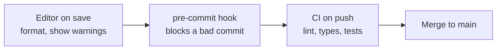

# Linters, formatters and type checkers

After this you can say what a linter, a formatter and a type checker each catch, run them in Python and JavaScript, and make them run automatically on every commit and in CI.

Before this: [Type systems](../../03-programming-fundamentals/02-thinking-like-a-programmer/03-type-systems.md) and [Unit testing](01-unit-testing.md).

## The idea

A teammate opens a pull request that fixes a bug, but the diff has 200 changed lines because their editor re-indented the file. Another change imports a module it never uses. A third passes a string where a number is expected, and nobody finds out until a customer does.

These problems can be found by a program reading your source without running it. Three kinds of tool do this. A formatter decides how code looks, a linter flags suspicious code, and a type checker finds values used the wrong way. Because they are cheap and fast, they run at every stage between your keyboard and the main branch, and later stages catch whatever earlier ones were skipped.



## Key terms

A **linter** reads code without running it (static analysis) and reports likely bugs and style problems, such as an unused variable or a comparison with `==` where `===` was meant. Each finding has a rule code, for example `F401`.

A **formatter** rewrites code into one fixed layout (spacing, line breaks, quotes). It has almost no options on purpose, so a team stops arguing about style.

A **type checker** uses type annotations to check that values match what functions expect. It does this before the program runs, and the annotations change nothing at runtime in Python.

A **pre-commit hook** is a script Git runs before it creates a commit; if it fails, the commit is refused. The **pre-commit** framework manages these hooks from a `.pre-commit-config.yaml` file. **CI** (continuous integration) runs checks on a server for every push; see CI/CD concepts<!-- link: ../../13-devops-and-cloud/02-ci-cd/01-ci-cd-concepts.md -->.

## How it works

The tools to know, by language:

| Job | Python | JavaScript and TypeScript |
|---|---|---|
| Linter | [ruff](https://docs.astral.sh/ruff/) (`ruff check`) | [ESLint](https://eslint.org/) |
| Formatter | `ruff format`, or black | [Prettier](https://prettier.io/) |
| Type checker | [mypy](https://mypy.readthedocs.io/) or pyright | `tsc --noEmit` (TypeScript compiler, check only) |

Running ruff on a messy file (the `[*]` mark means `--fix` can repair it):

```text
messy.py:1:1: I001 [*] Import block is un-sorted or un-formatted
messy.py:1:8: F401 [*] `os` imported but unused
messy.py:2:8: F401 [*] `sys` imported but unused
messy.py:4:5: F841 Local variable `unused` is assigned to but never used
Found 4 errors.
[*] 3 fixable with `--fix` (1 unsafe fix available with `--fix --unsafe-fixes`).
```

`ruff format --diff` shows what the formatter would change, without changing it:

```text
-def total_price(items,tax = 0.13):
+def total_price(items, tax=0.13):
```

A type checker catches what neither of those sees. In `typed.py`, the annotations say `items` is a list of floats:

```python
def total_price(items: list[float], tax: float = 0.13) -> float:
    return sum(items) * (1 + tax)


total_price(["a", "b"])
```

```text
typed.py:5: error: List item 0 has incompatible type "str"; expected "float"  [list-item]
typed.py:5: error: List item 1 has incompatible type "str"; expected "float"  [list-item]
Found 2 errors in 1 file (checked 1 source file)
```

The JavaScript side is the same idea. ESLint with its recommended rules plus `eqeqeq` (an `eslint.config.mjs` file) reports:

```text
  1:7   error  'unused' is assigned a value but never used  no-unused-vars
  2:24  error  Expected '===' and instead saw '=='          eqeqeq
```

and `npx tsc --noEmit --strict t.ts` on a call `double("4")` reports:

```text
t.ts(4,8): error TS2345: Argument of type 'string' is not assignable to parameter of type 'number'.
```

To run the tools on every commit, add a `.pre-commit-config.yaml` and run `pre-commit install` once. In the file below, `rev` pins the tool version:

```yaml
repos:
  - repo: https://github.com/astral-sh/ruff-pre-commit
    rev: v0.17.2
    hooks:
      - id: ruff-check
        args: [--fix]
      - id: ruff-format
  - repo: https://github.com/pre-commit/mirrors-mypy
    rev: v2.4.0
    hooks:
      - id: mypy
```

With it installed, `git commit` runs the hooks first. In our test run the commit was refused and the output began:

```text
ruff check...............................................................Failed
- hook id: ruff-check
- exit code: 1
- files were modified by this hook
```

A local hook can be skipped with `git commit --no-verify`, so CI runs the same checks again as the gate nobody can skip. In GitHub Actions<!-- link: ../../13-devops-and-cloud/02-ci-cd/02-github-actions.md --> that is one job (action versions as of 2026, from the [checkout](https://github.com/actions/checkout/releases) and [setup-python](https://github.com/actions/setup-python/releases) release pages):

```yaml
name: checks
on: [push, pull_request]
jobs:
  checks:
    runs-on: ubuntu-latest
    steps:
      - uses: actions/checkout@v7
      - uses: actions/setup-python@v7
        with:
          python-version: "3.14"
      - run: pip install ruff mypy pytest
      - run: ruff check . && ruff format --check . && mypy . && pytest
```

## Worked examples

<div class="example" markdown>

### Example 1: what each tool sees

Take one line from the Python file above and ask each tool.

1. `import os` that is never used: the linter reports `F401`. The formatter does not care, and the type checker does not care.
2. `def total_price(items,tax = 0.13):` has no space after the comma and spaces around `=` in a default value: the formatter rewrites it to `def total_price(items, tax=0.13):`. The linter has no complaint.
3. `label(n: int) -> str` returning `n`: the type checker reports `Incompatible return value type (got "int", expected "str")`. The other two do not notice.

Check: run `ruff check`, `ruff format --diff` and `mypy` on `messy.py` and match each message to one of the three lines. The three tools overlap very little, so projects run all three.

</div>

## Common mistakes

<div class="warning" markdown>

Watch out: silencing the tool instead of reading it. A `# type: ignore` or `# noqa` hides one warning, and a pile of them hides the real problem. Add one only with a comment saying why.

Watch out: different tool versions or settings on each machine. The editor formats one way and CI checks another. Keep the config in the repository (`pyproject.toml`, `eslint.config.mjs`, `.prettierrc`) and pin versions.

Watch out: believing that passing types means correct code. Python annotations are not checked at runtime, and a type checker cannot see a wrong formula. Tests still matter.

</div>

## Working with AI

<div class="ai" markdown>

Words to use: linter, formatter, type checker, static analysis, rule code, pre-commit hook, CI.

Prompts to try:

- "Set up ruff and mypy for a Python 3.14 project with a `pyproject.toml`, plus a `.pre-commit-config.yaml`. Use current versions from each tool's docs, and explain every rule category you enable."
- "mypy reports `Incompatible return value type (got "int", expected "str")` on line 8 of [paste code]. Is the annotation or the code wrong? Do not add `type: ignore`."

What to check:

- Config options that do not exist. Run the tool; a bad key or rule code makes it print an error.
- Version numbers copied from old examples. Look up the current release on the tool's page.
- An agent that makes the checks pass by adding ignore comments, deleting rules or loosening config. Read the diff for `noqa`, `type: ignore`, `eslint-disable` and edits to the config files.

</div>

## Quiz

1\. Which tool tells you a function is called with a string where a number is expected?

<details class="solution" markdown>
<summary>Answer</summary>

The type checker (mypy, pyright or `tsc`). A linter looks for suspicious patterns and a formatter only changes layout.

</details>

2\. Why do teams use a formatter with almost no options?

<details class="solution" markdown>
<summary>Answer</summary>

Layout stops being a topic in code review, and diffs show only real changes because every developer's code looks the same.

</details>

3\. A developer's hook fails and they commit with `git commit --no-verify`. What stops the problem from reaching main?

<details class="solution" markdown>
<summary>Answer</summary>

CI runs the same checks on the pushed code, and a branch rule can block merging when they fail.

</details>

4\. `ruff check` prints `F841 Local variable 'x' is assigned to but never used`, marked as an unsafe fix. Why would `--fix` not apply it automatically?

<details class="solution" markdown>
<summary>Answer</summary>

Deleting the assignment could remove a side effect, such as a function call whose result was stored. Ruff makes you opt in with `--unsafe-fixes` so you can review it.

</details>

## Lab

<div class="lab" markdown>

### Lab: add the three tools to a small project

Goal: run a linter, a formatter and a type checker, then block a bad commit. Time: about 20 minutes. Runs in: any terminal with Python 3 and Git.

1. Create a folder, run `git init`, make a virtual environment, and run `pip install ruff mypy pre-commit`.
2. Save `messy.py` with these lines: two unused imports (`import os`, `import sys`), then `def total_price(items,tax = 0.13):` with an unused local variable and a sum inside, then `def label(n: int) -> str:` returning `n`.
3. Run `ruff check messy.py`, `ruff format --diff messy.py` and `mypy messy.py`. Note which tool reported what.
4. Save the `.pre-commit-config.yaml` above, run `pre-commit install`, then `git add .` and `git commit -m "add messy"`.
5. Fix every problem, add the files again and commit.

Expected result: the first commit is refused at the ruff check step; the second succeeds.

<details class="solution" markdown>
<summary>Solution</summary>

```python
def total_price(items: list[float], tax: float = 0.13) -> float:
    return sum(items) * (1 + tax)


def label(n: int) -> str:
    return str(n)
```

Remove the unused imports, the unused variable and the `print` line, add the annotations, and return `str(n)`. Then `ruff check`, `ruff format --check` and `mypy` all report no problems.

</details>

</div>

## Where this shows up

- [Documentation and readmes](04-documentation-and-readmes.md) is the last piece of the chapter: the text around the code.
- CI pipelines<!-- link: ../../13-devops-and-cloud/02-ci-cd/01-ci-cd-concepts.md --> run these checks on every push.
