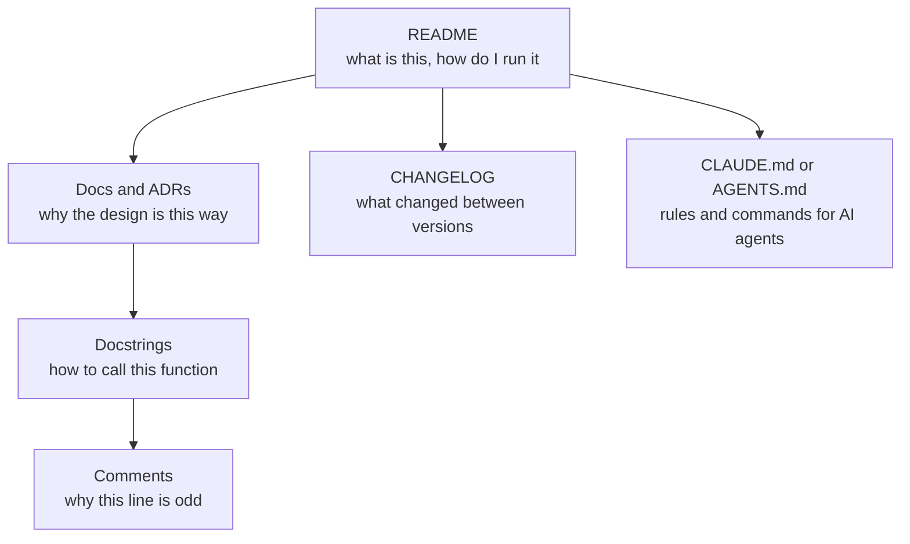

# Documentation and readmes

After this you can write a README a new developer can follow, document a function with a docstring and a comment that explains why, record a decision, and write a CLAUDE.md or AGENTS.md file for an AI agent.

Before this: [Linters, formatters and type checkers](03-linters-formatters-and-type-checkers.md).

## The idea

You join a team and clone a repository. You need to know what it does, how to run it, how to run the tests, and why the payment code retries three times. If the answers live in one person's head, you spend a day asking. If they are written down in the right place, you spend ten minutes reading.

Documentation is written for a reader who was not in the room: the next developer, you in six months, and now an AI agent that starts every session knowing nothing about your project. Each kind of document answers one question, and sits as close as possible to what it describes.



## Key terms

A **README** is the file (`README.md`) at the root of a repository that GitHub shows first. It is the front door.

A **docstring** is a string written as the first statement of a function, class or module. Tools such as `help()` and editors show it.

An **ADR** (architecture decision record) is a short document, one per decision, that records the context, the decision and its consequences. It is kept in the repository, usually in `docs/adr/`, and is never rewritten: a later ADR replaces an earlier one.

A **changelog** (`CHANGELOG.md`) lists notable changes per release, for people who use the software. The common format is [Keep a Changelog](https://keepachangelog.com/).

An **agent instruction file** is a Markdown file the agent loads at the start of each session. Claude Code reads `CLAUDE.md`, and many other tools read `AGENTS.md`, an open format described at [agents.md](https://agents.md). Claude Code can also read a repository's `AGENTS.md` in place of `CLAUDE.md` ([memory docs](https://code.claude.com/docs/en/memory), as of 2026).

## How it works

A README answers five questions in order: what the project is (one or two sentences), how to install it, how to run it, how to run the tests, and how to contribute. Put the commands in code blocks that can be copied.

```markdown
# Receipts API

Stores receipts and returns monthly totals. Python 3.14, FastAPI, PostgreSQL.

## Setup

    python -m venv .venv && source .venv/bin/activate
    pip install -r requirements.txt
    cp .env.example .env

## Run and test

    uvicorn app.main:app --reload
    pytest

## Contributing

Branch from `main`, run `ruff check . && pytest` before opening a pull request.
```

(In a real README the commands go in fenced `bash` blocks; they are indented here so this example can contain them.)

A docstring says what the function does, what it expects and what it raises, so a caller never reads the body. Python's `doctest` module can run the example inside it:

```python
def apply_discount(price: float, percent: float) -> float:
    """Return price reduced by percent, rounded to cents.

    Args:
        price: Price in dollars, 0 or more.
        percent: Discount from 0 to 100.

    Raises:
        ValueError: If percent is outside 0 to 100.

    >>> apply_discount(80, 10)
    72.0
    """
    if not 0 <= percent <= 100:
        raise ValueError("percent must be between 0 and 100")
    # Reject here: a negative percent would raise the price.
    return round(price * (1 - percent / 100), 2)
```

```text
1 test in 2 items.
1 passed.
Test passed.
```

Comments should say why, not what. `# add 1 to i` repeats the code and goes stale. `# The vendor API returns 429 under load, so retry 3 times` records something the code cannot show. If a comment is needed to explain what a block does, a better function name usually works instead; see Clean code<!-- link: ../../14-software-and-system-design/01-software-design/01-clean-code.md -->.

An ADR is one short page:

```markdown
# ADR 0003: Use PostgreSQL, not MongoDB

Status: accepted (2026-03-02)
Context: Receipts have a fixed shape and we need monthly totals with joins.
Decision: Use PostgreSQL.
Consequences: Schema changes need migrations. No document-style flexibility.
```

A changelog entry, newest first, written for users and not copied from commit messages:

```markdown
## [1.2.0] - 2026-06-01

### Added
- Monthly totals endpoint.

### Fixed
- Receipts with a 100% discount no longer fail validation.
```

## Worked examples

<div class="example" markdown>

### Example 1: a CLAUDE.md for the project above

An agent cannot guess your commands or your rules, and it reads this file at the start of every session. Keep it short and specific, because everything in it uses up the agent's context.

1. Commands the agent will need: how to run tests, lint and type check.
2. Rules that are not obvious from the code, with the reason.
3. Things not to touch.

```markdown
# Receipts API

## Commands
- Test: `pytest -q`
- Lint and types: `ruff check . && mypy .`

## Rules
- Money is stored as integer cents. Never use floats for amounts.
- New endpoints need a test in `tests/` before the code.
- Do not edit files in `migrations/`; create a new migration.
```

Check: open a fresh agent session, ask "how do I run the tests?", and see whether the answer matches the file. Then ask it to add a price field and see whether it uses integer cents. If it does not, the rule is unclear or buried. Instruction files are context the agent usually follows, not a guarantee, so anything that must hold (formatting, types, tests) also belongs in the checks from the previous lesson.

</div>

## Common mistakes

<div class="warning" markdown>

Watch out: documentation that is out of date. A wrong README is worse than none. Keep commands in files that get run (a `Makefile`, scripts, CI) and have the README point to them, and review docs in the same pull request as the code.

Watch out: comments that restate the code, or commented-out code. Version control remembers old code; delete it.

Watch out: an agent file that grows into a manual. Long files bury the rules. Keep it to commands, non-obvious rules and pointers to other docs.

</div>

## Working with AI

<div class="ai" markdown>

Words to use: README, docstring, ADR, changelog, doctest, CLAUDE.md, AGENTS.md.

Prompts to try:

- "Write a README for this repository with sections for what it is, setup, run, test and contributing. Use only commands that appear in `pyproject.toml` and the `Makefile`; do not invent any."
- "Read `pricing.py` and write Google-style docstrings for each public function. State the edge cases the code actually handles, and mark any you are unsure about."

What to check:

- Commands and flags that do not exist. Run every command in the README in a fresh clone.
- Docstrings that describe what the function should do instead of what it does. Compare each claim with the code and the tests.
- Comments that explain "what" in more words. Ask the agent to keep only comments that explain why.
- Invented project history in ADRs or changelogs. A decision record needs the real reason, so write the context yourself.

</div>

## Quiz

1\. What are the five questions a README should answer?

<details class="solution" markdown>
<summary>Answer</summary>

What the project is, how to install it, how to run it, how to run the tests, and how to contribute.

</details>

2\. Which comment is better, and why? (a) `# loop over items` (b) `# the API pages results 100 at a time, so we loop`

<details class="solution" markdown>
<summary>Answer</summary>

(b). It gives a reason the code cannot show. (a) repeats what the code already says and can go stale.

</details>

3\. A design choice made last year is now questioned in a meeting, and nobody remembers why. What document would have helped, and what does it contain?

<details class="solution" markdown>
<summary>Answer</summary>

An ADR: the context at the time, the decision, and its consequences. It is dated and kept in the repository.

</details>

4\. Your CLAUDE.md says "always run the tests", but the agent skips them sometimes. What do you do?

<details class="solution" markdown>
<summary>Answer</summary>

Treat the file as guidance, not enforcement. Put the tests in CI or a pre-commit hook so they run regardless, and keep the instruction short and specific so it is easy to follow.

</details>

## Lab

<div class="lab" markdown>

### Lab: document a small project for a stranger and an agent

Goal: write a README and an agent file, then test them on a fresh reader. Time: about 20 minutes. Runs in: any terminal.

1. Take the `pricing.py` and `test_pricing.py` files from [Unit testing](01-unit-testing.md) in a new folder.
2. Write `README.md` with the five sections (what, install, run, test, contribute).
3. Write `CLAUDE.md` with the test command, one non-obvious rule, and one thing not to touch.
4. Run `python -m doctest pricing.py` to check the docstring example (add the docstring from this lesson first).
5. Copy the folder to a new place and follow only your README. Fix any step that failed.

Expected result: `doctest` prints nothing (no output means all examples passed), and the README steps work from a clean copy.

<details class="solution" markdown>
<summary>Solution</summary>

A `README.md` with the lines: a one-sentence description, `pip install pytest`, `python -c "from pricing import apply_discount; print(apply_discount(80, 10))"` (prints `72.0`), `pytest`, and a contributing note. A `CLAUDE.md` with `Test: pytest -q`, the rule "percent is 0 to 100; raise ValueError otherwise", and "Do not change the signature of `apply_discount` without updating the tests".

</details>

</div>

## Where this shows up

- The AI-assisted development chapter<!-- link: ../../15-ai-and-llms/03-ai-assisted-development/01-claude-code.md --> shows how an agent uses CLAUDE.md in a session.
- Design docs and writing<!-- link: ../../16-the-workplace/05-design-docs-and-writing.md --> covers longer documents for a team.
