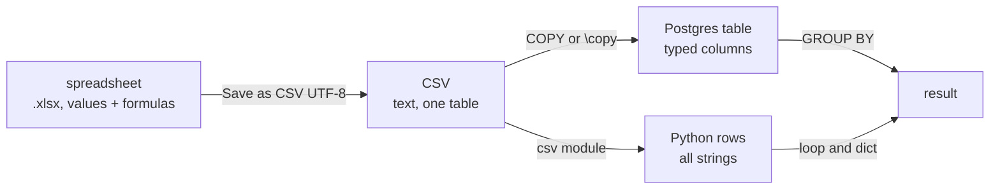

# Spreadsheets, CSV and SQL

After this you can export a spreadsheet to CSV without corrupting it, load it into Postgres or Python, and recognise the same aggregation in a formula, a pivot table, a GROUP BY and a loop.

Before this: [Lookups, pivot tables and charts](02-lookups-pivot-tables-and-charts.md) and [Data formats: JSON, YAML and CSV](../02-project-plumbing/03-data-formats-json-yaml-csv.md).

## The idea

A colleague emails an `.xlsx` file and you need it in a database. The file you can load is not the file you see: an `.xlsx` is a zipped bundle of XML with formatting, formulas and several sheets, while a CSV is plain text for one table. Exporting to CSV keeps the values and drops everything else, and each step can change the data.



## Key terms

A **CSV** file is plain text where each line is a row and commas separate the fields; quotes protect fields that contain commas ([RFC 4180](https://www.rfc-editor.org/rfc/rfc4180)). An **encoding** maps characters to bytes, and **UTF-8** is the usual one. **`COPY`** is the Postgres command that bulk-loads or exports a table from or to a file.

## How it works

Export from Excel with File, Save As, **CSV UTF-8 (Comma delimited)**. The plain "CSV" choice uses a legacy code page, so names such as `Zoë` can arrive as garbage ([Microsoft: import or export CSV](https://support.microsoft.com/en-us/office/import-or-export-text-txt-or-csv-files-5250ac4c-663c-47ce-937b-339e391393ba)). Export stores the displayed value of each cell, so formulas become their results, and only the active sheet is saved. In some locales Excel writes `;` as the separator, so open the file in a text editor first.

Excel also changes data when it opens a CSV, because it guesses types:

| Original text | What Excel makes of it | Why |
|---|---|---|
| `02134` (postal or zip code) | `2134` | read as a number, leading zero dropped |
| `12345678901234567890` (ID) | `12345678901234500000` | numbers keep 15 significant digits ([limits](https://support.microsoft.com/en-us/office/excel-specifications-and-limits-1672b34d-7043-467e-8e27-269d656771c3)) |
| `SEPT2`, `MARCH1` (gene names) | the dates 2-Sep and 1-Mar | read as dates; a study found this in many published gene lists ([Ziemann et al., 2016](https://genomebiology.biomedcentral.com/articles/10.1186/s13059-016-1044-7)) |
| `03/04/2026` | 3 April or 4 March | day and month order depends on locale |

To keep text as text, import with Data, From Text/CSV and set the column type to Text, instead of double-clicking the file. A saved file that already lost its zeros can't be repaired from the file alone. In your own exports, use ISO dates (`2026-03-04`), and read the file as text in code, then convert the columns you want as numbers.

Loading into Postgres (not run here, as no Postgres server was available; syntax from the [COPY docs](https://www.postgresql.org/docs/current/sql-copy.html)):

```sql
CREATE TABLE sales (sale_date date, region text, product text, qty int, price numeric(10,2));
COPY sales FROM '/var/lib/postgresql/sales.csv' (FORMAT csv, HEADER);
```

`COPY` reads the file on the database server and needs superuser or the `pg_read_server_files` role. From your own machine use psql's `\copy sales FROM 'sales.csv' WITH (FORMAT csv, HEADER)`, which streams the file from the client. In Python, `csv.DictReader` gives each row as a dictionary of strings, so you convert types yourself.

## Worked examples

<div class="example" markdown>

### Example 1: revenue by region, four ways

The question: total of `qty * price` for each region, using the eight sales rows from the chapter. Each tool does the same three things: pick the group key (`region`), compute `qty * price` per row, add up per group.

1. Spreadsheet formula, with a region name in `M2` and Total in column `F`: `=SUMIFS($F$2:$F$9,$B$2:$B$9,M2)`.
2. Pivot table: Region in Rows, Sum of Total in Values.
3. SQL `GROUP BY`, run below.
4. Python with a dict, no libraries beyond `csv`:

<div class="sql-runner" data-db="shop" markdown>

```sql
WITH sales (sale_date, region, product, qty, price) AS (
  VALUES (DATE '2026-01-05', 'East',  'Widget', 10,  2.50),
         (DATE '2026-01-07', 'West',  'Gadget',  4, 10.00),
         (DATE '2026-01-12', 'East',  'Gadget',  3, 10.00),
         (DATE '2026-02-02', 'West',  'Widget',  8,  2.50),
         (DATE '2026-02-09', 'East',  'Widget',  5,  2.50),
         (DATE '2026-02-15', 'North', 'Gadget',  6, 10.00),
         (DATE '2026-03-01', 'West',  'Gizmo',   2, 25.00),
         (DATE '2026-03-04', 'North', 'Widget', 12,  2.50)
)
SELECT region, SUM(qty * price) AS total
FROM sales
GROUP BY region
ORDER BY region;
```

</div>

(The `WITH sales ... VALUES` part builds the eight rows in place, because the sample shop database has its own tables. After `COPY`, you would write `FROM sales` against the real table.)

```python
import csv, io
text = """date,region,product,qty,price
2026-01-05,East,Widget,10,2.50
2026-01-07,West,Gadget,4,10.00
2026-01-12,East,Gadget,3,10.00
2026-02-02,West,Widget,8,2.50
2026-02-09,East,Widget,5,2.50
2026-02-15,North,Gadget,6,10.00
2026-03-01,West,Gizmo,2,25.00
2026-03-04,North,Widget,12,2.50
"""
totals = {}
for row in csv.DictReader(io.StringIO(text)):
    totals[row["region"]] = totals.get(row["region"], 0) + int(row["qty"]) * float(row["price"])
print(totals)
```

```text
{'East': 67.5, 'West': 110.0, 'North': 90.0}
```

Check: the SQL result is East 67.50, North 90.00, West 110.00, the same numbers as the pivot table's Grand Total column. The dict has no sorted order, and neither does a `GROUP BY` without `ORDER BY`.

</div>

| Idea | `SUMIFS` | Pivot | SQL | Python dict |
|---|---|---|---|---|
| group key | criteria cell | Rows field | `GROUP BY region` | `totals[row["region"]]` |
| aggregate | `SUMIFS` | Sum of Total | `SUM(qty * price)` | `+=` in a loop |
| recalculates | live | on Refresh | each query | each run |

## Common mistakes

<div class="warning" markdown>

Watch out: opening a CSV by double-clicking it, then saving over it. Excel has already guessed the types, and the save writes the damage back. Import it with a Text column type, or read it in code.

Watch out: a `.csv` with a byte order mark or a non-UTF-8 encoding. The first column name shows up as `date`, or accented letters break. Read with `encoding="utf-8-sig"` in Python, or re-export as CSV UTF-8.

Watch out: treating spreadsheet totals as the source of truth. A CSV has no formulas, so recompute totals in SQL or Python and compare.

</div>

## Working with AI

<div class="ai" markdown>

Words to use: CSV UTF-8, delimiter, header row, `COPY`, `\copy`, leading zeros, ISO 8601, `GROUP BY`.

Prompts to try:

- "Write the Postgres `CREATE TABLE` and `\copy` command for a CSV with columns date, region, product, qty, price. Keep postal codes as text."
- "This `GROUP BY` query and this SUMIFS formula should give the same totals but don't. List what could differ (blank cells, text numbers, trailing spaces, filters)."

What to check:

- `COPY` versus `\copy`: the first reads from the server's disk.
- Column types for IDs and postal codes (use `text`, not `int`).
- Dates: confirm the day and month order on a row you know.

</div>

## Quiz

1\. Why export as CSV UTF-8 rather than plain CSV?

<details class="solution" markdown>
<summary>Answer</summary>

Plain CSV uses a legacy code page, so non-ASCII characters can be corrupted. UTF-8 is what Postgres and Python expect.

</details>

2\. A column of 20-digit order IDs ends in `00000` after opening in Excel. What happened?

<details class="solution" markdown>
<summary>Answer</summary>

Excel keeps only 15 significant digits for numbers. Import the column as Text, or never open the file in Excel.

</details>

3\. Which SQL clause plays the role of the pivot table's Rows field?

<details class="solution" markdown>
<summary>Answer</summary>

`GROUP BY` (here `GROUP BY region`).

</details>

4\. `COPY sales FROM 'sales.csv' (FORMAT csv, HEADER)` fails with "No such file" although the file is in your current folder. Why?

<details class="solution" markdown>
<summary>Answer</summary>

`COPY` reads on the server, so the path is on the server. Use `\copy` in psql to read from your machine.

</details>

## Lab

<div class="lab" markdown>

### Lab: round trip a sales CSV

Goal: export, reload and check the totals. Time: about 15 minutes. Runs in: Excel or Google Sheets, then Python.

1. Save the sales sheet as CSV UTF-8 as `sales.csv`.
2. Open it in a text editor and confirm commas, the header and ISO dates.
3. Read it with `csv.DictReader` and compute revenue by region with a dict.
4. Compare with the pivot table and with the SQL runner above.

Expected result: East 67.5, West 110.0, North 90.0.

<details class="solution" markdown>
<summary>Solution</summary>

Use `open("sales.csv", newline="", encoding="utf-8-sig")` in place of `io.StringIO(text)` in Example 1. If you exported only columns A to E, the numbers match.

</details>

</div>

## Where this shows up

- Loading real files into a database: Loading data into Postgres<!-- link: ../../11-data-engineering-and-data-science/01-data-engineering/04-loading-data-into-postgres.md -->.
- Grouping in depth: Aggregates, GROUP BY and HAVING<!-- link: ../../10-databases-sql-and-postgres/02-querying/03-aggregates-group-by-and-having.md -->.
