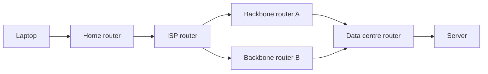
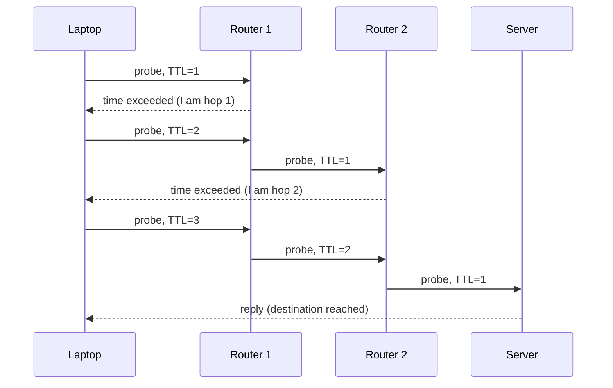

# Packets, routers and the internet

After this you can describe how a message gets from your laptop to a server, read the output of `tracert` or `traceroute`, and estimate the lowest latency a connection can have.

Before this: [Memory hierarchy and latency numbers](../../01-how-computers-work/02-hardware/04-memory-hierarchy-and-latency-numbers.md), which defines latency, bandwidth and round trip.

## The idea

You open `example.com` and a page arrives. Nothing connects your laptop to that server with a private wire. The data crosses a dozen machines owned by different companies, and each one only knows where to send it next.

The internet is a network of networks. Your home network connects to an ISP (internet service provider), which connects to larger networks, which connect to the network that hosts the server. Data does not travel as one stream. It is cut into small pieces called packets, and each packet is passed from machine to machine until it arrives.



In the diagram, every arrow is a hop: one link between two machines. The two backbone routers show that more than one path exists, and different packets of the same download can take different ones.

## Key terms

A **packet** is a small chunk of data with a header in front. The header holds the source address, the destination address and a few other fields ([RFC 791](https://datatracker.ietf.org/doc/html/rfc791), [MDN](https://developer.mozilla.org/en-US/docs/Glossary/Packet)). On Ethernet a packet carries at most about 1,500 bytes.

**Packet switching** is sending data as independent packets that share the same links, instead of reserving a dedicated circuit for each conversation, as the old telephone network did.

A **router** is a machine with several network connections that reads each packet's destination address and forwards the packet to the next machine closer to it. A **hop** is one such forwarding step.

An **ISP** is the company that connects you to the rest of the internet. Your **home router** is the box your ISP provides (or you buy). It is a router, a Wi-Fi access point and a few other services in one device.

A **default gateway** is the router your device sends everything to when the destination is not on the local network.

## How it works

Every router keeps a **routing table**: a list of destination ranges and, for each, the next hop. A router does not know the whole path, only its next step. Your laptop's table is tiny, in effect "send everything to the home router". The home router sends everything to the ISP. Routers inside the big networks exchange information about which ranges they can reach, so their tables stay current when a link fails.

Because packets travel separately, they can arrive out of order, arrive twice, or not arrive. Packet switching makes that normal. The layer above (TCP, in [Network layers, TCP and UDP](03-network-layers-tcp-and-udp.md)) puts the pieces back in order.

Each packet has a **TTL** (time to live, called hop limit in IPv6): a counter that every router lowers by one. A router that lowers it to zero drops the packet and sends back an error message ([ICMP](https://datatracker.ietf.org/doc/html/rfc792), "time exceeded"). This stops a packet from circling forever in a routing loop. It is also how `traceroute` works: it sends probes with TTL 1, 2, 3 and so on, and each router along the path reveals itself when it drops one.



Latency has a floor set by physics. Light in optical fibre travels at about 200,000 km/s, roughly two thirds of its speed in a vacuum. No amount of bandwidth gets a packet across Canada faster than distance divided by that speed. Bandwidth is how many bytes per second the slowest link allows once data is flowing; latency is how long the first byte takes. A page made of many small requests is limited by latency, a large download by bandwidth.

## Worked examples

<div class="example" markdown>

### Example 1: the shortest possible round trip

We want the lowest round-trip time from Toronto to Vancouver, ignoring routers and cable detours.

1. The great-circle distance between the two cities is about 3,359 km (computed below from their coordinates).
2. A packet goes there and a reply comes back, so the distance is travelled twice.
3. At 200,000 km/s, the time is $2 \times 3359 / 200000$ seconds.

<details class="code" markdown>
<summary>In code</summary>

```python
from math import radians, sin, cos, asin, sqrt

def km(a, b):
    la1, lo1, la2, lo2 = map(radians, (*a, *b))
    h = sin((la2 - la1) / 2) ** 2 + cos(la1) * cos(la2) * sin((lo2 - lo1) / 2) ** 2
    return 2 * 6371 * asin(sqrt(h))

d = km((43.65, -79.38), (49.28, -123.12))
print(round(d), "km")
print(round(2 * d / 200_000 * 1000, 1), "ms round trip, minimum")
```

```text
3359 km
33.6 ms round trip, minimum
```

</details>

Check: a real ping from Toronto to Vancouver is higher than 33.6 ms, because cables do not follow great circles and every router adds a little time. A measured value below the floor would mean the server is nearer than you think, for example a CDN edge (see Proxies and CDNs<!-- link: ../02-web-protocols/05-proxies-and-cdns.md -->).

</div>

<div class="example" markdown>

### Example 2: reading a traceroute

On Windows, `tracert` is the tool. The `-d` flag skips reverse DNS lookups and `-h 8` stops after 8 hops. Addresses belonging to my ISP are replaced with documentation addresses (203.0.113.0/24 and 198.51.100.0/24, reserved for examples).

```powershell
tracert -d -h 8 example.com
```

```text
Tracing route to example.com [104.20.23.154]
over a maximum of 8 hops:

  1     3 ms     5 ms     5 ms  192.168.2.1
  2     6 ms     4 ms     3 ms  203.0.113.1
  3     *        *        *     Request timed out.
  4     *        *        *     Request timed out.
  5     7 ms     5 ms     5 ms  198.51.100.2
  6    13 ms     9 ms     5 ms  198.51.100.3
  7     5 ms     5 ms     3 ms  198.51.100.4
  8     6 ms     3 ms    42 ms  108.162.239.32

Trace complete.
```

Hop 1 is the home router (a private address, see the next lesson). Hop 2 is the ISP's first router. Hops 3 and 4 show `*` because those routers are configured not to answer probes, yet they still forward traffic, so a timeout is not a failure. The three times per line are three probes. Hop 8 belongs to Cloudflare, which hosts `example.com`.

In WSL or Linux the command is `traceroute -n example.com` (unverified here, because WSL is not installed on this machine; see `man traceroute`).

</div>

## Common mistakes

<div class="warning" markdown>

Watch out: reading `* * *` in a traceroute as "the network is broken here". Many routers ignore probes. If later hops answer, traffic is passing through.

Watch out: reading the latency of hop 5 as the time spent on hop 5. Each line is the time to that router and back. It includes every earlier hop and the router's own low-priority handling of probe replies, so one slow line in the middle with fast lines after it is usually not a problem.

</div>

## Working with AI

<div class="ai" markdown>

Words to use: packet, hop, routing table, default gateway, TTL, latency, bandwidth, round-trip time.

Prompts to try:

- "Here is the output of `tracert -d example.com` from my laptop on home Wi-Fi: [paste]. Which hop is my home router and which is my ISP? Which lines suggest a real problem and which are routers that ignore probes?"
- "My API calls from Toronto to a server in Frankfurt take 95 ms round trip. What is the lowest round trip physics allows for that distance in fibre, and how much of the 95 ms is avoidable?"

What to check:

- A claim that adding bandwidth lowers latency. It does not; it only speeds up large transfers.
- A diagnosis from a single `*` or a single slow middle hop. Check whether the final hop is slow too.
- Distances or speeds without units. Redo the arithmetic with 200,000 km/s.

</div>

## Quiz

1\. Why does the internet send data as packets instead of one continuous stream?

<details class="solution" markdown>
<summary>Answer</summary>

Many conversations share the same links, and packets can take different paths around failures. No link is reserved for one conversation, so capacity is used only when data is actually being sent.

</details>

2\. A traceroute shows hop 1 at 2 ms, hop 2 at 4 ms, hop 3 as `*`, and hop 4 at 9 ms. Is hop 3 down?

<details class="solution" markdown>
<summary>Answer</summary>

No. Hop 4 answered, and its packets had to pass through hop 3, so hop 3 forwards traffic. It just does not reply to probes.

</details>

3\. What does a router do with a packet whose TTL reaches 0, and why does the design need this?

<details class="solution" markdown>
<summary>Answer</summary>

It drops the packet and sends back an ICMP "time exceeded" message. Without a TTL, a packet caught in a routing loop would circle forever and use up capacity.

</details>

4\. A video call has 30 ms of latency and 100 Mbit/s of bandwidth. Your plan is upgraded to 1 Gbit/s. What happens to the 30 ms?

<details class="solution" markdown>
<summary>Answer</summary>

It stays about the same. Latency is set by distance, the number of hops and queueing. More bandwidth only helps when the link is the bottleneck for large transfers.

</details>

## Lab

<div class="lab" markdown>

### Lab: trace three destinations

Goal: compare the paths and round-trip times to three servers. Time: about 10 minutes. Runs in: PowerShell on Windows (WSL commands are listed in step 4).

1. Run `tracert -d -h 15 example.com` and write down how many hops answer and the time of the last hop.
2. Run the same command for a site hosted in another country, for example `tracert -d -h 15 www.bbc.co.uk`.
3. Run `ping -n 5 example.com` and compare the average with the last hop in step 1.
4. In WSL or Linux, the equivalents are `traceroute -n example.com` and `ping -c 5 example.com` (unverified here).
5. Expected result: the first hop is a private address (the home router), a few hops are `*`, and farther destinations show larger times. Times never drop below the physical floor from Example 1.

<details class="solution" markdown>
<summary>Solution</summary>

Exact addresses and times depend on your ISP and location. For a pass, check that hop 1 is a private address such as `192.168.x.x` or `10.x.x.x`, that the last hop time is close to the ping average, and that the distant site is slower than the nearby one. If every hop after the first times out, your network or firewall may block probe replies; `ping` is then the better test.

</details>

</div>

## Where this shows up

- IP addresses and why hop 1 is a private address: [IP addresses, subnets and NAT](02-ip-addresses-subnets-and-nat.md).
- Network debugging tools<!-- link: ../02-web-protocols/07-network-debugging-tools.md --> use `ping` and `traceroute` to tell a slow network from a slow server.
- Latency numbers when you choose where to deploy a service: [memory hierarchy and latency numbers](../../01-how-computers-work/02-hardware/04-memory-hierarchy-and-latency-numbers.md).
