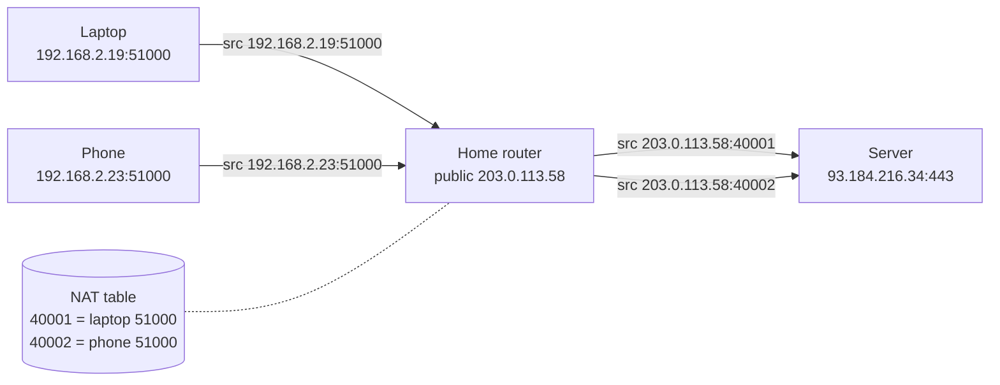

# IP addresses, subnets and NAT

After this you can read an address like `10.0.4.0/22`, say how many hosts it holds, tell a private address from a public one, and explain why your laptop is `192.168.x.x` while the internet sees a different address.

Before this: [Packets, routers and the internet](01-packets-routers-and-the-internet.md).

## The idea

Run `ipconfig` on a laptop at home. The address is something like `192.168.2.19`. Ask a website what your address is and it answers with something unrelated, such as `203.0.113.58`. Both are yours. The first is your address inside the house; the second is the address your home router uses on the internet, shared by every device in the house.

Two ideas explain this. Addresses are split into a network part and a host part, so routers can send packets by looking only at the network part. And a few address ranges are reserved for private use, so every home and office can reuse the same ones, with a translator (NAT) at the router joining them to the public internet.

## Key terms

An **IP address** identifies a network interface. **IPv4** addresses have 32 bits, written as four decimal bytes (`192.168.2.19`), which allows $2^{32} = 4{,}294{,}967{,}296$ addresses ([RFC 791](https://datatracker.ietf.org/doc/html/rfc791)). **IPv6** addresses have 128 bits, written in hexadecimal groups (`2606:4700:10::6814:179a`), about $3.4 \times 10^{38}$ addresses ([RFC 4291](https://datatracker.ietf.org/doc/html/rfc4291)). IPv4 ran short, which is why NAT exists.

A **subnet** is a block of addresses that share the same leading bits. **CIDR notation** writes it as an address, a slash and the number of fixed leading bits: `192.168.2.0/24` means the first 24 bits are the network and the last 8 identify the host ([RFC 4632](https://datatracker.ietf.org/doc/html/rfc4632)). The same split written as a **subnet mask** is `255.255.255.0`.

A **private address** is one in a range reserved for internal networks and never routed on the public internet ([RFC 1918](https://datatracker.ietf.org/doc/html/rfc1918)). **NAT** (network address translation) rewrites addresses on packets that cross the router between private and public ([RFC 3022](https://datatracker.ietf.org/doc/html/rfc3022)). **DHCP** hands out addresses automatically.

## How it works

For a /24, the network part is 24 bits and the host part is 8, so a block holds $2^8 = 256$ addresses. The first (host bits all zero) names the network and the last (all one) is the broadcast address, which leaves 254 usable hosts. In general a /$p$ block of IPv4 holds $2^{32-p}$ addresses.

```text
192.168.2.19  =  11000000.10101000.00000010 . 00010011
                 |------ network (24) ------| |-host (8)|
```

Smaller blocks come from larger prefixes: a /26 has $2^6 = 64$ addresses. One /24 splits into four /26 blocks.

The private ranges are fixed by RFC 1918:

| Range | CIDR | Addresses |
|---|---|---|
| 10.0.0.0 to 10.255.255.255 | 10.0.0.0/8 | 16,777,216 |
| 172.16.0.0 to 172.31.255.255 | 172.16.0.0/12 | 1,048,576 |
| 192.168.0.0 to 192.168.255.255 | 192.168.0.0/16 | 65,536 |

A device chooses where to send a packet by comparing the destination with its own subnet. Same subnet: deliver directly. Anything else: send to the default gateway. This is why a wrong mask breaks connections to some machines and not others.

When you join Wi-Fi, a **DHCP** server (usually the home router) leases your device an address, a mask, the gateway address and a DNS server ([RFC 2131](https://datatracker.ietf.org/doc/html/rfc2131)). The lease expires and is renewed, so the address can change.

Your packets leave with a private source address, which no outside router could answer. The home router fixes this. For each outgoing connection it replaces the source address and port with its own public address and a fresh port, and records the pairing in a table. When the reply comes back to that public port, it looks the pairing up and rewrites the destination back.



In the diagram, the laptop and the phone both use source port 51000, but the server sees two different public ports and the table tells the router which device each reply belongs to. A side effect: a connection started from outside has no table entry, so the router drops it. NAT is not a firewall, but it acts a little like one. To host a server at home you add a port-forward entry that creates the mapping by hand. (Detail: [ports](04-ports-and-sockets.md).)

Two special addresses matter to developers. `127.0.0.1` (the whole `127.0.0.0/8` block) is the **loopback** address: packets sent to it never leave your machine, and the name `localhost` points to it ([RFC 6761](https://datatracker.ietf.org/doc/html/rfc6761)). `0.0.0.0` means "all interfaces" when a server binds to it. A server bound to `127.0.0.1` accepts only connections from the same machine; one bound to `0.0.0.0` accepts connections from other devices on the network too.

## Worked examples

<div class="example" markdown>

### Example 1: a /24 in Python

We want the size, the usable range and the membership of the home network from my `ipconfig` output.

In PowerShell:

```powershell
ipconfig
```

```text
Wireless LAN adapter Wi-Fi:

   IPv4 Address. . . . . . . . . . . : 192.168.2.19
   Subnet Mask . . . . . . . . . . . : 255.255.255.0
   Default Gateway . . . . . . . . . : 192.168.2.1
```

(The adapter list is shortened. In WSL or Linux use `ip addr` and `ip route`; unverified here.) The Python standard library has an `ipaddress` module for the arithmetic ([docs](https://docs.python.org/3/library/ipaddress.html)).

```python
import ipaddress

net = ipaddress.ip_network("192.168.2.0/24")
print(net.netmask, net.num_addresses, net.broadcast_address)
hosts = list(net.hosts())
print(hosts[0], hosts[-1], len(hosts))
print(ipaddress.ip_address("192.168.2.19") in net)
print(ipaddress.ip_address("192.168.3.7") in net)
```

```text
255.255.255.0 256 192.168.2.255
192.168.2.1 192.168.2.254 254
True
False
```

Check: 256 addresses minus the network and broadcast addresses is 254 hosts, and `192.168.3.7` is outside because the third byte differs. A device with this mask would send a packet for it to the gateway `192.168.2.1`.

</div>

<div class="example" markdown>

### Example 2: private or public, and a split

```python
import ipaddress

for text in ["10.1.2.3", "172.20.0.5", "172.32.0.5", "8.8.8.8"]:
    print(text, ipaddress.ip_address(text).is_private)

print(ipaddress.ip_network("10.0.0.0/22").num_addresses)
print(list(ipaddress.ip_network("10.0.0.0/24").subnets(new_prefix=26)))
```

```text
10.1.2.3 True
172.20.0.5 True
172.32.0.5 False
8.8.8.8 False
1024
[IPv4Network('10.0.0.0/26'), IPv4Network('10.0.0.64/26'), IPv4Network('10.0.0.128/26'), IPv4Network('10.0.0.192/26')]
```

`172.32.0.5` is public even though it looks private: the 172 private range stops at `172.31.255.255` (a /12). A /22 holds $2^{10} = 1024$ addresses.

To see your public address, run `curl -s https://ifconfig.me`. It returns the router's address, here shown as `203.0.113.58` (a documentation address; my real one is replaced).

</div>

## Common mistakes

<div class="warning" markdown>

Watch out: assuming every `172.x.x.x` address is private. Only `172.16.0.0` to `172.31.255.255` is.

Watch out: starting a dev server bound to `0.0.0.0` on public Wi-Fi. Anyone on that network can reach it. Bind to `127.0.0.1` unless you need other devices.

Watch out: choosing the same private range at home and for a VPN or a cloud network. When two networks overlap, packets for an address go to the wrong one. Cloud networks are planned with CIDR blocks that do not overlap.

</div>

## Working with AI

<div class="ai" markdown>

Words to use: CIDR, subnet mask, RFC 1918, default gateway, NAT, DHCP, loopback, bind address.

Prompts to try:

- "I need three subnets for a staging VPC that must not overlap `10.0.0.0/16` (production). Propose CIDR blocks with at least 200 hosts each and show the usable range of each with Python's `ipaddress` module."
- "My Flask app is reachable at `localhost:5000` but not from my phone on the same Wi-Fi. Name two possible causes related to bind address and firewall, and how to check each."

What to check:

- Host counts that forget the network and broadcast addresses (a /24 has 254 usable hosts; some cloud providers reserve more).
- CIDR blocks that overlap. Verify with `ipaddress` (`a.overlaps(b)`).
- Advice to open a port on `0.0.0.0` without mentioning who can reach it.

</div>

## Quiz

1\. How many usable host addresses are in `10.0.8.0/22`? What is the last address in the block?

<details class="solution" markdown>
<summary>Answer</summary>

A /22 has $2^{10} = 1024$ addresses, so 1022 usable hosts. The block runs from `10.0.8.0` to `10.0.11.255`, so `10.0.11.255` is the last (the broadcast address).

</details>

2\. Predict the output: `ipaddress.ip_address("192.168.2.19") in ipaddress.ip_network("192.168.0.0/16")`.

<details class="solution" markdown>
<summary>Answer</summary>

`True`. The first 16 bits (`192.168`) match, and a /16 only fixes those.

</details>

3\. Your laptop's address is `192.168.2.19` but a website reports `203.0.113.58`. A teammate says the website is wrong. What is going on?

<details class="solution" markdown>
<summary>Answer</summary>

Both are right. The website sees the address of the home router after NAT. Your laptop's private address is only meaningful inside the home network.

</details>

4\. A server prints "listening on 127.0.0.1:8000". A colleague on the same network gets "connection refused" when they visit `http://your-ip:8000`. Why, and what fixes it?

<details class="solution" markdown>
<summary>Answer</summary>

It is bound to the loopback address, so only your own machine can connect. Bind to `0.0.0.0` (or your LAN address) if other devices should reach it, and check the firewall.

</details>

## Lab

<div class="lab" markdown>

### Lab: map your network

Goal: find your address, gateway and public address, and describe the subnet. Time: about 10 minutes. Runs in: PowerShell and Python.

1. Run `ipconfig` and find the IPv4 address, subnet mask and default gateway of the adapter you use.
2. Run `curl -s https://ifconfig.me` and compare the result with step 1.
3. Write a Python script that builds the network with `ipaddress.ip_interface("<your address>/<prefix>")` (a mask of `255.255.255.0` is /24), then prints the network, the number of usable hosts and whether the gateway is inside it.
4. Expected result: the network address ends in `.0`, the gateway is inside the network, and the public address is not in any private range.

<details class="solution" markdown>
<summary>Solution</summary>

```python
import ipaddress

iface = ipaddress.ip_interface("192.168.2.19/24")
gateway = ipaddress.ip_address("192.168.2.1")
print(iface.network)
print(len(list(iface.network.hosts())))
print(gateway in iface.network)
print(ipaddress.ip_address("8.8.8.8").is_private)
```

```text
192.168.2.0/24
254
True
False
```

(`8.8.8.8` stands in for your real public address. Use your own value from step 2; the documentation address `203.0.113.58` used in this lesson reports `True` for `is_private` because Python treats the documentation ranges as non-public.)

</details>

</div>

## Where this shows up

- Ports and the NAT table: [Ports and sockets](04-ports-and-sockets.md).
- Cloud networks (VPCs and subnets) use the same CIDR arithmetic; see [Volumes, networks and Compose](../../13-devops-and-cloud/01-containers/03-volumes-networks-and-compose.md) for Docker networks.
- Firewalls and exposure: a bind address of `0.0.0.0` is a security decision.
