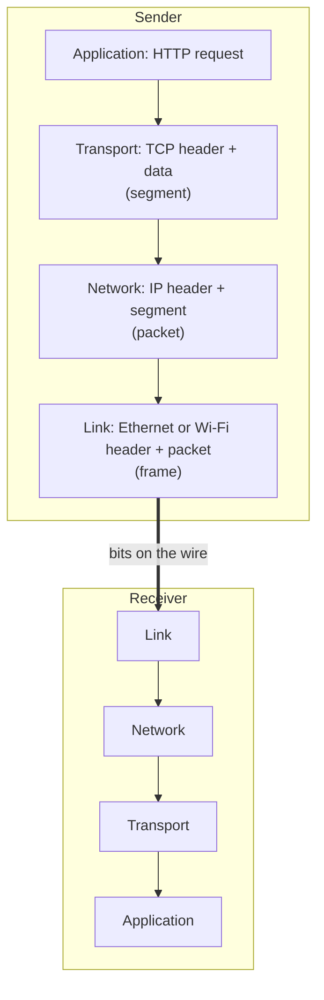
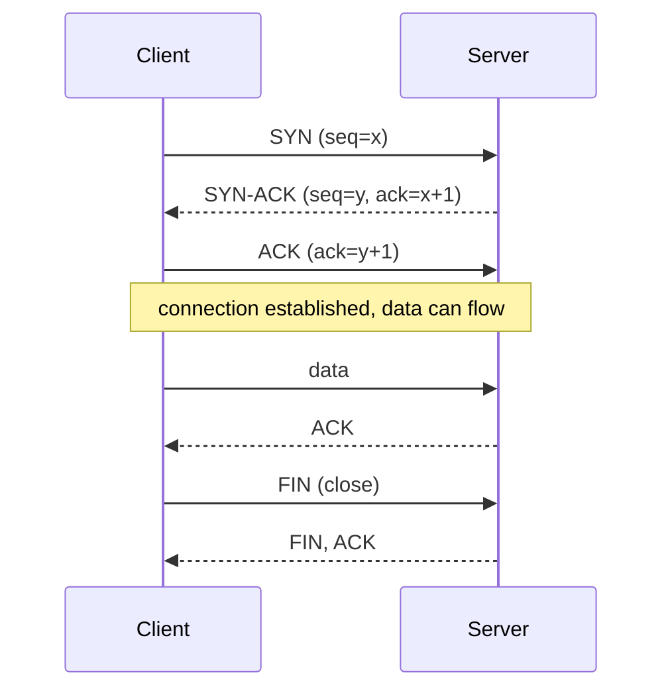

# Network layers, TCP and UDP

After this you can name the layers a web request passes through, explain what TCP guarantees that UDP does not, and pick the right one for a given job.

Before this: [IP addresses, subnets and NAT](02-ip-addresses-subnets-and-nat.md).

## The idea

A packet of the kind you saw in the last two lessons only knows how to get from one machine to another, and even that can fail. It carries no notion of "this belongs to the second half of a web page" and no promise of delivery. Everything else is built in layers on top of it, and each layer solves one problem and relies on the one below.

When your browser sends a request, the data is wrapped like a letter in nested envelopes. Each layer adds its own header in front and the receiving machine removes the headers in reverse order. This wrapping is called **encapsulation**.



In the diagram, going down the sender's column each layer adds a header; going up the receiver's column each layer strips the one meant for it.

## Key terms

The **TCP/IP model** has four layers ([RFC 1122](https://datatracker.ietf.org/doc/html/rfc1122)). The **OSI model** is a seven-layer teaching model that splits some of them. People mix the two, so here is the mapping:

| TCP/IP layer | OSI layers | What it does | Examples |
|---|---|---|---|
| Application | 7 application, 6 presentation, 5 session | Meaning of the data | HTTP, DNS, SSH, TLS |
| Transport | 4 transport | Which program, and how reliably | TCP, UDP |
| Internet (network) | 3 network | Which machine, across networks | IP, ICMP |
| Link | 2 data link, 1 physical | Next hop on one local network | Ethernet, Wi-Fi |

In conversation, "layer 7" means application, "layer 4" means transport (a "layer 4 load balancer" looks only at IP and port) and "layer 3" means IP.

**TCP** (Transmission Control Protocol) gives a program a reliable, ordered stream of bytes between two endpoints ([RFC 9293](https://datatracker.ietf.org/doc/html/rfc9293)). **UDP** (User Datagram Protocol) sends individual messages with no connection and no delivery guarantee ([RFC 768](https://datatracker.ietf.org/doc/html/rfc768)).

## How it works

TCP first sets up a connection with a **three-way handshake**. Each side picks a starting sequence number and the other side confirms it.



After the handshake TCP gives three guarantees, all built on the numbers it attaches to the bytes.

Reliability: the receiver acknowledges what it got. If the sender gets no acknowledgement in time, it sends the data again (retransmission). Ordering: each segment carries a sequence number, so the receiver puts segments back in order even when packets arrive shuffled. Flow control: the receiver tells the sender how much unread data it has room for (the receive window), so a fast sender does not overwhelm a slow receiver. TCP also slows down when it detects loss on the path, which is congestion control.

The price is time. Opening a connection costs one round trip before any data moves, and a lost packet stalls everything behind it until it is resent.

UDP skips all of that. A UDP datagram is sent and may or may not arrive, may arrive out of order, and nobody tells the sender. That makes it fast to start and cheap, and it suits data whose value expires quickly: DNS lookups (one small question, one small answer, retry if nothing comes back), live video and voice (a late frame is useless), and games (the newest position matters, not the old one). If a UDP-based program needs reliability, it adds it itself. **QUIC** ([RFC 9000](https://datatracker.ietf.org/doc/html/rfc9000)) is the main example: it builds reliable, encrypted streams on top of UDP and carries HTTP/3.

## Worked examples

<div class="example" markdown>

### Example 1: one UDP question, one UDP answer

We want to send a real DNS query as a single UDP datagram and read the reply, with no connection set up. The program builds the 29-byte query by hand: a 12-byte header, the name `example.com` as length-prefixed labels, and the record type and class (the DNS lesson explains these). It sends the bytes to Cloudflare's public resolver `1.1.1.1` on port 53.

```python
import socket
import struct

# DNS header: id, flags (recursion desired), 1 question, 0 other records
header = struct.pack("!HHHHHH", 0x1234, 0x0100, 1, 0, 0, 0)
name = b"".join(bytes([len(p)]) + p.encode() for p in "example.com".split(".")) + b"\x00"
question = name + struct.pack("!HH", 1, 1)  # type A, class IN

with socket.socket(socket.AF_INET, socket.SOCK_DGRAM) as s:
    s.settimeout(3)
    s.sendto(header + question, ("1.1.1.1", 53))
    reply, server = s.recvfrom(512)

print("sent", len(header + question), "bytes; got", len(reply), "bytes from", server)
answers = struct.unpack("!H", reply[6:8])[0]
print("answer records:", answers)
print("last 4 bytes as IPv4:", ".".join(str(b) for b in reply[-4:]))
```

```text
sent 29 bytes; got 61 bytes from ('1.1.1.1', 53)
answer records: 2
last 4 bytes as IPv4: 104.20.23.154
```

Walk through it: `SOCK_DGRAM` selects UDP; there is no `connect` and no `accept`; `sendto` names the destination on every call. The `settimeout(3)` line matters, because if the datagram or the reply is lost, `recvfrom` would wait forever and nobody retries for you.

Check: the address matches what `nslookup example.com` returned earlier in this chapter. Cloudflare returns several addresses and the order changes between runs, so the last four bytes can be a different one of them.

</div>

<div class="example" markdown>

### Example 2: the same job over TCP

A TCP program uses `SOCK_STREAM`, and `connect` triggers the handshake from the diagram. The next lesson, [Ports and sockets](04-ports-and-sockets.md), runs a TCP server and client on your machine. Real DNS also switches to TCP when an answer does not fit in one datagram.

</div>

## Common mistakes

<div class="warning" markdown>

Watch out: saying TCP is "safe" or "secure". It is reliable, which means delivered and in order. It does not encrypt anything; that is TLS<!-- link: ../02-web-protocols/03-tls-https-and-certificates.md -->, one layer up.

Watch out: assuming a UDP `sendto` that returned without error was delivered. It only means the operating system accepted the datagram.

Watch out: using UDP for something that must not lose data (a file, a payment) without adding acknowledgements and retries. Use TCP, or a protocol such as QUIC that provides them.

</div>

## Working with AI

<div class="ai" markdown>

Words to use: encapsulation, three-way handshake, SYN, retransmission, receive window, congestion control, datagram, QUIC.

Prompts to try:

- "Explain in a sequence diagram what happens at the TCP level when my browser opens `https://example.com`, from SYN to the first byte of the HTTP request. Which steps cost a round trip?"
- "I am designing a multiplayer game server that sends player positions 30 times per second. Compare TCP and UDP for this, and name what I would have to build myself on top of UDP."

What to check:

- A description that mixes the OSI and TCP/IP layer numbers without saying which it uses. Ask which model.
- A claim that TCP guarantees delivery "no matter what". If the path is cut, the connection fails with a timeout or reset; TCP only guarantees that data it delivers is complete and in order.
- Advice to use UDP "because it is faster" with no reason. The reason is stale data and head-of-line blocking, not raw speed.

</div>

## Quiz

1\. A browser sends an HTTP request. List the headers added on the way down, in order.

<details class="solution" markdown>
<summary>Answer</summary>

The HTTP data gets a TCP header (transport), then an IP header (network), then a link header such as Ethernet or Wi-Fi.

</details>

2\. How many round trips does it take before a client can send the first byte of application data over a new TCP connection?

<details class="solution" markdown>
<summary>Answer</summary>

One. SYN goes out and SYN-ACK comes back (one round trip); the client's ACK can be sent together with the first data.

</details>

3\. A video call drops one packet. Why is it better for the call that the transport does not stop and wait for that packet to be resent?

<details class="solution" markdown>
<summary>Answer</summary>

By the time the resend arrives, that moment of video has already passed. Waiting would stall every later frame (head-of-line blocking). Skipping the lost packet gives a brief glitch instead of a freeze.

</details>

4\. Predict: the program from Example 1 is run with the Wi-Fi turned off. What happens, and why does `settimeout` matter?

<details class="solution" markdown>
<summary>Answer</summary>

`sendto` usually fails right away with an `OSError` because there is no route. With a firewall dropping the reply instead, `sendto` succeeds and `recvfrom` raises `TimeoutError` after 3 seconds. Without the timeout, the call could wait forever, since UDP never reports the loss.

</details>

## Lab

<div class="lab" markdown>

### Lab: watch the handshake cost

Goal: measure how long the TCP connection setup takes compared with a ping. Time: about 10 minutes. Runs in: Python and PowerShell.

1. Run `ping -n 4 example.com` and note the average round-trip time.
2. Save the script below as `connect_time.py` and run it with `python connect_time.py`.
3. Compare: the connect time should be close to one round trip.
4. Cleanup: delete the script if you do not need it.

```python
import socket
import time

ip = socket.gethostbyname("example.com")  # DNS lookup, not timed
print("connecting to", ip)
for _ in range(5):
    start = time.perf_counter()
    with socket.create_connection((ip, 80), timeout=5):
        elapsed = (time.perf_counter() - start) * 1000
    print(f"connect took {elapsed:.1f} ms")
```

Expected result: five times close to the ping average. My run (ping average 4 ms):

```text
connecting to 104.20.23.154
connect took 5.7 ms
connect took 6.0 ms
connect took 5.9 ms
connect took 5.9 ms
connect took 7.9 ms
```

<details class="solution" markdown>
<summary>Solution</summary>

The connect time is one round trip (SYN out, SYN-ACK back) plus a little operating system work, so it lands slightly above the ping average. The script looks the address up first on purpose: timing `create_connection("example.com", 80)` directly adds a DNS lookup, and on a dual-stack host it may try an IPv6 address first, which made my numbers about 30 ms instead of 6 ms. Measure one thing at a time.

</details>

</div>

## Where this shows up

- Every web request starts with this handshake; HTTP requests and responses<!-- link: ../02-web-protocols/01-http-requests-and-responses.md --> and TLS<!-- link: ../02-web-protocols/03-tls-https-and-certificates.md --> sit on top.
- WebSockets and real-time communication<!-- link: ../02-web-protocols/06-websockets-and-real-time.md --> reuse a single long-lived TCP connection.
- [DNS and domains](05-dns-and-domains.md) uses UDP for most lookups.
