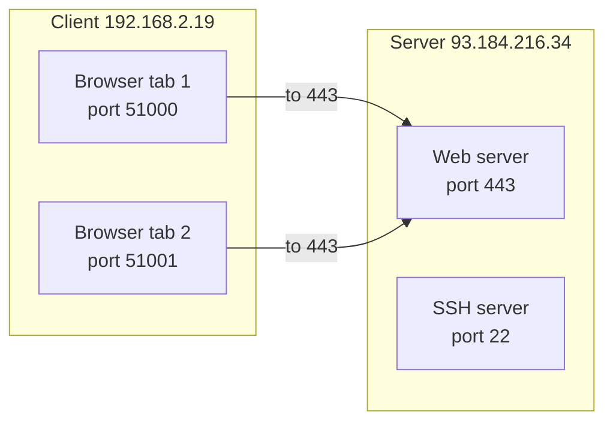
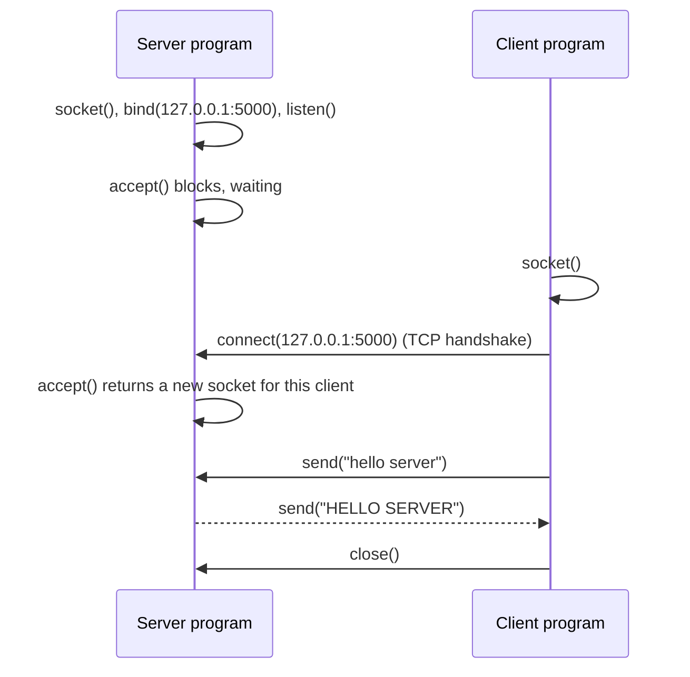

# Ports and sockets

After this you can say what a port is, read a line of `netstat` or `ss`, write a small TCP server and client in Python, and fix "address already in use".

Before this: [Network layers, TCP and UDP](03-network-layers-tcp-and-udp.md).

## The idea

An IP address gets a packet to a machine. That machine runs a browser, a database, an SSH server and a dozen other programs, and each of them needs its own incoming data. The **port** solves this: a 16-bit number, 0 to 65535, that TCP and UDP put in each segment to name the program on the machine that should receive it.

Think of the IP address as the street address of the building and the port as the apartment number. Unlike apartments, ports are not assigned to a program by default. A program claims one while it runs, and the operating system refuses a second claim on the same port.



In the diagram, both tabs talk to the same server port. The server tells them apart by the client's address and port, which are different for each.

## Key terms

A **port** is the 16-bit number that identifies an endpoint on a host for TCP or UDP ([MDN](https://developer.mozilla.org/en-US/docs/Glossary/Port)). TCP port 53 and UDP port 53 are separate.

A **socket** is one endpoint of a conversation: an IP address plus a port, plus the protocol. The programming interface of the same name is the set of operating system calls a program uses to create and use such an endpoint ([Python docs](https://docs.python.org/3/library/socket.html)).

A connection is identified by four values, the **4-tuple**: source address, source port, destination address and destination port. That is why 10,000 clients can all connect to port 443 on one server.

**Well-known ports** are 0 to 1023, **registered ports** are 1024 to 49151, and the rest, 49152 to 65535, are **dynamic (ephemeral) ports** that the operating system hands to clients for their end of a connection ([RFC 6335](https://datatracker.ietf.org/doc/html/rfc6335)). Linux picks its ephemeral ports from a different range by default (`/proc/sys/net/ipv4/ip_local_port_range`), so don't rely on those exact numbers.

To **listen** is to bind a socket to an address and port and wait for connections. To **connect** is to start a connection to a listening socket. A server has a listening socket and one extra socket per client.

## How it works

The sequence of calls is the same in every language, because each language's library wraps the operating system calls (see [system calls](../../02-operating-systems-and-linux/01-os-concepts/05-system-calls-and-kernel-mode.md)).



The ports below are assigned by IANA ([registry](https://www.iana.org/assignments/service-names-port-numbers/service-names-port-numbers.xhtml), as of 2026). Development servers often use ports such as 3000, 5000 or 8000 by convention; these are defaults of a framework, not rules.

| Port | Service |
|---|---|
| 22 | SSH |
| 25 | SMTP (mail between servers) |
| 53 | DNS (UDP, and TCP for large answers) |
| 80 | HTTP |
| 443 | HTTPS |
| 3306 | MySQL |
| 5432 | PostgreSQL |
| 6379 | Redis |

The cheat sheet has a longer list.

## Worked examples

<div class="example" markdown>

### Example 1: a TCP server and client on your machine

We write a server that accepts one connection, receives some bytes and replies in upper case. Save it as `server.py`:

```python
import socket

with socket.socket(socket.AF_INET, socket.SOCK_STREAM) as server:
    server.bind(("127.0.0.1", 5000))
    server.listen()
    print("listening on", server.getsockname())
    conn, addr = server.accept()
    with conn:
        print("connection from", addr)
        data = conn.recv(1024)
        print("received", data)
        conn.sendall(data.upper())
```

Step by step: `AF_INET` means IPv4 and `SOCK_STREAM` means TCP. `bind` claims the address and port. `listen` marks the socket as accepting connections. `accept` waits for a client and returns a new socket `conn` plus the client's address. `recv(1024)` reads up to 1024 bytes (it may return fewer; real programs loop).

Save the client as `client.py` and run it in a second terminal while the server waits:

```python
import socket

with socket.create_connection(("127.0.0.1", 5000)) as client:
    print("my end:", client.getsockname())
    print("server end:", client.getpeername())
    client.sendall(b"hello server")
    print("reply", client.recv(1024))
```

```text
my end: ('127.0.0.1', 61060)
server end: ('127.0.0.1', 5000)
reply b'HELLO SERVER'
```

The server terminal prints:

```text
listening on ('127.0.0.1', 5000)
connection from ('127.0.0.1', 61060)
received b'hello server'
```

Check: the client's end uses port 61060, which the operating system chose from the dynamic range. The two terminals show the same pair, so the 4-tuple is the same on both sides.

While the server is waiting, PowerShell shows the listening socket (`ss -ltn` does the same in WSL or Linux; unverified here):

```powershell
netstat -ano -p tcp | findstr :5000
```

```text
  TCP    127.0.0.1:5000         0.0.0.0:0              LISTENING       1544
```

The last column is the process ID of the program that owns the port.

</div>

<div class="example" markdown>

### Example 2: address already in use

Start the server from Example 1, and while it is waiting run this second program from another terminal:

```python
import socket

with socket.socket(socket.AF_INET, socket.SOCK_STREAM) as s:
    s.bind(("127.0.0.1", 5000))
    s.listen()
    print("second server listening")
```

```text
OSError: [WinError 10048] Only one usage of each socket address (protocol/network address/port) is normally permitted
```

On Linux and macOS the same failure reads `OSError: [Errno 98] Address already in use` (errno 98 on Linux; unverified here). Only one socket may listen on an address and port. The fix is to stop the other program, or choose another port. To find the owner, look up the process ID shown by `netstat -ano`, for example with `tasklist /FI "PID eq 1544"`, or `ss -ltnp` in WSL or Linux.

</div>

## Common mistakes

<div class="warning" markdown>

Watch out: assuming one `recv` returns one whole message. TCP is a stream of bytes with no message boundaries, so a read may return half a message or two messages glued together. Protocols add a length prefix or a delimiter, for example the blank line that ends HTTP headers.

Watch out: killing a server and restarting it at once, then seeing "address already in use" even though no process is left. Closed connections stay in a `TIME_WAIT` state for a short time. Servers set the `SO_REUSEADDR` option to rebind straight away.

Watch out: confusing the port a server listens on with the port a client uses. Your browser's port is random; only the server's is meaningful.

</div>

## Working with AI

<div class="ai" markdown>

Words to use: port, socket, listen, bind, ephemeral port, 4-tuple, `SO_REUSEADDR`, `TIME_WAIT`.

Prompts to try:

- "My Node server fails with `EADDRINUSE: address already in use :::3000` on Windows. Give me the PowerShell commands to find which process owns port 3000 and what I should check before killing it."
- "Write a Python TCP echo server that handles several clients using the `selectors` module, with a short explanation of what `accept` and `recv` do in the event loop."

What to check:

- Code that assumes `recv` returns a complete message, or `send` writes all bytes (`sendall` does).
- A server bound to `0.0.0.0` in an example that only needs `127.0.0.1`.
- Commands for the wrong operating system (`ss` and `lsof` on Windows, or `netstat -ano` on Linux). Check against the tool's help output.

</div>

## Quiz

1\. What is the difference between an IP address and a port?

<details class="solution" markdown>
<summary>Answer</summary>

The IP address identifies the machine's network interface; the port identifies which program on that machine receives the data. Together with the protocol they name a socket.

</details>

2\. Ten browser tabs connect to the same web server on port 443. How does the server keep the connections apart?

<details class="solution" markdown>
<summary>Answer</summary>

Each connection has a different 4-tuple. The server address and port are the same, but each tab uses its own source port (and the NAT router gives each a distinct public port).

</details>

3\. A new Flask app prints "Address already in use" on port 5000. Name two possible reasons.

<details class="solution" markdown>
<summary>Answer</summary>

An earlier copy of the app is still running (perhaps in another terminal), or another program uses port 5000. Find the process with `netstat -ano` (Windows) or `ss -ltnp` (Linux) and stop it, or run on another port.

</details>

4\. A server is bound to `127.0.0.1:5000`. Can a phone on the same Wi-Fi connect to `http://192.168.2.19:5000`? What would you change?

<details class="solution" markdown>
<summary>Answer</summary>

No, because loopback accepts only connections from the same machine. Bind to `0.0.0.0` (or the Wi-Fi address) and allow the port through the firewall.

</details>

## Lab

<div class="lab" markdown>

### Lab: a talking server

Goal: run the server and client, then break them on purpose. Time: about 15 minutes. Runs in: two terminals, Python 3.

1. Save `server.py` and `client.py` from Example 1 and start the server in one terminal.
2. In a second terminal run `netstat -ano -p tcp | findstr :5000` and note the process ID, then run the client.
3. After the client finishes, run `netstat -ano -p tcp | findstr :5000` again and describe what changed.
4. Start the server, then start it again in a third terminal. Read the error.
5. Change the server's address to `0.0.0.0` and run it. Run `netstat` again and compare the local address column with step 2.
6. Cleanup: stop the servers and delete the files if you do not need them.

<details class="solution" markdown>
<summary>Solution</summary>

Step 3: the `LISTENING` line is replaced by lines in `TIME_WAIT` for the closed connection, one per client port. Step 4: the second start fails with `WinError 10048` (Windows) because the port is taken. Step 5: the local address column shows `0.0.0.0:5000` instead of `127.0.0.1:5000`, so the socket accepts connections on every interface; Windows may show a firewall prompt.

</details>

</div>

## Where this shows up

- Every `localhost:3000` in front-end work is a port on the loopback address; see [IP addresses, subnets and NAT](02-ip-addresses-subnets-and-nat.md).
- [HTTP requests and responses](../02-web-protocols/01-http-requests-and-responses.md) are text sent through exactly this kind of socket.
- [Docker](../../13-devops-and-cloud/01-containers/03-volumes-networks-and-compose.md) publishes container ports with `-p 8080:80`, a port mapping like the NAT entry in the previous lesson.
