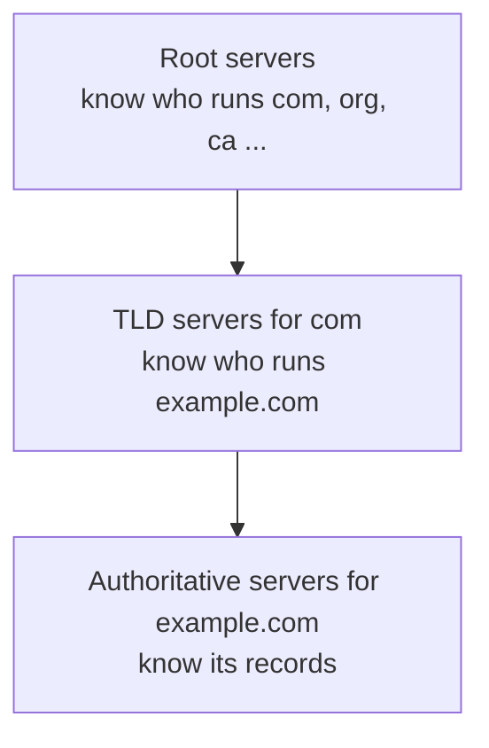
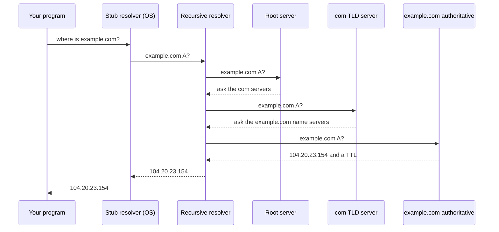

# DNS and domains

After this you can follow a name lookup from your laptop to the server that owns the answer, read the common DNS record types, and explain why a DNS change takes time to show up.

Before this: [Network layers, TCP and UDP](03-network-layers-tcp-and-udp.md) and [Ports and sockets](04-ports-and-sockets.md).

## The idea

You type `example.com`. A packet needs a numeric IP address, so something has to turn the name into one before the first byte is sent. That job belongs to the **Domain Name System** (DNS), a distributed database that maps names to records, mostly addresses ([RFC 1034](https://datatracker.ietf.org/doc/html/rfc1034), [MDN](https://developer.mozilla.org/en-US/docs/Glossary/DNS)).

No single server holds the whole database. The name is read right to left, and each part is managed by a different server: `.` (the root), then `com`, then `example`. A lookup walks down that tree, asking each level where the next level lives, and every answer along the way is cached so the walk rarely repeats.



## Key terms

A **domain name** is a hierarchical name like `www.example.com`. Its last label is the **top-level domain** (TLD): `com`, `ca`, `org`. A **subdomain** is a name under another one: `www` and `api` under `example.com`.

A **stub resolver** is the small client built into your operating system and programs. It asks one configured server and does no walking itself. A **recursive resolver** is the server that does the walking for it, usually run by your ISP, your router, or a public service such as 1.1.1.1 or 8.8.8.8. An **authoritative server** holds the real records for a domain and answers with the final word.

A **record** is one entry in a domain's data. The common types ([RFC 1035](https://datatracker.ietf.org/doc/html/rfc1035)):

| Type | Holds | Example |
|---|---|---|
| A | an IPv4 address | `example.com` is `104.20.23.154` |
| AAAA | an IPv6 address | `example.com` is `2606:4700:10::6814:179a` |
| CNAME | an alias to another name | `www.github.com` is `github.com` |
| MX | a mail server, with a priority | `gmail.com` has `gmail-smtp-in.l.google.com` |
| TXT | free text, used for verification and email policy | `v=spf1 -all` |
| NS | the name servers for the domain | `hera.ns.cloudflare.com` |

**TTL** (time to live) is the number of seconds a resolver may keep an answer in its cache before asking again.

A **registrar** is the company where you buy and renew a domain name. A **DNS host** is the service whose name servers hold your records. They are often the same company, but they don't have to be, and the registrar's job is to tell the TLD servers which name servers are yours.

## How it works

Suppose your laptop has not looked up `example.com` before and the recursive resolver's cache is empty.



In the diagram, the first three requests go to servers that only point onward. Only the authoritative server answers. The recursive resolver caches each step for its TTL, so the next lookup of `example.com` (or of any `.com` name) skips the root and TLD hops. Your operating system and browser keep their own caches too.

Most lookups travel over UDP port 53, as in the last lesson, and use TCP when an answer is too large. Before any of this, the OS checks a local file called the hosts file (`C:\Windows\System32\drivers\etc\hosts` on Windows, `/etc/hosts` on Linux and macOS). A line such as `127.0.0.1 myapp.test` there makes the name resolve without any DNS query, which is a common way to test a site locally and also how some malware redirects traffic.

## Worked examples

<div class="example" markdown>

### Example 1: asking the resolver

`nslookup` ships with Windows. The `Server` lines are the recursive resolver your machine is configured to use, here a Pi-hole on my home network.

```powershell
nslookup example.com
```

```text
Non-authoritative answer:
Server:  pi.hole
Address:  192.168.2.5

Name:    example.com
Addresses:  2606:4700:10::ac42:93f3
	  2606:4700:10::6814:179a
	  104.20.23.154
	  172.66.147.243
```

"Non-authoritative" means the answer came from a resolver (possibly from its cache), not from the domain's own servers. The record types are asked for with `-type`:

```powershell
nslookup -type=MX gmail.com
nslookup -type=CNAME www.github.com
nslookup -type=NS example.com
```

```text
gmail.com	MX preference = 5, mail exchanger = gmail-smtp-in.l.google.com
gmail.com	MX preference = 10, mail exchanger = alt1.gmail-smtp-in.l.google.com
www.github.com	canonical name = github.com
example.com	nameserver = hera.ns.cloudflare.com
example.com	nameserver = elliott.ns.cloudflare.com
```

(Output shortened to the relevant lines. For `MX`, the lowest preference number is tried first.)

To ask the authoritative server directly, give its name as a second argument:

```powershell
nslookup example.com hera.ns.cloudflare.com
```

```text
Server:  hera.ns.cloudflare.com
Address:  108.162.192.162

Name:    example.com
Addresses:  2606:4700:10::6814:179a
	  2606:4700:10::ac42:93f3
	  104.20.23.154
	  172.66.147.243
```

There is no "Non-authoritative" line this time. In WSL or Linux the usual tool is `dig example.com`, with `dig +trace example.com` to watch the walk from the root and `dig example.com MX` for a type (unverified here, since WSL is not installed on this machine; see `man dig`).

Check: the addresses from your resolver and from the authoritative server agree. When they don't, a cache holds an older answer.

</div>

<div class="example" markdown>

### Example 2: seeing a TTL

The UDP program from the previous lesson also shows the TTL: the reply's last record has the TTL as a 4-byte number 10 bytes from the end. Add this line to the end of that script:

```python
print("TTL in seconds:", struct.unpack("!I", reply[-10:-6])[0])
```

```text
TTL in seconds: 130
```

This is how long this resolver may still serve the answer from cache. The remaining time shrinks as the cached entry ages, and large public resolvers run many caches, so repeated runs can print different values. A short TTL (60 to 300 seconds) lets you move a service quickly; a long one (hours) cuts load on your name servers.

</div>

## Common mistakes

<div class="warning" markdown>

Watch out: "I changed the DNS record and nothing happened." Caches keep the old answer until its TTL runs out, and your browser and OS have caches too. Before a planned move, lower the TTL a day ahead. Changing which name servers a domain uses (at the registrar) can take much longer, because the TLD servers cache that information.

Watch out: putting a CNAME on the bare domain (`example.com`) when it already has other records such as MX. A CNAME means "this name is only an alias", so it can't share a name with other records. Use an A record, or the ALIAS-style record your DNS host offers.

Watch out: assuming "the site is down" when DNS is the problem. `curl` by IP address works while the name fails. Test both.

</div>

## Working with AI

<div class="ai" markdown>

Words to use: recursive resolver, authoritative server, A record, CNAME, MX, TXT, TTL, name server, registrar.

Prompts to try:

- "I bought `myshop.ca` at one registrar and want the site hosted on Vercel and email on Google Workspace. List the DNS records I need to add (type, name, value) and which of them can be CNAMEs."
- "I updated an A record two hours ago with TTL 3600. `nslookup` on my laptop still shows the old IP, but `nslookup myshop.ca 1.1.1.1` shows the new one. Explain why, and name the caches I should check."

What to check:

- Record values copied from a model rather than from your host's dashboard. A model can invent IP addresses, verification strings and target hostnames.
- A CNAME suggested at the root of the domain.
- Advice that says "wait 48 hours" for everything. The wait is the old TTL, or longer for name server changes. Check the TTL with `nslookup -debug` or `dig`.

</div>

## Quiz

1\. Name the servers a recursive resolver asks, in order, for `www.example.com` with empty caches.

<details class="solution" markdown>
<summary>Answer</summary>

A root server, then the `com` TLD servers, then the authoritative servers for `example.com`. The first two answer with a pointer to the next level.

</details>

2\. What is the difference between a registrar and a DNS host?

<details class="solution" markdown>
<summary>Answer</summary>

The registrar sells and renews the domain and records which name servers are in charge of it. The DNS host runs those name servers and stores the records (A, MX and so on). They can be different companies.

</details>

3\. You change an A record whose TTL is 86400. About how long can some users still get the old address?

<details class="solution" markdown>
<summary>Answer</summary>

Up to 86400 seconds, or 24 hours, counted from when each cache last fetched it. Caches that fetched it just before your change keep the old answer the longest.

</details>

4\. A site loads at `http://104.20.23.154` but not at `http://example.com` on your laptop. What does that point to, and what do you check?

<details class="solution" markdown>
<summary>Answer</summary>

It points to name resolution, not the server. Run `nslookup example.com` and compare with `nslookup example.com 1.1.1.1`. Also check the hosts file and flush the local cache (`ipconfig /flushdns` on Windows).

</details>

## Lab

<div class="lab" markdown>

### Lab: walk a lookup

Goal: ask three kinds of server for the same name and compare the answers. Time: about 15 minutes. Runs in: PowerShell on Windows (WSL equivalents in step 5).

1. Run `nslookup example.com` and note the resolver in the `Server` line.
2. Run `nslookup -type=NS example.com` and pick one name server from the output.
3. Ask that name server directly: `nslookup example.com <name server>`. Check that "Non-authoritative" is missing.
4. Ask a public resolver: `nslookup example.com 1.1.1.1`.
5. In WSL or Linux, `dig example.com`, `dig NS example.com` and `dig +trace example.com` do steps 1 to 3 (unverified here).
6. Write a Python line that does the resolver step for you: `socket.getaddrinfo("example.com", 443)`. Compare its addresses with step 1.

<details class="solution" markdown>
<summary>Solution</summary>

All four answers should show the same set of addresses, possibly in a different order, because the authoritative server may rotate them. In step 3 the answer comes from the authoritative server, so there is no "Non-authoritative" line. `getaddrinfo` goes through the same stub resolver as your browser, including the hosts file and the local cache. Example output from my machine: `socket.getaddrinfo("example.com", 443, type=socket.SOCK_STREAM)[0][4]` is `('104.20.23.154', 443)`.

</details>

</div>

## Where this shows up

- A domain name is part of every URL; [HTTP requests and responses](../02-web-protocols/01-http-requests-and-responses.md) start with the lookup in this lesson.
- TLS certificates<!-- link: ../02-web-protocols/03-tls-https-and-certificates.md --> are issued for domain names, and proving you own one often means adding a TXT or CNAME record.
- [Network debugging tools](../02-web-protocols/07-network-debugging-tools.md) covers `dig`, `curl` and `nslookup` for finding which layer is failing.
