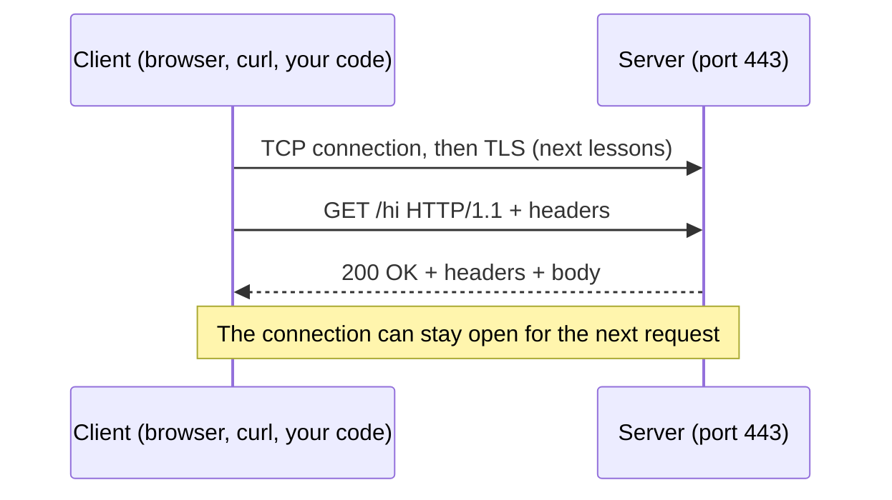

# HTTP requests and responses

After this you can read a raw HTTP request and response, pick the right method and status code, and use `curl -v` to see what your code actually sends.

Before this: [Network layers, TCP and UDP](../01-how-the-internet-works/03-network-layers-tcp-and-udp.md).

## The idea

You type a URL, and a page appears. Under the page is a short text conversation: your browser sends one message asking for something, and a server sends one message back. That conversation is **HTTP**, and every web page, API call and image download is made of it.

HTTP runs on top of a TCP connection (see the TCP lesson linked above). The client opens a connection to a port, sends a request, and the server sends a response. Each request is independent: HTTP itself keeps no memory of earlier requests.



## Key terms

An **HTTP request** is a message from client to server made of a request line, headers, an empty line and an optional body.

An **HTTP response** is the server's reply: a status line, headers, an empty line and an optional body.

A **method** (or verb) says what the client wants to do: `GET`, `POST` and so on. A **status code** is a three-digit number saying how it went. A **header** is a `Name: value` line of metadata. The **body** is the payload, such as HTML or JSON.

A method is **safe** if it only reads and changes nothing on the server. A method is **idempotent** if sending it once or ten times leaves the server in the same state. Safe methods are idempotent; the reverse is false.

## How it works

The exact bytes of a request are plain text. The standard is [RFC 9110](https://www.rfc-editor.org/rfc/rfc9110) (semantics) and [RFC 9112](https://www.rfc-editor.org/rfc/rfc9112) (the HTTP/1.1 message format); [MDN](https://developer.mozilla.org/en-US/docs/Web/HTTP/Messages) is easier to read.

```text
GET /hi HTTP/1.1          <- request line: method, path, version
Host: example.com         <- headers, one per line
Accept: */*
                          <- empty line ends the headers
(body, if any)
```

The methods you meet most:

| Method | Meaning | Safe | Idempotent |
|---|---|---|---|
| `GET` | Read a resource | yes | yes |
| `HEAD` | Like `GET`, headers only | yes | yes |
| `POST` | Create something, or run an action | no | no |
| `PUT` | Replace a resource with the body | no | yes |
| `PATCH` | Change part of a resource | no | not guaranteed |
| `DELETE` | Remove a resource | no | yes |

Status codes come in classes by first digit. `200 OK`, `301`/`302` (redirect), `404 Not Found` and `500 Internal Server Error` are the ones you will see daily. The full table is in the [chapter cheat sheet](index.md).

| Class | Meaning |
|---|---|
| 1xx | Informational |
| 2xx | Success |
| 3xx | Redirect or "use your cached copy" |
| 4xx | The client made a mistake |
| 5xx | The server failed |

Idempotency matters when a request fails halfway. If a `DELETE` times out, retrying is safe. If a `POST /payments` times out, retrying may charge twice; that is why payment APIs add an idempotency key.

## Worked examples

<div class="example" markdown>

### Example 1: watching a request with `curl -v`

`curl -v` prints the request lines with `>` and the response lines with `<`. We ask for `https://example.com` and throw the body away.

```bash
curl -sv https://example.com -o /dev/null
```

Output, trimmed (connection details removed):

```text
> GET / HTTP/1.1
> Host: example.com
> User-Agent: curl/8.19.0
> Accept: */*
>
< HTTP/1.1 200 OK
< Content-Type: text/html; charset=utf-8
< Transfer-Encoding: chunked
< Server: cloudflare
< cf-cache-status: HIT
```

1. The request line is `GET / HTTP/1.1`: method, path, version.
2. `Host` is required in HTTP/1.1, because one IP address can serve many sites.
3. The status line `200 OK` has the version, code and reason text.
4. `Content-Type` tells the client how to read the body. `cf-cache-status: HIT` is a CDN header, covered in the proxies lesson.

Check: change the URL to `https://httpbin.org/status/404` and confirm the status line becomes `404 NOT FOUND`.

Now a request with a body. `POST` with a JSON body to httpbin, which echoes what it received:

```bash
curl -s -X POST https://httpbin.org/post -H "Content-Type: application/json" -d '{"name":"Ada"}'
```

```text
{
  "data": "{\"name\":\"Ada\"}",
  "headers": {
    "Content-Length": "14",
    "Content-Type": "application/json",
    "Host": "httpbin.org",
    "User-Agent": "curl/8.19.0"
  },
  "json": {"name": "Ada"},
  "url": "https://httpbin.org/post"
}
```

The server received 14 bytes and parsed them as JSON because of the `Content-Type` header.

</div>

<div class="example" markdown>

### Example 2: the raw bytes, in Python

HTTP is only text over a socket, so we can write the request by hand against a small local server.

```python
import socket, threading
from http.server import BaseHTTPRequestHandler, HTTPServer

class Hello(BaseHTTPRequestHandler):
    def do_GET(self):
        body = b"hello\n"
        self.send_response(200)
        self.send_header("Content-Type", "text/plain")
        self.send_header("Content-Length", str(len(body)))
        self.end_headers()
        self.wfile.write(body)
    def log_message(self, *a):
        pass

server = HTTPServer(("127.0.0.1", 8081), Hello)
threading.Thread(target=server.serve_forever, daemon=True).start()

request = "GET /hi HTTP/1.1\r\nHost: localhost\r\nConnection: close\r\n\r\n"
with socket.create_connection(("127.0.0.1", 8081)) as s:
    s.sendall(request.encode())
    data = b""
    while chunk := s.recv(4096):
        data += chunk
print(data.decode())
```

```text
HTTP/1.0 200 OK
Server: BaseHTTP/0.6 Python/3.14.4
Date: Mon, 26 Oct 2026 00:22:47 GMT
Content-Type: text/plain
Content-Length: 6

hello
```

Lines end with `\r\n`, and a blank line separates headers from body. Python's built-in server answers with `HTTP/1.0` by default; that is a property of this server, not of the request.

</div>

## Common mistakes

<div class="warning" markdown>

Watch out: using `GET` for actions that change data. Browsers, crawlers and caches assume `GET` is safe and may repeat or prefetch it, so a `GET /delete?id=5` link can delete things on its own.

Watch out: returning `200` with an error message in the body. Clients and monitoring tools read the status code first. Use `4xx` for the caller's mistake and `5xx` for yours.

Watch out: assuming `PUT` and `POST` are interchangeable. `PUT` replaces a resource at a known URL and is idempotent; `POST` is not.

</div>

## Working with AI

<div class="ai" markdown>

Words to use: request line, header, status code, idempotent, safe method, `Content-Type`, `curl -v`.

Prompts to try:

- "Here is the output of `curl -v` for my failing endpoint (pasted below). Explain each request header and why the server might answer 415."
- "Which status code should a REST endpoint return when the JSON body is valid but the email is already registered? Give the code, the reason, and the RFC 9110 section."

What to check:

- A wrong method or status code. Look the code up on [MDN](https://developer.mozilla.org/en-US/docs/Web/HTTP/Status) before you ship it.
- A `curl` command with invented flags. Run `curl --help all` or `man curl`.
- Advice to retry a `POST` automatically. Confirm the endpoint is idempotent or has an idempotency key.

</div>

## Quiz

1\. What is the difference between a safe method and an idempotent method? Give one method that is idempotent but not safe.

<details class="solution" markdown>
<summary>Answer</summary>

A safe method changes nothing on the server; an idempotent method can be repeated with the same end state. `PUT` and `DELETE` are idempotent but not safe.

</details>

2\. In `curl -v` output, what do lines starting with `>` and `<` show?

<details class="solution" markdown>
<summary>Answer</summary>

`>` lines are what curl sent (the request); `<` lines are what the server sent back (the response).

</details>

3\. A client gets `503` after sending `POST /orders`. Is it safe to retry automatically?

<details class="solution" markdown>
<summary>Answer</summary>

Not without checking. `POST` is not idempotent, and the server may have created the order before failing. Use an idempotency key or check for the order first.

</details>

4\. A login endpoint returns `200 OK` with `{"error": "bad password"}`. Why is that a problem, and what should it return?

<details class="solution" markdown>
<summary>Answer</summary>

Clients, proxies and monitoring read the status code, so the failure looks like success. Return `401 Unauthorized` (or `400`/`403` as the design requires).

</details>

## Lab

<div class="lab" markdown>

### Lab: read and send HTTP by hand

Goal: send requests with curl and see the exact bytes. Time: about 15 minutes. Runs in: Git Bash or WSL (Ubuntu).

1. Run `curl -sv https://example.com -o /dev/null` and find the request line, the `Host` header and the status line.
2. Run `curl -sI https://httpbin.org/get` (`-I` sends `HEAD`) and note that there is no body.
3. Run `curl -si https://httpbin.org/status/404 | head -1`, then change `404` to `500` and `301`.
4. Run `curl -s -X POST https://httpbin.org/post -d "a=1&b=2"` and find where `a` and `b` appear in the reply.
5. Run the Python example above and add a second header with `send_header`. Confirm it appears in the output.

Expected result: you can point at each part of a request and a response.

<details class="solution" markdown>
<summary>Solution</summary>

Step 4 prints `"form": {"a": "1", "b": "2"}`, because `-d` sends `Content-Type: application/x-www-form-urlencoded`. Step 3 with `301` shows a `Location` header and no automatic follow, because `-L` was not given.

</details>

</div>

## Where this shows up

- [HTTP headers, cookies and caching](02-http-headers-cookies-and-caching.md) covers the headers in more detail.
- [REST API design](../../09-back-end/01-servers-and-apis/04-rest-api-design.md) builds on methods and status codes.
