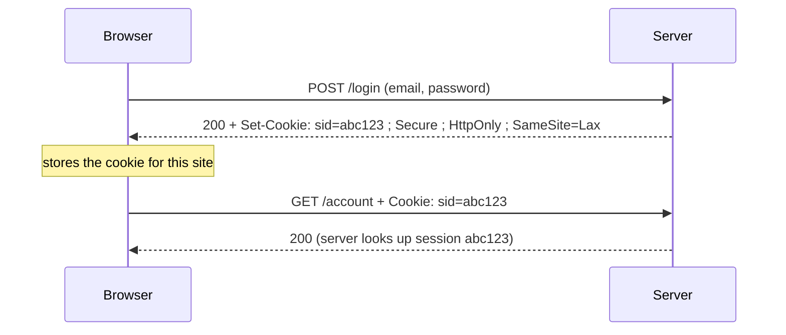
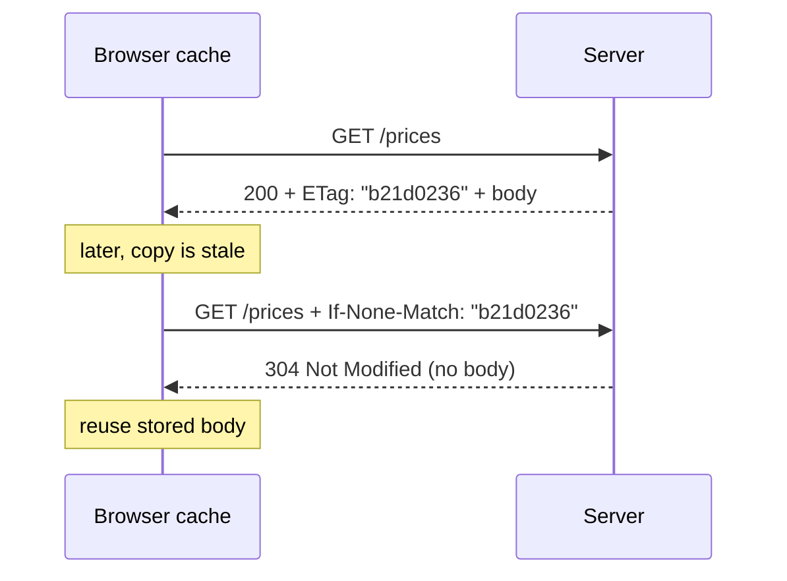

# HTTP headers, cookies and caching

After this you can read the headers that control content, login state and caching, set a cookie safely, and explain why a browser sometimes gets a `304` with no body.

Before this: [HTTP requests and responses](01-http-requests-and-responses.md).

## The idea

HTTP is stateless: each request stands alone. Yet a site knows who you are and doesn't re-download its logo on every click. Both come from headers. A cookie header carries identity from one request to the next, and caching headers let a browser or CDN reuse a response.



## Key terms

A **header** is one `Name: value` line. Request headers describe the client and what it wants; response headers describe the reply.

A **cookie** is a small name-value pair the server asks the browser to store with `Set-Cookie`, and the browser sends back in a `Cookie` header on later requests to that site.

A **cache** stores a response so it can be reused. **Freshness** means a stored response may be used without asking the server. **Revalidation** means asking the server "has this changed?" before reusing it.

An **ETag** is an identifier for one version of a resource, usually a hash of the content.

## How it works

Headers you will read most often (full list in the [cheat sheet](index.md)):

| Header | Direction | Purpose |
|---|---|---|
| `Content-Type` | both | Format of the body, such as `application/json` |
| `Accept` | request | Formats the client can handle |
| `Authorization` | request | Credentials, such as `Bearer <token>` |
| `User-Agent` | request | Which client is calling |
| `Set-Cookie` / `Cookie` | response / request | Store and send cookies |
| `Cache-Control` | both | Caching rules |
| `ETag` / `If-None-Match` | response / request | Revalidation |

**Cookie attributes** are set on `Set-Cookie` and limit what the cookie can do ([MDN](https://developer.mozilla.org/en-US/docs/Web/HTTP/Cookies)):

- `Secure`: only sent over HTTPS.
- `HttpOnly`: JavaScript cannot read it, which limits what a cross-site scripting (XSS) attack can steal.
- `SameSite=Lax` or `Strict`: not sent on most cross-site requests, which blocks many cross-site request forgery (CSRF) attacks. Browsers treat a missing `SameSite` as `Lax`.
- `Max-Age` or `Expires`: how long it lives; without them it ends with the browser session.

Caching runs on `Cache-Control` ([RFC 9111](https://www.rfc-editor.org/rfc/rfc9111)):

- `max-age=60`: fresh for 60 seconds; the browser does not ask the server.
- `no-cache`: may store, but must revalidate every time.
- `no-store`: do not store at all (use for private data).
- `public` / `private`: shared caches such as CDNs may, or may not, store it.

Once a stored copy is stale, the browser revalidates, as in the diagram.



A `304` saves the bandwidth of the body but still costs a round trip. A long `max-age` saves the round trip too, which is why build tools put a hash in file names (`app.3f9a1c.js`) and cache them for a year.

**HTTP versions** in one paragraph: HTTP/1.1 sends one request at a time per connection (browsers open several). HTTP/2 ([RFC 9113](https://www.rfc-editor.org/rfc/rfc9113)) multiplexes many requests over one TCP connection and compresses headers. HTTP/3 ([RFC 9114](https://www.rfc-editor.org/rfc/rfc9114)) does the same over QUIC, which runs on UDP and avoids one lost packet stalling every request. The methods, status codes and headers are the same in all three; only the wire format changes.

## Worked examples

<div class="example" markdown>

### Example 1: a conditional request in Python

We serve a body with an `ETag`, fetch it, then ask again with `If-None-Match`.

```python
import hashlib, threading, urllib.request, urllib.error
from http.server import BaseHTTPRequestHandler, HTTPServer

BODY = b"price list v1\n"
ETAG = '"' + hashlib.sha256(BODY).hexdigest()[:8] + '"'

class H(BaseHTTPRequestHandler):
    def do_GET(self):
        if self.headers.get("If-None-Match") == ETAG:
            self.send_response(304)
            self.send_header("ETag", ETAG)
            self.end_headers()
            return
        self.send_response(200)
        self.send_header("ETag", ETAG)
        self.send_header("Cache-Control", "no-cache")
        self.send_header("Content-Length", str(len(BODY)))
        self.end_headers()
        self.wfile.write(BODY)
    def log_message(self, *a):
        pass

server = HTTPServer(("127.0.0.1", 8082), H)
threading.Thread(target=server.serve_forever, daemon=True).start()

url = "http://127.0.0.1:8082/prices"
r = urllib.request.urlopen(url)
etag = r.headers["ETag"]
print(r.status, etag, len(r.read()), "bytes")
req = urllib.request.Request(url, headers={"If-None-Match": etag})
try:
    urllib.request.urlopen(req)
except urllib.error.HTTPError as e:
    print(e.code, e.reason, len(e.read()), "bytes")
```

```text
200 "b21d0236" 14 bytes
304 Not Modified 0 bytes
```

1. The first request has no `If-None-Match`, so the server sends 14 bytes and the `ETag`.
2. The second sends the `ETag` back. It matches, so the server answers `304` with no body.
3. Python's `urllib` raises an error for `304` because it did not ask for a conditional response itself; a browser handles it without showing you anything.

Check against the real world with httpbin:

```bash
curl -si -H "If-None-Match: abc" https://httpbin.org/etag/abc | head -3
```

```text
HTTP/1.1 304 NOT MODIFIED
Date: Mon, 26 Oct 2026 00:22:25 GMT
Connection: keep-alive
```

</div>

<div class="example" markdown>

### Example 2: a cookie in `curl`

```bash
curl -si "https://httpbin.org/cookies/set?session=abc123" | head -8
```

```text
HTTP/1.1 302 FOUND
Date: Mon, 26 Oct 2026 00:22:19 GMT
Content-Type: text/html; charset=utf-8
Content-Length: 223
Connection: keep-alive
Server: gunicorn/19.9.0
Location: /cookies
Set-Cookie: session=abc123; Path=/
```

This cookie has no `Secure`, `HttpOnly` or `SameSite`, so it is fine for a demo and wrong for a real login. A login cookie from a real app would look like `Set-Cookie: sid=...; Secure; HttpOnly; SameSite=Lax; Path=/; Max-Age=86400`.

</div>

## Common mistakes

<div class="warning" markdown>

Watch out: thinking `no-cache` means "do not cache". It means "revalidate before use". For data that must never be stored, use `no-store`.

Watch out: putting a session ID or token in `localStorage` or a cookie without `HttpOnly`. Any script on the page, including a compromised dependency, can read it.

Watch out: long `max-age` on a file whose name never changes. Users keep the old copy. Give the file a hashed name or use a short `max-age` with an `ETag`.

</div>

## Working with AI

<div class="ai" markdown>

Words to use: `Set-Cookie`, `HttpOnly`, `SameSite`, `Cache-Control`, `ETag`, revalidation, `304`.

Prompts to try:

- "My Express app sets a session cookie. Give the `Set-Cookie` header it should send for a production login (HTTPS only, 24 hours), and explain each attribute."
- "Here are the response headers of my API (pasted). Will a CDN cache this response, for how long, and what do I change so it never caches the `/me` endpoint?"

What to check:

- Cookie code that omits `Secure`, `HttpOnly` or `SameSite`. Read the actual `Set-Cookie` line in the devtools Network tab.
- `Cache-Control` advice that confuses `no-cache` and `no-store`. Check [MDN](https://developer.mozilla.org/en-US/docs/Web/HTTP/Caching).
- Claims about browser defaults. Test in the browser you ship to.

</div>

## Quiz

1\. What does `HttpOnly` stop?

<details class="solution" markdown>
<summary>Answer</summary>

JavaScript on the page reading the cookie through `document.cookie`. The browser still sends it with requests.

</details>

2\. A response has `Cache-Control: max-age=3600`. A user reloads the page after 10 minutes. Does the browser contact the server for that resource?

<details class="solution" markdown>
<summary>Answer</summary>

Normally no; the copy is fresh for 3600 seconds. A hard refresh (Ctrl+Shift+R) forces a request anyway.

</details>

3\. A server returns `304` to your `fetch`. What is in the body?

<details class="solution" markdown>
<summary>Answer</summary>

Nothing. The browser reuses its stored body and you get a normal `200` response in JavaScript.

</details>

4\. Which header would you add so a page of account data is never stored by any cache?

<details class="solution" markdown>
<summary>Answer</summary>

`Cache-Control: no-store`.

</details>

## Lab

<div class="lab" markdown>

### Lab: inspect headers on a real site

Goal: read caching and cookie headers in the browser and in curl. Time: about 15 minutes. Runs in: any browser, plus Git Bash or WSL.

1. Open any site, press F12, choose the Network tab, reload, and click the main document.
2. In Response headers find `Content-Type` and `Cache-Control`.
3. Click a JavaScript file. Note its `Cache-Control` and whether it has an `ETag`.
4. Reload normally, then with Ctrl+Shift+R. Compare the Size column (`disk cache` or `304` against full size).
5. Run `curl -sI https://example.com` and find `Cache-Control` or `ETag` in the output. If neither appears, write down that the server leaves caching to the client.

Expected result: you can say, for one file, whether it is fresh, revalidated or downloaded again.

<details class="solution" markdown>
<summary>Solution</summary>

Normal reload usually shows `(disk cache)` for fresh files and `304` for revalidated ones; a hard refresh sends `Cache-Control: no-cache` and re-downloads everything.

</details>

</div>

## Where this shows up

- [TLS, HTTPS and certificates](03-tls-https-and-certificates.md) explains the `Secure` in `Secure` cookies.
- [Sessions, cookies and JWT](../../09-back-end/02-auth/02-sessions-cookies-and-jwt.md) uses these cookies for login.
- [CORS and same origin](../../09-back-end/02-auth/04-cors-and-same-origin.md) adds the `Access-Control-*` headers.
