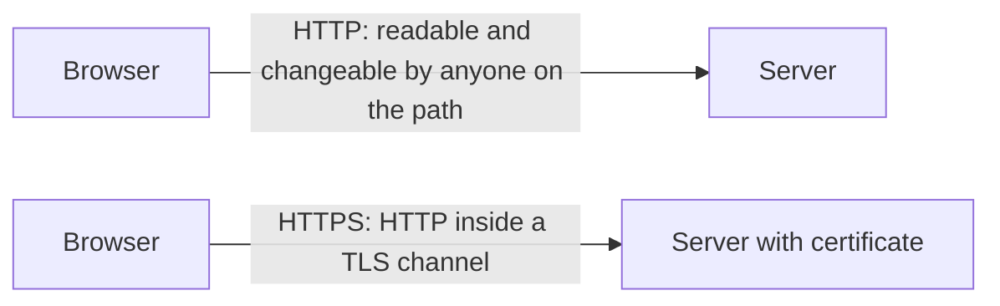
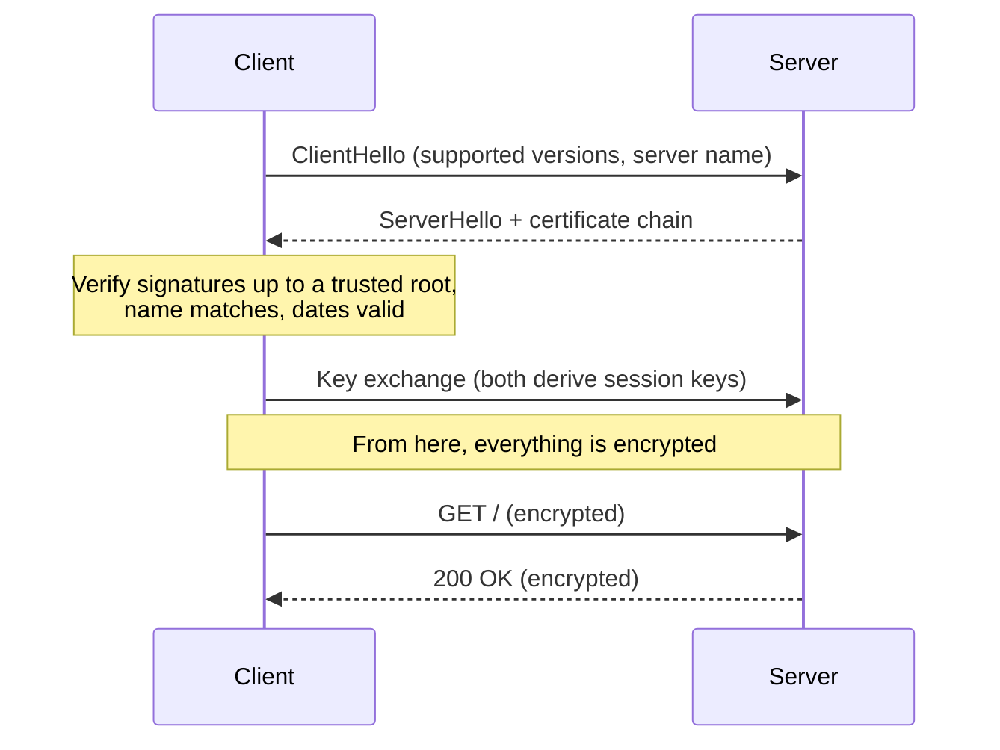

# TLS, HTTPS and certificates

After this you can say what HTTPS protects and what it doesn't, read a certificate chain, and diagnose the three common certificate errors.

Before this: [HTTP headers, cookies and caching](02-http-headers-cookies-and-caching.md).

## The idea

On café Wi-Fi, plain HTTP is a postcard: every device between you and the server can read it and change it. **HTTPS** is HTTP sent inside an encrypted channel, like a sealed envelope. It also has to answer a second question: is the envelope going to the real `example.com` and not an impostor? Certificates answer that.



## Key terms

**TLS** (Transport Layer Security) is the protocol that sets up an encrypted, authenticated channel over a TCP connection. Version 1.3 is the current one ([RFC 8446](https://www.rfc-editor.org/rfc/rfc8446)). **SSL** is the older name and the older protocol; versions of SSL are obsolete, but people still say "SSL certificate" and mean a TLS certificate.

**HTTPS** is HTTP over TLS, usually on port 443.

TLS provides three things:

- Confidentiality: eavesdroppers see only scrambled bytes (encryption).
- Integrity: any change in transit is detected.
- Authentication: the client checks it is talking to the server it asked for.

A **certificate** is a signed file that binds a name (like `example.com`) to a public key. A **certificate authority (CA)** is an organization that signs certificates after checking that the requester controls the name. A **chain of trust** runs from the server's certificate, through intermediate CAs, to a **root CA** whose certificate is already installed in your operating system or browser.

## How it works

When a connection starts, the server sends its certificate chain. The client checks it, then both sides agree on keys for fast encryption. The key-exchange mathematics is in [The TLS handshake](../../12-security/02-cryptography/05-the-tls-handshake.md); this lesson only covers what the checks mean.



The client's checks, in plain words:

1. Each certificate in the chain is signed by the next one, ending at a root already trusted.
2. Today's date is between the certificate's start and end dates.
3. The name you typed appears in the certificate's list of names.

**Let's Encrypt** is a free CA that issues certificates automatically. As of 2026 its default certificate is valid for 90 days ([FAQ](https://letsencrypt.org/docs/faq/)), so renewal is automated with tools such as certbot or a hosting platform's built-in feature.

### What the padlock means

The padlock means the connection to that domain is encrypted and the certificate matches the domain. It does not mean the site is honest. A phishing site at `paypa1-login.com` can have a valid certificate for its own name. Check the domain, not the lock.

## Worked examples

<div class="example" markdown>

### Example 1: inspect a real certificate

`openssl s_client` opens a TLS connection and prints what the server sent. The `-servername` flag sends the name the client wants.

```bash
echo | openssl s_client -connect example.com:443 -servername example.com 2>/dev/null | grep -E "^ *([0-9] )?(s|i):|Verification|Protocol"
```

```text
 0 s:CN=example.com
   i:C=US, O=SSL Corporation, CN=Cloudflare TLS Issuing ECC CA 3
 1 s:C=US, O=SSL Corporation, CN=Cloudflare TLS Issuing ECC CA 3
   i:C=US, O=SSL Corporation, CN=SSL.com TLS Transit ECC CA R2
 2 s:C=US, O=SSL Corporation, CN=SSL.com TLS Transit ECC CA R2
   i:C=US, O=SSL Corporation, CN=SSL.com TLS ECC Root CA 2022
Verification: OK
Protocol: TLSv1.3
```

Each `s:` is a subject (who the certificate is for) and each `i:` is its issuer. Certificate 0 is issued by 1, which is issued by 2, which is issued by the root. That is the chain of trust. `Verification: OK` means the chain ends at a root your system trusts.

Check: run the same thing in Python, which also reports the expiry date.

```python
import socket, ssl
ctx = ssl.create_default_context()
with socket.create_connection(("example.com", 443)) as raw:
    with ctx.wrap_socket(raw, server_hostname="example.com") as s:
        cert = s.getpeercert()
        print(s.version())
        print("subject:", dict(x[0] for x in cert["subject"]))
        print("issuer :", dict(x[0] for x in cert["issuer"])["organizationName"])
        print("expires:", cert["notAfter"])
```

```text
TLSv1.3
subject: {'commonName': 'example.com'}
issuer : SSL Corporation
expires: Dec 25 22:56:35 2026 GMT
```

</div>

<div class="example" markdown>

### Example 2: the common errors

[badssl.com](https://badssl.com) hosts servers with deliberately broken certificates. The same Python verification fails with a different message for each fault.

```python
import socket, ssl
ctx = ssl.create_default_context()
for host in ("wrong.host.badssl.com", "self-signed.badssl.com"):
    try:
        with socket.create_connection((host, 443), timeout=10) as raw:
            ctx.wrap_socket(raw, server_hostname=host)
    except ssl.SSLCertVerificationError as e:
        print(host, "->", e.verify_message)
```

```text
wrong.host.badssl.com -> Hostname mismatch, certificate is not valid for 'wrong.host.badssl.com'.
self-signed.badssl.com -> self-signed certificate
```

| Error | Cause | Fix |
|---|---|---|
| Expired | End date passed, usually a failed auto-renewal | Renew, then fix the renewal job |
| Name mismatch | The certificate lists other names (for example only `example.com`, not `www.example.com`) | Reissue with every name in use |
| Self-signed or unknown issuer | No trusted CA signed it; also happens when the server omits an intermediate certificate | Use a real CA; send the full chain |

</div>

## Common mistakes

<div class="warning" markdown>

Watch out: turning verification off to "fix" an error (`curl -k`, `verify=False` in Python `requests`, `NODE_TLS_REJECT_UNAUTHORIZED=0`). The connection is then encrypted to anyone, including an attacker. Fix the certificate; use `-k` only for a throwaway local test.

Watch out: believing the padlock proves a site is safe. It proves only an encrypted connection to the named domain.

Watch out: letting a certificate expire. Monitor expiry dates, because a renewal job fails silently.

</div>

## Working with AI

<div class="ai" markdown>

Words to use: certificate chain, intermediate certificate, root CA, SAN (subject alternative name), expiry, TLS 1.3, certbot.

Prompts to try:

- "`curl https://api.internal.example` fails with `unable to get local issuer certificate`. Here is the output of `openssl s_client -connect ... -showcerts`. Which certificate in the chain is missing?"
- "Write a certbot command and cron entry for nginx on Ubuntu with Let's Encrypt, and explain how I test the renewal without waiting 60 days."

What to check:

- Advice to disable verification. Reject it unless the target is a local test.
- Commands for the wrong web server or an old certbot flag. Run `certbot --help` and compare with the [certbot docs](https://certbot.eff.org/).
- A claim about certificate lifetimes. Lifetimes change; see the CA's current policy.

</div>

## Quiz

1\. Name the three guarantees TLS provides.

<details class="solution" markdown>
<summary>Answer</summary>

Confidentiality (encryption), integrity (tampering is detected) and authentication (you reached the named server).

</details>

2\. A user reports "your certificate is invalid" only on `www.shop.example`, while `shop.example` works. What is the likely cause?

<details class="solution" markdown>
<summary>Answer</summary>

Name mismatch: the certificate does not list `www.shop.example`. Reissue it with both names.

</details>

3\. Does a valid padlock on `secure-bank-login.net` mean it is your bank?

<details class="solution" markdown>
<summary>Answer</summary>

No. Anyone can get a certificate for a domain they control. The padlock proves the connection, not who owns the domain.

</details>

4\. Why do people still say "SSL certificate"?

<details class="solution" markdown>
<summary>Answer</summary>

SSL is the old protocol name. The certificates are the same kind, and are used by TLS. The old name stuck.

</details>

## Lab

<div class="lab" markdown>

### Lab: read a certificate chain

Goal: inspect certificates in the browser and with openssl. Time: about 15 minutes. Runs in: Git Bash or WSL, plus a browser.

1. In your browser, click the padlock on any HTTPS site and open the certificate details. Note the issuer and expiry date.
2. Run `echo | openssl s_client -connect github.com:443 -servername github.com 2>/dev/null | grep -E "^ *([0-9] )?(s|i):"`.
3. Match the issuer from step 1 to one of the `i:` lines.
4. Run the Python script from Example 2 and add `expired.badssl.com` to the list. Record the message.
5. Run `curl -sI https://self-signed.badssl.com`, then again with `-k`. Explain the difference.

Expected result: step 5 fails without `-k` and succeeds with it.

<details class="solution" markdown>
<summary>Solution</summary>

Without `-k`, curl reports a certificate problem and exits with a non-zero code (60 with OpenSSL-based builds). With `-k` it skips verification and prints headers, which is exactly the unsafe shortcut the Common mistakes section warns about. The `expired.badssl.com` result may read "certificate has expired" or "unable to get local issuer certificate", depending on which check fails first.

</details>

</div>

## Where this shows up

- [The TLS handshake](../../12-security/02-cryptography/05-the-tls-handshake.md) explains the key exchange.
- [Proxies and CDNs](05-proxies-and-cdns.md): a proxy or CDN often ends TLS for your server.
