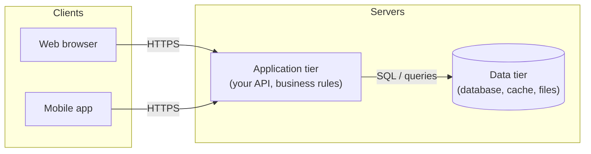
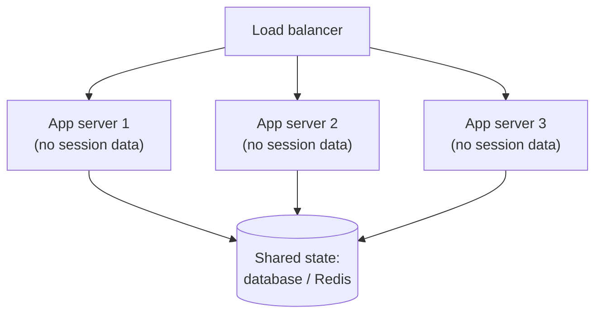

# Client-server architecture

After this you can sketch a web system as clients and tiers, say where its state lives, and explain why stateless servers are easy to scale.

Before this: [HTTP headers, cookies and caching](02-http-headers-cookies-and-caching.md).

## The idea

A to-do app has a screen, some logic ("a task needs a title") and stored data. In the **client-server** model these live in different places: the **client** starts conversations and shows things to a person; the **server** waits for requests, does the shared work and holds the shared data. Many clients talk to one service, which is why one server can keep everybody's tasks in sync.

Real systems split the server side further into **tiers**, each a separate program that can be moved or scaled on its own.



A common name for this is **three-tier architecture**: presentation (the client), application (logic) and data (storage). Some systems add a proxy or CDN in front, covered in the [next lesson](05-proxies-and-cdns.md).

## Key terms

A **thin client** does little work itself: it shows what the server sends, as with a server-rendered web page. A **thick client** (or rich client) runs significant logic locally, as with a single-page app, a mobile app or a desktop app that works offline.

A server is **stateless** if it keeps no information about earlier requests between requests: everything it needs arrives with the request or is read from a shared store. A server is **stateful** if it remembers things in its own memory.

**State** is data that changes over time and that the system must remember. It can live in the client (a token, local storage), in the application server's memory, or in a shared data tier.

**Polling** means the client asks repeatedly, "anything new?". **Push** means the server sends data when something happens, without being asked. The [WebSockets lesson](06-websockets-and-real-time.md) covers push.

## How it works

Where state lives decides what you can do with the servers.

| State lives in | Example | Effect |
|---|---|---|
| Client | A signed token, a draft in `localStorage` | The user can read and tamper with it, so the server must verify it |
| Application server memory | A login session in a Python dict | Fast, but lost on restart and invisible to other servers |
| Data tier | A row in Postgres, a key in Redis | Shared by every server, survives restarts, costs a network round trip |

If each application server held its own sessions, a second server would not recognise your login. Moving the state to the data tier (or into a signed token the client sends) makes the application servers interchangeable, so you can add or remove them freely. That is the point of "stateless servers": any server can handle any request.



The data tier is the hard part to scale, because it is the one place that must stay consistent. Scaling it is the topic of database scaling<!-- link: ../../14-software-and-system-design/02-system-design/04-database-scaling-replication-and-sharding.md -->.

## Worked examples

<div class="example" markdown>

### Example 1: state in server memory breaks when the server changes

We build a tiny server that counts visits per session in a dict. Then we clear the dict, which is what a restart or a second server looks like to the client.

```python
import json, threading, urllib.request
from http.server import BaseHTTPRequestHandler, HTTPServer

sessions = {}          # server-held state: lost if the process restarts

class H(BaseHTTPRequestHandler):
    def do_GET(self):
        sid = self.headers.get("X-Session", "")
        n = sessions.get(sid, 0) + 1
        sessions[sid] = n
        body = json.dumps({"visits_for_this_session": n}).encode()
        self.send_response(200)
        self.send_header("Content-Length", str(len(body)))
        self.end_headers()
        self.wfile.write(body)
    def log_message(self, *a):
        pass

server = HTTPServer(("127.0.0.1", 8086), H)
threading.Thread(target=server.serve_forever, daemon=True).start()

def get(sid):
    req = urllib.request.Request("http://127.0.0.1:8086/", headers={"X-Session": sid})
    return json.load(urllib.request.urlopen(req))

print(get("alice"), get("alice"), get("bob"))
sessions.clear()       # simulates a restart, or landing on a second server
print(get("alice"))
```

```text
{'visits_for_this_session': 1} {'visits_for_this_session': 2} {'visits_for_this_session': 1}
{'visits_for_this_session': 1}
```

1. The first three calls behave: Alice reaches 2, Bob has his own count.
2. After `sessions.clear()`, Alice's count is back to 1. The server forgot her.
3. The fix is to store the counter in a database or Redis that every server and every restart sees.

Check: this is a stateful server. Replace `sessions` with a shared store and the same client calls would keep counting.

</div>

<div class="example" markdown>

### Example 2: choosing a client type

A note-taking app must work on a plane. A thin client fails there, because every page needs the server. A thick client (a PWA or mobile app) keeps notes locally and syncs later. The cost is more logic in the client, and a sync step to resolve edits made on two devices.

</div>

## Common mistakes

<div class="warning" markdown>

Watch out: trusting the client. Anything in the browser, including hidden form fields, prices in JavaScript and a role stored in a cookie, can be changed by the user. Validate and authorize on the server.

Watch out: storing sessions or uploaded files on one app server's disk or memory, then scaling to two servers. Users get logged out at random. Use a shared store.

Watch out: polling too fast. A client polling every second with 10,000 users is 10,000 requests per second for mostly empty answers.

</div>

## Working with AI

<div class="ai" markdown>

Words to use: stateless, session store, three-tier, thin client, thick client, shared state, horizontal scaling.

Prompts to try:

- "My Flask app keeps login sessions in a Python dict. I want to run 3 instances behind a load balancer. List what breaks and give me two ways to fix it, with the tradeoffs."
- "Draw a three-tier diagram in Mermaid for a React front end, an Express API and Postgres, and mark where authorization is checked."

What to check:

- Designs that put an authorization check only in the client. Find where the server enforces it.
- "Stateless" servers that still write to local disk or keep module-level caches. Search the code for global dicts, local files and in-memory sessions.
- Diagrams with a single database arrow and no mention of failure. Ask what happens when it is down.

</div>

## Quiz

1\. What makes a server stateless?

<details class="solution" markdown>
<summary>Answer</summary>

It keeps nothing about earlier requests in its own memory; whatever it needs arrives with the request or comes from a shared store.

</details>

2\. In Example 1, why did Alice's count reset?

<details class="solution" markdown>
<summary>Answer</summary>

The count lived in the server process's memory (`sessions`), and clearing it models a restart or a different server.

</details>

3\. A shopping site stores the cart total in a cookie and trusts it at checkout. What is wrong?

<details class="solution" markdown>
<summary>Answer</summary>

The client controls the cookie, so a user can lower the total. The server must recompute the total from prices it holds.

</details>

4\. Which client type fits an app that must work offline: thin or thick?

<details class="solution" markdown>
<summary>Answer</summary>

Thick, because it needs local logic and data. It then needs a sync step.

</details>

## Lab

<div class="lab" markdown>

### Lab: make the counter survive a restart

Goal: move server state out of memory. Time: about 15 minutes. Runs in: any shell with Python.

1. Run the Example 1 script and confirm the output.
2. Replace the `sessions` dict with functions `load()` and `save()` that read and write a JSON file `sessions.json`.
3. Remove the `sessions.clear()` line and call `sessions = load()` there instead, to model a restart.
4. Check that Alice's count continues from 2.
5. Cleanup: delete `sessions.json`.

Expected result: Alice's count is 3 after the restart.

<details class="solution" markdown>
<summary>Solution</summary>

`load()` returns `json.load(open("sessions.json"))` or `{}` if the file is missing; `save()` writes the dict after each request. The state is now in a shared store (a file), so a second process pointed at the same file would agree. A real system uses a database or Redis, which handle concurrent writes safely; a plain file does not.

</details>

</div>

## Where this shows up

- What a back end does<!-- link: ../../09-back-end/01-servers-and-apis/01-what-a-back-end-does.md --> builds the application tier.
- Scalability basics<!-- link: ../../14-software-and-system-design/02-system-design/01-scalability-basics.md --> uses stateless servers as its first step.
