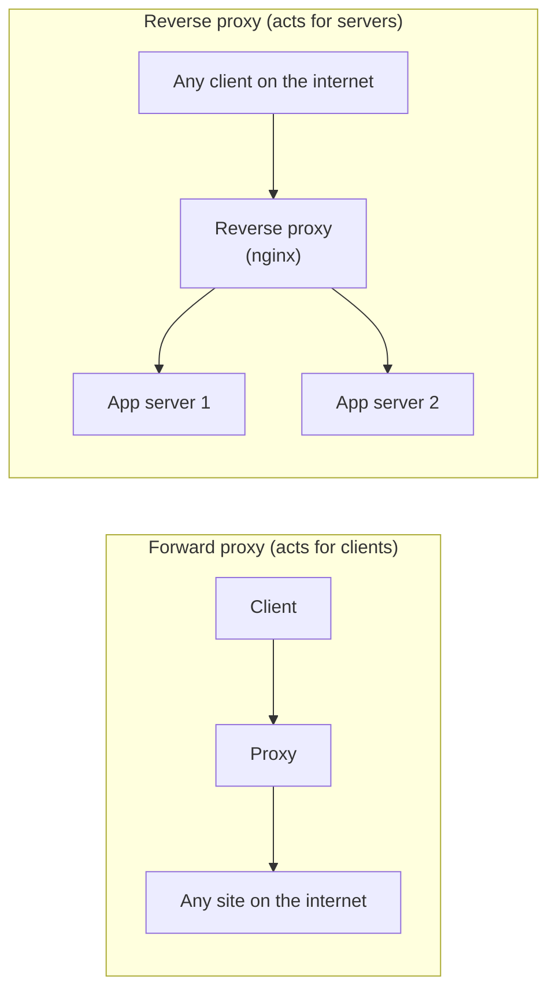
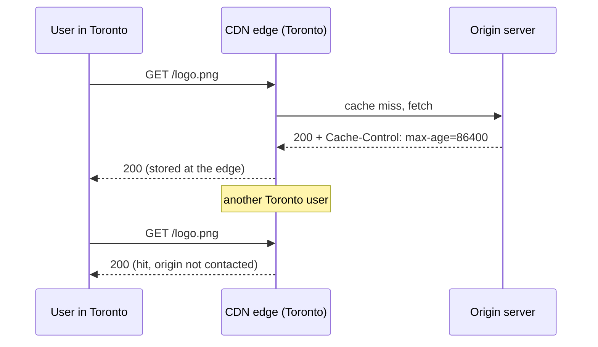

# Proxies and CDNs

After this you can tell a forward proxy from a reverse proxy, explain what nginx and a CDN do in front of an app, and read the headers that show a proxy was involved.

Before this: [Client-server architecture](04-client-server-architecture.md).

## The idea

A **proxy** is a server that sits between a client and another server and passes requests along. The client talks to the proxy; the proxy talks to the real server. The question is who set the proxy up, and for whom.

A **forward proxy** acts for clients: a company routes all employee traffic through it to filter sites or hide internal addresses. A **reverse proxy** acts for servers: it receives requests from the internet and forwards them to the right back-end server. Almost every production web app has a reverse proxy in front of it.



## Key terms

A **reverse proxy** receives requests on behalf of one or more back-end servers and forwards them. **nginx** is a widely used web server that is often configured as one.

A **CDN** (content delivery network) is a worldwide set of reverse-proxy servers, called **edge** servers or points of presence, that cache your content near users. Examples are Cloudflare, Fastly and Amazon CloudFront.

The **origin** is your real server, the one behind the CDN or proxy.

A **load balancer** spreads requests across several identical servers and stops sending to the ones that are down. It is a reverse proxy with that job. Details are in [load balancing](../../14-software-and-system-design/02-system-design/02-load-balancing.md).

**TLS termination** means the proxy handles HTTPS and talks plain HTTP to the servers behind it, inside a private network.

## How it works

A reverse proxy does several jobs in one place, so the app servers don't have to:

- Terminates TLS, so certificates live in one place.
- Sends `/api/*` to the app server and `/static/*` to files.
- Distributes requests across servers (load balancing).
- Compresses responses, limits request rates and hides the app servers' addresses.
- Caches responses.

Because the app server now sees the proxy's address as the client, the proxy adds headers with the original facts: `X-Forwarded-For` (the client IP), `X-Forwarded-Proto` (`http` or `https`) and the standard `Forwarded` header ([RFC 7239](https://www.rfc-editor.org/rfc/rfc7239)). An app that logs or rate-limits by IP must read these, and must trust them only from its own proxy, since a client can send a fake one.

A minimal nginx reverse proxy configuration looks like this ([nginx docs](https://nginx.org/en/docs/http/ngx_http_proxy_module.html)):

```text
server {
    listen 80;
    location / {
        proxy_pass http://127.0.0.1:3000;
        proxy_set_header X-Forwarded-For $remote_addr;
    }
}
```

A CDN adds caching at the edge. The first user in a region gets a miss and the edge fetches from the origin; later users get a hit from a nearby server.



What the edge may cache is decided by the `Cache-Control` headers from the previous lessons ([HTTP headers, cookies and caching](02-http-headers-cookies-and-caching.md)). `private` or `no-store` responses must not be stored in a shared cache.

## Worked examples

<div class="example" markdown>

### Example 1: a reverse proxy in 30 lines

We start a back end that reports the `X-Forwarded-For` header it receives, and a proxy that forwards to it.

```python
import threading, urllib.request
from http.server import BaseHTTPRequestHandler, HTTPServer

class Backend(BaseHTTPRequestHandler):
    def do_GET(self):
        body = f"backend saw X-Forwarded-For={self.headers.get('X-Forwarded-For')}\n".encode()
        self.send_response(200)
        self.send_header("Content-Length", str(len(body)))
        self.end_headers()
        self.wfile.write(body)
    def log_message(self, *a): pass

class Proxy(BaseHTTPRequestHandler):
    def do_GET(self):
        req = urllib.request.Request("http://127.0.0.1:8085" + self.path,
            headers={"X-Forwarded-For": self.client_address[0]})
        with urllib.request.urlopen(req) as r:
            body = r.read()
        self.send_response(200)
        self.send_header("Content-Length", str(len(body)))
        self.end_headers()
        self.wfile.write(body)
    def log_message(self, *a): pass

for port, h in ((8085, Backend), (8084, Proxy)):
    threading.Thread(target=HTTPServer(("127.0.0.1", port), h).serve_forever, daemon=True).start()
print(urllib.request.urlopen("http://127.0.0.1:8084/").read().decode())
```

```text
backend saw X-Forwarded-For=127.0.0.1
```

1. The client talks only to port 8084, the proxy.
2. The proxy opens its own request to port 8085 and adds the client's address.
3. The back end never sees the client directly. Without the header it would see only the proxy.

Check: remove the `headers=` argument and rerun; the back end prints `None`.

</div>

<div class="example" markdown>

### Example 2: seeing a CDN in curl

```bash
curl -sI https://example.com | grep -iE "^(server|age|cf-cache-status)"
```

```text
Server: cloudflare
Age: 13981
cf-cache-status: HIT
```

`Server: cloudflare` shows the reply came through Cloudflare's edge. `cf-cache-status: HIT` says the edge served a stored copy, and `Age` is how many seconds it has been stored (about 3.9 hours here). Other CDNs use other header names, such as `X-Cache`.

</div>

## Common mistakes

<div class="warning" markdown>

Watch out: trusting `X-Forwarded-For` from anyone. A client can send its own value. Accept it only from your proxy's address, and take the right-most entry your proxy added.

Watch out: caching personalized pages at the CDN. If `/account` has no `Cache-Control: private`, one user's page can be served to another. Set it explicitly and test while logged out.

Watch out: forgetting that a proxy can return stale content after you deploy. Purge the CDN cache or use hashed file names.

</div>

## Working with AI

<div class="ai" markdown>

Words to use: reverse proxy, forward proxy, edge, origin, cache hit, `X-Forwarded-For`, TLS termination.

Prompts to try:

- "Write an nginx server block that proxies `/api/` to `localhost:8000`, serves `/static/` from `/var/www/static`, and passes the original client IP and protocol to the app."
- "My app behind Cloudflare shows every visitor's IP as a Cloudflare address. Which header has the real IP, and how do I trust it only from Cloudflare?"

What to check:

- nginx directives that don't exist or sit in the wrong block. Run `nginx -t` and check [the nginx docs](https://nginx.org/en/docs/).
- Config that trusts forwarded headers from the public internet.
- Cache rules that would store logged-in responses. Request the URL with a cookie and look at `Cache-Control` and the CDN's status header.

</div>

## Quiz

1\. Which kind of proxy hides your back-end servers from the internet?

<details class="solution" markdown>
<summary>Answer</summary>

A reverse proxy. The internet sees the proxy only.

</details>

2\. A response has `cf-cache-status: HIT` and `Age: 3600`. What does that say?

<details class="solution" markdown>
<summary>Answer</summary>

The CDN edge served a stored copy that is an hour old, without asking the origin.

</details>

3\. Your app behind nginx logs `127.0.0.1` for every request. Why, and what is the fix?

<details class="solution" markdown>
<summary>Answer</summary>

The connection comes from nginx. Have nginx set `X-Forwarded-For` and make the app read it, trusting only the proxy.

</details>

4\. You deploy a new `app.js` and users still see the old one. Name two fixes.

<details class="solution" markdown>
<summary>Answer</summary>

Purge the CDN cache for that file, or name files by content hash so each version is a new URL.

</details>

## Lab

<div class="lab" markdown>

### Lab: build and break a proxy

Goal: run the proxy example and observe forwarded headers. Time: about 15 minutes. Runs in: any shell with Python.

1. Save Example 1 as `proxy.py` and run it with `python proxy.py`.
2. Confirm the output shows `127.0.0.1`.
3. Remove the `headers=` argument and run again. Note the output.
4. In the `Backend` class, also print `self.client_address[0]` in the body.
5. Explain in one sentence why the two values differ in a deployed system.

Expected result: with the header the back end sees the real client address; without it, only the proxy's.

<details class="solution" markdown>
<summary>Solution</summary>

In this local run both addresses are `127.0.0.1` because the client and the proxy are on one machine. In a deployment `client_address` is the proxy's private address and `X-Forwarded-For` is the visitor's public address.

</details>

</div>

## Where this shows up

- [Load balancing](../../14-software-and-system-design/02-system-design/02-load-balancing.md) and [caching strategies](../../14-software-and-system-design/02-system-design/03-caching-strategies.md) extend this lesson.
- [Network debugging tools](07-network-debugging-tools.md) shows how to tell whether a proxy or the origin produced a response.
