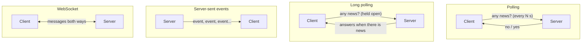
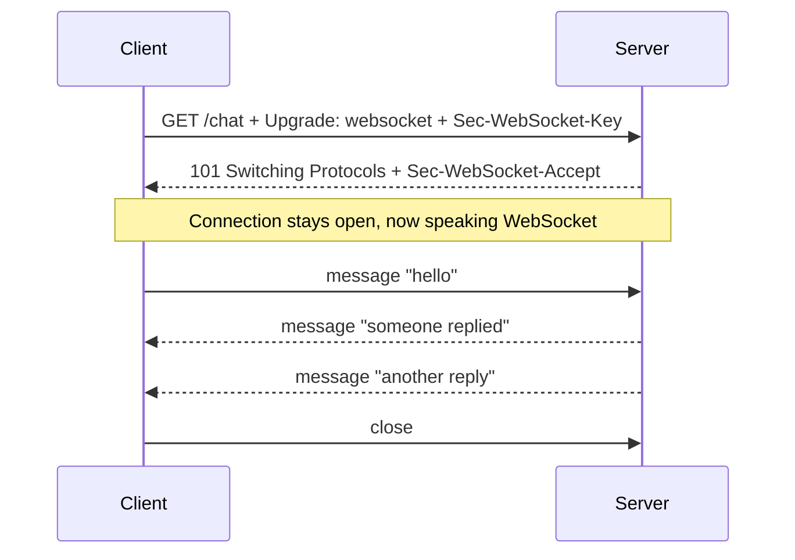

# WebSockets and real-time communication

After this you can choose between polling, long polling, server-sent events and WebSockets for a feature that needs live updates, and describe how each works.

Before this: [Client-server architecture](04-client-server-architecture.md).

## The idea

A chat message arrives, a delivery driver's dot moves on a map, a build finishes. In plain HTTP the client asks and the server answers, so the server cannot speak first. Real-time features work around that in four ways, from simplest to most flexible. The question each answers is: how does the client learn that something changed?



## Key terms

**Polling** means the client sends a normal request on a timer. **Long polling** means the server holds the request open until it has something to send (or a timeout), then the client immediately asks again.

**Server-sent events (SSE)** is a one-way stream from server to browser over a single long HTTP response with `Content-Type: text/event-stream`. The browser API is `EventSource` ([MDN](https://developer.mozilla.org/en-US/docs/Web/API/Server-sent_events)).

A **WebSocket** is a persistent, two-way connection between client and server that starts as an HTTP request and then switches protocol ([RFC 6455](https://www.rfc-editor.org/rfc/rfc6455), [MDN](https://developer.mozilla.org/en-US/docs/Web/API/WebSockets_API)). Either side can send a message at any time.

## How it works

SSE is HTTP: the server answers once and never finishes. Each event is a few `field: value` lines followed by a blank line.

A WebSocket begins with an ordinary HTTP request that asks to upgrade. If the server agrees, it replies `101 Switching Protocols`, and the same TCP connection then carries WebSocket messages, not HTTP.



The `Sec-WebSocket-Accept` value is the base64 of the SHA-1 hash of the client's key plus a fixed GUID from the RFC. It proves the server understood the upgrade, not that the server is trustworthy; authentication is separate.

Which one fits:

| Option | Direction | Cost and caveats | Fits |
|---|---|---|---|
| Polling | Client asks | Simple, works everywhere; wasteful, delay up to the interval | Dashboards refreshed every 30 s |
| Long polling | Client asks, server holds | Fewer empty replies; many held connections | Fallback when nothing else works |
| SSE | Server to client | Plain HTTP, auto-reconnect; one direction only | Notifications, live scores, progress bars, AI token streaming |
| WebSocket | Both ways | Needs a stateful connection per user; harder to scale and to put behind proxies | Chat, multiplayer games, collaborative editing |

Start with the simplest option that meets the delay requirement. Persistent connections mean each server holds a connection per user, which interacts with load balancers (they must allow upgrades and long timeouts) and with the stateless design from the [previous lesson](04-client-server-architecture.md).

## Worked examples

<div class="example" markdown>

### Example 1: an SSE stream with a raw socket

We write a server that sends three events half a second apart, and a client that reads from the socket and prints each chunk when it arrives.

```python
import socket, threading, time
from http.server import BaseHTTPRequestHandler, ThreadingHTTPServer

class Events(BaseHTTPRequestHandler):
    def do_GET(self):
        self.send_response(200)
        self.send_header("Content-Type", "text/event-stream")
        self.send_header("Cache-Control", "no-cache")
        self.end_headers()
        for i in range(1, 4):
            self.wfile.write(f"data: tick {i}\n\n".encode())
            self.wfile.flush()
            time.sleep(0.5)
    def log_message(self, *a):
        pass

server = ThreadingHTTPServer(("127.0.0.1", 8083), Events)
threading.Thread(target=server.serve_forever, daemon=True).start()

start = time.time()
with socket.create_connection(("127.0.0.1", 8083)) as s:
    s.sendall(b"GET /events HTTP/1.1\r\nHost: x\r\nAccept: text/event-stream\r\n\r\n")
    while chunk := s.recv(1024):
        if b"tick" in chunk:
            print(f"{time.time() - start:.1f}s", chunk.decode().strip())
```

```text
0.0s data: tick 1
0.5s data: tick 2
1.0s data: tick 3
```

1. The response has no `Content-Length`; the connection stays open and the server writes events as they happen.
2. `flush()` pushes each event out right away. Without it, the data waits in a buffer.
3. The timestamps show the client receiving events as the server produces them, with one request.

Check: change `range(1, 4)` to `range(1, 6)` and confirm two more lines.

</div>

<div class="example" markdown>

### Example 2: the WebSocket handshake key

The RFC gives an example key. We compute the matching accept value.

```python
import base64, hashlib
key = "dGhlIHNhbXBsZSBub25jZQ=="
guid = "258EAFA5-E914-47DA-95CA-C5AB0DC85B11"
print(base64.b64encode(hashlib.sha1((key + guid).encode()).digest()).decode())
```

```text
s3pPLMBiTxaQ9kYGzzhZRbK+xOo=
```

This matches the value in [RFC 6455, section 1.3](https://www.rfc-editor.org/rfc/rfc6455#section-1.3).

</div>

## Common mistakes

<div class="warning" markdown>

Watch out: reaching for WebSockets when SSE or polling would do. A WebSocket server must track every open connection, and a rolling deploy drops them all.

Watch out: no reconnect logic. Connections break on mobile networks and sleep. The client must reconnect and ask for what it missed (SSE does reconnect, with a `Last-Event-ID` header you can use).

Watch out: skipping authentication on the upgrade request. Check the user before accepting the upgrade, and check the `Origin` header.

</div>

## Working with AI

<div class="ai" markdown>

Words to use: polling interval, long polling, server-sent events, `EventSource`, WebSocket upgrade, reconnect, backpressure.

Prompts to try:

- "I need live order status on a web page. Updates flow only from server to browser, about one per minute per user, up to 5,000 users. Compare polling, SSE and WebSockets for this, and pick one."
- "Write a minimal Node.js endpoint that streams server-sent events with Express, including the headers and a heartbeat comment line every 15 seconds."

What to check:

- A WebSocket recommended for one-way data. Ask what two-way messages the client actually sends.
- Missing proxy settings. nginx needs the `Upgrade` and `Connection` headers forwarded and a longer read timeout, or connections drop after a minute.
- No plan for many servers: a message to one server must reach users connected to another (usually through a message broker like Redis).

</div>

## Quiz

1\. A page shows a progress bar for a long export. The browser never sends anything back during the export. Which option fits best?

<details class="solution" markdown>
<summary>Answer</summary>

SSE: one-way, plain HTTP, reconnects automatically. Polling every few seconds also works.

</details>

2\. What HTTP status code does the server send to accept a WebSocket upgrade?

<details class="solution" markdown>
<summary>Answer</summary>

`101 Switching Protocols`.

</details>

3\. Users of a WebSocket chat are dropped at exactly 60 seconds behind nginx. What is the likely cause?

<details class="solution" markdown>
<summary>Answer</summary>

nginx's default proxy read timeout is 60 seconds, which closes an idle connection. Raise the timeout or send periodic ping messages.

</details>

4\. Name one cost of a WebSocket that polling doesn't have.

<details class="solution" markdown>
<summary>Answer</summary>

The server holds an open connection for every user, so it is stateful and harder to scale and to deploy without disconnecting people.

</details>

## Lab

<div class="lab" markdown>

### Lab: watch an event stream in curl

Goal: see SSE data arrive in time. Time: about 10 minutes. Runs in: any shell with Python and curl.

1. Save the server half of Example 1 as `sse.py`, ending with `server.serve_forever()` in place of the thread and client code.
2. Run `python sse.py` in one terminal.
3. In another, run `curl -N http://127.0.0.1:8083/events`. The `-N` flag turns off output buffering.
4. Watch the lines appear one at a time.
5. Run it again without `-N` and note whether anything changes. Stop the server with Ctrl+C.

Expected result: three `data:` lines, half a second apart.

<details class="solution" markdown>
<summary>Solution</summary>

```python
# the server from Example 1 up to ThreadingHTTPServer(...), then:
server.serve_forever()
```

For this small stream, curl's output may look the same with and without `-N`, because curl writes out received data as it arrives when writing to a terminal. Piping it to a file or another command is where buffering shows.

</details>

</div>

## Where this shows up

- Async JavaScript and the event loop<!-- link: ../../08-front-end/02-javascript-and-typescript/03-async-javascript-and-the-event-loop.md --> shows the `EventSource` and `WebSocket` browser APIs in use.
- Queues and event-driven design<!-- link: ../../14-software-and-system-design/02-system-design/06-queues-and-event-driven-design.md --> covers how messages reach every server.
