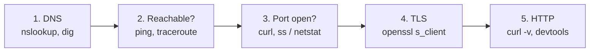

# Network debugging tools

After this you can pick the right tool for a network symptom ("it times out", "wrong certificate", "works on my machine") and read what it tells you.

Before this: [TLS, HTTPS and certificates](03-tls-https-and-certificates.md) and [HTTP requests and responses](01-http-requests-and-responses.md).

## The idea

A request crosses many steps: resolve the name, open a TCP connection, negotiate TLS, send HTTP, wait for the app. A failure at any step looks like "the site is down". Each tool tests one step, so debugging means working down the list and finding the first step that fails.



## Key terms

**Latency** is how long a request takes to start getting an answer; a **timeout** is the client giving up after a set time. **Connection refused** means the machine answered but nothing listens on that port; a timeout means nobody answered at all. A **hop** is one router on a path.

## How it works

The tools, grouped by the step they test. Commands for Windows are noted where they differ; the Linux ones were checked against their man pages, not run here (see the report note).

| Tool | Tests | Example |
|---|---|---|
| `nslookup`, `dig` | DNS: what addresses does this name give? | `nslookup example.com` |
| `ping` | Is the host reachable, and how long is the round trip? | `ping -c 4 example.com` (Windows: `-n 4`) |
| `traceroute` | Which routers lie on the path? | `traceroute example.com` (Windows: `tracert`) |
| `ss`, `netstat` | Which ports is this machine listening on, and who is connected? | `ss -tlnp` (Windows: `netstat -an`) |
| `curl -v` | A whole HTTP exchange, step by step | `curl -v https://example.com` |
| `openssl s_client` | The TLS handshake and certificate chain | `openssl s_client -connect example.com:443 -servername example.com` |
| Browser devtools, Network tab | What the browser sent, got, and how long each phase took | F12 |

The Network tab shows each request, its status, headers, body and a timing breakdown (waiting, download). Right-click a request and choose "Copy as cURL" to repeat it in a terminal, which separates "the server is wrong" from "my front end code is wrong".

Which tool for which symptom:

| Symptom | First tool | What you learn |
|---|---|---|
| `Could not resolve host` | `nslookup name` | DNS has no record, or your resolver is down |
| Hangs, then times out | `ping`, then `curl -v` | A firewall drops packets, or the host is down; the curl output shows whether connection or response is the slow step |
| `Connection refused` | `ss -tlnp` on the server | Nothing listens on that port, or it listens only on `127.0.0.1` |
| Certificate error | `openssl s_client` | Which certificate is served, its names and dates, and a missing intermediate |
| `502`/`504` from a proxy | `curl -v` against the origin directly | The proxy works but the app behind it fails or is slow |
| Works in curl, fails in the browser | devtools Network tab, console | CORS, cookies or mixed content |
| Slow page | `curl -w` timings, devtools timing | DNS, connect, TLS or server time is the slow part |

## Worked examples

<div class="example" markdown>

### Example 1: where does the time go?

`curl -w` prints timings after the request. Each value is seconds since the start.

```bash
curl -s -o /dev/null -w "dns %{time_namelookup} connect %{time_connect} tls %{time_appconnect} ttfb %{time_starttransfer} total %{time_total}\n" https://example.com
```

```text
dns 0.005141 connect 0.011858 tls 0.035359 ttfb 0.050639 total 0.050705
```

1. DNS finished at 5 ms.
2. The TCP connection was open at 12 ms, so the TCP handshake took about 7 ms (one round trip).
3. TLS was ready at 35 ms: about 24 ms for the handshake.
4. The first byte of the reply arrived at 51 ms, so the server took about 15 ms to respond.

Check: the numbers must be non-decreasing from left to right. If `ttfb` minus `tls` is large, the server (or its database) is slow; if `dns` is large, look at the resolver.

</div>

<div class="example" markdown>

### Example 2: three failures, three messages

Resolution failure:

```bash
curl -sS https://nonexistent.invalid
```

```text
curl: (6) Could not resolve host: nonexistent.invalid
```

Nothing listening (port 9 on this machine):

```bash
curl -sS --max-time 3 http://localhost:9
```

```text
curl: (7) Failed to connect to localhost port 9 ...
```

Bad certificate (from the previous lesson):

```bash
curl -sS https://self-signed.badssl.com
```

The curl exit code tells the failing step: 6 for DNS, 7 for connect, 60 for certificate verification on builds using OpenSSL (the Windows build used here exits with another code). The exit codes are listed in `man curl`.

Reachability and path, on Windows, trimmed:

```text
ping -n 2 example.com
Reply from 172.66.147.243: bytes=32 time=5ms TTL=55
Reply from 172.66.147.243: bytes=32 time=6ms TTL=55

tracert -d -h 6 example.com
  1     1 ms     1 ms     1 ms  192.168.2.1
  3     *        *        *     Request timed out.
  6     8 ms     5 ms     5 ms  142.124.125.12
```

A row of `*` is a router that doesn't answer probes. It is not necessarily a fault, since many routers drop them while still forwarding traffic. Look at whether later hops answer.

</div>

## Common mistakes

<div class="warning" markdown>

Watch out: treating a failed `ping` as proof a server is down. Many hosts block ICMP. If `curl -v` connects, the server is up.

Watch out: reading `traceroute` stars as the break. Only a path that stops answering all the way to the end points to a fault.

Watch out: debugging in the browser only. Caches, extensions and cookies change what you see. Reproduce with `curl` to remove them.

</div>

## Working with AI

<div class="ai" markdown>

Words to use: timeout vs connection refused, DNS resolution, handshake, time to first byte, listening port, exit code.

Prompts to try:

- "Here is the output of `curl -v https://api.example.com/health` and `nslookup api.example.com` (both pasted). In which step does it fail, and what is the next command to run?"
- "Explain this `ss -tlnp` output line by line. Is my service reachable from other machines or only from localhost?"

What to check:

- Flags that exist on Linux but not on macOS or Windows (`ping -c` against `ping -n`, `ss` against `netstat`). Run the command's `--help`.
- Pasted output containing tokens or cookies. Strip `Authorization` and `Cookie` values before sharing logs.
- A diagnosis from one data point. Ask for a second command that would prove or rule it out.

</div>

## Quiz

1\. `curl` says `Connection refused`. Is the machine down?

<details class="solution" markdown>
<summary>Answer</summary>

No. A machine answered and refused: nothing is listening on that port (or a firewall rejects it). A down machine gives a timeout.

</details>

2\. In Example 1, how long did the server take to produce the first byte after TLS finished?

<details class="solution" markdown>
<summary>Answer</summary>

$0.050639 - 0.035359 = 0.01528$ seconds, about 15 ms.

</details>

3\. A page works in `curl` but the browser shows a blank result and a red request in the Network tab. What do you check next?

<details class="solution" markdown>
<summary>Answer</summary>

The browser console and that request's headers: CORS errors, blocked mixed content, or a cookie that curl never sent.

</details>

4\. Which tool shows which certificate a server is sending?

<details class="solution" markdown>
<summary>Answer</summary>

`openssl s_client -connect host:443 -servername host`.

</details>

## Lab

<div class="lab" markdown>

### Lab: diagnose three broken URLs

Goal: use the symptom table to name the failing step. Time: about 15 minutes. Runs in: Git Bash or WSL.

1. Run `curl -sS https://nonexistent.invalid` and say which step failed.
2. Run `curl -sS --max-time 3 http://localhost:9` and say which step failed.
3. Run `curl -sS https://self-signed.badssl.com` and say which step failed.
4. For `https://example.com`, run the `curl -w` command from Example 1 three times and compare the `dns` and `ttfb` values.
5. In your browser, open the Network tab on any site, find the slowest request, and read its timing breakdown.

Expected result: failures at DNS, connect and TLS verification; the repeated timings differ by a few milliseconds, with `dns` often near zero on later runs because the answer is cached.

<details class="solution" markdown>
<summary>Solution</summary>

Step 1: DNS (exit 6). Step 2: TCP connect (exit 7). Step 3: certificate verification (exit 60 on OpenSSL builds). Step 4: `dns` and `connect` shrink on repeat runs; `ttfb` depends on the server.

</details>

</div>

## Where this shows up

- [DNS and domains](../01-how-the-internet-works/05-dns-and-domains.md) and [ports and sockets](../01-how-the-internet-works/04-ports-and-sockets.md) explain the first two steps in depth.
- [The chapter cheat sheet](index.md) lists the commands in one place.
