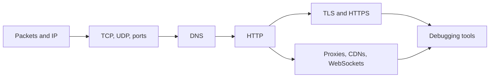

# Networking

How data crosses the internet, from IP addresses and DNS to HTTP and HTTPS, and the tools for debugging a connection.

Before this folder: Operating systems and Linux.

This folder follows a request across the internet. The first chapter covers packets and routers, IP addresses and subnets, the network layers, TCP and UDP, ports and sockets, and DNS. The second covers what runs on top: HTTP requests, headers and cookies, TLS and HTTPS, client-server architecture, proxies and CDNs, WebSockets, and the tools for debugging a connection.

When an AI-written service fails to connect, the cause is often here: the wrong port, a DNS record that has not changed yet, a missing header, a certificate problem. With this vocabulary you can ask a precise question and read the output of tools like `curl` and `dig`.

It builds on [Operating systems and Linux](../02-operating-systems-and-linux/index.md), because the labs use the Linux terminal. It feeds [Front end](../08-front-end/index.md), [Back end](../09-back-end/index.md), [Security](../12-security/index.md) (TLS) and [DevOps and cloud](../13-devops-and-cloud/index.md) (subnets, security groups).

### How to use this folder

- The labs use WSL2 Ubuntu, so set that up first.
- Keep the Web protocols cheat sheet (status codes, headers) open while you work on back end code.
- Run the debugging tools lesson's commands against a site you own or a public test site.

<!-- lessons:start -->
## Lessons

### 1. [How the internet works](01-how-the-internet-works/index.md)

1. [Packets, routers and the internet](01-how-the-internet-works/01-packets-routers-and-the-internet.md)
2. [IP addresses, subnets and NAT](01-how-the-internet-works/02-ip-addresses-subnets-and-nat.md)
3. [Network layers, TCP and UDP](01-how-the-internet-works/03-network-layers-tcp-and-udp.md)
4. [Ports and sockets](01-how-the-internet-works/04-ports-and-sockets.md)
5. [DNS and domains](01-how-the-internet-works/05-dns-and-domains.md)

### 2. [Web protocols](02-web-protocols/index.md)

1. [HTTP requests and responses](02-web-protocols/01-http-requests-and-responses.md)
2. [HTTP headers, cookies and caching](02-web-protocols/02-http-headers-cookies-and-caching.md)
3. [TLS, HTTPS and certificates](02-web-protocols/03-tls-https-and-certificates.md)
4. [Client-server architecture](02-web-protocols/04-client-server-architecture.md)
5. [Proxies and CDNs](02-web-protocols/05-proxies-and-cdns.md)
6. [WebSockets and real-time communication](02-web-protocols/06-websockets-and-real-time.md)
7. [Network debugging tools](02-web-protocols/07-network-debugging-tools.md)

<!-- lessons:end -->
