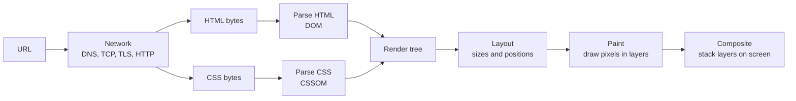
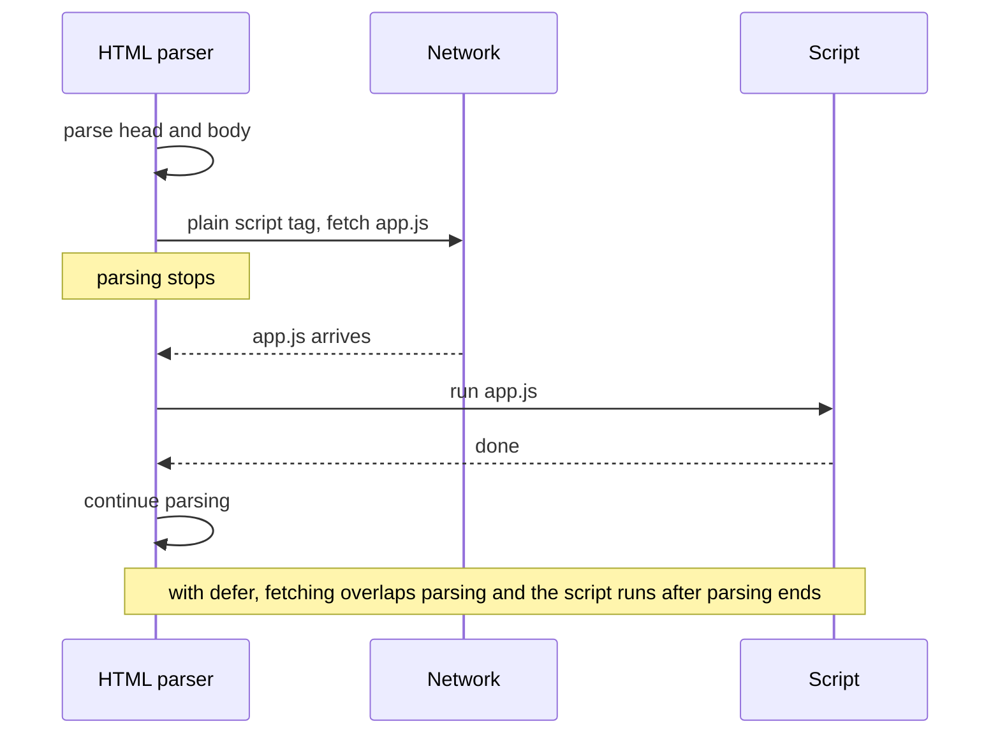

# How browsers render pages

After this you can describe the steps a browser takes from a URL to pixels, say why a script can freeze a page, and tell which CSS changes are cheap and which are expensive.

Before this: [HTTP requests and responses](../../07-networking/02-web-protocols/01-http-requests-and-responses.md) and [DNS and domains](../../07-networking/01-how-the-internet-works/05-dns-and-domains.md).

## The idea

You type a URL and press Enter. A moment later there is a page. In between, the browser turns text into a picture, and it does this in a fixed sequence of stages. If a page is blank for two seconds, or jumps around while it loads, one of the stages is waiting on something. Knowing the stages tells you which one.



## Key terms

The **DOM** (Document Object Model) is the browser's in-memory tree of the page, with one node for each element and each piece of text. HTML is the text file; the DOM is the live structure built from it.

The **CSSOM** (CSS Object Model) is the matching tree of style rules built from the CSS.

The **render tree** combines the two: only the nodes that will be drawn, each with its final computed styles. An element with `display: none` is in the DOM but not in the render tree.

**Layout** (also called **reflow**) works out the size and position of every box. **Paint** fills in pixels: text, colours, borders, images. **Compositing** stacks painted layers in the right order on screen, and the GPU can move a layer without repainting it.

A **render-blocking** resource is one the browser must finish before it can show anything. CSS is render-blocking by default. A script without `defer` or `async` is **parser-blocking**.

## How it works

1. The browser resolves the domain, opens a connection and sends an HTTP request. The response body is HTML bytes, decoded to text.
2. The HTML parser reads the text from top to bottom and builds the DOM. When it meets a `<link rel="stylesheet">`, it starts fetching the CSS and keeps parsing. When it meets a `<script src>`, it stops, because the script might change the page, and it fetches and runs the script first.
3. The CSS is parsed into the CSSOM. The browser will not paint until it has it, since drawing unstyled content and then restyling it would flash.
4. DOM plus CSSOM give the render tree. Layout computes each box. Paint and composite put the result on screen.

The parser stops at a plain script, so the position and attributes of a script tag matter.



A `defer` script downloads in parallel and runs after the document is parsed, in order. An `async` script downloads in parallel and runs as soon as it arrives, in any order, so it suits independent scripts such as analytics. See [`<script>` on MDN](https://developer.mozilla.org/en-US/docs/Web/HTML/Reference/Elements/script).

JavaScript can change the DOM or the styles after the first paint, and then part of the pipeline runs again. The cost depends on how far back it has to go.

| Change | Stages that rerun | Cost |
|---|---|---|
| `width`, `margin`, `font-size`, adding an element | layout, paint, composite | highest |
| `color`, `background-color`, `box-shadow` | paint, composite | medium |
| `transform`, `opacity` | composite only | lowest |

A change that forces layout again is a **reflow**; one that forces only redrawing is a **repaint**. Animate with `transform` and `opacity` where you can (see the [rendering overview on MDN](https://developer.mozilla.org/en-US/docs/Web/Performance/Guides/How_browsers_work) and [web.dev on rendering performance](https://web.dev/articles/rendering-performance)).

You can inspect the result in the browser's DevTools (press F12). The Elements panel shows the live DOM and the styles applied to each node. The Performance panel records a timeline of parsing, scripting, layout and paint, with long tasks marked in red.

```python
from html.parser import HTMLParser

class Tree(HTMLParser):
    depth = 0
    def handle_starttag(self, tag, attrs):
        print("  " * self.depth + tag)
        self.depth += 1
    def handle_endtag(self, tag):
        self.depth -= 1

Tree().feed("<html><head><title>Hi</title></head><body><h1>Hi</h1><p>One <b>bold</b> word</p></body></html>")
```

```text
html
  head
    title
  body
    h1
    p
      b
```

## Worked examples

<div class="example" markdown>

### Example 1: why the page is blank

A page has `<script src="analytics.js"></script>` in `<head>`, the file takes 800 ms to download, and then runs for 200 ms.

1. The parser reaches the script tag in `<head>` and stops. Nothing below it is in the DOM yet.
2. The browser downloads (800 ms) and runs (200 ms) the script. That is 1,000 ms with no content.
3. Parsing resumes, the render tree is built, and the first paint happens at least a second late.
4. Add `defer`. The download overlaps parsing, the content paints as soon as the CSS is ready, and the script runs afterwards.

Check: in DevTools, open the Network panel, reload, and compare when the script finishes with the First Contentful Paint marker in the Performance panel. The lab below makes the gap easy to see.

</div>

## Common mistakes

<div class="warning" markdown>

Watch out: putting a large synchronous script in `<head>` "so it loads first". It loads first and holds up everything else. Use `defer`, or place the script at the end of `<body>`.

Watch out: reading `element.offsetHeight` right after changing styles in a loop. The read forces the browser to run layout immediately each time. Batch all the writes, then do the reads.

Watch out: judging speed by feel on a fast laptop. Use the Performance panel with network and CPU throttling turned on.

</div>

## Working with AI

<div class="ai" markdown>

Words to use: DOM, CSSOM, render tree, render-blocking, defer, async, reflow, repaint, composite.

Prompts to try:

- "This page shows a blank screen for about 1.5 s. Here is the `<head>` and the Performance panel summary: [paste]. Which resources are render-blocking and how do I make them non-blocking?"
- "This animation janks. Does it trigger layout or only composite? Rewrite it to use `transform` and `opacity`."

What to check:

- Advice to add `async` to a script that depends on another. `async` scripts run in arrival order, so use `defer` for dependencies.
- Claims about speed with no measurement. Record the Performance panel before and after the change.
- `will-change` sprinkled over many elements. Each one creates a layer that uses memory.

</div>

## Quiz

1\. What is the difference between the DOM and the HTML file?

<details class="solution" markdown>
<summary>Answer</summary>

The HTML file is text. The DOM is the tree of objects the browser builds from it, which scripts can change while the page is open. After a script edits the page, the DOM no longer matches the file.

</details>

2\. Which stages rerun when JavaScript changes an element's `transform`? When it changes its `width`?

<details class="solution" markdown>
<summary>Answer</summary>

`transform` reruns only compositing. `width` reruns layout, then paint and composite, because other boxes may move.

</details>

3\. A page has three plain `<script src>` tags at the top of `<head>`. The first paint is slow. Name two fixes.

<details class="solution" markdown>
<summary>Answer</summary>

Add `defer` to each (they keep their order), or move them to the end of `<body>`. A bundler can also merge them into one smaller file.

</details>

4\. An element has `display: none`. Is it in the DOM? In the render tree?

<details class="solution" markdown>
<summary>Answer</summary>

It is in the DOM and not in the render tree. It takes no space and is not painted. `visibility: hidden` is different: it stays in the render tree and keeps its space.

</details>

## Lab

<div class="lab" markdown>

### Lab: see a blocking script

Goal: watch a script hold up the page, then fix it with `defer`. Time: about 10 minutes. Runs in: any browser.

1. Make a folder with two files, `index.html` and `slow.js`, from the code below.
2. Open `index.html` in a browser (double-click it). Notice the blank page for about 3 seconds.
3. Add `defer` to the script tag, save and reload. The heading now appears at once and the tab title changes after about 3 seconds.
4. Open DevTools, Performance panel, record a reload, and find the long task for `slow.js`.
5. Cleanup: delete the folder.

```html
<!doctype html>
<html lang="en">
<head>
  <meta charset="utf-8">
  <title>Render test</title>
  <script src="slow.js"></script>
</head>
<body>
  <h1>Hello, browser</h1>
  <p>Can you read this while the script runs?</p>
</body>
</html>
```

```javascript
const start = Date.now();
while (Date.now() - start < 3000) {}
document.title = "Script finished";
```

Expected result: without `defer` the page is blank for about 3 seconds; with `defer` the text shows immediately.

<details class="solution" markdown>
<summary>Solution</summary>

Change the script line to `<script src="slow.js" defer></script>`. The loop still blocks the main thread for 3 seconds after parsing ends, so the page is visible but cannot respond to clicks during that time. `defer` fixes the blank page, not the slow script.

</details>

</div>

## Where this shows up

- Scripts that touch the page are the subject of the DOM and events<!-- link: ../02-javascript-and-typescript/02-the-dom-and-events.md -->.
- Load time and layout shift are covered in web performance<!-- link: ../03-react/05-web-performance.md -->.
