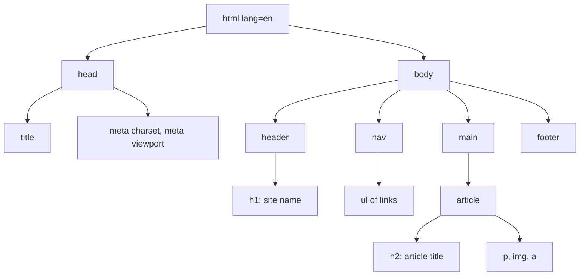

# HTML

After this you can write a well-structured HTML page with semantic elements, a working form, and images and links that make sense without sight.

Before this: [How browsers render pages](01-how-browsers-render-pages.md).

## The idea

HTML describes what each piece of a page is, not how it looks. A heading is a heading, a list is a list, and a button is a button. The browser, a search engine and a screen reader all read that meaning. Looks come later from CSS.

A page is a tree of nested elements. The tree below is a typical article page: the semantic elements say what each region is, where a `<div>` would say nothing.



## Key terms

An **element** is a start tag, content and an end tag, such as `<p>Hello</p>`. An **attribute** is a name and value inside the start tag, such as `href="/about"`. A **void element** such as `` or `<input>` has no content and no end tag.

**Semantic HTML** means choosing the element that matches the meaning of the content: `<nav>`, `<main>`, `<article>`, `<button>`.

A **landmark** is an element (`<header>`, `<nav>`, `<main>`, `<footer>`) that lets keyboard and screen reader users jump between page regions.

A **block** element starts on a new line and fills the width, like `<p>` and `<div>`. An **inline** element flows inside a line, like `<a>` and `<strong>`. CSS can change either.

## How it works

Every page needs this skeleton:

```html
<!doctype html>
<html lang="en">
<head>
  <meta charset="utf-8">
  <meta name="viewport" content="width=device-width, initial-scale=1">
  <title>Page title</title>
</head>
<body>
  <main>
    <h1>One main heading</h1>
  </main>
</body>
</html>
```

- `<!doctype html>` puts the browser in standards mode. Without it, old quirks apply.
- `lang` tells screen readers which pronunciation rules to use and helps translation tools.
- `meta charset` says the file is UTF-8 text. Save the file as UTF-8 too.
- `meta viewport` makes a phone lay the page out at the device width, not a 980 px desktop width scaled down. Without it, responsive CSS does nothing on phones ([MDN](https://developer.mozilla.org/en-US/docs/Web/HTML/Guides/Viewport_meta_element)).

Use headings `<h1>` to `<h6>` as an outline, one `<h1>`, with no skipped levels, and do not choose a level for its size. Use `<ul>`, `<ol>` and `<table>` for lists and tables, `<button>` for actions, and `<a href>` for navigation.

Links and images:

```html
<a href="/docs/start.html">Get started</a>

```

The `alt` text is what a screen reader reads and what shows if the image fails. Describe the purpose of the image. For a purely decorative image, use `alt=""` so it is skipped. Setting `width` and `height` lets the browser reserve space before the image loads, which stops the page jumping.

Forms collect input. Each control needs a label, linked either by `for` and `id` or by wrapping:

```html
<form action="/signup" method="post">
  <label for="email">Email</label>
  <input id="email" name="email" type="email" required>
  <label for="age">Age</label>
  <input id="age" name="age" type="number" min="16" max="120">
  <button type="submit">Sign up</button>
</form>
```

The `name` is the key sent to the server; the `id` connects the label. The `type` picks the keyboard on a phone and the built-in check. The browser validates `required`, `type`, `min`, `max`, `minlength` and `pattern` before it sends anything, and shows its own message ([MDN: form validation](https://developer.mozilla.org/en-US/docs/Learn_web_development/Extensions/Forms/Form_validation)). This is for convenience only: anyone can skip it with DevTools or `curl`, so the server must check again.

A quick audit of a page can be scripted. This finds images with no `alt` and inputs that cannot have a label:

```python
from html.parser import HTMLParser

class Audit(HTMLParser):
    def handle_starttag(self, tag, attrs):
        a = dict(attrs)
        if tag == "img" and "alt" not in a:
            print("img without alt:", a.get("src"))
        if tag == "input" and a.get("type") != "submit" and "id" not in a:
            print("input without id (no label can point to it):", a.get("name"))

Audit().feed('<input name="email"><label for="n">N</label><input id="n" name="n">')
```

```text
img without alt: a.png
input without id (no label can point to it): email
```

## Worked examples

<div class="example" markdown>

### Example 1: div soup to semantic HTML

A generated page has this header:

```html
<div class="header"><div class="logo">Shop</div><div class="menu"><div onclick="go('/cart')">Cart</div></div></div>
```

1. The outer `div` is the page header: use `<header>`.
2. The menu is navigation: use `<nav>`, containing a list.
3. "Cart" is a link, not a click handler on a `div`. A `div` cannot be reached with Tab and does not respond to Enter. Use `<a href="/cart">`.

```html
<header>
  <p class="logo">Shop</p>
  <nav><ul><li><a href="/cart">Cart</a></li></ul></nav>
</header>
```

Check: press Tab in the browser. The link gets a focus ring and Enter follows it. The `div` version did neither.

</div>

## Common mistakes

<div class="warning" markdown>

Watch out: using a placeholder as a label. It disappears when the user types and is not reliably read by assistive tools. Keep a visible `<label>`.

Watch out: `<div>` or `<span>` with a click handler instead of `<button>`. You lose keyboard support, focus and the role. Use the real element.

Watch out: trusting browser validation. It checks the form on the client only; the server must repeat every check.

</div>

## Working with AI

<div class="ai" markdown>

Words to use: semantic element, landmark, label, alt text, void element, viewport meta, constraint validation.

Prompts to try:

- "Convert this div-based markup to semantic HTML5 without changing how it looks: [paste]. List each change and the reason."
- "Write a signup form with name, email and age (16 to 120) using only built-in HTML validation, and tell me what the server still has to check."

What to check:

- Several `<h1>` elements or skipped heading levels. Look at the outline in DevTools.
- Missing or vague `alt` such as "image". Read it aloud and see whether it carries the meaning.
- ARIA attributes added to something that has a native element. Delete them and use the native element.
- Inputs with no `<label>`. Click the label text and see whether the field focuses.

</div>

## Quiz

1\. Why use `<button>` instead of a `<div>` with a click handler?

<details class="solution" markdown>
<summary>Answer</summary>

A `<button>` is focusable, responds to Enter and Space, and is announced as a button. A `div` needs all of that added by hand and usually ends up missing some.

</details>

2\. What does `` tell a screen reader?

<details class="solution" markdown>
<summary>Answer</summary>

The image is decorative; skip it. A missing `alt` is different: the reader may announce the file name.

</details>

3\. A form has `<input type="email" required>`. A user disables JavaScript and submits `abc`. Is the value still rejected? What if they send the request with `curl`?

<details class="solution" markdown>
<summary>Answer</summary>

Built-in validation does not need JavaScript, so the browser still rejects `abc`. With `curl` there is no browser, so the value reaches the server unchecked. The server must validate.

</details>

4\. A phone shows your page tiny, as if zoomed out. What is the likely cause?

<details class="solution" markdown>
<summary>Answer</summary>

The `<meta name="viewport" content="width=device-width, initial-scale=1">` tag is missing, so the phone lays out at a wide default width and scales it down.

</details>

## Lab

<div class="lab" markdown>

### Lab: a signup page

Goal: write a semantic page with a validated form and check it. Time: about 15 minutes. Runs in: any browser, plus Python 3 for step 4.

1. Save the code below as `signup.html` and open it in a browser.
2. Submit the empty form, then enter `abc` as the email, then an age of 10. Read each message.
3. Press Tab through the page and watch the focus order.
4. Run the audit script above on the file's text. Expected: no output.
5. Cleanup: delete the file.

```html
<!doctype html>
<html lang="en">
<head>
  <meta charset="utf-8">
  <meta name="viewport" content="width=device-width, initial-scale=1">
  <title>Sign up</title>
</head>
<body>
  <header><nav><a href="/">Home</a></nav></header>
  <main>
    <h1>Sign up</h1>
    <form action="/signup" method="post">
      <label for="email">Email</label>
      <input id="email" name="email" type="email" required>
      <label for="age">Age</label>
      <input id="age" name="age" type="number" min="16" max="120">
      <button type="submit">Sign up</button>
    </form>
  </main>
  <footer><p>Example page</p></footer>
</body>
</html>
```

Expected result: the browser blocks the submit and shows a message beside the first invalid field. Tab goes Home link, email, age, button.

<details class="solution" markdown>
<summary>Solution</summary>

An empty email shows "Please fill out this field". `abc` shows a message asking for an email address. An age of 10 shows that the value must be 16 or greater. The wording differs by browser. Nothing is sent until all three pass, and because `action="/signup"` points to a server that does not exist, a valid submit shows a 404 or a connection error, which is expected.

</details>

</div>

## Where this shows up

- Styling these elements is next, in [CSS and the box model](03-css-and-the-box-model.md).
- Reading and changing the tree from code is in the DOM and events<!-- link: ../02-javascript-and-typescript/02-the-dom-and-events.md -->; the server side of the form is in [HTTP requests and responses](../../07-networking/02-web-protocols/01-http-requests-and-responses.md).
