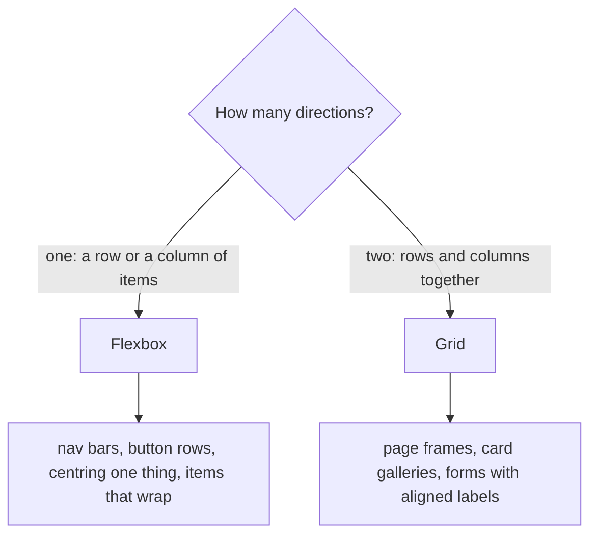

# Layout with flexbox, grid and responsive design

After this you can lay out a page with flexbox or grid, choose between them, and make the layout adapt from a phone to a wide monitor.

Before this: [CSS and the box model](03-css-and-the-box-model.md).

## The idea

By default, blocks stack top to bottom and inline content wraps like text. Real pages need a nav bar with links in a row, a sidebar next to content, and a card grid that has four columns on a monitor and one on a phone. Two CSS systems do this: flexbox for one direction, grid for two.

Both work the same way. You set a `display` value on a parent, the **container**, and its direct children, the **items**, are arranged by rules you give the container.

```text
Flexbox (row): items flow along ONE axis

  main axis ------------------------>
  +-------+  +---------+  +-----+
  |   A   |  |    B    |  |  C  |      cross axis
  +-------+  +---------+  +-----+          |
                                           v

Grid: items sit in cells of rows AND columns

  +-------+-----------+-------+
  |   A   |     B     |   C   |
  +-------+-----------+-------+
  |   D   |     E     |   F   |
  +-------+-----------+-------+
   1fr        2fr        1fr
```

## Key terms

**Flexbox** (`display: flex`) arranges items in a line along a **main axis**, set by `flex-direction` (`row` by default, or `column`). The **cross axis** is perpendicular to it.

**Grid** (`display: grid`) arranges items in **tracks**, which are rows and columns, with the **fr** unit meaning one share of the free space.

A **media query** applies rules only when a condition holds, such as `@media (min-width: 40rem)`.

**Responsive design** means one page that adapts to the screen. **Mobile first** means writing the small-screen layout as the base and adding `min-width` queries for larger screens.

## How it works

The container properties in flexbox:

| Property | Controls |
|---|---|
| `flex-direction` | main axis: `row` or `column` |
| `justify-content` | spacing along the main axis: `flex-start`, `center`, `space-between` |
| `align-items` | alignment along the cross axis: `stretch`, `center`, `flex-start` |
| `gap` | space between items |
| `flex-wrap` | `wrap` lets items drop to a new line |

On the items, `flex: 1` means "share the leftover space equally". `flex: 2` takes twice the share of a `flex: 1` sibling. Remember that `justify-content` follows the main axis, so switching to `column` swaps which property moves things horizontally.

```css
.nav { display: flex; gap: 1rem; justify-content: space-between; align-items: center; }
```

Grid defines the tracks on the container:

```css
.cards { display: grid; grid-template-columns: 1fr 2fr 1fr; gap: 20px; }
```

Take a 1000 px container with two 20 px gaps. The 960 px left over is split 1:2:1:

```python
W, gap, fr = 1000, 20, [1, 2, 1]
free = W - gap * (len(fr) - 1)
print([free * f / sum(fr) for f in fr])
```

```text
[240.0, 480.0, 240.0]
```

For a grid that needs no media query, `repeat(auto-fit, minmax(200px, 1fr))` makes as many 200 px-minimum columns as fit and stretches them to fill the row. With a 16 px gap, that gives 1 column at 360 px, 3 at 700 px and 4 at 1000 px.

Media queries make bigger changes, and mobile first keeps the base CSS simple:

```css
.layout { display: grid; gap: 1rem; }              /* phone: one column */
@media (min-width: 48rem) {
  .layout { grid-template-columns: 1fr 3fr; }      /* wider: sidebar and content */
}
```



The rule of thumb is that flexbox sizes the layout from the content outward and grid places content into a structure you define first ([MDN: grid and flexbox](https://developer.mozilla.org/en-US/docs/Web/CSS/Guides/Grid_layout/Relationship_of_grid_layout_with_other_layout_methods)). They nest freely: a grid of cards, each card a flex column.

Two supporting pieces. Fluid sizing helps: `max-width: 100%` on images and `width: min(100% - 2rem, 60rem)` on a page container. And the viewport meta tag from [HTML](02-html.md) must be present, or `min-width` queries on phones compare against a 980 px width.

## Worked examples

<div class="example" markdown>

### Example 1: a centred card, then a responsive gallery

1. To centre one box on the page, use the cross axis and the main axis together:

```css
body { min-height: 100vh; display: flex; justify-content: center; align-items: center; }
```

2. For the gallery, put the cards in a grid whose columns adapt:

```css
.gallery { display: grid; grid-template-columns: repeat(auto-fit, minmax(200px, 1fr)); gap: 16px; }
```

Check: open the page and drag the window narrower. The card sits in the middle at every size, and the gallery goes from four columns to one with no media query. In DevTools, click the `grid` badge in the Elements panel to draw the track lines.

</div>

## Common mistakes

<div class="warning" markdown>

Watch out: setting `display: flex` on the wrong element. It affects the children of that element only. If nothing moves, check that you styled the parent.

Watch out: using `width: 100vw`. It includes the scrollbar and causes a sideways scroll bar. Use `width: 100%` for fluid blocks.

Watch out: desktop-first CSS with `max-width` queries stacked on top of each other. It is easy to leave a middle size broken. Start small and add `min-width` queries.

</div>

## Working with AI

<div class="ai" markdown>

Words to use: flex container, main axis, cross axis, grid track, fr unit, auto-fit, media query, mobile first.

Prompts to try:

- "Make this nav bar a flex row with the logo at the left and links at the right, collapsing to a column below 40rem. Mobile first, no JavaScript. Here is my HTML: [paste]."
- "Replace the floats in this CSS with grid. Keep the same layout at 1200px and put the sidebar on top at 600px."

What to check:

- Fixed pixel widths on containers. Resize the window to 320 px wide and look for horizontal scrolling.
- Media queries written with `max-width` while the rest is mobile first. Read the cascade top to bottom at one width.
- A framework or float-based layout when grid or flexbox would do. Ask why.

</div>

## Quiz

1\. Which property aligns items along the main axis of a flex container, and which along the cross axis?

<details class="solution" markdown>
<summary>Answer</summary>

`justify-content` on the main axis, `align-items` on the cross axis. With `flex-direction: column` the main axis is vertical.

</details>

2\. A grid has `grid-template-columns: 1fr 1fr 2fr` and a 900 px container with no gap. What are the column widths?

<details class="solution" markdown>
<summary>Answer</summary>

225, 225 and 450 px: the 900 px is split into 4 shares of 225.

</details>

3\. A flex row of three cards overflows the screen on a phone instead of wrapping. What do you add?

<details class="solution" markdown>
<summary>Answer</summary>

`flex-wrap: wrap` on the container, plus a `flex-basis` or `min-width` on the items so they know when to wrap. Or use the `auto-fit` grid.

</details>

4\. Flexbox or grid: a page with a header, a sidebar, content and a footer?

<details class="solution" markdown>
<summary>Answer</summary>

Grid for the page frame, since it has rows and columns. Flexbox for the row of links inside the header.

</details>

## Lab

<div class="lab" markdown>

### Lab: a responsive page

Goal: build a page that changes from one column to a sidebar layout with a card grid. Time: about 20 minutes. Runs in: any browser.

1. Save the code below as `layout.html` and open it.
2. Drag the window wide and narrow. Note the width at which the sidebar appears (768 px, because 48rem is 48 times 16 px).
3. Open DevTools and use device mode (Ctrl+Shift+M) to see it at phone size.
4. Change `minmax(150px, 1fr)` to `minmax(300px, 1fr)` and check how many cards fit per row.
5. Cleanup: delete the file.

```html
<!doctype html>
<html lang="en">
<head>
  <meta charset="utf-8">
  <meta name="viewport" content="width=device-width, initial-scale=1">
  <title>Layout</title>
  <style>
    * { box-sizing: border-box; }
    body { margin: 0; font-family: sans-serif; }
    header, aside, section { padding: 1rem; background: #eef; }
    .page { display: grid; gap: 1rem; padding: 1rem; }
    .cards { display: grid; gap: 1rem; grid-template-columns: repeat(auto-fit, minmax(150px, 1fr)); }
    .card { background: #ffd; padding: 1rem; border: 1px solid #aa6; }
    @media (min-width: 48rem) {
      .page { grid-template-columns: 12rem 1fr; }
      header { grid-column: 1 / -1; }
    }
  </style>
</head>
<body>
  <div class="page">
    <header>Header</header>
    <aside>Sidebar</aside>
    <section>
      <div class="cards">
        <div class="card">1</div><div class="card">2</div><div class="card">3</div>
        <div class="card">4</div><div class="card">5</div><div class="card">6</div>
      </div>
    </section>
  </div>
</body>
</html>
```

Expected result: below 768 px everything stacks in one column; above it the sidebar sits left of the content and the header spans both columns. Cards fill as many columns as fit.

<details class="solution" markdown>
<summary>Solution</summary>

`grid-column: 1 / -1` means "from the first grid line to the last", so the header spans both tracks. With `minmax(300px, 1fr)` and a content area of about 700 px, 2 cards fit per row instead of 4.

</details>

</div>

## Where this shows up

- Every component you build in React<!-- link: ../03-react/01-components-props-and-jsx.md --> is styled with these same properties.
- Next: [accessibility](05-accessibility.md), which checks that the layout works for keyboard and screen reader users.
