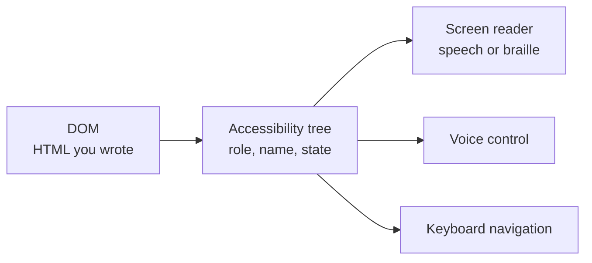

# Accessibility

After this you can name the main accessibility requirements for a web page, build to them with semantic HTML first, and test a page with automated tools, a keyboard and a screen reader.

Before this: [HTML](02-html.md) and [CSS and the box model](03-css-and-the-box-model.md).

## The idea

Some of your users cannot see the screen, cannot use a mouse, have low vision, or cannot hear audio. Others have a broken wrist, a bright sun on the screen, or a slow connection. Accessibility (often written a11y) means the page works for all of them. It is also a legal duty: in Ontario, the Accessibility for Ontarians with Disabilities Act (AODA) requires accessible public websites for designated public sector organizations and for businesses and non-profits with 50 or more employees, to WCAG 2.0 Level AA ([ontario.ca](https://www.ontario.ca/page/how-make-websites-accessible), checked 2026). Employers ask about it, and an inaccessible page is also a bug for search engines and tests.

Assistive technology does not read the pixels. It reads the **accessibility tree**, which the browser builds from the DOM: each node has a role (what it is), a name (what it is called) and a state (checked, expanded, disabled).



## Key terms

**WCAG** (Web Content Accessibility Guidelines) is the W3C standard. Version 2.2 is a W3C Recommendation ([w3.org](https://www.w3.org/TR/WCAG22/)). It has three conformance levels: A, AA and AAA. Level AA is the usual target and the legal one in most places.

The four principles are called **POUR**. Content must be Perceivable (users can sense it: text alternatives, captions, contrast), Operable (users can use it: keyboard, enough time, no seizure-triggering flashes), Understandable (readable, predictable, with help for input errors) and Robust (it works with current and future assistive technology, which is mostly valid, semantic HTML).

**AODA** is Ontario's accessibility law. A **screen reader** reads the accessibility tree aloud. **ARIA** (Accessible Rich Internet Applications) is a set of attributes (`role`, `aria-label`, `aria-expanded`) that add roles and states when HTML alone cannot express them.

**Focus** is the element that receives keyboard input. The **focus order** follows the DOM order.

## How it works

Work in this order, as most problems vanish at step 1.

1. Semantic HTML. A real `<button>`, `<a href>`, `<nav>`, `<main>`, `<label>` and heading outline each give the right role, name, keyboard behaviour and focus for free. The first rule of ARIA is: do not use ARIA if a native element does the job ([W3C ARIA Authoring Practices](https://www.w3.org/WAI/ARIA/apg/practices/read-me-first/)).
2. Text alternatives. Every informative image gets meaningful `alt`; decorative ones get `alt=""`. Icon-only buttons need a name: `<button aria-label="Close">x</button>`. Every form control gets a visible `<label>`.
3. Contrast. Level AA needs a contrast ratio of at least 4.5:1 for normal text and 3:1 for large text and UI components ([SC 1.4.3](https://www.w3.org/TR/WCAG22/#contrast-minimum)). The ratio uses the relative luminance of the two colours:

```python
def lin(c):
    c /= 255
    return c / 12.92 if c <= 0.04045 else ((c + 0.055) / 1.055) ** 2.4

def luminance(hex_colour):
    r, g, b = (int(hex_colour[i:i + 2], 16) for i in (1, 3, 5))
    return 0.2126 * lin(r) + 0.7152 * lin(g) + 0.0722 * lin(b)

def contrast(a, b):
    hi, lo = sorted((luminance(a), luminance(b)), reverse=True)
    return (hi + 0.05) / (lo + 0.05)

for fg in ["#000000", "#767676", "#777777", "#0b5cad", "#999999"]:
    print(fg, f"{contrast(fg, '#ffffff'):.2f}")
```

```text
#000000 21.00
#767676 4.54
#777777 4.48
#0b5cad 6.67
#999999 2.85
```

On white, `#767676` just passes at 4.54, `#777777` just fails at 4.48, and the popular light grey `#999999` fails by a wide margin.

4. Keyboard. Everything clickable must be reachable with Tab, used with Enter or Space, and show where focus is. Never write `outline: none` without a replacement. Use `:focus-visible` to style it. Skip `tabindex` values above 0, which scramble the focus order.
5. Don't rely on colour alone. An error shown only in red is invisible to a colour-blind user; add text or an icon.
6. ARIA only when needed, for things HTML cannot say: `aria-expanded="false"` on a menu toggle, `aria-live="polite"` on a status message that updates. Wrong ARIA is worse than none, since it overrides the native meaning.

Testing has three layers, and you need all of them because automated tools catch only part of the problems:

| Layer | Tool | Finds |
|---|---|---|
| Automated | Lighthouse (in Chrome DevTools), axe DevTools | missing alt, low contrast, missing labels, bad ARIA |
| Keyboard | Tab, Shift+Tab, Enter, Space, Esc | unreachable controls, lost focus, keyboard traps |
| Screen reader | NVDA (free, Windows), VoiceOver (macOS, iOS) | confusing names, wrong order, silent updates |

## Worked examples

<div class="example" markdown>

### Example 1: fixing a div button

```html
<div class="btn" onclick="save()"></div>
```

1. Role: a `div` has none. Use `<button type="button">`; this adds Tab focus and Enter and Space handling.
2. Name: the image has no `alt`, so the button has no name. Since the icon carries the meaning, name the button, and make the image decorative.
3. Focus: leave the browser's default ring, or style `:focus-visible` with a visible outline.

```html
<button type="button" class="btn" onclick="save()"> Save</button>
```

Check: run Lighthouse's accessibility audit before and after, then Tab to the button and press Enter. In Chrome DevTools, Elements, Accessibility tab, the node now shows role "button" and name "Save".

</div>

## Common mistakes

<div class="warning" markdown>

Watch out: assuming a score of 100 in Lighthouse means the page is accessible. Automated tools cover only a minority of the success criteria. Always add a keyboard pass.

Watch out: `outline: none` or `outline: 0` to remove the "ugly" focus ring. Keyboard users then cannot see where they are. Restyle it instead.

Watch out: `aria-label` on a `div` to make it a button. The label gives it a name but not keyboard behaviour. Use `<button>`.

</div>

## Working with AI

<div class="ai" markdown>

Words to use: accessibility tree, WCAG 2.2 AA, POUR, semantic HTML, accessible name, focus-visible, aria-live.

Prompts to try:

- "Audit this component for WCAG 2.2 AA. List each failure with the success criterion number and a fix that uses native HTML before ARIA: [paste]."
- "This modal traps focus badly. Using only the `<dialog>` element, write a version where Tab stays inside and Esc closes it, and say what a screen reader announces."

What to check:

- Generated markup with `role="button"` on a `div`, or extra `aria-*` on native elements. Replace with the native element.
- Invented success criterion numbers. Look each up on w3.org.
- Contrast claims. Compute the ratio with a checker, as in the script above.
- Images with `alt` text that repeats the filename or says "image of".

</div>

## Quiz

1\. What do the letters in POUR stand for, and which principle covers captions on video?

<details class="solution" markdown>
<summary>Answer</summary>

Perceivable, Operable, Understandable, Robust. Captions are Perceivable.

</details>

2\. A page has grey text `#999999` on white at normal size. Does it meet AA?

<details class="solution" markdown>
<summary>Answer</summary>

No. The ratio is 2.85:1 and AA needs 4.5:1 for normal text. `#767676` is the lightest grey that passes on white.

</details>

3\. An icon-only "search" button is announced as just "button". What is wrong and what is the fix?

<details class="solution" markdown>
<summary>Answer</summary>

It has no accessible name. Add visible text, or `aria-label="Search"` on the button, or `alt="Search"` on the icon image inside it.

</details>

4\. Your site is run by a Toronto company with 80 employees. Does AODA's website requirement apply?

<details class="solution" markdown>
<summary>Answer</summary>

Yes. It applies to businesses and non-profits with 50 or more employees, to WCAG 2.0 Level AA for the public website (ontario.ca, as of 2026). Targeting WCAG 2.2 AA also covers this.

</details>

## Lab

<div class="lab" markdown>

### Lab: audit and fix a bad page

Goal: find and fix accessibility problems with tools and a keyboard. Time: about 20 minutes. Runs in: Chrome or Edge.

1. Save the code below as `a11y.html` and open it.
2. Open DevTools, Lighthouse, tick Accessibility only, and run the audit. Write down the failures.
3. Use only the keyboard: Tab through the page. Note what cannot be reached.
4. Fix the page until Lighthouse reports no failures and every control works with Tab and Enter.
5. Cleanup: delete the file.

```html
<!doctype html>
<html>
<head>
  <meta charset="utf-8">
  <title>Bad page</title>
  <style>
    p { color: #999; }
    *:focus { outline: none; }
  </style>
</head>
<body>
  <p>Subscribe to our newsletter</p>
  
  <input type="text" placeholder="Email">
  <div onclick="alert('subscribed')">Subscribe</div>
</body>
</html>
```

Expected result: Lighthouse lists the missing `lang`, the low contrast and the image without `alt`; it may also flag the input, which has only a placeholder. The `div` is skipped by Tab, and no focus ring shows anywhere.

<details class="solution" markdown>
<summary>Solution</summary>

```html
<!doctype html>
<html lang="en">
<head>
  <meta charset="utf-8">
  <title>Newsletter</title>
  <style>
    p { color: #595959; }
  </style>
</head>
<body>
  <main>
    <p>Subscribe to our newsletter</p>
    
    <label for="email">Email</label>
    <input id="email" type="email">
    <button type="button" onclick="alert('subscribed')">Subscribe</button>
  </main>
</body>
</html>
```

Changes: `lang` added, darker text (`#595959` is about 7:1 on white), `alt` on the image, a real label, a `<button>`, and the `outline: none` rule removed so the browser's focus ring shows. `<main>` gives a landmark. The `logo.png` file does not exist in the lab, so the alt text shows instead of the picture; that is expected.

</details>

</div>

## Where this shows up

- Component libraries in React<!-- link: ../03-react/01-components-props-and-jsx.md --> still render HTML, so the same rules apply.
- Automated accessibility checks run in [end-to-end tests](../../06-developer-tools-and-workflow/03-code-quality/02-integration-tests-mocks-and-e2e.md). Back to the [chapter cheat sheet](index.md).
