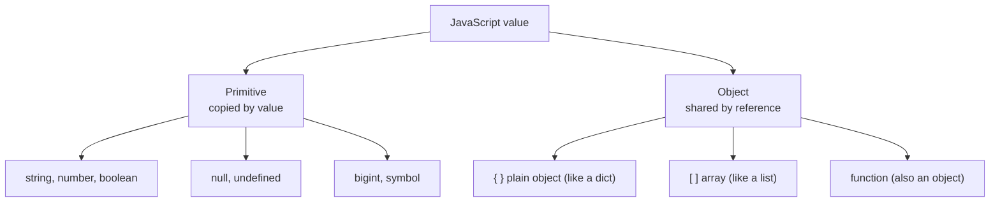
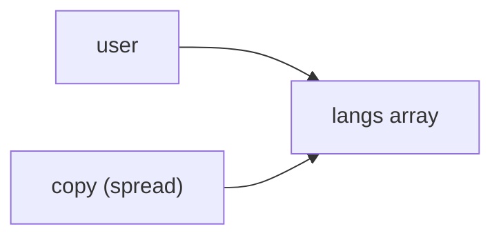

# JavaScript for Python programmers

After this you can read and write everyday JavaScript, and predict where it behaves differently from Python.

Before this: [Values, types and variables](../../03-programming-fundamentals/01-python-basics/01-values-types-and-variables.md) and [How browsers render pages](../01-html-css-and-the-browser/01-how-browsers-render-pages.md).

## The idea

You paste a Python function into a chat and ask for it in JavaScript. The result runs, but `"1" == 1` is true, `[10, 9, 1].sort()` returns `[1, 10, 9]`, and a missing key gives `undefined` instead of an error. None of this is a bug in the answer. JavaScript made different choices, mostly to keep a page running when something is slightly wrong.

The language itself is small and close to Python: variables, functions, objects, arrays, classes, modules. What differs is a handful of defaults. This lesson lists them. JavaScript runs in every browser and, through Node.js, on servers; the examples here run in Node 24.



## Key terms

A **primitive** is an immutable value that is not an object: string, number, boolean, `null`, `undefined`, `bigint` and `symbol`. Every other value is an **object**, including arrays and functions.

**Coercion** is the automatic conversion of a value to another type, which `==` and `+` apply when the types differ.

A **falsy** value is one that counts as `false` in a condition. Everything else is **truthy**.

**Destructuring** unpacks values from an array or object into variables. **Spread** (`...`) copies the items of an array or the properties of an object into a new one.

An **ES module** is a file that shares names with `export` and receives them with `import`.

## How it works

Python and JavaScript line up like this for the daily basics:

| Python | JavaScript | Difference |
|---|---|---|
| `x = 1` | `let x = 1` or `const x = 1` | `const` forbids reassigning the name; the object it names can still change |
| `None` | `null` and `undefined` | `undefined` means "never set"; `null` means "set to nothing" |
| `==` | `===` | `==` coerces types; use `===` always |
| `and`, `or`, `not` | `&&`, `\|\|`, `!` | Same short-circuit rules |
| `dict` | object `{ a: 1 }` | Keys are strings (or symbols); missing key gives `undefined` |
| `list` | array `[1, 2]` | `.length`, not `len()`; `typeof` says `"object"` |
| `f"{x}"` | `` `${x}` `` | Backtick template literals |
| `for x in xs` | `for (const x of xs)` | `for...in` walks keys as strings; avoid it on arrays |

Truthiness is the sharpest difference. In Python `[]` and `{}` are falsy; in JavaScript they are truthy. The falsy values are `false`, `0`, `""`, `null`, `undefined`, `NaN` and `0n`.

```javascript
console.log(0 == "", "1" == 1, null == undefined, null == 0);
console.log(0 === "", "1" === 1, null === undefined);
console.log([] ? "truthy" : "falsy", "0" ? "truthy" : "falsy", NaN ? "truthy" : "falsy");
console.log(1 + "2", "3" * "4", [10, 9, 1].sort(), 0.1 + 0.2);
```

```text
true true true false
false false false
truthy truthy falsy
12 12 [ 1, 10, 9 ] 0.30000000000000004
```

The `+` operator joins strings if either side is a string, so `1 + "2"` is `"12"`, while `*` converts to numbers. `sort()` with no argument compares items as strings; pass `(a, b) => a - b` for numbers. All numbers are 64-bit floats, so there is no separate integer type (see [floating point](../../01-how-computers-work/01-bits-and-data/04-floating-point.md)).

Two operators replace many Python `if` checks. `a ?? b` uses `b` only when `a` is `null` or `undefined`, so `0 ?? "x"` is `0`. `a?.b` stops and returns `undefined` if `a` is missing, instead of raising.

Arrow functions are the short form of functions: `n => n * n`. They matter for `this`. A regular method gets `this` from how it is called, so detaching it loses the object. An arrow function takes `this` from the surrounding code and never changes it. In practice: use arrows for callbacks, and let frameworks handle `this` for you.

Modules work like Python imports:

```javascript
import area, { PI } from "./mod.mjs";
```

`export default` gives the one main value a file offers, and `export const` adds named ones. Importers use braces for named exports. Local files need the extension in Node.

## Worked examples

<div class="example" markdown>

### Example 1: objects, destructuring, spread and array methods

We want to read fields from a user object, make an edited copy, and total some data with `filter`, `map` and `reduce`.

1. Destructure `name` and the nested `city` out of `user`. The third name, `role`, is missing, so its default `"guest"` is used.
2. Spread `user` into a new object and override `name`. The copy is shallow: its `langs` is the same array as the original's.
3. Chain `filter` (keep items that pass), `map` (transform each item) and `reduce` (fold to one value, with a start value of `0`).

```javascript
const user = { name: "Ada", langs: ["py", "js"], address: { city: "Toronto" } };
const { name, address: { city }, role = "guest" } = user;
console.log(name, city, role);

const copy = { ...user, name: "Grace" };
console.log(copy.name, user.name, copy.langs === user.langs);
console.log(user.missing, user.missing?.deep, user.missing ?? "default");

const nums = [1, 2, 3, 4, 5];
const evens = nums.filter(n => n % 2 === 0);
const squares = nums.map(n => n * n);
const total = nums.reduce((acc, n) => acc + n, 0);
console.log(evens, squares, total);
const [first, ...rest] = nums;
console.log(first, rest);
```

```text
Ada Toronto guest
Grace Ada true
undefined undefined default
[ 2, 4 ] [ 1, 4, 9, 16, 25 ] 15
1 [ 2, 3, 4, 5 ]
```

Check: `copy.langs === user.langs` printed `true`, so editing `copy.langs` would change `user` too. The same aliasing exists in Python (see [references, mutability and copying](../../03-programming-fundamentals/02-thinking-like-a-programmer/02-references-mutability-and-copying.md)).



</div>

## Common mistakes

<div class="warning" markdown>

Watch out: `for (const k in arr)` gives the indexes as strings (`"0"`, `"1"`). Use `for...of` for values.

Watch out: `typeof null` is `"object"`, a historical quirk. Test for it with `x === null`, and for arrays with `Array.isArray(x)`.

Watch out: calling a detached method, such as `const f = obj.method; f()`, loses `this` and often throws a `TypeError`. Pass an arrow function or call `obj.method()`.

</div>

## Working with AI

<div class="ai" markdown>

Words to use: `===`, truthy and falsy, `undefined`, destructuring, spread, shallow copy, ES module.

Prompts to try:

- "Translate this Python function to JavaScript for Node 24, with ES modules. List every place where Python and JavaScript semantics differ, such as truthiness, integer division and dict key errors."
- "This JavaScript prints `[1, 10, 9]` for `[10, 9, 1].sort()`. Explain why and give the fix."

What to check:

- Truthiness ported from Python: `if (items)` is always true for an array, so the check should be `items.length > 0`.
- `//` or `**` assumed to behave like Python's; run `Math.floor(a / b)` for floor division and check negatives.
- `==` in generated code, and `var` instead of `let` or `const`. Search for both.
- Shallow copies where a deep copy was needed; `structuredClone(obj)` makes a deep one.

</div>

## Quiz

1\. Name two differences in truthiness between Python and JavaScript.

<details class="solution" markdown>
<summary>Answer</summary>

An empty array `[]` and an empty object `{}` are truthy in JavaScript but falsy in Python. The string `"0"` is truthy in both, but `NaN` and `undefined` exist only in JavaScript, and both are falsy.

</details>

2\. Predict the output of `console.log(0 ?? "x", 0 || "x", null ?? "x")`.

<details class="solution" markdown>
<summary>Answer</summary>

`0 x x`. `??` only replaces `null` and `undefined`, so `0 ?? "x"` stays `0`. `||` replaces any falsy value, so `0 || "x"` is `"x"`.

</details>

3\. A teammate writes `const { a } = config` and gets `undefined` for `a`, with no error. Where should you look first?

<details class="solution" markdown>
<summary>Answer</summary>

At the spelling of the key and the shape of `config`. Reading a missing property never raises in JavaScript. Log `config` and check for a typo, a nested object, or `config` itself being a string or a promise.

</details>

4\. Why does `const nums = [1, 2]; nums.push(3)` work?

<details class="solution" markdown>
<summary>Answer</summary>

`const` stops the name `nums` from being reassigned. It does not freeze the array, so its contents can change.

</details>

## Lab

<div class="lab" markdown>

### Lab: port a Python function

Goal: translate a small Python function and compare outputs. Time: about 15 minutes. Runs in: any terminal with Node 24.

1. Create `inventory.mjs` with an array of objects: `{ name: "pen", qty: 0, price: 1.5 }`, `{ name: "book", qty: 3, price: 12 }`, `{ name: "bag", qty: 2, price: 30 }`.
2. Use `filter` to keep items with `qty > 0`, `map` to compute `qty * price`, and `reduce` to total them.
3. Print the total with a template literal.
4. Run `node inventory.mjs`.
5. Add a line that prints `items.find(i => i.name === "lamp")?.price ?? "no price"`.

Expected result: the total is 96, and the last line prints `no price`.

<details class="solution" markdown>
<summary>Solution</summary>

```javascript
const items = [
  { name: "pen", qty: 0, price: 1.5 },
  { name: "book", qty: 3, price: 12 },
  { name: "bag", qty: 2, price: 30 },
];
const total = items
  .filter(i => i.qty > 0)
  .map(i => i.qty * i.price)
  .reduce((acc, v) => acc + v, 0);
console.log(`Total: ${total}`);
console.log(items.find(i => i.name === "lamp")?.price ?? "no price");
```

```text
Total: 96
no price
```

</details>

</div>

## Where this shows up

- The next lesson uses these objects and arrays on web pages: [The DOM and events](02-the-dom-and-events.md).
- Types for all of this arrive in [TypeScript](04-typescript.md).
