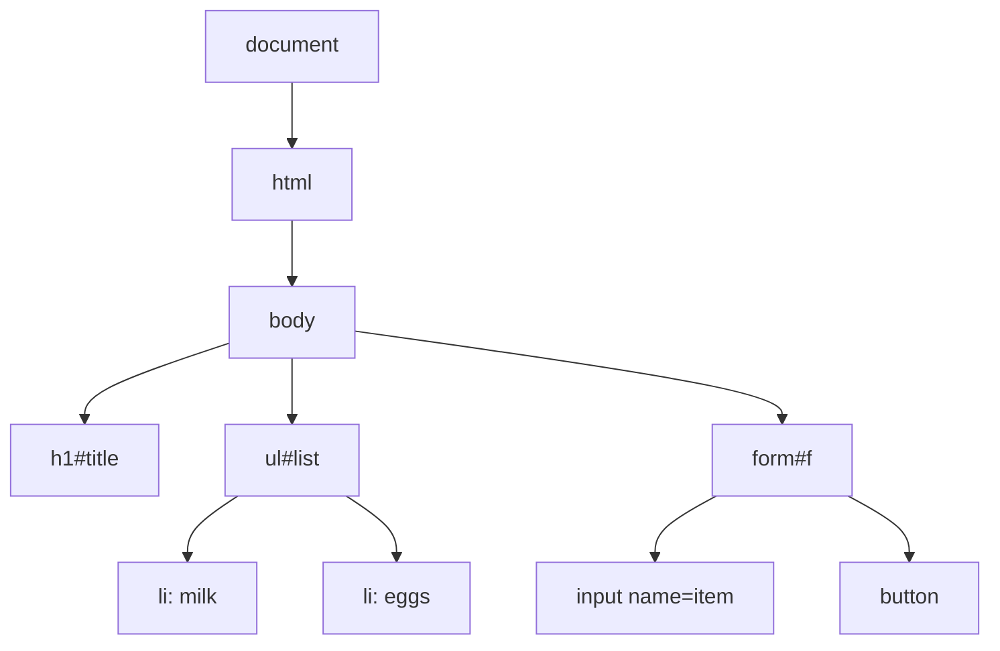
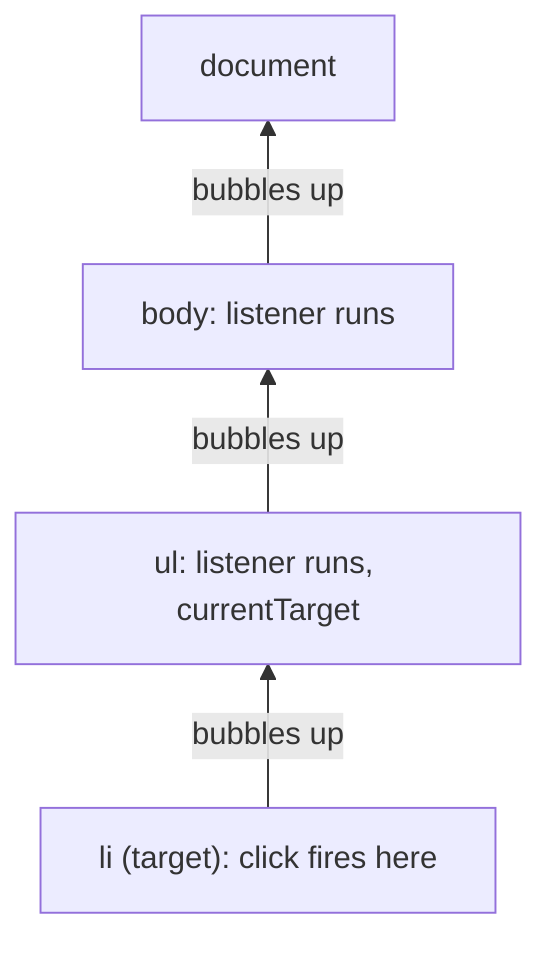

# The DOM and events

After this you can change a web page from JavaScript, respond to clicks and form submissions, and explain why one listener on a parent can handle many children.

Before this: [JavaScript for Python programmers](01-javascript-for-python-programmers.md) and [HTML](../01-html-css-and-the-browser/02-html.md).

## The idea

A to-do page has a list and a form. When you type "bread" and press Enter, the browser by default sends the form to a server and reloads the page. We want the item to appear in the list at once, with no reload. To do that, JavaScript has to reach into the page, add an element, and run when the user acts.

The browser turns the HTML into a tree of objects and exposes it to JavaScript. Your code reads and edits that tree, and the browser redraws the page when it changes. User actions travel through the same tree as events.



## Key terms

The **DOM** (Document Object Model) is the browser's tree of objects for a page. Each box in the diagram is a **node**; the ones for tags are **elements**.

A **selector** is a CSS pattern such as `#list` or `li.done` that picks elements.

An **event** is a signal that something happened, such as `click`, `input` or `submit`. A **listener** (or handler) is a function the browser calls when that event reaches an element.

**Bubbling** is the path an event takes after it fires on its target: it runs the target's listeners, then its parent's, up to `document`. **Event delegation** is putting one listener on a parent and using `event.target` to find which child was hit.

## How it works

Finding and changing elements takes three calls you will use constantly. These snippets run in a browser page (the examples here were also run in jsdom, a DOM written in JavaScript, so the printed output is real).

```javascript
const title = document.querySelector("#title");   // first match, or null
title.textContent = "Groceries";                   // set text, safely
title.classList.add("done");                       // add a CSS class
console.log(title.outerHTML);
console.log(document.querySelectorAll("li").length); // all matches
```

```text
<h1 id="title" class="done">Groceries</h1>
2
```

`querySelector` returns `null` when nothing matches, and then the next line throws a `TypeError`. `classList` has `add`, `remove` and `toggle`, which is how JavaScript changes appearance: it flips classes, and CSS does the styling. `textContent` treats the string as text. `innerHTML` parses it as HTML, so putting user input there allows script injection (see [XSS](../../12-security/01-web-security/04-xss-csrf-and-browser-security.md)).

`addEventListener("click", fn)` registers a listener. The browser passes `fn` an event object whose `target` is the element that was hit and whose `currentTarget` is the element the listener is attached to.

An event has two phases before it bubbles: it first travels down from `document` to the target (capture), then back up (bubble). Listeners run on the way up unless you ask otherwise, which is why delegation works.



Two methods control an event. `event.preventDefault()` cancels the browser's default action, such as a form submit or a link navigation. `event.stopPropagation()` stops the bubbling; use it rarely, because it hides events from other code.

## Worked examples

<div class="example" markdown>

### Example 1: delegation and a form

We want a click on any list item to toggle a `done` class, and a form that adds items without reloading.

1. Attach one `click` listener to the `ul`. It catches clicks from every `li`, including ones added later.
2. In the listener, `event.target.closest("li")` walks up from whatever was clicked (maybe a `<span>` inside the item) to the nearest `li`. If there is none, the click was on the list's padding, so do nothing.
3. Attach a `submit` listener to the form. Call `event.preventDefault()` first, or the page reloads.
4. Read the value with `new FormData(form).get("item")`, make an `li` with `createElement`, set its `textContent`, `append` it, and `reset` the form.

```javascript
const list = document.querySelector("#list");
list.addEventListener("click", (event) => {
  const li = event.target.closest("li");
  if (li) li.classList.toggle("done");
});

const form = document.querySelector("#f");
form.addEventListener("submit", (event) => {
  event.preventDefault();
  const item = new FormData(form).get("item");
  const li = document.createElement("li");
  li.textContent = item;
  list.append(li);
  form.reset();
});
```

After clicking "eggs" and submitting "bread", the list's HTML reads (jsdom run):

```text
<li>milk</li><li class="done">eggs</li><li>bread</li>
```

Check: the new "bread" item can be clicked and toggled too, with no extra code, because the listener sits on the `ul`. Attaching a listener to each `li` at load time would miss it.

</div>

## Common mistakes

<div class="warning" markdown>

Watch out: running a script before the element exists. A `<script>` in the `<head>` runs before the body is parsed, so `querySelector` returns `null`. Add `type="module"` (modules are deferred) or put the script at the end of the body.

Watch out: calling the function instead of passing it. `addEventListener("click", save())` runs `save` now and registers its return value. Write `save` or `() => save()`.

Watch out: a form without `preventDefault()` reloads the page and wipes your state, which looks like the code "did nothing".

</div>

## Working with AI

<div class="ai" markdown>

Words to use: `querySelector`, `addEventListener`, event bubbling, event delegation, `event.target`, `preventDefault`, `textContent`.

Prompts to try:

- "Using plain DOM APIs with no framework, write a todo list where clicks on items toggle a class. Use event delegation on the `ul` and explain what `event.target.closest` does."
- "My submit handler runs and then the page reloads. Here is the handler and the form HTML. Why?"

What to check:

- `innerHTML` with user-supplied text. Replace it with `textContent` or `createElement`.
- Listeners added inside a loop or inside another handler, which register duplicates. Click once and count the log lines.
- jQuery-style or old APIs such as `getElementsByClassName` loops, and `onclick="..."` attributes. They work, but `addEventListener` is the current style.
- Selectors that do not match your HTML. Run the selector in the browser console and look for `null`.

</div>

## Quiz

1\. What is the difference between `event.target` and `event.currentTarget`?

<details class="solution" markdown>
<summary>Answer</summary>

`target` is the element where the event started (the deepest element clicked). `currentTarget` is the element whose listener is running now. With a listener on a `ul` and a click on an `li`, they differ.

</details>

2\. A `div` listener and a `button` listener (the button is inside the div) both log. In what order do they print after a click on the button?

<details class="solution" markdown>
<summary>Answer</summary>

Button first, then div. The event fires on the target and bubbles up to its ancestors.

</details>

3\. A page's script contains `document.querySelector("#save").addEventListener(...)` in the `<head>` and fails with "Cannot read properties of null". Why, and what fixes it?

<details class="solution" markdown>
<summary>Answer</summary>

The script ran before the `#save` element was parsed, so the query returned `null`. Load the script with `type="module"` or `defer`, or move it to the end of the body.

</details>

4\. Why is event delegation useful for a list that grows while the page is open?

<details class="solution" markdown>
<summary>Answer</summary>

One listener on the parent also handles items added later, and it avoids registering one function per item.

</details>

## Lab

<div class="lab" markdown>

### Lab: a counter in the browser

Goal: build a page with a button that counts clicks. Time: about 15 minutes. Runs in: a browser plus any editor.

1. Create `counter.html` with `<p id="out">0</p>` and `<button id="add">Add</button>`.
2. Add `<script type="module">` at the end of the body.
3. In it, select both elements, keep `let n = 0`, and on each click increment `n` and set `out.textContent`.
4. Toggle a class `big` on the paragraph when `n` is above 4. Add `.big { font-size: 2rem; }` in a `<style>` tag.
5. Open the file in a browser and click six times.

Expected result: the number counts up and gets bigger after the fifth click.

<details class="solution" markdown>
<summary>Solution</summary>

```html
<p id="out">0</p>
<button id="add">Add</button>
<style>.big { font-size: 2rem; }</style>
<script type="module">
  const out = document.querySelector("#out");
  let n = 0;
  document.querySelector("#add").addEventListener("click", () => {
    n += 1;
    out.textContent = n;
    out.classList.toggle("big", n > 4);
  });
</script>
```

</details>

</div>

## Where this shows up

- Callbacks like these are the start of asynchronous code: [Async JavaScript and the event loop](03-async-javascript-and-the-event-loop.md).
- React replaces manual DOM edits with components: [components, props and JSX](../03-react/01-components-props-and-jsx.md).
