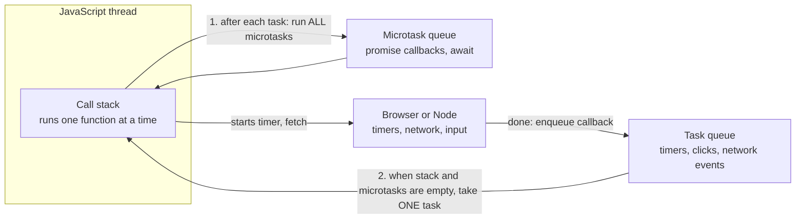
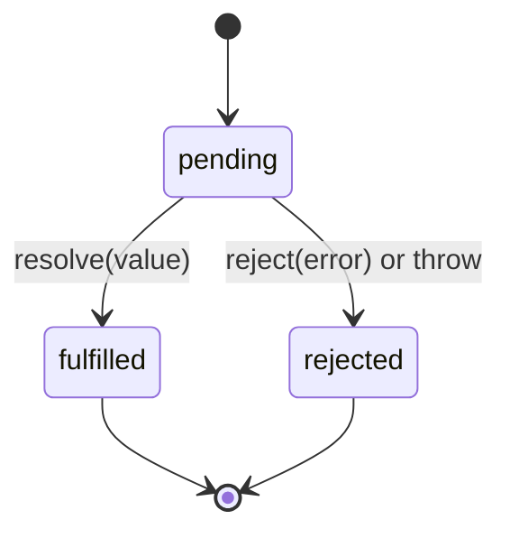

# Async JavaScript and the event loop

After this you can write code that waits for the network with `async` and `await`, predict the order in which callbacks run, and explain why a long loop freezes a page.

Before this: [The DOM and events](02-the-dom-and-events.md) and [HTTP requests and responses](../../07-networking/02-web-protocols/01-http-requests-and-responses.md).

## The idea

A page calls an API that takes 300 ms to answer. If JavaScript waited for the reply the way a Python script waits on `requests.get`, the tab would not scroll, click or repaint for 300 ms. So JavaScript never waits. It starts the request, hands the browser a function to call when the answer arrives, and goes on with other work.

JavaScript runs your code on a single thread, one piece at a time. The **event loop** is what makes that work with waiting: it picks the next finished piece of work and runs it, over and over. The waiting itself (network, timers, clicks) is done by the browser or by Node outside your code.



## Key terms

The **call stack** is the list of functions currently running; the thread can only run the top one.

A **task** (also a macrotask) is a unit of work waiting in the **task queue**: a timer callback, a click handler, a network event. A **microtask** is a smaller unit, queued by promises and `await`, in the **microtask queue**.

A **callback** is a function passed to be called later. A **promise** is an object for a value that is not ready yet; it is **pending**, then **fulfilled** with a value or **rejected** with an error.

`async` marks a function that returns a promise. `await` pauses that function until a promise settles, without blocking the thread.

## How it works

The loop, as in the diagram, repeats:

1. Run the current task until the call stack is empty.
2. Run every microtask in the queue, including any new ones they queue, until it is empty.
3. Let the browser repaint if it needs to.
4. Take the next task from the task queue and go to step 1.

So microtasks always run before the next task. A promise callback jumps ahead of a `setTimeout(..., 0)` that was registered earlier.

Promises replaced nested callbacks. `async` and `await` are syntax over promises that lets asynchronous code read top to bottom, with `try`/`catch` for errors.



`fetch(url)` returns a promise of a response. It rejects only when the request itself fails (no network, blocked by CORS). A 404 or 500 still fulfils, so you must check `response.ok`.

```javascript
async function getJson(url) {
  const res = await fetch(url);
  if (!res.ok) throw new Error(`HTTP ${res.status}`);
  return res.json();
}
try {
  console.log(await getJson(base + "/ok"));
  await getJson(base + "/missing");
} catch (err) {
  console.log("caught:", err.message);
}
```

Here `base` was a local test server run with Node's `http` module. Output:

```text
{ id: 1 }
caught: HTTP 404
```

Sequential `await`s add their times; `Promise.all([a, b])` starts both and waits for the slowest. It rejects as soon as one input rejects.

```javascript
const sleep = (ms, v) => new Promise(r => setTimeout(() => r(v), ms));
await sleep(200, "a"); await sleep(200, "b");           // about 400 ms
const both = await Promise.all([sleep(200, "a"), sleep(200, "b")]); // about 200 ms
```

```text
sequential 400 ms ab
parallel 200 ms [ 'a', 'b' ]
```

Top-level `await` works in ES modules (`.mjs` files and `type="module"` scripts).

## Worked examples

<div class="example" markdown>

### Example 1: predict the order

We want the order of the seven log lines. Predict first, then run.

```javascript
console.log("1 sync start");
setTimeout(() => console.log("2 timeout 0 (task)"), 0);
Promise.resolve().then(() => console.log("3 promise then (microtask)"));
queueMicrotask(() => console.log("4 queueMicrotask"));
(async () => {
  console.log("5 inside async, before await");
  await null;
  console.log("6 after await (microtask)");
})();
console.log("7 sync end");
```

1. The whole script is the first task. Its synchronous lines run in order: 1, then 5 (an `async` function runs synchronously until its first `await`), then 7.
2. `setTimeout` hands line 2 to the task queue. The other three callbacks (lines 3, 4 and 6, the last being the rest of the async function) go to the microtask queue in the order they were registered.
3. The script ends, the stack is empty, and the microtasks run: 3, 4, 6.
4. Only then does the loop take the timer task: 2.

```text
1 sync start
5 inside async, before await
7 sync end
3 promise then (microtask)
4 queueMicrotask
6 after await (microtask)
2 timeout 0 (task)
```

Check: the output matches the prediction `1 5 7 3 4 6 2`. Notice that `setTimeout(..., 0)` came before the promise in the source but ran last.

</div>

<div class="example" markdown>

### Example 2: blocking the main thread

A loop that spins for 500 ms keeps the call stack busy, so nothing else can run, including a timer that asked for 0 ms.

```javascript
const start = performance.now();
setTimeout(() => console.log("timer fired after 500 ms (asked for 0)"), 0);
while (performance.now() - start < 500) {}  // blocks the thread
console.log("loop done");
```

```text
loop done
timer fired after 500 ms (asked for 0)
```

In a browser the same loop also stops repainting and click handling, so the page freezes. Slow work like this belongs in a Web Worker (a separate thread), or has to be cut into smaller chunks.

</div>

## Common mistakes

<div class="warning" markdown>

Watch out: not checking `res.ok`. A 500 from the server does not throw, so the code carries on with an error body and fails later in `res.json()` or in the UI.

Watch out: `await` inside `forEach` or a `map` callback. `forEach` does not wait for the async callbacks, so the code after it runs too early. Use a `for...of` loop to go one at a time, or `await Promise.all(items.map(...))` to go in parallel.

Watch out: forgetting `await`. You get a pending promise object where you expected data, and `console.log` prints `Promise { <pending> }`.

</div>

## Working with AI

<div class="ai" markdown>

Words to use: event loop, microtask, promise, `async`/`await`, `Promise.all`, rejection, main thread.

Prompts to try:

- "Here is my `fetch` helper. Add error handling for network failure and for non-2xx responses, and say which one `fetch` rejects on."
- "These three requests are independent but run one after another with `await`. Rewrite them to run concurrently with `Promise.all` and tell me what happens if one fails."

What to check:

- A `.then()` chain without a `.catch()`, or an `async` function called without `await` or `.catch()`. Unhandled rejections go unnoticed; check the console.
- Missing `res.ok` checks and missing `res.json()` awaits.
- `Promise.all` for tasks that depend on each other, or for hundreds of calls at once; you may need a limit.
- Claims about execution order: run the snippet and compare, as in Example 1.

</div>

## Quiz

1\. Why does JavaScript not wait for a network response?

<details class="solution" markdown>
<summary>Answer</summary>

It has one thread for your code. Waiting would block clicks, scrolling and repainting. It registers a callback and keeps running; the event loop calls it when the response is ready.

</details>

2\. Predict the output.

```javascript
setTimeout(() => console.log("A"), 0);
Promise.resolve().then(() => console.log("B"));
console.log("C");
```

<details class="solution" markdown>
<summary>Answer</summary>

`C`, `B`, `A`. The synchronous line runs first, then the microtask, then the timer task.

</details>

3\. A page shows data that is `undefined` right after a `fetch` call. The code is `const data = fetchUser(); render(data)`, where `fetchUser` is `async`. What is wrong?

<details class="solution" markdown>
<summary>Answer</summary>

`fetchUser()` returns a promise, and `render` got the promise, not the user. Use `const data = await fetchUser()` inside an `async` function.

</details>

4\. Two independent API calls take 300 ms each. How long does `await a(); await b();` take, and how long does `await Promise.all([a(), b()])` take?

<details class="solution" markdown>
<summary>Answer</summary>

About 600 ms and about 300 ms. In the second form both requests are in flight together.

</details>

## Lab

<div class="lab" markdown>

### Lab: sequential against parallel

Goal: measure the cost of awaiting one after another. Time: about 15 minutes. Runs in: any terminal with Node 24.

1. Create `race.mjs` with a `sleep(ms, value)` helper that returns a promise.
2. Time two `await sleep(300, ...)` calls in a row with `performance.now()`.
3. Time the same two inside `Promise.all`.
4. Add a third promise that rejects after 100 ms (`throw` inside `setTimeout` will not work; use `new Promise((_, reject) => ...)`) and wrap `Promise.all` in `try`/`catch`.

Expected result: about 600 ms, about 300 ms, then a caught error after about 100 ms.

<details class="solution" markdown>
<summary>Solution</summary>

```javascript
const sleep = (ms, v) => new Promise(r => setTimeout(() => r(v), ms));
const fail = (ms) => new Promise((_, reject) => setTimeout(() => reject(new Error("boom")), ms));
const ms = (t) => Math.round((performance.now() - t) / 100) * 100;

let t = performance.now();
await sleep(300); await sleep(300);
console.log("sequential", ms(t));

t = performance.now();
await Promise.all([sleep(300), sleep(300)]);
console.log("parallel", ms(t));

t = performance.now();
try { await Promise.all([sleep(300), fail(100)]); }
catch (e) { console.log("caught", e.message, "after", ms(t)); }
```

```text
sequential 600
parallel 300
caught boom after 100
```

</details>

</div>

## Where this shows up

- The same loop drives servers: [Node.js and its runtime](../../09-back-end/01-servers-and-apis/02-nodejs-and-its-runtime.md).
- React data loading is `fetch` plus state: [data fetching and forms](../03-react/03-data-fetching-and-forms.md).
- Python has the same model in `asyncio`: threads, processes and asyncio<!-- link: ../../03-programming-fundamentals/05-concurrency/03-threads-processes-and-asyncio.md -->.
