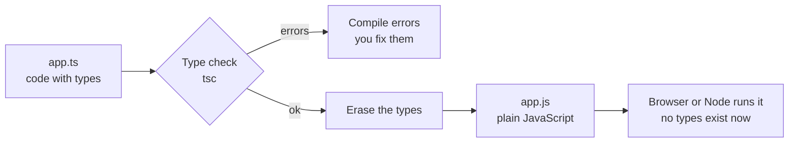

# TypeScript

After this you can read and write basic TypeScript, run the type checker, and say what types do and do not protect you from.

Before this: [JavaScript for Python programmers](01-javascript-for-python-programmers.md) and [Type systems](../../03-programming-fundamentals/02-thinking-like-a-programmer/03-type-systems.md).

## The idea

A function expects a user with a `name`, and a caller passes `{ nam: "Ada" }`. JavaScript runs it happily and prints `Hello undefined` in production. The mistake could have been caught by reading the code, and a program can do that reading for you.

**TypeScript** is JavaScript plus a type syntax. You write the types, a checker compares them against how the values are used, and then the types are deleted and plain JavaScript is what runs. This is the same idea as Python's type hints with `mypy`, except that the types are part of the language syntax.



## Key terms

A **type annotation** is a `: type` written after a variable, parameter or return value.

An **interface** and a **type alias** both name a shape. `interface User { id: number }` describes an object. `type Id = number | string` can name any type, including unions.

A **union type** (`A | B`) allows a value of either type. **Narrowing** is the checker's reasoning that, inside an `if (typeof x === "string")`, the value must be a string.

A **generic** is a type with a placeholder, written `<T>`, so one function works for many types while keeping them linked.

**Strict mode** (`"strict": true` in `tsconfig.json`) turns on the full set of checks. **Type erasure** means the types do not exist when the program runs.

## How it works

Install the checker as a development dependency, then run it without producing files. As of 2026 the current release is TypeScript 7.0 ([npm](https://www.npmjs.com/package/typescript), [typescriptlang.org](https://www.typescriptlang.org/)), and `tsc --init` writes a `tsconfig.json` with `"strict": true`.

```bash
npm install --save-dev typescript
npx tsc --noEmit
```

`--noEmit` checks only. Most projects run it in CI or as an `npm run typecheck` script, while a bundler such as Vite (next lesson) does the erasing.

The common building blocks in one file, `app.ts`:

```typescript
interface User {
  id: number;
  name: string;
  email?: string;            // optional: string | undefined
}
type Id = number | string;

function greet(user: User): string {
  return `Hello ${user.name}`;
}

function show(id: Id): string {
  if (typeof id === "string") return id.toUpperCase();   // narrowed to string
  return id.toFixed(1);                                   // narrowed to number
}

function first<T>(items: T[]): T | undefined {
  return items[0];
}

console.log(greet({ id: 1, name: "Ada" }));
console.log(show("ab"), show(3));
console.log(first([10, 20]), first<string>([]));
```

```text
Hello Ada
AB 3.0
10 undefined
```

`tsc --noEmit --strict app.ts` reports no errors. In `first`, the `T` links the input to the output: a list of numbers gives `number | undefined`.

Interface or alias? For object shapes either works; use `interface` for objects that other code might extend and `type` for unions and anything else. Pick one convention per project.

`any` switches checking off for a value, and the switch spreads to everything it touches. `unknown` is the safe choice for data you do not control (a parsed JSON body, a caught error): you can hold it, but you must narrow it before using it.

Node can run `.ts` files directly. Since Node 22.18 and 23.6, "type stripping" is on by default, and it is stable in Node 24.12 and later ([Node.js docs](https://nodejs.org/api/typescript.html)). Node deletes the annotations and runs the rest. It does not check types, and it fails on syntax that needs code generated, such as `enum`.

## Worked examples

<div class="example" markdown>

### Example 1: what the checker catches, and what runs

We have `bad.ts` with six mistakes that JavaScript would accept.

```typescript
interface User { id: number; name: string }
const u: User = { id: 1, name: "Ada" };
console.log(u.nam);
const n: number = "5";
function f(x) { return x; }
function g(v: unknown) { return v.toUpperCase(); }
function h(id: number | string) { return id.toFixed(1); }
const m: string | undefined = undefined as string | undefined;
console.log(m.length);
```

1. Run `npx tsc --noEmit --strict bad.ts`.
2. Read each error: a misspelled property, a wrong assignment, a parameter with no type, an `unknown` used without narrowing, a method that exists on only one member of a union, and a possibly-`undefined` value.

```text
bad.ts(3,15): error TS2551: Property 'nam' does not exist on type 'User'. Did you mean 'name'?
bad.ts(4,7): error TS2322: Type 'string' is not assignable to type 'number'.
bad.ts(5,12): error TS7006: Parameter 'x' implicitly has an 'any' type.
bad.ts(6,33): error TS18046: 'v' is of type 'unknown'.
bad.ts(7,45): error TS2339: Property 'toFixed' does not exist on type 'string | number'.
  Property 'toFixed' does not exist on type 'string'.
bad.ts(9,13): error TS18048: 'm' is possibly 'undefined'.
```

3. Now run a file with just `const n: number = "5"; console.log(typeof n);` using `node wrong.ts`. It prints `string`: the type error is real, but Node does not check types, and the annotation is gone at runtime.

Check: `npx tsc --noEmit wrong.ts` exits with code 1 and the TS2322 error, while `node wrong.ts` runs without complaint. A passing build and a correct program are different things.

</div>

<div class="example" markdown>

### Example 2: narrowing a tagged union

A **discriminated union** gives each variant a literal `kind` field. A `switch` on `kind` narrows the type in each branch, and with strict mode the checker tells you if a case is missing.

```typescript
type Shape = { kind: "circle"; r: number } | { kind: "square"; side: number };
function area(s: Shape): number {
  switch (s.kind) {
    case "circle": return Math.PI * s.r ** 2;
    case "square": return s.side ** 2;
  }
}
console.log(area({ kind: "square", side: 3 }));
```

```text
9
```

Add a `triangle` variant without a case and `tsc` reports that the function does not return a value on every path.

</div>

## Common mistakes

<div class="warning" markdown>

Watch out: trusting types for data from outside the program. `const user = (await res.json()) as User` tells the checker to believe you; if the server sends something else, the error appears later and far away. Validate with a schema library or narrow from `unknown`.

Watch out: silencing errors with `any` or `as`. Each one removes a check. Ask what the real type is instead.

Watch out: expecting types at runtime. `typeof` and `instanceof` work on values; `interface` and `type` are gone, so `if (x instanceof User)` on an interface is an error.

</div>

## Working with AI

<div class="ai" markdown>

Words to use: type annotation, interface, union type, narrowing, generic, `strict`, `unknown`, `tsc --noEmit`.

Prompts to try:

- "Add TypeScript types to this JavaScript function with strict mode on. Use `unknown` and narrowing for the parsed JSON, not `any`. Show the `tsc --noEmit` errors you expect before and after."
- "This error says `Type 'string | undefined' is not assignable to type 'string'`. Here is the code. Fix it by narrowing rather than with `as`."

What to check:

- `any` and `as` sprinkled in to make errors disappear. Search for them, and for `// @ts-ignore`.
- Types that match the AI's guess of an API, not the real response. Compare with a sample payload.
- Whether `tsc --noEmit` actually passes. Run it; do not trust the claim.
- A `tsconfig.json` with `"strict": false` or missing, which makes most of the safety vanish.

</div>

## Quiz

1\. What does it mean that TypeScript types are erased?

<details class="solution" markdown>
<summary>Answer</summary>

The compiled or stripped output is plain JavaScript with no type information. Types are checked before the program runs and cannot validate data that arrives while it runs.

</details>

2\. What does `node app.ts` print for `const n: number = "5"; console.log(typeof n);`?

<details class="solution" markdown>
<summary>Answer</summary>

`string`. Node strips the annotation and runs the code without type checking. `tsc --noEmit` is what reports the error.

</details>

3\. A function takes `value: unknown` and calls `value.trim()`. The checker refuses. How do you fix it?

<details class="solution" markdown>
<summary>Answer</summary>

Narrow first: `if (typeof value === "string") { value.trim() }`. Inside the `if`, the checker knows it is a string.

</details>

4\. Why can `enum Color { Red }` fail under `node file.ts`?

<details class="solution" markdown>
<summary>Answer</summary>

Type stripping only removes annotations. An `enum` creates a runtime object, which needs generated code, so Node reports `ERR_UNSUPPORTED_TYPESCRIPT_SYNTAX`. Use a union of string literals instead.

</details>

## Lab

<div class="lab" markdown>

### Lab: type a small module and break it

Goal: set up TypeScript in a folder and see both an error and a clean run. Time: about 15 minutes. Runs in: any terminal with Node 24.

1. Make a folder, run `npm init -y`, then `npm install --save-dev typescript`, then `npx tsc --init`.
2. Create `cart.ts` with `interface Item { name: string; price: number; qty: number }` and a function `total(items: Item[]): number`.
3. Call it with two items and print the result. Run it with `node cart.ts`.
4. Change one call to pass `qty: "2"`. Run `npx tsc --noEmit`, then `node cart.ts` again.

Expected result: step 4 gives a TS2322 error from `tsc`, while Node still runs and prints `15`, because `"2"` is coerced to a number.

<details class="solution" markdown>
<summary>Solution</summary>

```typescript
interface Item { name: string; price: number; qty: number }
function total(items: Item[]): number {
  return items.reduce((sum, i) => sum + i.price * i.qty, 0);
}
console.log(total([
  { name: "pen", price: 1.5, qty: 2 },
  { name: "book", price: 12, qty: 1 },
]));
```

```text
15
```

With `qty: "2"`, `tsc` reports that `string` is not assignable to `number`. Node prints `15` here because `"2" * 1.5` coerces to `3`, so the wrong type hid a bug that only the checker reports.

</details>

</div>

## Where this shows up

- Vite builds TypeScript projects: [npm, bundlers and Vite](05-npm-bundlers-and-vite.md).
- React components are typed with props interfaces: [components, props and JSX](../03-react/01-components-props-and-jsx.md).
