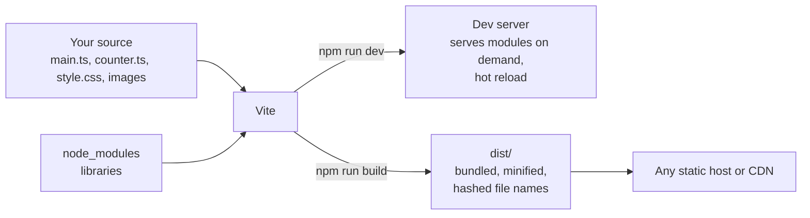
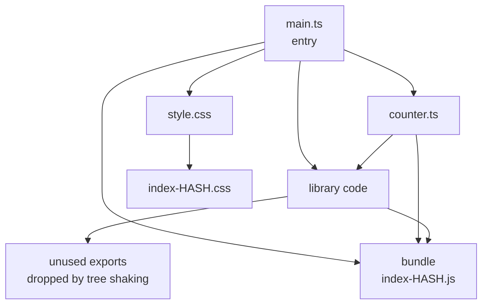

# npm, bundlers and Vite

After this you can create a front-end project with Vite, read its `package.json`, and explain what a bundler does between your source files and what the browser loads.

Before this: [TypeScript](04-typescript.md) and [Package managers and dependencies](../../04-developer-tools-and-workflow/02-project-plumbing/01-package-managers-and-dependencies.md).

## The idea

A real front-end project has dozens of files: TypeScript, CSS, images, and code from libraries you installed. The browser can load each file with its own request, but it cannot read TypeScript, it does not know where `node_modules` is, and a hundred requests are slow. A build tool takes your source and produces a small set of files the browser can use.

You already know the Python version of the first half: `pip` installs packages and `pyproject.toml` or `requirements.txt` lists them. In JavaScript, **npm** does this and `package.json` is the list.



## Key terms

**npm** is the package manager and registry for JavaScript. `package.json` lists the project's name, **scripts** (named commands) and **dependencies**. `devDependencies` are tools used while building, such as TypeScript; `package-lock.json` pins the exact versions installed.

A **bundler** starts at an entry file, follows every `import`, and combines the modules it finds into a few output files. **Tree shaking** drops exports that nothing imports. **Minification** shortens the code by removing whitespace and renaming variables.

**Vite** is a development server and build tool. In development it serves your files as native ES modules; for production it bundles them. **HMR** (hot module replacement) swaps a changed module into the running page without a full reload.

## How it works

Browsers load ES modules natively: `<script type="module" src="/src/main.ts">` makes the browser fetch that file, then fetch every file it imports, one request per module. That is fine on your laptop and slow for a site with hundreds of modules, so production builds bundle.



The graph in the diagram is what the bundler builds by reading `import` statements. Anything not reachable from the entry never reaches the output, and the hash in the file name changes when the content does, so browsers can cache old files forever and still get new ones.

The two modes differ:

1. `npm run dev` starts a server. A request for `/src/counter.ts` gets the file with the types stripped, transformed on the fly. Edit and save, and HMR updates the page in milliseconds.
2. `npm run build` bundles, tree-shakes and minifies into `dist/`. Run `npm run preview` to serve `dist/` locally and check the real output.

Vite does not check types. The template's build script is `tsc && vite build`, which runs the checker first.

Facts as of 2026: Vite 8 needs Node 20.19+ or 22.12+ and bundles production builds with Rolldown ([vite.dev guide](https://vite.dev/guide/)). The scaffolding command takes a template name from the list in the guide.

```bash
npm create vite@latest demo -- --template vanilla-ts
cd demo
npm install
npm run dev
```

The `--` passes `--template` through to the creator. Open the address it prints (by default `http://localhost:5173/`).

A **semantic version** in `package.json` such as `^8.3.4` allows updates to any `8.x.y` at or above that. The lock file keeps installs repeatable, so commit it, and use `npm ci` in CI to install exactly what it lists.

## Worked examples

<div class="example" markdown>

### Example 1: read a scaffolded project and watch tree shaking

The template's `package.json` (trimmed) is:

```json
{
  "name": "demo",
  "private": true,
  "type": "module",
  "scripts": {
    "dev": "vite",
    "build": "tsc && vite build",
    "preview": "vite preview"
  },
  "devDependencies": {
    "typescript": "~6.0.3",
    "vite": "^8.3.4"
  }
}
```

1. `"type": "module"` makes `.js` files ES modules for Node.
2. `npm run build` runs the `build` script: type check, then bundle.
3. Running it in the fresh project printed (sizes will vary):

```text
✓ 9 modules transformed.
dist/index.html                  0.45 kB │ gzip: 0.29 kB
dist/assets/index-CsUDhMuy.css   4.10 kB │ gzip: 1.46 kB
dist/assets/index-wktXvZw9.js    4.49 kB │ gzip: 2.02 kB
✓ built in 106ms
```

Nine modules went in, and one JavaScript file and one CSS file came out, with content hashes in their names.

4. To see tree shaking, make `math.js` with two exports, `add` and a second function containing a distinctive string, and have `main.js` import only `add`. Build with `index.html` containing `<script type="module" src="./main.js"></script>`.

```text
dist/assets/index-DEbj0aoa.js  0.69 kB │ gzip: 0.41 kB
```

Check: `grep -c "only appears" dist/assets/*.js` prints `0`. The unused function and its string are not in the bundle.

</div>

## Common mistakes

<div class="warning" markdown>

Watch out: committing `node_modules/`. It is large and regenerated by `npm install`. Put it in `.gitignore`; commit `package.json` and `package-lock.json`.

Watch out: mixing package managers. If `package-lock.json` exists, use npm; running `yarn` or `pnpm` too creates a second lock file that disagrees.

Watch out: putting secrets in front-end code or `VITE_` environment variables. Anything bundled into `dist/` is public. Keep secrets on the server.

</div>

## Working with AI

<div class="ai" markdown>

Words to use: `package.json` scripts, `devDependencies`, lock file, ES modules, bundler, tree shaking, HMR, Vite.

Prompts to try:

- "I'm on Node 24 and Vite 8. Scaffold a vanilla TypeScript project and show the `package.json` scripts. Which command type-checks, and which one builds?"
- "My Vite build output is 800 kB. List the ways to find out which dependency is large and how to reduce it, with the exact commands."

What to check:

- Package names that do not exist, or exist as a different project. Look the name up on npmjs.com and check downloads and the repository link before running `npm install`.
- Instructions for an older tool such as Create React App or Webpack config, and Vite options from older versions. Check against the current vite.dev docs.
- `npm install` with `--force` or `--legacy-peer-deps` suggested as a fix; it hides a version conflict.
- Mixed `require()` and `import` code. Use one module style per project.

</div>

## Quiz

1\. What is the difference between `dependencies` and `devDependencies`?

<details class="solution" markdown>
<summary>Answer</summary>

`dependencies` are needed by the running code; `devDependencies` are only needed to build, test or check it, such as TypeScript or Vite. For a front-end app the bundler includes only what the code imports, so the distinction matters most for server projects.

</details>

2\. Why bundle for production when browsers support ES modules?

<details class="solution" markdown>
<summary>Answer</summary>

Fewer requests, smaller files (tree shaking and minification), and cache-friendly hashed names. Native modules mean one request per file.

</details>

3\. You ran `npm run dev` and your page works, but `npm run build` fails with a type error. Which command found it, and why did dev not?

<details class="solution" markdown>
<summary>Answer</summary>

The build script runs `tsc` first. The dev server only strips types and never checks them.

</details>

4\. A teammate clones the repo and gets different package versions than you. What file was likely missing or ignored, and which command avoids the problem?

<details class="solution" markdown>
<summary>Answer</summary>

`package-lock.json`, which pins exact versions. Commit it, and install with `npm ci`.

</details>

## Lab

<div class="lab" markdown>

### Lab: create, build and inspect a Vite app

Goal: scaffold a project, add a function, and see the build output. Time: about 20 minutes. Runs in: any terminal with Node 24.

1. Run `npm create vite@latest myapp -- --template vanilla-ts`, then `cd myapp` and `npm install`.
2. Run `npm run dev`, open the printed address, and click the counter button.
3. With the page open, edit the text in `src/main.ts`. Save, and watch the page update without a reload.
4. Stop the server (Ctrl+C), run `npm run build`, and list the files in `dist/assets`.
5. Add a type error in `src/counter.ts` (assign a string to a `number`) and run `npm run build` again.
6. Cleanup: delete the `myapp` folder when you are done.

Expected result: the dev server updates instantly, the build lists a hashed `.js` and `.css` file, and step 5 fails at the `tsc` stage before bundling.

<details class="solution" markdown>
<summary>Solution</summary>

```bash
npm create vite@latest myapp -- --template vanilla-ts
cd myapp
npm install
npm run dev
npm run build
ls dist/assets
```

For step 5, change `let counter = 0` to `let counter: number = "x"` in `src/counter.ts`. The output ends with `error TS2322: Type 'string' is not assignable to type 'number'.` and no `dist/` update.

</details>

</div>

## Where this shows up

- React projects start from the same Vite scaffold: [components, props and JSX](../03-react/01-components-props-and-jsx.md).
- Bundle size drives load time: [web performance](../03-react/05-web-performance.md).
