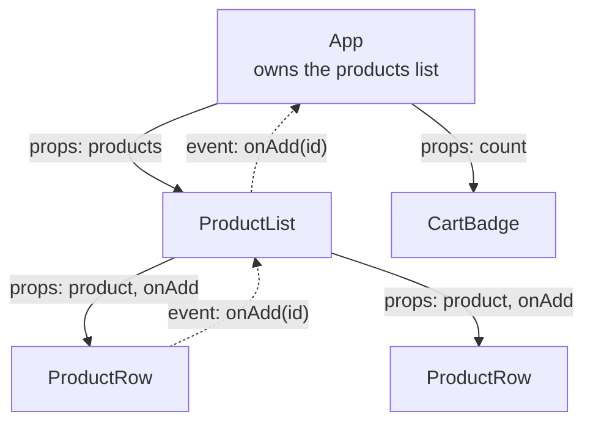

# Components, props and JSX

After this you can read a React component, say what each piece of JSX turns into, and pass data between components with props.

Before this: [JavaScript for Python programmers](../02-javascript-and-typescript/01-javascript-for-python-programmers.md), [the DOM and events](../02-javascript-and-typescript/02-the-dom-and-events.md) and [how browsers render pages](../01-html-css-and-the-browser/01-how-browsers-render-pages.md).

## The idea

Take a shopping page with a header, a list of products and a cart badge. With plain DOM code you write steps: "find the badge element, set its text to 3, add a class to the third row". When the data changes in ten ways, you write ten sets of steps and keep them consistent by hand.

React ([react.dev](https://react.dev/learn)) is a JavaScript library for building user interfaces from pieces called components. Its model is **declarative**: you describe what the screen should look like for the current data, and React works out the DOM changes. You write the picture; React writes the steps.

A page becomes a tree of components. Data flows down the tree as props. When a child needs to tell its parent something (a click, a typed letter), the parent hands it a function, and the child calls that function. In the diagram, data goes down and events go up.



## Key terms

A **component** is a JavaScript function that takes an object of inputs and returns a description of UI. Its name starts with a capital letter.

**JSX** is a syntax extension that lets you write HTML-like markup inside JavaScript. Browsers do not understand it; a build tool compiles it to plain function calls.

**Props** (short for properties) are the inputs a parent passes to a component. A component must not change its own props.

**Children** is the special prop holding whatever is written between a component's opening and closing tags.

A **key** is a string or number that identifies one item in a list, so React can match items between renders.

## How it works

A function component is an ordinary function. React calls it to get JSX, and the markup it returns is what appears on screen.

```jsx
function Greeting({ name, children }) {
  return (
    <section>
      <h1>Hello, {name}</h1>
      {children}
    </section>
  );
}
```

JSX has a few rules that differ from HTML:

1. A component returns one root element. Wrap siblings in a parent or in a fragment, `<>...</>`.
2. Every tag closes, including `` and `<input />`.
3. Attribute names follow JavaScript: `className`, not `class`; `htmlFor`, not `for`; `onClick`, camelCase.
4. Curly braces switch back to JavaScript: `{name}`, `{items.length}`, `style={{ color: "red" }}` (the outer braces are the switch, the inner ones are an object).
5. Braces hold expressions (values), not statements. Use a ternary or `&&` instead of `if`.

JSX is not magic. A compiler turns each tag into a function call. With the automatic JSX runtime, `<Greeting name="Ada">Hi</Greeting>` becomes the call below, which returns a plain object describing the element. That object is what React compares between renders.

```javascript
const el = jsx(Greeting, { name: "Ada", children: "Hi" });
```

Lists and conditions are plain JavaScript:

- To show a list, `map` over an array and give each element a `key` that is stable and unique among siblings, usually a database id. An array index is a poor key when items can be reordered or removed, because React then matches the wrong item to the wrong state.
- To show something only sometimes, use `if` outside the JSX, a ternary `cond ? <A /> : <B />`, or `cond && <A />`.
- Composition means building bigger components by nesting smaller ones and passing content through `children`, instead of copying markup. A `Card` component that renders `{children}` inside a border works for any content.

## Worked examples

<div class="example" markdown>

### Example 1: a todo list with an empty case

We want a `TodoList` that shows each todo with a key, and a message when there are none.

1. Take the array as a prop: `todos`.
2. If it is empty, return a message early.
3. Otherwise `map` each todo to an `<li>` with `key={t.id}`.

```jsx
function TodoList({ todos }) {
  if (todos.length === 0) return <p>Nothing to do.</p>;
  return (
    <ul>
      {todos.map(t => (
        <li key={t.id}>{t.done ? "done: " : ""}{t.text}</li>
      ))}
    </ul>
  );
}
```

We rendered it to a string with `renderToString` from `react-dom/server` (react and react-dom 19.3) for an empty list and for two todos:

```text
<p>Nothing to do.</p>
<ul><li>done: <!-- -->read</li><li>write</li></ul>
```

Check: the empty case returns the message, and the second `<li>` has no "done: " prefix. The `<!-- -->` is a marker React adds between adjacent text pieces; it is not visible in a browser.

</div>

<div class="example" markdown>

### Example 2: the `0 && ...` trap

`{count && <Badge />}` shows nothing when `count` is `false` or `null`, but when `count` is `0` it renders the number 0, because `0 && x` evaluates to `0` and React prints numbers. Rendered with `{0 && "hidden"}`, the output was:

```text
<p class="x" style="color:red">0<!-- -->hi</p>
```

The fix is a real boolean: `{count > 0 && <Badge />}`.

</div>

## Common mistakes

<div class="warning" markdown>

Watch out for three slips. First, a lowercase component name: `<todoList />` is read as an HTML tag, so name components `TodoList`. Second, `key={index}` on a list that can be reordered or filtered, which attaches state to the wrong row; use an id. Third, changing a prop inside a component (`props.items.push(x)`), which changes the parent's data behind its back; copy first.

</div>

## Working with AI

<div class="ai" markdown>

Words to use: function component, props, children, JSX, key, conditional rendering, composition, fragment.

Prompts to try:

- "Here is my React 19 component. Explain which props flow down and which callbacks flow up, and list anything that mutates props."
- "Refactor this 200-line component into smaller components using composition and children. Keep behaviour identical and tell me which props each new component needs."

What to check:

- Keys: every list item has a stable id key, not the array index or `Math.random()`.
- Class-component syntax (`extends React.Component`) or `class=` in JSX; current code uses function components and `className`.
- The `0 &&` trap: a numeric condition in `&&` should be turned into a boolean.
- Hidden mutation: `push`, `sort` or assignment on props. Run the page and check that the parent's data is unchanged.

</div>

## Quiz

1\. What does "declarative" mean in React, and what do you give up compared with writing DOM code by hand?

<details class="solution" markdown>
<summary>Answer</summary>

You describe the UI for the current data and React updates the DOM. You give up direct control of each DOM step; for the rare case where you need it, React has escape hatches such as refs.

</details>

2\. What does this render when `count` is `0`?

```jsx
<p>{count && <b>items</b>}</p>
```

<details class="solution" markdown>
<summary>Answer</summary>

`<p>0</p>`. The expression `0 && x` is `0`, and React renders numbers. Use `count > 0 && ...`.

</details>

3\. A list of editable rows uses `key={index}`. After deleting the first row, the second row's typed text appears in the wrong row. Why?

<details class="solution" markdown>
<summary>Answer</summary>

After the deletion, the old second row has index 0, so React matches it to the old first row's component and its state. A stable id as the key makes React match each row to its own data.

</details>

4\. A child needs to tell its parent that a button was clicked. How is that done if props only flow down?

<details class="solution" markdown>
<summary>Answer</summary>

The parent passes a function as a prop (for example `onAdd`). The child calls it, and the parent's function runs and can change the parent's data.

</details>

## Lab

<div class="lab" markdown>

### Lab: a product list from composition

Goal: build `ProductList`, `ProductRow` and `CartBadge` from the diagram and check the output. Time: about 15 minutes. Runs in: any folder with Node (use a throwaway folder).

1. Run `npm create vite@latest shop -- --template react`, then `cd shop` and `npm install`.
2. In `src/App.jsx`, define an array of three products with `id`, `name` and `price`.
3. Write `ProductRow({ product })` returning an `<li>` with the name and price.
4. Write `ProductList({ products })` that returns "No products" for an empty array and otherwise maps to `ProductRow` with `key={p.id}`.
5. Render `<ProductList products={products} />` in `App`, run `npm run dev` and open the printed address. Change the array to `[]` and check the message.

Expected result: three rows, then the message when the array is empty.

<details class="solution" markdown>
<summary>Solution</summary>

```jsx
const products = [
  { id: 1, name: "Pen", price: 2 },
  { id: 2, name: "Notebook", price: 5 },
  { id: 3, name: "Bag", price: 30 },
];

function ProductRow({ product }) {
  return <li>{product.name}: ${product.price}</li>;
}

function ProductList({ products }) {
  if (products.length === 0) return <p>No products</p>;
  return <ul>{products.map(p => <ProductRow key={p.id} product={p} />)}</ul>;
}

export default function App() {
  return <ProductList products={products} />;
}
```

</details>

</div>

## Where this shows up

- Every React page you will read at work is a tree like this. Next: [State and hooks](02-state-and-hooks.md).
- Typed props are covered in [TypeScript](../02-javascript-and-typescript/04-typescript.md), and the dev server in [npm, bundlers and Vite](../02-javascript-and-typescript/05-npm-bundlers-and-vite.md).
