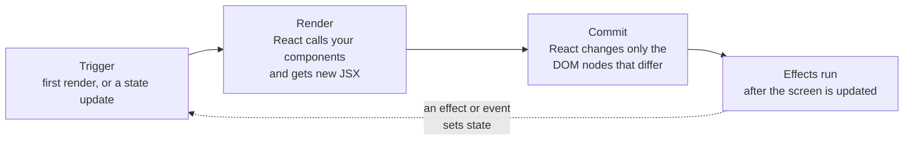
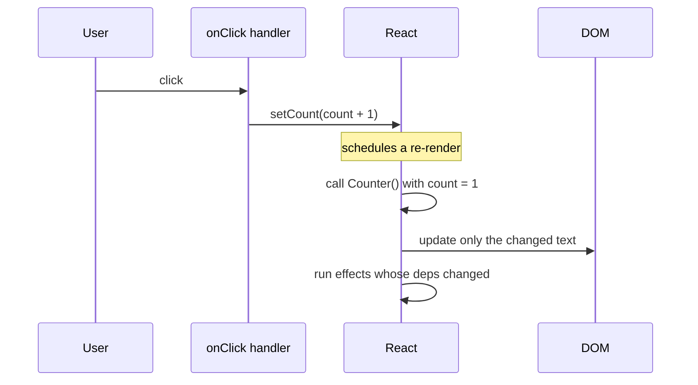

# State and hooks

After this you can add state to a component, update it without bugs, and explain when an effect runs and why.

Before this: [Components, props and JSX](01-components-props-and-jsx.md).

## The idea

A counter button must remember how many times it was clicked. A local variable cannot hold that, because React calls the component function again on every update and the variable would reset to its start value. React keeps the remembered value outside the function and hands it back on each call.

That remembered value is **state**. Changing state tells React to call the component again (a re-render) and compare the new JSX with the old. Only the differences reach the DOM. In the diagram, a state update starts a cycle of three phases.



## Key terms

**State** is data a component remembers between renders. Changing it triggers a re-render.

A **hook** is a function whose name starts with `use` that lets a component use a React feature, such as state or effects. `useState` is the first one you meet.

A **re-render** is React calling a component function again with the current props and state.

An **effect** is code that runs after the screen has been updated, to synchronise the component with something outside React: a timer, a subscription, a network request, the page title.

A **dependency array** is the list passed as the second argument to `useEffect`. React re-runs the effect only when a value in the list changed since the last render.

## How it works

`useState(initial)` returns a pair: the current value and a setter function.

```jsx
const [count, setCount] = useState(0);
```

Calling `setCount(5)` does not change `count` in the code that is already running. It schedules a re-render, and in that next render `count` is 5. Inside one render, state is a snapshot. This explains the classic surprise below: calling `setCount(count + 1)` twice in one click adds 1, not 2, because both calls use the same snapshot. When the new value depends on the old one, pass an updater function, `setCount(c => c + 1)`.

The sequence for one click is shown below.



State must be treated as immutable: never change an object or array in place, always give the setter a new one. React decides whether to re-render by comparing the new value with the old by identity; a mutated array is the same object, so nothing happens (and other state changes then reveal the hidden edit). Copy instead:

| Goal | Immutable update |
|---|---|
| Add to an array | `setItems([...items, newItem])` |
| Remove | `setItems(items.filter(i => i.id !== id))` |
| Change one item | `setItems(items.map(i => i.id === id ? { ...i, done: true } : i))` |
| Change an object field | `setUser({ ...user, name: "Ada" })` |

Two more state ideas:

- Lifting state up: when two siblings need the same data, move the state to their closest common parent and pass it down as props, with setter callbacks for the children to call.
- Other triggers: a component also re-renders when its parent re-renders, even if its own props did not change. That is normal and usually cheap.

`useEffect(setup, deps)` runs `setup` after each commit where `deps` changed. If `setup` returns a function, React calls it as cleanup before the next run and when the component is removed. An empty array `[]` means "run once after the first render"; omitting the array means "after every render".

```jsx
useEffect(() => {
  const id = setInterval(() => setT(x => x + 1), 1000);
  return () => clearInterval(id);   // cleanup
}, []);
```

Every value from the component that the effect reads (props, state, functions) belongs in the array; the lint rule `react-hooks/exhaustive-deps` checks this. Before reaching for an effect, check the [You Might Not Need an Effect](https://react.dev/learn/you-might-not-need-an-effect) page: values you can compute from props and state during render do not need one, and neither does work done in an event handler.

The **rules of hooks** ([react.dev](https://react.dev/reference/rules/rules-of-hooks)): call hooks only at the top level of a component or of another hook, never inside `if`, loops or nested functions, because React matches hooks to state by call order. Call them only from components or custom hooks.

Three more hooks, one paragraph each:

- `useRef(initial)` returns an object `{ current }` that survives re-renders, and changing it does not trigger one. It holds a DOM node (`ref={inputRef}`) or a value such as a timer id.
- `useMemo(fn, deps)` caches the result of `fn` until a dependency changes. It is an optimization for expensive calculations, not a way to make code correct.
- A **custom hook** is your own function starting with `use` that calls other hooks, so stateful logic can be shared. `useToggle` below returns the current value and a function that flips it.

```jsx
function useToggle(initial = false) {
  const [on, setOn] = useState(initial);
  return [on, () => setOn(o => !o)];
}
```

## Worked examples

<div class="example" markdown>

### Example 1: snapshots and updaters

We want to predict the result of one click that calls the setter twice.

1. With `setN(n + 1); setN(n + 1);`, both calls read the same `n` from this render, so both schedule "set to 1".
2. With `setN(c => c + 1); setN(c => c + 1);`, React feeds each updater the latest pending value: 0 becomes 1, then 2.

We ran both in a test with `@testing-library/react` (React 19.3):

```text
render, n = 0
render, n = 1
after click: n=1
updater form: n=2
```

Check: the first component rendered only once more after the click (state 1, not 2), and the updater form reached 2.

</div>

<div class="example" markdown>

### Example 2: mutation vs a new array, and cleanup

A "mutate" button that does `todos.push(...)` left the list showing `a`. Pressing "toggle" (which makes a new array) then showed `a*b`, the hidden edit appearing late. An "add" button using `[...todos, x]` updated at once.

```text
after mutate: a
after toggle: a*b
after add: a*bc
```

For effects, a `Timer` with `[on]` as its dependency logged this over mount, a re-render with the same `on`, a change of `on`, and unmount:

```text
effect start
cleanup
effect start
cleanup
```

The effect did not re-run for the same `on`. Cleanup ran before the next run and at unmount.

</div>

## Common mistakes

<div class="warning" markdown>

Watch out for three slips. First, mutating state (`items.push(x); setItems(items)`): the identity is unchanged, so React may skip the update. Second, a stale or missing dependency: an effect that reads `userId` but lists `[]` keeps using the first value. Fix it by listing every value it reads. Third, a hook inside an `if`: the call order changes between renders, and React attaches state to the wrong hook or throws an error.

</div>

## Working with AI

<div class="ai" markdown>

Words to use: state, re-render, immutable update, updater function, lifting state up, dependency array, cleanup function, custom hook.

Prompts to try:

- "This React 19 component re-renders in a loop. Here is the code. Which effect or state update triggers each render, and what should the dependency array be?"
- "Is this useEffect needed? The value can be derived from props. Rewrite it without an effect if possible and explain why."

What to check:

- Effects that only copy props into state (`useEffect(() => setX(prop), [prop])`); compute during render instead.
- Dependency arrays silenced with an eslint-disable comment instead of fixed.
- Mutation of state (`push`, `sort`, direct assignment); look for the setter being passed the same object.
- `useMemo` or `useCallback` added everywhere "for performance" without a measurement.

</div>

## Quiz

1\. Why can't a plain local variable replace `useState` for a counter?

<details class="solution" markdown>
<summary>Answer</summary>

React calls the component function again on each render, so a local variable is recreated. State is stored by React between calls, and changing it triggers the re-render.

</details>

2\. What is the value of `n` after one click?

```jsx
const [n, setN] = useState(0);
// onClick:
setN(n + 1);
setN(n + 1);
setN(n + 1);
```

<details class="solution" markdown>
<summary>Answer</summary>

1. All three calls use the snapshot `n = 0` and each schedules "set to 1". Use `setN(c => c + 1)` to get 3.

</details>

3\. This list never updates on screen after pressing Add. Find the bug.

```jsx
function add(text) { items.push({ id: Date.now(), text }); setItems(items); }
```

<details class="solution" markdown>
<summary>Answer</summary>

It mutates the existing array and passes the same object back, so React sees no change. Use `setItems([...items, { id: Date.now(), text }])`.

</details>

4\. When does the cleanup function in `useEffect(() => { ...; return cleanup }, [id])` run?

<details class="solution" markdown>
<summary>Answer</summary>

Before the effect runs again because `id` changed, and when the component is removed from the page.

</details>

## Lab

<div class="lab" markdown>

### Lab: a todo list with state

Goal: add, toggle and remove todos, with every update immutable. Time: about 20 minutes. Runs in: the Vite project from the previous lab.

1. Create `useState([])` for todos and `useState("")` for the text of a new todo.
2. Add a form with an input and an Add button; on submit, add `{ id: Date.now(), text, done: false }` with a spread and clear the input.
3. Show each todo with a checkbox that toggles `done` using `map`, and a Remove button using `filter`.
4. Add an effect that sets `document.title` to the number of todos left, with the right dependency array.
5. Open React DevTools and check the todos state changes on each click.

Expected result: the list updates immediately, and the tab title shows the number of unfinished todos.

<details class="solution" markdown>
<summary>Solution</summary>

```jsx
import { useState, useEffect } from "react";

export default function App() {
  const [todos, setTodos] = useState([]);
  const [text, setText] = useState("");
  useEffect(() => {
    document.title = `${todos.filter(t => !t.done).length} left`;
  }, [todos]);
  function add(e) {
    e.preventDefault();
    setTodos([...todos, { id: Date.now(), text, done: false }]);
    setText("");
  }
  return (
    <>
      <form onSubmit={add}>
        <input value={text} onChange={e => setText(e.target.value)} />
        <button>Add</button>
      </form>
      <ul>
        {todos.map(t => (
          <li key={t.id}>
            <input type="checkbox" checked={t.done}
              onChange={() => setTodos(todos.map(x => x.id === t.id ? { ...x, done: !x.done } : x))} />
            {t.text}
            <button type="button" onClick={() => setTodos(todos.filter(x => x.id !== t.id))}>Remove</button>
          </li>
        ))}
      </ul>
    </>
  );
}
```

</details>

</div>

## Where this shows up

- State plus effects is how data fetching works: [Data fetching and forms](03-data-fetching-and-forms.md).
- Re-render cost and `useMemo` come back in [Web performance](05-web-performance.md).
