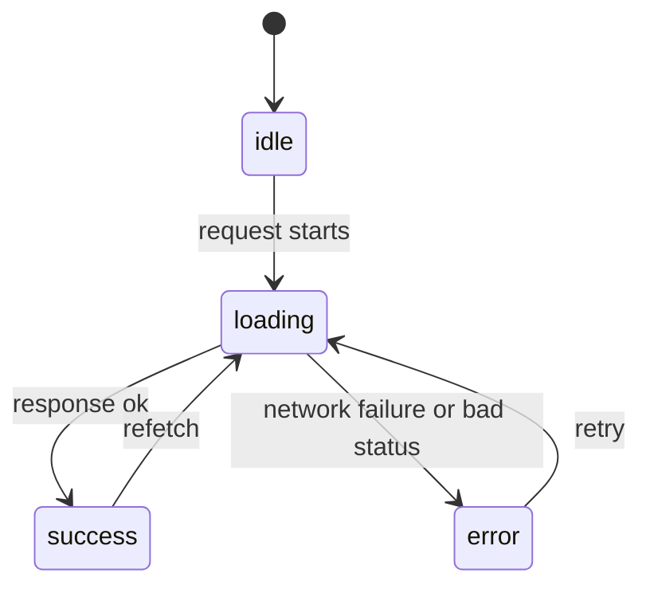

# Data fetching and forms

After this you can load data from an API in a component without race conditions, show loading and error states, and build a controlled form with validation.

Before this: [State and hooks](02-state-and-hooks.md) and [async JavaScript and the event loop](../02-javascript-and-typescript/03-async-javascript-and-the-event-loop.md).

## The idea

A profile page shows a user's name, but the name lives on a server. The component renders first, with nothing to show, then asks the server, then renders again when the answer arrives. So the page is in one of four situations, and the code must handle all of them: nothing requested yet, waiting, got the data, or failed.



Writing this as one state value (`status`) instead of separate booleans such as `isLoading` and `isError` prevents impossible combinations like "loading and failed" at the same time.

## Key terms

A **race condition** is a bug where the result depends on the order in which things finish. Here: request 1 starts, request 2 starts, request 2 finishes, then request 1 finishes and overwrites the newer data.

An **AbortController** is a browser object whose `signal` can be passed to `fetch`. Calling `abort()` cancels the request, and the `fetch` promise rejects with an error named `AbortError`.

A **controlled input** is a form field whose value is held in React state: the field shows `value`, and `onChange` updates the state.

**Server state** is data that lives on a server and is only borrowed by the page (users, orders). It can go stale, and it is shared between components. It differs from UI state (a menu is open), which only the page owns.

## How it works

The basic pattern is to fetch inside an effect, keep a status in state, and cancel in cleanup. The `useEffect` and cleanup behaviour is from the [previous lesson](02-state-and-hooks.md).

```jsx
function User({ id }) {
  const [state, setState] = useState({ status: "loading" });
  useEffect(() => {
    const ctl = new AbortController();
    setState({ status: "loading" });
    fetch(`/api/users/${id}`, { signal: ctl.signal })
      .then(r => { if (!r.ok) throw new Error("HTTP " + r.status); return r.json(); })
      .then(data => setState({ status: "success", data }))
      .catch(e => { if (e.name !== "AbortError") setState({ status: "error", message: e.message }); });
    return () => ctl.abort();
  }, [id]);
  if (state.status === "loading") return <p>Loading...</p>;
  if (state.status === "error") return <p role="alert">Error: {state.message}</p>;
  return <p>{state.data.name}</p>;
}
```

Three details matter. `fetch` only rejects on network failure, so a 404 or 500 still resolves; check `r.ok` yourself. The cleanup aborts the previous request when `id` changes, so a late reply can never overwrite a newer one. And the `AbortError` is expected, so it is ignored rather than shown.

This pattern is fine for one small request. Real pages also need caching, de-duplication (two components asking for the same data), retries, refetching when the user returns to the tab, and updating the page after a change. A server-state library handles all of that. [TanStack Query](https://tanstack.com/query/latest) is the common one (as of 2026, `@tanstack/react-query` 5.x on npm); SWR is a smaller alternative.

```jsx
const { data, isPending, error } = useQuery({
  queryKey: ["user", id],
  queryFn: () => fetch(`/api/users/${id}`).then(r => r.json()),
});
```

The `queryKey` plays the role of the dependency array, and the library keeps a cache keyed by it.

Forms follow the controlled-input pattern. State holds the field, `onChange` copies each keystroke into it, and the `onSubmit` handler calls `e.preventDefault()` (otherwise the browser reloads the page), validates, then sends the data.

Validation has two layers. Client checks (an `@` in the email) give fast feedback. Server checks are the real ones, because anyone can call your API without your form; see validation and error handling<!-- link: ../../09-back-end/01-servers-and-apis/05-validation-and-error-handling.md -->.

A note on where React is heading: in frameworks that support React Server Components, such as Next.js, a component can run on the server, read a database, and send finished markup, so no fetch-in-effect is needed for the first load. Those components cannot use state or effects; the ones that do are marked `"use client"`. Next.js documents its data fetching in its [App Router docs](https://nextjs.org/docs/app/getting-started/fetching-data). The next lesson places this in the wider landscape.

## Worked examples

<div class="example" markdown>

### Example 1: the race, with and without abort

We want to see the bug the cleanup prevents. We mocked `fetch` so `/api/users/1` takes 100 ms and `/api/users/2` takes 10 ms, then rendered `User` with `id=1` and immediately changed it to `id=2`.

1. Without abort, request 2 returns first and shows `user2`; at 100 ms request 1 returns and its `.then` overwrites it.
2. With the `AbortController` cleanup, the request for 1 is cancelled when `id` changes to 2.

```text
without abort:
after fast request: user2
after slow request: user1
with abort:
after id 2: user2
after slow request 1 would have landed: user2
```

Check: the screen shows the data for `id=2`, which is the id in the props, only in the second case. A third render with `id=3`, mocked to return 404, showed `Error: HTTP 404`.

</div>

<div class="example" markdown>

### Example 2: a controlled form with validation

```jsx
function Form() {
  const [email, setEmail] = useState("");
  const [err, setErr] = useState("");
  function submit(e) {
    e.preventDefault();
    if (!email.includes("@")) { setErr("Enter a valid email"); return; }
    setErr(""); setEmail("");
  }
  return (
    <form onSubmit={submit}>
      <label>Email <input value={email} onChange={e => setEmail(e.target.value)} /></label>
      <button>Send</button>
      {err && <p role="alert">{err}</p>}
    </form>
  );
}
```

Submitting `bad` showed the message; submitting `a@b.ca` cleared the error and reset the input to an empty string (checked with `input.value`).

</div>

## Common mistakes

<div class="warning" markdown>

Watch out for three slips. First, trusting `fetch` to reject on a 404: it does not, so check `r.ok`. Second, an `async` function passed directly to `useEffect`: it returns a promise, but React expects a cleanup function or nothing; define the async function inside and call it. Third, switching an input between `value={undefined}` and a string, which turns it from uncontrolled to controlled with a warning; start state at `""`.

</div>

## Working with AI

<div class="ai" markdown>

Words to use: race condition, AbortController, loading and error states, server state, cache key, controlled input, stale data.

Prompts to try:

- "Convert this useEffect fetch in React 19 to TanStack Query v5. Keep the loading and error UI and use a query key that includes the id."
- "Review this component for race conditions when the id prop changes quickly. Show the sequence of events that breaks it."

What to check:

- A fetch with no `r.ok` check, or no error branch in the UI.
- An effect fetching on every render because the dependency array is missing.
- Old TanStack Query v4 syntax (`useQuery(["key"], fn)`); v5 takes one options object.
- API keys or secrets placed in front-end code; anything in the bundle is public.

</div>

## Quiz

1\. Why is a single `status` value better than `isLoading` and `isError` booleans?

<details class="solution" markdown>
<summary>Answer</summary>

It allows only one situation at a time. Two booleans permit impossible combinations, like loading and error together.

</details>

2\. Predict the output for `fetch("/missing")` where the server returns 404, if the code is `fetch(url).then(() => "ok").catch(() => "failed")`.

<details class="solution" markdown>
<summary>Answer</summary>

`"ok"`. A 404 is still a complete HTTP response, so `fetch` resolves. Only network failures reject.

</details>

3\. A search box fires a request per keystroke. Typing "cat" sometimes shows results for "ca". Why, and what are two fixes?

<details class="solution" markdown>
<summary>Answer</summary>

A race condition: the reply for "ca" arrived after the reply for "cat". Abort the previous request in the effect cleanup, or use a library that tracks the latest key. Debouncing the input also reduces requests.

</details>

4\. What does `e.preventDefault()` do in a submit handler?

<details class="solution" markdown>
<summary>Answer</summary>

It stops the browser's default form submission, which would reload the page, so your React code handles the data instead.

</details>

## Lab

<div class="lab" markdown>

### Lab: a user lookup with all four states

Goal: build a component that loads a user by id with loading, error and success views. Time: about 20 minutes. Runs in: the Vite project from before; needs internet.

1. Use `https://jsonplaceholder.typicode.com/users/ID` as the API (it returns user 1 to 10 and a 404 for others).
2. Add a number input for the id (controlled) and the `User` component from this lesson, with the id as a prop.
3. Open the DevTools Network tab, set throttling to "Slow 4G", and change the id quickly. Check that earlier requests show as cancelled.
4. Enter 999 and check the error message.
5. Replace the effect with `useQuery` after `npm install @tanstack/react-query` (wrap the app in a `QueryClientProvider`). Compare: go back to a previous id and notice there is no loading flash.

Expected result: the name appears, then the error for 999, and cancelled requests in the Network tab.

<details class="solution" markdown>
<summary>Solution</summary>

Use the `User` component above with the URL `https://jsonplaceholder.typicode.com/users/${id}`. For step 5:

```jsx
import { QueryClient, QueryClientProvider, useQuery } from "@tanstack/react-query";

const queryClient = new QueryClient();

function User({ id }) {
  const { data, isPending, error } = useQuery({
    queryKey: ["user", id],
    queryFn: async () => {
      const r = await fetch(`https://jsonplaceholder.typicode.com/users/${id}`);
      if (!r.ok) throw new Error("HTTP " + r.status);
      return r.json();
    },
  });
  if (isPending) return <p>Loading...</p>;
  if (error) return <p role="alert">Error: {error.message}</p>;
  return <p>{data.name}</p>;
}
// in main.jsx: <QueryClientProvider client={queryClient}><App /></QueryClientProvider>
```

</details>

</div>

## Where this shows up

- The API on the other end is built in REST API design<!-- link: ../../09-back-end/01-servers-and-apis/04-rest-api-design.md -->.
- Next: [Frameworks and libraries landscape](04-frameworks-and-libraries-landscape.md).
