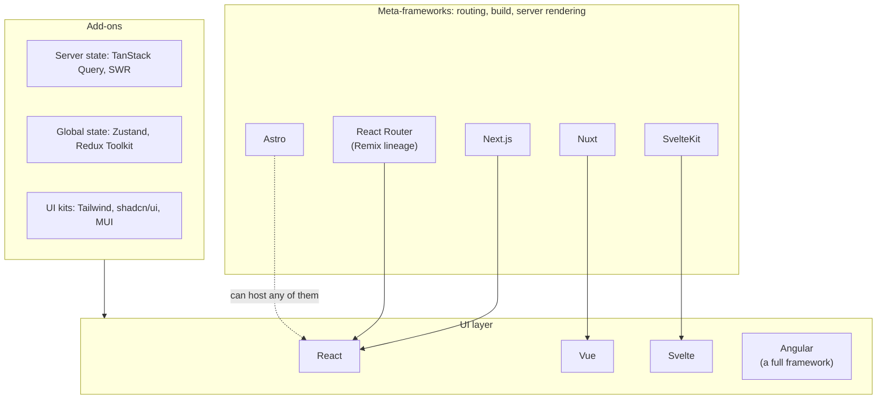

# Frameworks and libraries landscape

After this you can place a front-end tool on the map (library, framework, meta-framework), explain SSR, SSG, CSR and islands, and pick a reasonable stack for a new project.

Before this: [Data fetching and forms](03-data-fetching-and-forms.md) and [npm, bundlers and Vite](../02-javascript-and-typescript/05-npm-bundlers-and-vite.md).

## The idea

A job posting says "React, Next.js, Tailwind, TanStack Query, Zustand". Each name does a different job, and a project usually mixes several. The map below sorts them by the question they answer: what draws the UI, what organizes the app (routing, building, server rendering), and what adds smaller features (data, global state, components).

## Key terms

A **library** is code your program calls; you stay in control of the structure. A **framework** is code that calls yours: it sets the structure, such as folders, routing and build, and you fill in the pieces (inversion of control). React describes itself as a library. Angular is a framework.

A **meta-framework** is a framework built on top of a UI library that adds routing, a build setup and server rendering. Next.js (on React), Nuxt (on Vue) and SvelteKit (on Svelte) are examples.

**CSR** (client-side rendering): the server sends a nearly empty HTML page and JavaScript builds the UI in the browser. **SSR** (server-side rendering): the server builds the HTML on each request, and the browser then **hydrates** it, meaning it attaches JavaScript so the page becomes interactive. **SSG** (static site generation): the HTML is built once at build time and served as files. **Islands**: the page is mostly static HTML, and only marked components ship JavaScript.

## How it works

The rendering strategies differ in when the HTML is made and how much JavaScript the browser needs.

| Strategy | HTML made | First paint | Good for |
|---|---|---|---|
| CSR | In the browser | Slow (blank until JS runs) | Dashboards behind a login |
| SSR | On the server, per request | Fast | Personalized pages that search engines should see |
| SSG | At build time | Fastest, served from a CDN | Docs, blogs, marketing pages |
| Islands | Build or request time | Fast, little JS | Content sites with a few interactive widgets |

Meta-frameworks mix these per route: a Next.js app can have a static marketing page, a server-rendered product page and a client-rendered dashboard.

The main choices as of 2026:

| Tool | Kind | Notes |
|---|---|---|
| React 19 | UI library | The largest ecosystem and job market |
| Vue 3 | UI framework (progressive) | Single-file components, gentler learning curve |
| Angular 22 | Full framework | TypeScript by default, includes router, forms and HTTP client |
| Svelte 5 | Compiler-based UI framework | Compiles components to small JavaScript, less runtime |
| Next.js 16 | React meta-framework | File-based routing, server components, SSR and SSG |
| Nuxt, SvelteKit | Meta-frameworks for Vue and Svelte | The same role as Next.js |
| Astro 7 | Content-focused meta-framework | Islands; can use React, Vue or Svelte inside |
| React Router | Routing library and framework mode | Continues the Remix v2 line |

Versions are the latest on npm in October 2026 ([react](https://react.dev/versions), [next](https://www.npmjs.com/package/next), [vue](https://www.npmjs.com/package/vue), [@angular/core](https://www.npmjs.com/package/@angular/core), [svelte](https://www.npmjs.com/package/svelte), [astro](https://www.npmjs.com/package/astro)); they change every few months, so check before you pin one.

Popularity, as of 2026: in the [2025 Stack Overflow Developer Survey](https://survey.stackoverflow.co/2025/technology), the share of all respondents who used each web framework was React 44.7%, Next.js 20.8%, Angular 18.2%, Vue.js 17.6%, Svelte 7.2% and Astro 4.5%. A survey of people who answer Stack Overflow polls is one sample; use it as a rough ranking, not a market measurement.

Other layers you will meet:

- Global client state: Redux Toolkit (large, explicit), Zustand (small, simple), or React's own context for rarely changing values. Many apps need none, because server state sits in TanStack Query and local state in components.
- Styling and components: Tailwind CSS (utility classes), component kits such as MUI, and copy-in collections such as shadcn/ui.
- Build tools: Vite for plain single-page apps, or the one built into the meta-framework.

## Worked examples

### Example 1: choosing for three projects

We want a stack for each case, using the questions below.

1. Does the page need search engines to read it, or fast first paint on weak phones? If yes, prefer SSR or SSG over plain CSR.
2. How interactive is it? Mostly reading text: static or islands. Mostly widgets: a UI library with client state.
3. What does the team know, and what do the job listings in your market ask for?

| Project | Choice | Reason |
|---|---|---|
| Internal admin dashboard behind login | Vite + React, TanStack Query | No SEO need; CSR is simple |
| Company blog and docs | Astro (or Next.js static export) | Content, little JavaScript |
| Online shop with product pages | Next.js | SEO, per-request data, many routes |

Check: say which of SSR, SSG, CSR or islands each row uses, and why the dashboard can skip server rendering.

## Common mistakes

Watch out for three slips. First, choosing a tool by popularity alone: pick by the project's needs and your team's skills. Second, adding Redux, a UI kit and a router to a small app before any need appears; start with the least. Third, treating a version number from a tutorial as current: many tutorials show old APIs (Next.js "pages router", Redux without Toolkit). Check the official docs for the version in your `package.json`.

## Working with AI

Words to use: meta-framework, SSR, SSG, hydration, islands, server components, server state, bundle.

Prompts to try:

- "I am building a content site with a few interactive widgets, five pages, deployed as static files. Compare Astro and Next.js for it on JavaScript shipped, build setup and hosting."
- "Explain what my Next.js 16 page does on the server and what runs in the browser. Here is the file, and which parts are marked use client?"

What to check:

- Version drift: code written for an older major version (Next.js pages router, Vue 2 options syntax, Angular NgModules). Compare with the official docs for your version.
- Recommended libraries that are abandoned or tiny; check the npm page for recent releases and weekly downloads.
- Server-only code (database access, secrets) landing in a client component; anything marked `use client` is sent to the browser.

## Quiz

1\. What is the difference between a library and a framework?

Answer

You call a library; a framework calls you. A framework sets the app's structure and you fill in the parts.

2\. Which rendering strategy fits a documentation site updated by developers a few times a day, and why?

Answer

SSG. Pages are the same for everyone, so building them once and serving files from a CDN is fastest and cheapest.

3\. A team reports their React dashboard shows a blank page for two seconds on slow phones, and it needs no SEO. What are two options?

Answer

Reduce the JavaScript sent (code splitting, fewer libraries), or add SSR in a meta-framework so HTML arrives first. Since there is no SEO need, first measure whether the bundle is the problem.

4\. What does hydration do?

Answer

It attaches event handlers and state to HTML that the server already rendered, so the page becomes interactive without rebuilding the DOM.

## Lab

### Lab: compare two starters

Goal: see the difference between a plain React app and a meta-framework. Time: about 15 minutes. Runs in: any folder with Node (use a throwaway folder; needs internet).

1. Run `npm create vite@latest plain -- --template react`, then `cd plain`, `npm install`, `npm run build`. Note the size of the JavaScript file in `dist/assets`.
2. Run `npx create-next-app@latest next-app` and accept the defaults; then `cd next-app` and `npm run build`. Read the route table printed at the end.
3. In a browser, open each dev server, choose View Source, and compare: which page's HTML already contains the text on screen?
4. Delete both folders.

Expected result: the Vite page source has an empty `
`, and the Next.js source contains the rendered text.

Solution

The Vite template is CSR: the HTML is a shell and JavaScript fills in `#root`. Next.js renders the page to HTML on the server (or at build time), then hydrates it. The route table marks each route as static or dynamic.

## Where this shows up

- Pages that load slowly are the subject of [Web performance](05-web-performance.md).
- Server-side code for these frameworks runs on Node, covered in [Node.js and its runtime](../../09-back-end/01-servers-and-apis/02-nodejs-and-its-runtime.md).
