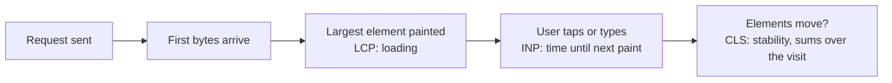

# Web performance

After this you can name the Core Web Vitals, find out which one a page fails, and pick the fix that matches the cause instead of guessing.

Before this: [Frameworks and libraries landscape](04-frameworks-and-libraries-landscape.md) and [how browsers render pages](../01-html-css-and-the-browser/01-how-browsers-render-pages.md).

## The idea

A product page feels slow. It could be a 3 MB image, a 900 KB JavaScript bundle that blocks the first paint, a banner that pushes the button down just as you tap, or a component that re-renders 40 times per keystroke. Each cause has a different fix, and fixing the wrong one wastes a week. So the order is always: measure, find the biggest cost, fix it, measure again.

Google defines three user-centred metrics, the **Core Web Vitals**. In the timeline, each marks a different moment in a page's life.



## Key terms

**Largest Contentful Paint (LCP)** is the time until the biggest visible element (usually a hero image or a heading block) is drawn. It measures loading. Good is 2.5 seconds or less ([web.dev/lcp](https://web.dev/articles/lcp)).

**Interaction to Next Paint (INP)** is how long the page takes to show a response after a click, tap or key press, taken from the slowest of the visit's interactions. It measures responsiveness. Good is 200 milliseconds or less ([web.dev/inp](https://web.dev/articles/inp)).

**Cumulative Layout Shift (CLS)** is a score of how much visible content jumps around unexpectedly. Good is 0.1 or less ([web.dev/cls](https://web.dev/articles/cls)).

The thresholds are measured at the 75th percentile of real page loads, split by mobile and desktop ([web.dev/vitals](https://web.dev/articles/vitals), as of 2026). A **bundle** is the JavaScript file(s) a build tool produces for the browser. **Code splitting** means breaking the bundle into chunks that load on demand.

## How it works

Match the symptom to a cause and a fix.

| Metric failing | Usual causes | Fixes |
|---|---|---|
| LCP | Big or late hero image, slow server, JavaScript blocking render | Resize and compress images, use WebP or AVIF, serve from a CDN, cache, avoid lazy-loading the hero image, ship less JavaScript |
| INP | Long JavaScript tasks on the main thread, heavy re-renders | Do less work per event, split big tasks, avoid needless re-renders, defer non-urgent work |
| CLS | Images or ads without reserved space, late-injected banners, web fonts swapping | Set `width` and `height` on images, reserve space for dynamic content |

Four levers cover most front-end problems:

1. Bundle size. Every kilobyte of JavaScript must be downloaded, parsed and run. In a Vite or Next.js build, load rarely used screens on demand with a dynamic `import()`; React wraps it as `lazy` plus `Suspense`. Check what is inside the bundle with a bundle analyzer, and replace heavy libraries (a 70 KB date library for one format call).
2. Images. Serve the displayed size, not the camera size; use `srcset` for different screens, WebP or AVIF where supported, `loading="lazy"` below the fold, and always `width` and `height`.
3. Caching. Give build files content hashes in their names (`app.3f9a1c.js`) and serve them with a long `Cache-Control: max-age` plus `immutable`; the HTML itself gets a short cache. A CDN keeps copies near users (see [the memory hierarchy](../../01-how-computers-work/02-hardware/04-memory-hierarchy-and-latency-numbers.md): a round trip across an ocean costs about 90 ms, so fewer of them matters).
4. Rendering work in React. A parent's update re-renders all its children by default. This is usually cheap. `React.memo` skips a child when its props are unchanged, `useMemo` caches a calculation, and `useCallback` caches a function. They are tools for a measured problem. Most components re-render in under a millisecond, and the memo check itself costs something; wrapping everything adds noise and bugs (a stale dependency) for no gain. The [React Compiler](https://react.dev/learn/react-compiler) can add this memoization automatically, so you write less of it by hand.

Measure in two ways. Lab data comes from a controlled run, such as **Lighthouse** in Chrome DevTools (Performance report with LCP, CLS and total blocking time). Field data comes from real users, such as the Chrome UX Report or the `web-vitals` library. The React DevTools **Profiler** records a session and shows which components rendered and how long each took.

## Worked examples

<div class="example" markdown>

### Example 1: when memo helps, and what it costs

We want to see how many times a child renders when only the parent's state changes. `Plain` and a `memo`-wrapped `Memoed` both receive the unchanged prop `label="a"`, and we click the parent's button three times.

```jsx
const Memoed = memo(function Memoed({ label }) { return <i>{label}</i>; });
// Parent has a counter in state and renders <Plain label="a" /> and <Memoed label="a" />
```

Counting renders (React 19.3, test with Testing Library):

```text
Plain renders: 4
Memoed renders: 1
```

The plain child rendered on mount plus each of three clicks; the memoized one rendered once. This is a real saving only if `Plain` is expensive. If the child renders a thousand rows or does heavy work, memoizing helps; if it renders one `<i>`, the saving is invisible.

Check: confirm with the Profiler instead of counting by hand. Record, click, and look for components marked as rendered with a time more than a few milliseconds.

</div>

<div class="example" markdown>

### Example 2: code splitting a heavy screen

A charts page imports a 400 KB library, but most visitors never open it. Loading it on demand:

```jsx
const Chart = lazy(() => import("./Chart.jsx"));

<Suspense fallback={<p>Loading chart...</p>}>
  <Chart />
</Suspense>
```

In a test, the first output was `Loading chart...` and after the import finished, `Chart`. The bundler turns `import()` into a separate file that is fetched when first needed. Check the Network tab: the chunk should load only when the route opens.

</div>

## Common mistakes

<div class="warning" markdown>

Watch out for three slips. First, optimizing without measuring: profile first, because the slow part is rarely the one you suspect. Second, `useMemo` and `useCallback` everywhere, which adds code and stale-dependency bugs while the page is just as slow. Third, lazy-loading the hero image, which delays LCP; lazy-load only what starts off screen.

</div>

## Working with AI

<div class="ai" markdown>

Words to use: LCP, INP, CLS, main thread, bundle size, code splitting, cache headers, re-render, Profiler.

Prompts to try:

- "Here is my Lighthouse report summary: LCP 4.1 s, CLS 0.02, total blocking time 800 ms, hero image 2.4 MB. Rank the likely causes and give the first three things to change."
- "My React 19 list component takes 300 ms to respond to a click. Here is the React DevTools Profiler output. Which component re-renders unnecessarily and why?"

What to check:

- Advice to add `useMemo` or `React.memo` with no profile evidence; ask what measurement shows the problem.
- Invented Lighthouse or web-vitals options; check the official docs.
- Cache headers that are too long on the HTML file, so users keep an old page.
- Thresholds quoted from memory; compare with web.dev.

</div>

## Quiz

1\. Which Core Web Vital measures visual stability, and what is a good value?

<details class="solution" markdown>
<summary>Answer</summary>

Cumulative Layout Shift (CLS); 0.1 or less at the 75th percentile.

</details>

2\. Given the rendering in Example 1, how many times does `Plain` render after four clicks on the parent button, counting mount?

<details class="solution" markdown>
<summary>Answer</summary>

Five: one mount plus four updates. A plain child re-renders each time its parent does, even with unchanged props.

</details>

3\. A page jumps down just before the user taps a button, and the banner above it loads late. Which metric, and what fix?

<details class="solution" markdown>
<summary>Answer</summary>

CLS. Reserve the banner's space in advance (fixed height, or `width` and `height` on its image) so nothing moves when it loads.

</details>

4\. Your teammate wants to wrap every component in `memo`. What do you say?

<details class="solution" markdown>
<summary>Answer</summary>

Measure first. Most re-renders are cheap, and memo adds a props comparison and the risk of stale values. Use it where the Profiler shows an expensive child re-rendering with the same props.

</details>

## Lab

<div class="lab" markdown>

### Lab: measure a page, fix one thing

Goal: find the biggest problem on a real page and confirm the fix. Time: about 20 minutes. Runs in: Chrome, plus any site you built or a static page.

1. Open the page in a Chrome Incognito window (extensions skew results). Open DevTools, Lighthouse tab, choose Mobile, run the report. Write down LCP, CLS and the top three "Opportunities".
2. Open the Network tab, reload, sort by size. Note the largest file and whether it is an image or JavaScript.
3. Fix the single biggest item: resize or compress the image, or lazy-load a route.
4. Run Lighthouse again and compare the same numbers.
5. In your React app, open the Profiler tab in React DevTools, record while typing in an input, and check which components rendered.

Expected result: one number (usually LCP) improves, and you can name the cause.

<details class="solution" markdown>
<summary>Solution</summary>

There is no single answer; a typical result is a hero image reduced from megabytes to under 200 KB, which lowers LCP by seconds on a mobile profile. Lighthouse results vary between runs, so run it two or three times.

</details>

</div>

## Where this shows up

- Caching headers are covered in [HTTP headers, cookies and caching](../../07-networking/02-web-protocols/02-http-headers-cookies-and-caching.md), and CDNs in [proxies and CDNs](../../07-networking/02-web-protocols/05-proxies-and-cdns.md).
- The next chapter moves to the server side: what a back end does<!-- link: ../../09-back-end/01-servers-and-apis/01-what-a-back-end-does.md -->.
