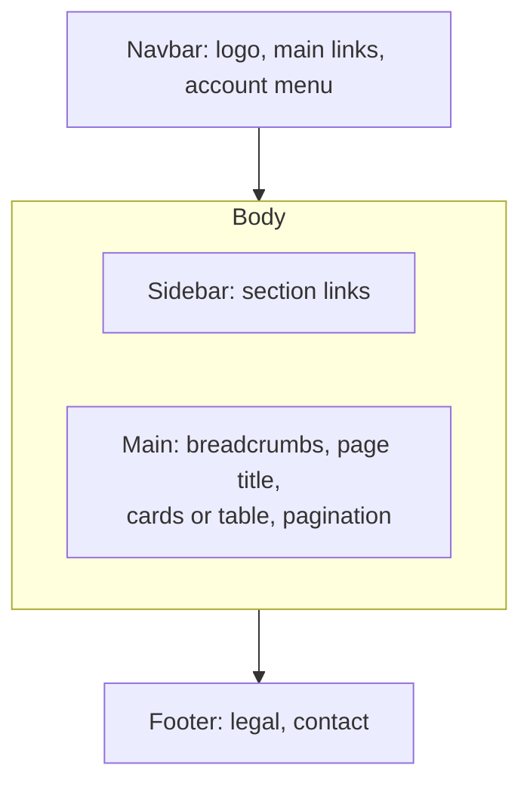
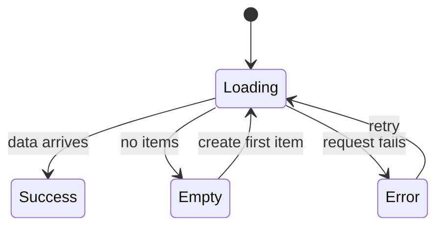

# UI vocabulary and components

After this you can name the parts of a user interface correctly, pick the right component for a job, and list the states every screen needs.

Before this: [Accessibility](../01-html-css-and-the-browser/05-accessibility.md), [Layout with flexbox, grid and responsive design](../01-html-css-and-the-browser/04-layout-flexbox-grid-and-responsive.md) and [Components, props and JSX](../03-react/01-components-props-and-jsx.md).

## The idea

A designer's note says: "Put the CTA in a sticky footer, show a skeleton while it loads, and confirm with a toast." If you cannot name those things, you build the wrong ones and write vague prompts for an AI coding tool. For a developer, most of UI design is vocabulary: what each pattern is called, what it is for, and when to avoid it.

The **user interface** (UI) is what the user sees and touches: layout, text, colour, controls. The **user experience** (UX) is the whole experience of getting a task done, including speed, clarity, mistakes and recovery. A screen can look polished (good UI) and still make people lose their work (bad UX). The next lessons cover [visual design](02-visual-design-basics.md) (the look) and [UX research](04-ux-research-and-usability.md) (the experience). This lesson covers the parts.



## Key terms

**Layout** is how elements are arranged on the screen: what is where, and how much space separates them. **Visual hierarchy** is the order in which the eye reads a page, controlled by size, weight, colour, contrast and position. The most important thing should look the most important.

An **affordance** is what an element lets you do (a button affords pressing). A **signifier** is the visible clue that tells you so (a raised shape, a label, an underline). In practice, a design fails when the affordance exists but the signifier is missing, such as a clickable card with no hover state.

Actions come in ranks. The **primary action** is the one thing you most want the user to do on a view (Save). A **secondary action** is an alternative (Cancel), drawn quieter. A **destructive action** deletes or overwrites data; it is usually red and often asks for confirmation or offers undo. A **call to action** (CTA) is the button or link that asks for the next step in a flow ("Start free trial"). Keep to one primary action per view, or nothing looks primary.

## How it works

Pick a component by the job, not by what looks good. The tables give the job first.

Actions and navigation:

| Component | Job | Rule |
|---|---|---|
| Button | Do something on this page (submit, save, open a dialog) | Label with a verb: "Save changes" |
| Link | Go somewhere (another URL or section) | A button acts, a link navigates |
| Navbar | Top-level destinations, always visible | 5 to 7 items; collapses to a menu button on small screens |
| Sidebar | Many sections of an app | Highlight the current one |
| Tabs | Switch between views of the same thing | One panel visible at a time; do not use for steps |
| Breadcrumbs | Show where you are in a hierarchy | Home / Shop / Shoes; the last item is the current page |
| Pagination | Move through a long list in pages | Use when users must find or return to a position |
| Infinite scroll | Load more as you scroll | Use for feeds; avoid when users need the footer or a position |
| Accordion | Collapse sections to save space | Good for FAQs; `<details>` and `<summary>` give it natively |

Overlays, which sit on top of the page, differ in how strongly they interrupt:

| Component | Blocks the page? | Use for |
|---|---|---|
| Modal dialog | Yes | A decision or short form that must be finished first; use rarely |
| Drawer (side sheet, bottom sheet on phones) | Usually | Details or editing while the list stays visible |
| Popover | No | A small panel with interactive content next to its trigger |
| Tooltip | No | A short label on hover or focus; never needed to finish a task, never interactive |
| Toast (snackbar) | No | A brief confirmation after an action, which fades away |

HTML has native support for two of these. The `<dialog>` element opened with `showModal()` makes the rest of the page inert, moves focus into the dialog and closes on Esc ([MDN](https://developer.mozilla.org/en-US/docs/Web/HTML/Reference/Elements/dialog)). The `popover` attribute is Baseline "newly available" as of 2026 ([MDN](https://developer.mozilla.org/en-US/docs/Web/API/Popover_API)). A toast needs `role="status"` so a screen reader announces it, and it must never be the only place an error appears, since it disappears.

Choosing and showing data:

| Component | Job | Rule |
|---|---|---|
| Select | Pick one from a short, fixed list | Native `<select>` first |
| Combobox | Type to filter a long list, then pick | Autocomplete; needs careful ARIA, so use a library |
| Menu | A list of actions (not values) from a button | "Dropdown" is a loose word that covers select, combobox and menu |
| Radio, checkbox, switch | One of few visible options, any of several, or an on/off that applies at once | A switch takes effect immediately; a checkbox waits for Save |
| Card | A self-contained summary of one item | Make the whole card one link, not three |
| Badge | A small count or status label | Never rely on its colour alone |

A **breakpoint** is a viewport width where the layout changes. Tailwind's defaults are 640, 768, 1024, 1280 and 1536 px ([tailwindcss.com](https://tailwindcss.com/docs/responsive-design), as of 2026); choose yours where your content breaks, not at device sizes.

Every screen that shows data has more states than the happy one. Missing states cause most "it looks broken" bugs, and the [data fetching](../03-react/03-data-fetching-and-forms.md) lesson shows the code side.



For the loading state, a **skeleton** is grey placeholder shapes in the layout of the coming content; use it when the layout is known. A **spinner** is an animation with no layout; use it for short waits of unknown length, and a progress bar when you know the percentage. An **empty state** says why nothing is there and offers the next step ("No projects yet. Create one."). An **error state** says what failed and what to do. A **success state** confirms the result.

## Worked examples

<div class="example" markdown>

### Example 1: a "delete project" flow

The spec says: "Users can delete a project. It is permanent."

1. Trigger: a destructive button, "Delete project", placed away from Save and styled as secondary or outlined red. Red filled is for the final confirm.
2. Because deleting is permanent, interrupt with a modal dialog. A toast or tooltip would not stop a mistake.
3. Name the buttons by their effect: "Delete project" and "Cancel", never "OK" and "Cancel". Focus starts on Cancel, the safe choice.
4. Afterwards show a toast: "Project deleted." If deletion were reversible, skip the modal and offer "Undo" in the toast instead; this is faster for users.

```text
+------------------------------------+
|  Delete "Budget app"?          [x] |
|                                    |
|  This permanently removes the      |
|  project and its 14 files.         |
|                                    |
|            [ Cancel ] [ Delete ]   |
+------------------------------------+
   Cancel = secondary, Delete = destructive
```

Check: write the sentence "primary action, secondary action, destructive action" next to the three buttons you see. If two buttons look equally loud, the hierarchy is wrong.

</div>

## Common mistakes

<div class="warning" markdown>

Watch out: a modal for everything. Each modal blocks the page and traps attention. Use it only when the user must decide before continuing; for the rest use a popover, a drawer or an inline message.

Watch out: putting an error only in a toast, or required help only in a tooltip. Toasts vanish and tooltips do not exist on touch screens. Show errors next to the field and keep them on screen.

Watch out: handling only the success state. Always build the loading, empty and error states together; ask "what if there are zero items, or the request fails?" before the screen is finished.

</div>

## Working with AI

<div class="ai" markdown>

Words to use: modal dialog, drawer, popover, toast, combobox, skeleton, empty state, primary and destructive action, breakpoint.

Prompts to try:

- "Build a React confirm-delete modal using the native `<dialog>` and `showModal()`. Buttons are 'Cancel' (focused first) and 'Delete project'. Close on Esc. No library."
- "This screen has a spinner and a success view. Add the empty and error states, with a retry button, and list which of the four states each branch handles."

What to check:

- Names that drift: a "modal" that is really a popover, or a "dropdown" that is a menu. Say the exact name in the prompt and in the code.
- A generated custom dropdown or modal built from `div`s. Check it with Tab, Enter and Esc, or replace it with `<select>`, `<dialog>` or a tested library.
- Buttons labelled "OK" and "Submit". Rename them to the action.
- Missing empty and error states. Test with an empty array and a failing request.

</div>

## Quiz

1\. Name the difference between a button and a link, and say which one "Download report" is.

<details class="solution" markdown>
<summary>Answer</summary>

A button performs an action on the current page; a link navigates to a URL. "Download report" navigates to a file, so use a link (`<a href download>`), styled as a button if you want.

</details>

2\. A user saves a setting and you want to tell them it worked, without interrupting. Which component, and what must it do for screen readers?

<details class="solution" markdown>
<summary>Answer</summary>

A toast (snackbar). Give it `role="status"` so it is announced. It fades away, so it must not be the only record of an error.

</details>

3\. A product list shows a blank white area after the page loads. The API returned `[]`. Which state is missing and what should it contain?

<details class="solution" markdown>
<summary>Answer</summary>

The empty state. It should say there are no products and give the next step, such as "Add your first product".

</details>

4\. A country field has 190 options. Select or combobox, and why?

<details class="solution" markdown>
<summary>Answer</summary>

A combobox, because the user can type to filter. Scrolling a 190-item select is slow. A native `<select>` still works, since browsers let you type the first letters.

</details>

## Lab

<div class="lab" markdown>

### Lab: build and audit a confirm dialog

Goal: build a delete flow with native HTML, then audit its states and keyboard behaviour. Time: about 20 minutes. Runs in: Chrome or Edge, any editor.

1. Save the code below as `confirm.html` and open it in the browser.
2. Click "Delete project". Press Tab several times: focus moves between the two dialog buttons (and the browser's own toolbar), and never to the list behind. Press Esc: the dialog closes.
3. Confirm the delete. Check that the toast text appears and the list updates.
4. Delete all three projects. The page shows an empty state with a next step, which is the third state.
5. Add the fourth state: make a `Delete` fail 1 time in 3 with `Math.random()`. Show an inline error message in the dialog and keep it open.
6. Cleanup: delete the file.

```html
<!doctype html>
<html lang="en">
<head><meta charset="utf-8"><title>Projects</title></head>
<body>
<h1>Projects</h1>
<ul id="list"></ul>
<p id="empty" hidden>No projects yet. Reload to restore the demo data.</p>
<p id="toast" role="status"></p>

<dialog id="dlg">
  <form method="dialog">
    <h2>Delete project?</h2>
    <p>This permanently removes <strong id="name"></strong>.</p>
    <button value="cancel" autofocus>Cancel</button>
    <button value="delete">Delete project</button>
  </form>
</dialog>

<script>
const projects = ["Budget app", "Portfolio", "Notes"];
const list = document.getElementById("list");
const dlg = document.getElementById("dlg");
let target = null;

function render() {
  list.innerHTML = "";
  for (const p of projects) {
    const li = document.createElement("li");
    li.append(p + " ");
    const b = document.createElement("button");
    b.textContent = "Delete project";
    b.onclick = () => { target = p; document.getElementById("name").textContent = p; dlg.showModal(); };
    li.append(b);
    list.append(li);
  }
  document.getElementById("empty").hidden = projects.length > 0;
}
dlg.addEventListener("close", () => {
  if (dlg.returnValue === "delete") {
    projects.splice(projects.indexOf(target), 1);
    document.getElementById("toast").textContent = "Project deleted.";
    render();
  }
});
render();
</script>
</body>
</html>
```

Expected result: Tab never reaches the list behind the dialog, Esc closes it, the toast shows "Project deleted.", and after the last delete the empty message shows.

<details class="solution" markdown>
<summary>Solution</summary>

For step 5, the dialog must stay open on failure, and a `close` listener runs too late for that. Delete the `close` listener and add a `submit` handler instead:

```javascript
dlg.querySelector("form").addEventListener("submit", (e) => {
  if (e.submitter.value !== "delete") return;
  if (Math.random() < 1 / 3) {
    e.preventDefault();
    let err = dlg.querySelector(".err");
    if (!err) { err = document.createElement("p"); err.className = "err"; err.setAttribute("role", "alert"); dlg.querySelector("form").prepend(err); }
    err.textContent = "Could not delete the project. Try again.";
    return;
  }
  projects.splice(projects.indexOf(target), 1);
  document.getElementById("toast").textContent = "Project deleted.";
  render();
});
```

`preventDefault()` stops the form from closing the dialog, so the error appears where the user is looking, and `role="alert"` makes a screen reader read it out.

</details>

</div>

## Where this shows up

- The look of these components is the next lesson, [Visual design basics](02-visual-design-basics.md); the same parts come ready-made in [design systems](03-design-systems-and-figma.md).
- Mobile apps use the same patterns under other names, such as bottom sheets and snackbars, in [mobile platforms](../05-mobile-development/01-mobile-platforms-native-and-cross-platform.md). Back to the [chapter cheat sheet](index.md).
