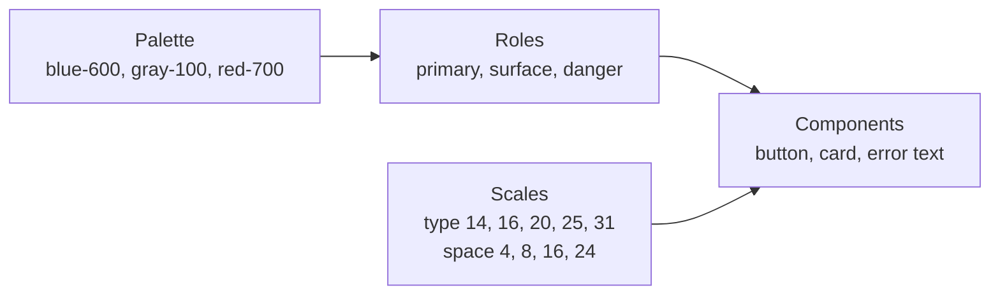

# Visual design basics

After this you can set up a type scale, a spacing scale and a colour palette with named roles, group elements so the layout reads well, and check text contrast with a script.

Before this: [UI vocabulary and components](01-ui-vocabulary-and-components.md) and [CSS and the box model](../01-html-css-and-the-browser/03-css-and-the-box-model.md).

## The idea

Visual design looks like taste, but a developer can do most of it by constraint: choose a small set of sizes, spaces and colours once, then use only those. A page with 40 font sizes and 17 greys looks messy; one with 6 sizes, 8 spaces and a 3-colour palette looks designed. Fewer choices mean every difference on the page carries meaning.



In the diagram, raw values go into named roles and scales, and components use the roles and scales only. The next lesson, [design systems](03-design-systems-and-figma.md), calls these named values tokens.

## Key terms

A **type scale** is a fixed list of font sizes, often each step a constant ratio larger than the last (1.25 is common). **Line length** (measure) is the number of characters per line. **Line height** is the vertical distance between lines of text, set as a plain number such as `1.5`.

A **spacing scale** is a fixed list of gaps, built from a base unit, usually 4 px or 8 px, so every margin and padding is a multiple of it. A **grid** is a set of columns and gutters that elements snap to; CSS Grid from the [layout lesson](../01-html-css-and-the-browser/04-layout-flexbox-grid-and-responsive.md) draws it.

**Colour roles** are names for what a colour does. A **primary** colour marks the brand and the main action. **Neutrals** (greys) carry text, borders and backgrounds, and make up most of a screen. **Semantic colours** carry meaning: success (green), warning (amber), danger or error (red) and info (blue). **Contrast ratio** is a number from 1 to 21 comparing the brightness of two colours.

The **Gestalt principles** describe how people group what they see. Proximity: things close together look related. Similarity: things that look alike look like the same kind. Others include common region (a box around items) and alignment.

## How it works

Typography. Body text is 16 px (`1rem`), the browser default. Build the other sizes from the scale. Keep lines to roughly 45 to 80 characters: WCAG's Level AAA criterion 1.4.8 says no more than 80 ([w3.org](https://www.w3.org/WAI/WCAG22/Understanding/visual-presentation.html)), and `max-width: 65ch` does it in CSS. Use a line height of about 1.5 for body text and tighter (1.2) for large headings. Use at most two typefaces.

```python
base, ratio = 16, 1.25
print([round(base * ratio ** i, 1) for i in range(-1, 6)])
print([4 * i for i in range(1, 13)])
```

```text
[12.8, 16.0, 20.0, 25.0, 31.2, 39.1, 48.8]
[4, 8, 12, 16, 20, 24, 28, 32, 36, 40, 44, 48]
```

Round the type scale to whole pixels (13, 16, 20, 25, 31, 39, 49). Of the multiples of 4, designers mostly use 4, 8, 12, 16, 24, 32 and 48.

Grouping. Put less space between related things than between unrelated ones. A label belongs to its field, so the gap between label and field is smaller than the gap between one field and the next.

```text
Email                 <- 4 px gap to its field
[____________]
                      <- 16 px gap: a new group starts
Password
[____________]
```

Colour. Choose one primary hue, a grey ramp and four semantic colours. Contrast comes from WCAG 2.2, a W3C Recommendation (as of 2026, [w3.org](https://www.w3.org/TR/WCAG22/)). Level AA needs at least 4.5:1 for normal text, 3:1 for large text (18 pt, or 14 pt bold; WCAG gives points, and 18 pt is 24 CSS px) and 3:1 for the visible edges of UI components such as inputs and focus rings. Touch and click targets should be at least 24 by 24 CSS px (SC 2.5.8). This script computes the ratio from the same formula as the [accessibility lesson](../01-html-css-and-the-browser/05-accessibility.md):

```python
def lin(c):
    c /= 255
    return c / 12.92 if c <= 0.04045 else ((c + 0.055) / 1.055) ** 2.4

def luminance(h):
    r, g, b = (int(h[i:i + 2], 16) for i in (1, 3, 5))
    return 0.2126 * lin(r) + 0.7152 * lin(g) + 0.0722 * lin(b)

def contrast(a, b):
    hi, lo = sorted((luminance(a), luminance(b)), reverse=True)
    return (hi + 0.05) / (lo + 0.05)

def verdict(ratio):
    if ratio >= 4.5: return "AA for all text"
    if ratio >= 3: return "large text and UI parts only"
    return "fails"

for fg, bg in [("#ffffff", "#3b82f6"), ("#ffffff", "#2563eb"),
               ("#6b7280", "#ffffff"), ("#6b7280", "#f3f4f6"), ("#dc2626", "#ffffff")]:
    r = contrast(fg, bg)
    print(fg, "on", bg, f"{r:.2f}", verdict(r))
```

```text
#ffffff on #3b82f6 3.68 large text and UI parts only
#ffffff on #2563eb 5.17 AA for all text
#6b7280 on #ffffff 4.83 AA for all text
#6b7280 on #f3f4f6 4.39 large text and UI parts only
#dc2626 on #ffffff 4.83 AA for all text
```

Consistency. The same thing looks and behaves the same way everywhere: one style per kind of button, one date format, one name per concept. Users learn a pattern once; consistency is also a usability heuristic in [lesson 4](04-ux-research-and-usability.md).

## Worked examples

<div class="example" markdown>

### Example 1: a button that looks right and fails

A brand blue is `#3b82f6`. The designer wants white text on it.

1. Compute the ratio: white on `#3b82f6` is 3.68:1.
2. Check the rule. Button labels are normal-size text, so AA needs 4.5:1. It fails.
3. Darken the blue until it passes: `#2563eb` gives 5.17:1. Keep the hue and lower the lightness; do not just change the text colour, since white is already the maximum.
4. Check the other states. The hover colour must pass too, so a darker blue (`#1d4ed8`, 6.70:1) works for hover.

Check: run the script above with each fg and bg pair. All of the button's states must show "AA for all text".

</div>

<div class="example" markdown>

### Example 2: grey on grey

Secondary text `#6b7280` passes on white (4.83:1) but fails on a light-grey card `#f3f4f6` (4.39:1). The ratio depends on the pair, not on the text colour alone, so check each text colour on each surface it sits on.

</div>

## Common mistakes

<div class="warning" markdown>

Watch out: testing contrast only on white. Text on cards, banners, hover states and images has different backgrounds, and light-grey placeholder text is the usual failure.

Watch out: using colour as the only signal, such as red text for an error. Add an icon or words. Colour-blind users cannot tell some reds from greens; DevTools has a vision-deficiency emulator in the Rendering tab.

Watch out: arbitrary spacing like `margin: 13px` and `padding: 7px`. Use values from the spacing scale, or the layout drifts out of alignment.

</div>

## Working with AI

<div class="ai" markdown>

Words to use: type scale, spacing scale, 8 px grid, contrast ratio, WCAG 2.2 AA, semantic colour, visual hierarchy, proximity.

Prompts to try:

- "Generate a CSS palette for a finance app: one primary, a 9-step grey ramp, and success, warning and danger colours. Every text and background pair that I will use must pass WCAG 2.2 AA. List the pairs and their ratios."
- "Here is my page's CSS [paste]. List every font size, margin and padding value that is not on a 4 px grid or a 1.25 type scale, and suggest the nearest scale value."

What to check:

- Contrast ratios stated by the AI. Models often guess; recompute with the script.
- Palettes that pass only for text on white. Test each pair that will really be used.
- A scale with many near-duplicates (15 px, 16 px, 17 px). Cut it down to the scale.
- Invented WCAG criterion numbers. Look them up on w3.org.

</div>

## Quiz

1\. What contrast ratio does WCAG 2.2 AA need for normal text, large text, and the border of a text input?

<details class="solution" markdown>
<summary>Answer</summary>

4.5:1 for normal text, 3:1 for large text, and 3:1 for the border of a UI component such as an input (SC 1.4.3 and SC 1.4.11).

</details>

2\. Predict the verdict: `#9ca3af` text on white.

<details class="solution" markdown>
<summary>Answer</summary>

The ratio is 2.54:1, so it fails even for large text. This grey is a common placeholder colour, and placeholders carry the same contrast rule as other text.

</details>

3\. A form has the same 24 px gap between every label and field and between every pair of fields. Which Gestalt principle is violated and what is the fix?

<details class="solution" markdown>
<summary>Answer</summary>

Proximity. Equal gaps make the label look as related to the previous field as to its own. Use a small gap (4 px) between label and field and a larger one (16 or 24 px) between groups.

</details>

4\. Why choose 4 px or 8 px as the base of a spacing scale?

<details class="solution" markdown>
<summary>Answer</summary>

Every spacing value is then a multiple of the base, so elements line up and designers and developers pick from a short list instead of arguing about 13 px versus 14 px.

</details>

## Lab

<div class="lab" markdown>

### Lab: audit a palette

Goal: extend the contrast script into a palette checker and fix failing pairs. Time: about 15 minutes. Runs in: any terminal with Python.

1. Save the contrast script above as `contrast.py`.
2. Add a list of five pairs from a site or app you use. View the page's real colours with DevTools (Elements, Styles, click a colour swatch).
3. Print the ratio and verdict for each pair, and mark each pair as text or UI component.
4. Write a function `lightest_grey_on(bg)` that returns the lightest grey `#rrggbb` (red, green and blue equal) with a ratio of at least 4.5 on `bg`. Print it for `#ffffff` and `#f3f4f6`.
5. Cleanup: delete the file.

Expected result: the greys are `#767676` on white and `#6f6f6f` on `#f3f4f6`.

<details class="solution" markdown>
<summary>Solution</summary>

```python
def lightest_grey_on(bg):
    for v in range(255, -1, -1):
        g = f"#{v:02x}{v:02x}{v:02x}"
        if contrast(g, bg) >= 4.5:
            return g

print(lightest_grey_on("#ffffff"), lightest_grey_on("#f3f4f6"))
```

Add this below the script. Searching from light to dark returns the first grey that passes. The result is `#767676` on white and `#6f6f6f` on `#f3f4f6`, a darker grey, because the grey card is itself darker than white.

</details>

</div>

## Where this shows up

- Colour roles and scales become tokens and CSS custom properties in [Design systems and Figma](03-design-systems-and-figma.md).
- Contrast checks run in Lighthouse and axe; see [Accessibility](../01-html-css-and-the-browser/05-accessibility.md). Back to the [chapter cheat sheet](index.md).
