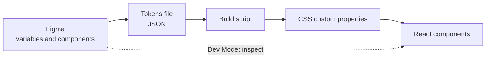

# Design systems and Figma

After this you can explain what a design system and a design token are, read a designer's Figma file with the right vocabulary, and turn tokens into CSS custom properties.

Before this: [Visual design basics](02-visual-design-basics.md) and [Components, props and JSX](../03-react/01-components-props-and-jsx.md).

## The idea

A company with five products and thirty developers needs every button to look and behave the same. Without a shared source, each team makes its own blue, its own 13 px gap and its own dropdown, and the product drifts. A **design system** is the shared source: design principles, a set of reusable components, the values they use (colours, spacing, type) and the rules for using them, kept in sync between design files and code.

The designer works in a design tool, usually Figma; the developer works in code. The system is the contract between them, and the values in it are called tokens.



In the diagram, values flow from the design file to a tokens file to CSS, and components read only from the CSS. The dotted line is the manual path: a developer inspecting a design and reading numbers by eye.

## Key terms

A **design token** is a named design value: `color-primary`, `space-4`, `radius-md`. The name carries the meaning and the value can change. Tokens come in layers. **Primitive** tokens are the raw palette (`blue-600 = #2563eb`). **Semantic** tokens give a primitive a role (`color-primary = blue-600`). Components use only the semantic layer, so a dark theme or a rebrand changes the mapping in one place. The Design Tokens Community Group publishes a JSON format for tokens, with a first stable version, 2025.10, released in October 2025 ([designtokens.org](https://www.designtokens.org/)).

A **component library** is code for the UI components, ready to use. Four kinds are worth knowing by name (awareness, not a recommendation):

| Kind | Examples | What you get |
|---|---|---|
| Design system with guidelines | Material Design (Google), Apple Human Interface Guidelines | Principles, specs and components for a platform ([m3.material.io](https://m3.material.io/)) |
| Styled library | Material UI (MUI), Bootstrap, Ant Design, Chakra UI | Install a package; components are ready and themeable |
| Headless library | Radix UI, React Aria | Behaviour and accessibility with no styling; you add the CSS |
| Copy-in components | shadcn/ui | A command-line tool copies the component source into your repo and you own it ([ui.shadcn.com](https://ui.shadcn.com/docs)) |

Prefer a tested library for hard widgets (combobox, date picker, modal focus handling) instead of writing them, because accessibility bugs hide in them.

Figma vocabulary, from the Figma help centre (checked 2026, [help.figma.com](https://help.figma.com)):

| Figma term | Meaning |
|---|---|
| Frame | A layer that acts as a container for other layers; frames can nest. A screen is a top-level frame |
| Auto layout | A frame setting that arranges its children by direction, gap and padding, and resizes as content changes |
| Hug contents, fill container, fixed | The three resizing modes: shrink to fit children, stretch to the parent, or keep a set size |
| Component | A reusable design element. The original is the main component; each copy is an instance |
| Variant | One version of a component; the versions live in a component set and differ by property values, such as `size=sm` or `state=hover` |
| Variable | A reusable value (colour, number, string or boolean) in a collection; each variable can have a value per mode, such as light and dark. This is how Figma stores design tokens |
| Dev Mode | A developer-focused view of a file: measurements, applied variables, generated code snippets and a "Ready for dev" status ([guide](https://help.figma.com/hc/en-us/articles/15023124644247-Guide-to-Dev-Mode)) |

Dev Mode is not on Figma's free plan (as of 2026, see the guide), and the code it generates is a starting point, not production code.

## How it works

Auto layout is flexbox from the [layout lesson](../01-html-css-and-the-browser/04-layout-flexbox-grid-and-responsive.md) with another name, so the translation is direct:

| Figma | CSS |
|---|---|
| Auto layout, horizontal or vertical | `display: flex` with `flex-direction: row` or `column` |
| Gap, padding | `gap`, `padding` |
| Wrap | `flex-wrap: wrap` |
| Hug contents | `width: fit-content` (or leave `auto`) |
| Fill container | `flex: 1` along the main axis, `align-self: stretch` across it |
| Fixed | `width: 240px` |
| Component and instance | a React component and a use of it |
| Variant property | a prop |
| Variable and mode | a CSS custom property and a theme selector |

A tokens file turns into CSS with a short script. The JSON follows the shape of the Design Tokens format (`$value`, groups, `{alias}` references) but keeps colours as plain hex strings; the 2025.10 specification writes a colour as an object, so a real tool such as Style Dictionary may need the longer form. This is `tokens.json`, abridged:

```json
{
  "primitive": { "color": { "blue": { "600": { "$value": "#2563eb" } } },
                 "space": { "4": { "$value": "16px" } } },
  "light": { "color": { "primary": { "$value": "{color.blue.600}" } } },
  "dark":  { "color": { "primary": { "$value": "{color.blue.400}" } } }
}
```

The script walks the tree, joins the path into a name, and writes an alias as `var(...)`:

```python
import json

def flat(node, path=()):
    for key, val in node.items():
        if isinstance(val, dict) and "$value" in val:
            yield path + (key,), val["$value"]
        elif isinstance(val, dict):
            yield from flat(val, path + (key,))

def css_value(v):
    if v.startswith("{"):
        return "var(--" + v[1:-1].replace(".", "-") + ")"
    return v

def block(selector, *nodes):
    lines = [f"  --{'-'.join(p)}: {css_value(v)};" for n in nodes for p, v in flat(n)]
    return selector + " {\n" + "\n".join(lines) + "\n}"

tokens = json.load(open("tokens.json"))
print(block(":root", tokens["primitive"], tokens["light"]))
print(block('[data-theme="dark"]', tokens["dark"]))
```

With the full file from the lab, the output is:

```text
:root {
  --color-blue-400: #60a5fa;
  --color-blue-600: #2563eb;
  ...
  --color-primary: var(--color-blue-600);
  --color-on-primary: var(--color-gray-50);
  ...
}
[data-theme="dark"] {
  --color-primary: var(--color-blue-400);
  --color-on-primary: var(--color-gray-900);
  ...
}
```

Components then write `background: var(--color-primary)`. Setting `data-theme="dark"` on `<html>` re-points the semantic variables, and every component follows with no other change.

## Worked examples

<div class="example" markdown>

### Example 1: from a Figma button to a React component

The file has a component set `Button` with properties `variant` (primary, secondary, destructive), `size` (sm, md) and `state` (default, hover, focus, disabled).

1. Variant properties that change the design become props: `variant` and `size`.
2. State is not a prop for most states. Hover and focus are CSS pseudo-classes (`:hover`, `:focus-visible`), and `disabled` is the native attribute.
3. Colours and gaps come from tokens, never copied hex values: `background: var(--color-primary)`, `padding: var(--space-2) var(--space-4)`.
4. The class names follow the variants, so the stylesheet is the table of variants.

```typescript
type Variant = "primary" | "secondary" | "destructive";
type Size = "sm" | "md";

function buttonClass(variant: Variant, size: Size, disabled = false): string {
  return ["btn", `btn--${variant}`, `btn--${size}`, disabled ? "is-disabled" : ""]
    .filter(Boolean)
    .join(" ");
}

console.log(buttonClass("primary", "md"));
console.log(buttonClass("destructive", "sm", true));
```

```text
btn btn--primary btn--md
btn btn--destructive btn--sm is-disabled
```

Check: save as `button.ts` and run `node button.ts` (Node 24 strips the types). The TypeScript compiler will reject `buttonClass("danger", "md")`, which is the point of typing the variants.

</div>

## Common mistakes

<div class="warning" markdown>

Watch out: copying values from Dev Mode into components (`#2563eb`, `padding: 11px`). The design then drifts the first time a token changes. Map each number to a token; if none fits, ask the designer whether it should be one.

Watch out: components that use primitive tokens (`var(--color-blue-600)`) directly. Dark mode and rebrands then need edits in every component. Use semantic tokens.

Watch out: implementing only the default frame. Check the Figma file for hover, focus, disabled, error, loading and empty states, and for the small-screen frame, before you call it done.

</div>

## Working with AI

<div class="ai" markdown>

Words to use: design token, semantic token, CSS custom property, auto layout, variant, component set, Dev Mode, headless component.

Prompts to try:

- "Convert this tokens JSON (Design Tokens format, hex colours) into CSS custom properties. Aliases must become `var()` references, and the dark values go under `[data-theme="dark"]`: [paste]."
- "Write a React `Button` with `variant` and `size` props typed as unions, styled only with CSS custom properties named `--color-primary` and `--space-*`. No hard-coded colours."

What to check:

- Hard-coded hex values and pixel numbers that bypass the tokens. Search the generated code for `#` and `px`.
- Invented component-library props or imports. Compare with the library's docs for your installed version.
- Custom `div`-based widgets where a headless or native element exists. Test with the keyboard.
- Token names that describe the value (`blue-button`) rather than the role (`color-primary`).

</div>

## Quiz

1\. What is the difference between a primitive and a semantic token, and which does a component use?

<details class="solution" markdown>
<summary>Answer</summary>

A primitive is a raw value (`blue-600 = #2563eb`); a semantic token names a role (`color-primary`) and points to a primitive. Components use semantic tokens, so a theme change edits one mapping.

</details>

2\. A Figma frame uses auto layout, vertical, gap 16, padding 24, with a child set to "fill container". Write the CSS for the frame.

<details class="solution" markdown>
<summary>Answer</summary>

`display: flex; flex-direction: column; gap: 16px; padding: 24px;` In a column, a child that fills the container's width gets `align-self: stretch` (or `width: 100%`); `flex: 1` would fill the height instead.

</details>

3\. A developer copies `color: #2563eb` from Dev Mode into a stylesheet. Name the problem.

<details class="solution" markdown>
<summary>Answer</summary>

A hard-coded value bypasses the token, so dark mode and later colour changes miss it. Use `var(--color-primary)`.

</details>

4\. Which is "copy-in", a styled library or a headless library: shadcn/ui, MUI, Radix UI?

<details class="solution" markdown>
<summary>Answer</summary>

shadcn/ui is copy-in (its source is added to your repo), MUI is a styled library, and Radix UI is headless (behaviour and accessibility, no styling).

</details>

## Lab

<div class="lab" markdown>

### Lab: tokens to a themed page

Goal: generate CSS from a tokens file and switch the theme on a page. Time: about 20 minutes. Runs in: a browser and Python, no design tool.

1. In a new folder, save the tokens below as `tokens.json` and the script from "How it works" as `build.py`.
2. Run `python build.py > tokens.css` and open `tokens.css` to see the variables.
3. Write `index.html` that links `tokens.css`, sets the page background, text and a button from `var(--color-...)` tokens, and has a button that toggles `document.documentElement.dataset.theme` between `"light"` and `"dark"`.
4. Open it and toggle. Both themes must change every colour on the page.
5. Add a script `check.py` that resolves each alias to its hex value and prints the contrast ratio of `text` on `surface`, `text-muted` on `surface` and `on-primary` on `primary` in both themes. Each must be at least 4.5.
6. Cleanup: delete the folder.

```json
{
  "primitive": {
    "color": {
      "blue": { "400": { "$value": "#60a5fa" }, "600": { "$value": "#2563eb" } },
      "gray": {
        "50": { "$value": "#f9fafb" },
        "300": { "$value": "#d1d5db" },
        "600": { "$value": "#4b5563" },
        "900": { "$value": "#111827" }
      }
    },
    "space": { "1": { "$value": "4px" }, "2": { "$value": "8px" }, "4": { "$value": "16px" } },
    "radius": { "md": { "$value": "6px" } }
  },
  "light": {
    "color": {
      "primary": { "$value": "{color.blue.600}" },
      "on-primary": { "$value": "{color.gray.50}" },
      "surface": { "$value": "{color.gray.50}" },
      "text": { "$value": "{color.gray.900}" },
      "text-muted": { "$value": "{color.gray.600}" }
    }
  },
  "dark": {
    "color": {
      "primary": { "$value": "{color.blue.400}" },
      "on-primary": { "$value": "{color.gray.900}" },
      "surface": { "$value": "{color.gray.900}" },
      "text": { "$value": "{color.gray.50}" },
      "text-muted": { "$value": "{color.gray.300}" }
    }
  }
}
```

Expected result: the page flips between a light and a dark theme, and the checker prints six ratios, all above 4.5.

<details class="solution" markdown>
<summary>Solution</summary>

`index.html`:

```html
<!doctype html>
<html lang="en">
<head>
<meta charset="utf-8">
<title>Tokens</title>
<link rel="stylesheet" href="tokens.css">
<style>
  body { background: var(--color-surface); color: var(--color-text); padding: var(--space-4); font: 16px/1.5 system-ui; }
  .muted { color: var(--color-text-muted); }
  .btn { background: var(--color-primary); color: var(--color-on-primary);
         border: 0; border-radius: var(--radius-md); padding: var(--space-2) var(--space-4); font: inherit; }
</style>
</head>
<body>
  <h1>Settings</h1>
  <p class="muted">Tokens decide every colour and gap on this page.</p>
  <button class="btn" type="button">Save changes</button>
  <button class="btn" type="button" id="toggle">Toggle theme</button>
  <script>
    document.getElementById("toggle").onclick = () => {
      const root = document.documentElement;
      root.dataset.theme = root.dataset.theme === "dark" ? "light" : "dark";
    };
  </script>
</body>
</html>
```

`check.py` (the `contrast` function is from the previous lesson):

```python
import json

def lin(c):
    c /= 255
    return c / 12.92 if c <= 0.04045 else ((c + 0.055) / 1.055) ** 2.4

def lum(h):
    r, g, b = (int(h[i:i + 2], 16) for i in (1, 3, 5))
    return 0.2126 * lin(r) + 0.7152 * lin(g) + 0.0722 * lin(b)

def contrast(a, b):
    hi, lo = sorted((lum(a), lum(b)), reverse=True)
    return (hi + 0.05) / (lo + 0.05)

t = json.load(open("tokens.json"))
prim = t["primitive"]["color"]

def hex_of(ref):
    node = prim
    for k in ref[1:-1].split(".")[1:]:
        node = node[k]
    return node["$value"]

for theme in ("light", "dark"):
    c = t[theme]["color"]
    for fg, bg in [("on-primary", "primary"), ("text", "surface"), ("text-muted", "surface")]:
        r = contrast(hex_of(c[fg]["$value"]), hex_of(c[bg]["$value"]))
        print(theme, fg, "on", bg, f"{r:.2f}")
```

```text
light on-primary on primary 4.95
light text on surface 16.98
light text-muted on surface 7.23
dark on-primary on primary 6.98
dark text on surface 16.98
dark text-muted on surface 12.04
```

Dark mode needs its own mapping, not just inverted values: its primary is the lighter `blue-400`, with dark text on it (`on-primary` is `gray-900`), because white on `blue-400` is only 2.54:1, which fails.

</details>

</div>

## Where this shows up

- The component states and the Figma frames you inspect are tested in [UX research and usability](04-ux-research-and-usability.md).
- Utility CSS frameworks such as Tailwind keep the same idea in a config file; see the [frameworks landscape](../03-react/04-frameworks-and-libraries-landscape.md). Back to the [chapter cheat sheet](index.md).
