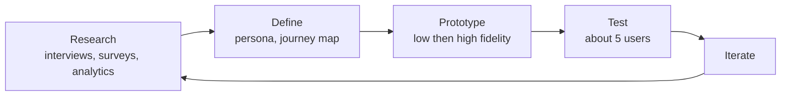
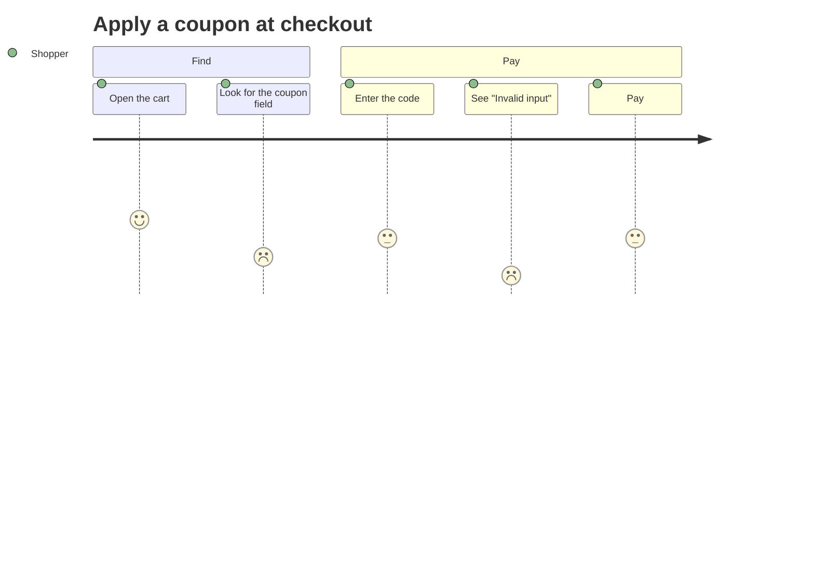

# UX research and usability

After this you can name Nielsen's 10 usability heuristics, choose a research method for a question, plan a small usability test, and write form errors that help.

Before this: [UI vocabulary and components](01-ui-vocabulary-and-components.md) and [Accessibility](../01-html-css-and-the-browser/05-accessibility.md).

## The idea

A team builds a checkout flow that everyone on the team finds easy. A real customer cannot find the "Apply coupon" field and abandons the purchase. The team is the worst test group, since they know how the product works. UX research means asking real users early, while changes are cheap.

The work is a loop: learn about users, define the problem, sketch a solution, test it with a few people, and repeat.



## Key terms

**User research** collects evidence about what users need and do. **Qualitative** methods (interviews, observing a task) tell you why people act as they do, from a few people. **Quantitative** methods (surveys, analytics) tell you how many do it, from many people. Use both: analytics shows that 60% of users drop out on step 3, and an interview or test shows why.

An **interview** is a one-to-one conversation; ask about what the person did last time ("Tell me about the last time you booked a trip"), not what they would do. A **survey** is a questionnaire, and leading questions bias it. **Analytics** record behaviour (clicks, funnel drop-off) but not motive.

A **persona** is a short, fictional profile of a typical user group (goals, context, frustrations), built from research data. A **journey map** lays out the steps a user takes to reach a goal, with how they feel at each step and where it goes wrong.



In the diagram, the score (1 is unhappy, 5 is happy) drops at two steps, which are the places to fix first.

A **prototype** is a draft of the interface made to be tested. A **low-fidelity** prototype (paper sketches, grey wireframes) is quick, tests structure and flow, and invites honest criticism. A **high-fidelity** prototype (a clickable Figma file that looks real) tests wording, visual detail and interactions. Start low; fidelity is spent only after the flow is right.

A **usability test** has a user attempt realistic tasks with the prototype or product while you observe, usually asking them to think aloud. A **heuristic evaluation** is a review by an expert against a list of rules, with no users, which is cheap and catches many problems first.

## How it works

Nielsen Norman Group (NN/g) publishes the standard checklist, 10 usability heuristics from Jakob Nielsen (published 1994, last reviewed 2024, [nngroup.com](https://www.nngroup.com/articles/ten-usability-heuristics/)).

| # | Heuristic | In plain words | Example |
|---|---|---|---|
| 1 | Visibility of system status | Tell users what is happening | Upload progress bar; a "Saved" confirmation |
| 2 | Match between the system and the real world | Use the user's words and conventions | "Basket" with a basket icon, not "Order entity" |
| 3 | User control and freedom | A clear way out of mistakes | Undo, Cancel, Back |
| 4 | Consistency and standards | Same words and actions mean the same thing; follow platform conventions | The logo links home on every page |
| 5 | Error prevention | Remove error-prone conditions or confirm first | A date picker instead of free-text dates |
| 6 | Recognition rather than recall | Show options instead of making users remember | Recent searches, visible labels |
| 7 | Flexibility and efficiency of use | Shortcuts for experts | Keyboard shortcuts, saved filters |
| 8 | Aesthetic and minimalist design | Leave out irrelevant information | A checkout with only the needed fields |
| 9 | Help users recognize, diagnose, and recover from errors | Plain-language errors that suggest a fix | "That email is already registered. Log in or reset your password." |
| 10 | Help and documentation | Easy to search, short, task-focused | A help link next to a confusing field |

Testing. NN/g's research finds that one user reveals about 31% of the usability problems on average, and that five users find about 85% ([Nielsen, 2000](https://www.nngroup.com/articles/why-you-only-need-to-test-with-5-users/)). The model is that each user finds a problem with probability $p = 0.31$, so $n$ users find $1-(1-p)^n$ of them:

```python
p = 0.31
for n in (1, 3, 5, 10, 15):
    print(n, f"{100 * (1 - (1 - p) ** n):.1f}%")
```

```text
1 31.0%
3 67.1%
5 84.4%
10 97.6%
15 99.6%
```

The curve flattens after about five, so NN/g recommends several small rounds (test with 5, fix, test with 5 more) over one big one. Use 3 to 4 users per group when your audience has distinct groups. This is for finding problems in a qualitative test; the 31% is an average across projects, not a promise for yours.

Forms are where most flows fail, so follow these rules.

1. Put a visible `<label>` above each field. A placeholder disappears when typing starts and is often low contrast, so it is a hint, not a label.
2. Use the right input `type` (`email`, `tel`, `number`) and `autocomplete` values, so phones show the right keyboard and browsers autofill.
3. Ask for only what you need, in one column.
4. Validate when the user leaves a field or submits, not on every keystroke, which shows "invalid email" after the first letter.
5. Show the error next to its field, in text. WCAG 2.2 requires that an automatically detected error is identified and described in text (SC 3.3.1, Level A), and that a known fix is suggested (SC 3.3.3, Level AA) ([w3.org](https://www.w3.org/WAI/WCAG22/Understanding/error-identification.html)).
6. Say what happened and how to fix it, in plain words, without blame: "Use at least 12 characters. You have 8." not "Invalid input" or "You entered the wrong password format."
7. Keep what the user typed, move focus to the first error, and link the error to its field with `aria-describedby` and `aria-invalid="true"`.

## Worked examples

<div class="example" markdown>

### Example 1: a heuristic evaluation of one error

A signup form shows a browser `alert("Error")` after submitting, and clears all fields.

1. Does the user know what failed? No. This breaks heuristic 9, since the message names neither the field nor the fix.
2. Do they keep their work? No, the fields are cleared. This breaks heuristic 3 (user control and freedom) and wastes effort.
3. Is the status visible? The alert disappears and the page looks the same. That is heuristic 1.
4. Rewrite the message and placement: under the email field, "Enter an email address like name@example.com.", with the typed text kept and focus moved to the field.

Check: after the fix, trace the same failed submit as a user. The three things that went wrong (what, where, kept input) should each have an answer on screen.

</div>

## Common mistakes

<div class="warning" markdown>

Watch out: asking leading or hypothetical questions ("Would you use a dark mode?"). People say yes and then do not. Watch what they do, and ask about past behaviour.

Watch out: a persona invented in a meeting, with a stock photo and a name. Without research data it records the team's assumptions. Build it from interviews or analytics, or do not call it a persona.

Watch out: testing with your teammates, or helping the tester when they get stuck. If they stall, that is the finding. Write it down, then ask what they expected to happen.

</div>

## Working with AI

<div class="ai" markdown>

Words to use: usability heuristic, think-aloud, task success rate, funnel drop-off, low-fidelity prototype, error message, inline validation, `aria-describedby`.

Prompts to try:

- "Review this signup form HTML against Nielsen's 10 usability heuristics. For each violation give the heuristic number and name, the element, and a fix: [paste]."
- "Write five usability-test tasks for a coupon flow. Each task is a goal in the user's words with no hints about which button to press."

What to check:

- Generated "user research", personas or survey results. An AI cannot interview your users; treat them as hypotheses to test.
- Heuristic names and numbers. Compare with the NN/g list above.
- Error messages that blame the user, say only "Invalid input", or appear only as a colour change or a toast.
- Validation code that fires on every keystroke or clears the field. Test with a wrong value and keep typing.

</div>

## Quiz

1\. Analytics show 60% of users leave at the payment step. What kind of data is this, and what method would you add to learn why?

<details class="solution" markdown>
<summary>Answer</summary>

Quantitative (it says how many, not why). Add a qualitative method: a usability test of the payment step or short interviews.

</details>

2\. Predict the result: using the model with $p = 0.31$, about what share of problems do 3 users find?

<details class="solution" markdown>
<summary>Answer</summary>

$1-(1-0.31)^3 \approx 0.67$, so about 67%. Five users give about 84%.

</details>

3\. A form field shows red text "Invalid" the moment the user types one character. Which heuristic and which form rule does it break?

<details class="solution" markdown>
<summary>Answer</summary>

Heuristic 9, since "Invalid" does not say what is wrong or how to fix it, and the validation rule: validate when the user leaves the field or submits, not on every keystroke.

</details>

4\. Your team has budget for 15 test participants. How does NN/g advise spending it?

<details class="solution" markdown>
<summary>Answer</summary>

Run three rounds of 5 users, fixing problems between rounds, instead of one round of 15. Each round finds what the last fix introduced or missed.

</details>

## Lab

<div class="lab" markdown>

### Lab: evaluate and fix a signup form

Goal: find heuristic violations in a form and fix its errors. Time: about 20 minutes. Runs in: Chrome or Edge, no design tool.

1. Save the code below as `signup.html`, open it, and submit it empty. Then submit a bad email and a short password.
2. List five problems, each with a heuristic number from the table.
3. Rewrite the form: visible labels, `type="email"`, `autocomplete`, and `novalidate` on the form so your own messages show.
4. On submit, validate the email (looks like an address) and the password (at least 12 characters). Show each message in text under its field, link it with `aria-describedby`, set `aria-invalid`, keep the typed values and focus the first bad field.
5. When both are valid, show "Account created." in a `role="status"` paragraph.
6. Cleanup: delete the file.

```html
<!doctype html>
<html lang="en">
<head><meta charset="utf-8"><title>Sign up</title></head>
<body>
<form onsubmit="alert('Error'); this.reset(); return false">
  <input placeholder="Email">
  <input placeholder="Password">
  <button>OK</button>
</form>
</body>
</html>
```

Expected result: submitting empty shows two messages under the fields with focus on Email. A valid pair shows "Account created."

<details class="solution" markdown>
<summary>Solution</summary>

Problems: no labels, only placeholders (6); a generic alert that names nothing (9); fields cleared on error (3); no status after success (1); no `type` or `autocomplete`, and the "OK" button does not say what it does (4, 2). One possible fix:

```html
<!doctype html>
<html lang="en">
<head><meta charset="utf-8"><title>Sign up</title>
<style>.err { color: #b91c1c; }</style></head>
<body>
<form id="f" novalidate>
  <p><label for="email">Email</label><br>
     <input id="email" name="email" type="email" autocomplete="email" aria-describedby="email-error"><br>
     <span id="email-error" class="err"></span></p>
  <p><label for="password">Password (at least 12 characters)</label><br>
     <input id="password" name="password" type="password" autocomplete="new-password" aria-describedby="password-error"><br>
     <span id="password-error" class="err"></span></p>
  <button type="submit">Create account</button>
</form>
<p id="status" role="status"></p>
<script>
const rules = {
  email: (v) => /^\S+@\S+\.\S+$/.test(v) ? "" : "Enter an email address like name@example.com.",
  password: (v) => v.length >= 12 ? "" : `Use at least 12 characters. You have ${v.length}.`,
};
const form = document.getElementById("f");
form.addEventListener("submit", (e) => {
  e.preventDefault();
  let first = null;
  for (const [name, check] of Object.entries(rules)) {
    const input = form.elements[name];
    const msg = check(input.value);
    document.getElementById(name + "-error").textContent = msg;
    input.setAttribute("aria-invalid", msg ? "true" : "false");
    if (msg && !first) first = input;
  }
  document.getElementById("status").textContent = first ? "" : "Account created.";
  if (first) first.focus();
});
</script>
</body>
</html>
```

Values stay because the page never resets or reloads. Keep the error `<span>` elements in the page from the start, so a screen reader finds the `aria-describedby` target.

</details>

</div>

## Where this shows up

- Error and status messages become API-level concerns in [validation and error handling](../../09-back-end/01-servers-and-apis/05-validation-and-error-handling.md).
- Usability problems found in a test are tracked like any other bug; see [How software teams work](../../16-the-workplace/01-how-software-teams-work.md), where designers and product managers join the team. Back to the [chapter cheat sheet](index.md).
