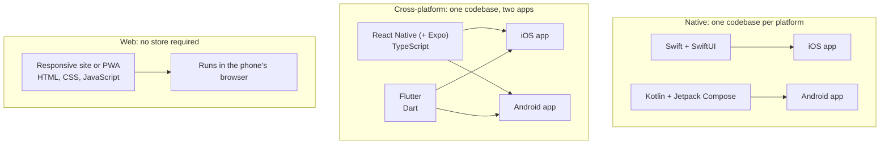
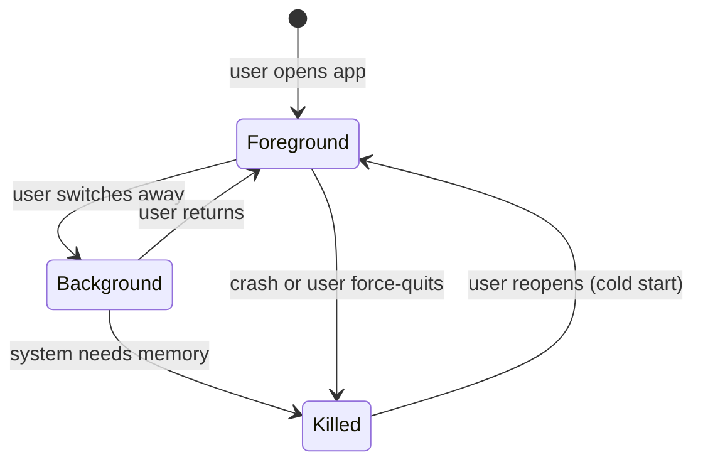
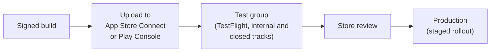

# Mobile platforms: native and cross-platform

After this you can name the two mobile platforms and the main ways to build for them, pick an approach for a given project, and describe what happens between your code and a user's phone (lifecycle, permissions, store review, releases).

Before this: [Frameworks and libraries landscape](../03-react/04-frameworks-and-libraries-landscape.md) and [Layout with flexbox, grid and responsive design](../01-html-css-and-the-browser/04-layout-flexbox-grid-and-responsive.md).

## The idea

A team has a React web app and the product owner says "we need an app". That sentence hides a decision: there are two operating systems that matter on phones, and four ways to reach them. Each way trades effort, speed and access to the phone's features.

The two platforms are **iOS** (Apple's system for the iPhone, programmed mostly in Swift) and **Android** (Google's system, used by many manufacturers and programmed mostly in Kotlin). In Canada, StatCounter shows iOS at about 65% and Android at about 35% of mobile traffic in September 2026 ([StatCounter, Canada](https://gs.statcounter.com/os-market-share/mobile/canada)). That measures web traffic, not devices sold, so check your own users.



## Key terms

A **native app** is built with the platform's own language and UI toolkit: Swift with SwiftUI on iOS, Kotlin with Jetpack Compose on Android. Both toolkits are **declarative**: you describe what the screen looks like for the current state, and the toolkit updates it, the same idea as React ([SwiftUI](https://developer.apple.com/swiftui/), [Jetpack Compose](https://developer.android.com/compose)).

A **cross-platform framework** lets one codebase produce apps for both platforms. **React Native** runs your TypeScript and maps React components to the platform's real UI widgets. **Expo** is a framework on top of React Native that supplies the project setup, navigation and build services; the React Native docs recommend starting new apps with a framework such as Expo ([React Native](https://reactnative.dev/docs/environment-setup)). **Flutter** is Google's toolkit: you write Dart, and Flutter draws its own widgets instead of using the platform's ([Flutter](https://docs.flutter.dev/get-started/fundamentals)).

A **PWA** (progressive web app) is a website that can be installed and work offline. The [next lesson](02-pwas-offline-and-push.md) covers it.

An **app store** (Apple App Store, Google Play) is the only normal way to distribute a native app to the public. A store submission goes through **review**: the store checks your build against its rules before users can get it.

## How it works

How to choose is a question of what the app needs from the phone, who builds it and how fast it must ship.

| Approach | Strong when | Cost |
|---|---|---|
| Native | Heavy graphics, newest platform features on day one, deep system integration | Two codebases, two skill sets |
| React Native + Expo | Team already knows React and TypeScript, standard screens and device features | A native module is sometimes needed for unusual features |
| Flutter | Custom look that is identical on both platforms, team willing to learn Dart | A separate language (Dart) and its own widget set |
| Responsive web or PWA | Content, forms, internal tools, no store friction | Limited access to device features, weaker on iOS |

React Native 0.88 was the documented release and Expo SDK 58 the default template in October 2026; versions move every few months, so read the current docs before starting.

### Lifecycle

An app is in the **foreground** when the user is looking at it, and in the **background** when they have switched away. The operating system may suspend a background app and, when memory runs low, kill it without warning ([Android activity lifecycle](https://developer.android.com/guide/components/activities/activity-lifecycle)).



Two consequences follow. Save the user's work when the app goes to the background, not when it is killed, because there is no callback at the kill. And treat a return from `Killed` as a fresh start that must restore state. React Native exposes the states as `active`, `background` and, on iOS only, `inactive` ([AppState](https://reactnative.dev/docs/appstate)):

```tsx
import { AppState } from "react-native";

const subscription = AppState.addEventListener("change", (state) => {
  if (state === "background") saveDraft();
});
// later: subscription.remove();
```

### Permissions

Access to the camera, location, contacts or notifications needs the user's consent. Both platforms follow one pattern: declare in the app's configuration that you may use the feature, ask at runtime when the user does something that needs it, and handle a "no" by degrading the feature.

### Release path



On iOS, TestFlight allows up to 100 internal testers and up to 10,000 external ones, and the first build for external testers goes through App Review ([TestFlight](https://developer.apple.com/testflight/)). On Android, Play Console has internal, closed and open testing tracks plus production, and updates can roll out to a percentage of users first ([Play Console tracks](https://support.google.com/googleplay/android-developer/answer/9859348)). As of 2026, a new personal developer account on Google Play must run a closed test with at least 12 testers for 14 continuous days before applying for production ([Google Play](https://support.google.com/googleplay/android-developer/answer/14151465)).

**Over-the-air updates** (OTA) let a React Native or Expo app replace its JavaScript and images without a new store release. They cannot change native code, permissions or the SDK version, and they must still follow store rules ([EAS Update](https://docs.expo.dev/eas-update/introduction/)).

## Worked examples

<div class="example" markdown>

### Example 1: choosing for three projects

We apply three questions: does it need device features beyond the camera and notifications, who is building it, and does it need to be in a store?

1. A clinic booking tool used from phones, built by two web developers: a responsive site, later a PWA. No store, one codebase, fast deploys.
2. A consumer app with maps, camera and push, built by a React team: React Native with Expo. One codebase, familiar tools.
3. A video editor with heavy GPU work: native, because the work depends on platform graphics and media APIs.

Check: for project 2, say which part cannot be fixed by an over-the-air update (a new permission or native module needs a store release).

</div>

## Common mistakes

<div class="warning" markdown>

Three slips to avoid. Asking for every permission at launch: users deny, and the iOS system prompt normally appears only once, so ask in context. Assuming "cross-platform" means "write once, never touch native code": plan time for platform differences, store setup and the odd native module. Planning to ship a fix through an OTA update when it changes permissions or native code: that needs a new store build and review.

</div>

## Working with AI

<div class="ai" markdown>

Words to use: native, cross-platform, Expo, EAS, lifecycle, runtime permission, TestFlight, release track, staged rollout, over-the-air update.

Prompts to try:

- "We are a team of three React developers building a booking app with push notifications. Compare React Native with Expo, Flutter and a PWA on effort, device access and store requirements."
- "List what happens from a signed build to production on Google Play, including testing tracks and any requirements for a new developer account."

What to check:

- Code written for old SDKs or APIs (React Native without a framework, the old `Permissions` module). Match it to the docs for your Expo SDK.
- Claims about store rules and review times. These change; read the current App Store and Play Console pages.
- Permission code that asks for more than the feature uses.
- Advice to push a native change over the air.

</div>

## Quiz

1\. Name one thing an over-the-air update can change and one it cannot.

<details class="solution" markdown>
<summary>Answer</summary>

It can change JavaScript and images. It cannot change native code, app permissions or the SDK version.

</details>

2\. A React Native app is in the `background` state and the system needs memory. What can happen, and what should the app have done earlier?

<details class="solution" markdown>
<summary>Answer</summary>

The process can be killed with no callback. The app should have saved the user's work when it entered the background.

</details>

3\. A team of web developers needs an internal tool for field staff to fill in forms on phones. Which approach, and why?

<details class="solution" markdown>
<summary>Answer</summary>

A responsive web app or PWA. It needs no store review, deploys instantly and reuses the team's skills. Native or React Native is only needed if a device feature is missing from the browser.

</details>

4\. A new developer on a personal Google Play account has tested the app with five friends for a week. Can they release to production?

<details class="solution" markdown>
<summary>Answer</summary>

Not yet. As of 2026 the rule is a closed test with at least 12 testers opted in continuously for 14 days.

</details>

## Lab

<div class="lab" markdown>

### Lab: scaffold an Expo app and find the native settings

Goal: see what a cross-platform project contains. Time: about 15 minutes. Runs in: any throwaway folder with Node (needs internet). A phone with Expo Go is optional.

1. Run `npx create-expo-app@latest hello-app`, then `cd hello-app`.
2. Open `package.json` and note the versions of `expo`, `react-native` and `react`.
3. Open `app.json`. Find the app `name`, the `ios` section and the `android` section. These hold settings that become native configuration.
4. Open `src/app/index.tsx` and change the heading text `Welcome to&nbsp;Expo` to your name.
5. Run `npx expo start`. Press `w` to open it in the browser, or scan the QR code with Expo Go on a phone.
6. Delete the folder when done.

Expected result: the app shows your text. The project has no Xcode or Android Studio folders, because Expo generates them only when you ask for a native build.

<details class="solution" markdown>
<summary>Solution</summary>

In October 2026 the template used Expo SDK 58 and React Native 0.88. The code is TypeScript with React components, as in [Components, props and JSX](../03-react/01-components-props-and-jsx.md), but it uses `View` and `Text`-style components that map to native widgets rather than HTML elements. Edits to files reload the running app.

</details>

</div>

## Where this shows up

- Installable web apps with offline support are in [PWAs, offline and push](02-pwas-offline-and-push.md).
- How screens and components should look on a phone is the subject of [UI vocabulary and components](../04-ui-and-ux-design/01-ui-vocabulary-and-components.md).
- Caching and update rules you set on a server also shape what an installed app sees: [HTTP headers, cookies and caching](../../07-networking/02-web-protocols/02-http-headers-cookies-and-caching.md).
