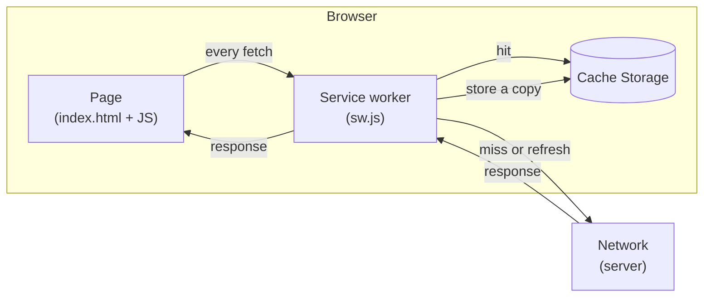
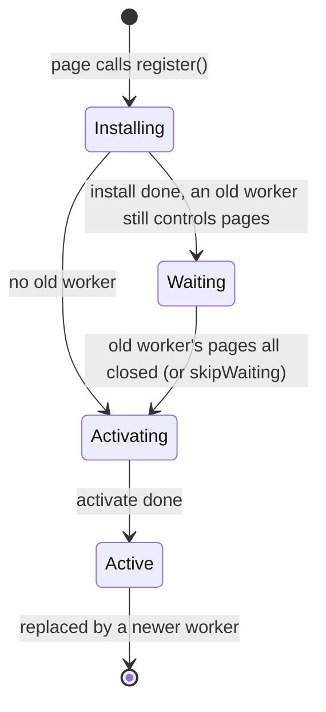
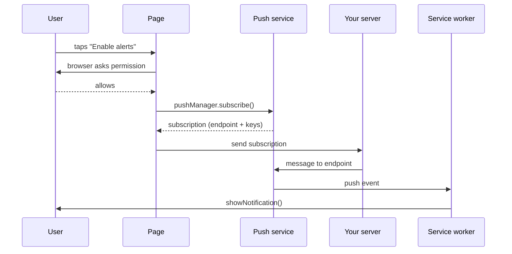

# PWAs, offline and push

After this you can say what makes a web app installable, explain the service worker lifecycle and the main caching strategies, describe how push notifications reach a browser, and build a small offline-capable PWA.

Before this: [Mobile platforms: native and cross-platform](01-mobile-platforms-native-and-cross-platform.md), [Async JavaScript and the event loop](../02-javascript-and-typescript/03-async-javascript-and-the-event-loop.md) and [HTTP headers, cookies and caching](../../07-networking/02-web-protocols/02-http-headers-cookies-and-caching.md).

## The idea

You open a web app on a train, the signal drops, and the page shows the browser's dinosaur. A native app would still open and show its last data. A **progressive web app** (PWA) closes that gap: it is a website with two extra files, a manifest that says "I can be installed" and a service worker that says "I handle requests myself", so it can open from the home screen, load offline and, in some browsers, receive notifications.



In the diagram, the service worker sits between the page and the network. Every request from a page it controls passes through it, and the worker decides whether to answer from the cache, the network or both.

## Key terms

A **web app manifest** is a JSON file linked from the page (`<link rel="manifest" href="manifest.json">`) that gives the app a name, icons, a start URL and a display mode such as `standalone`, which opens it without browser chrome.

A **service worker** is a JavaScript file that the browser runs in the background, separate from the page, with no access to the DOM. It listens for events (`install`, `activate`, `fetch`, `push`) and can answer requests from **Cache Storage**, a browser store of request and response pairs that scripts manage. It runs only on HTTPS, or on `localhost`, which browsers treat as a secure context.

**Installability** is whether the browser offers to install the app. For Chromium browsers, MDN lists a linked manifest with `name` or `short_name`, 192 px and 512 px icons, `start_url` and `display`, served over HTTPS or localhost; a service worker is not required to be installable, though it is needed for offline use ([MDN](https://developer.mozilla.org/en-US/docs/Web/Progressive_web_apps/Guides/Making_PWAs_installable)). Safari on iOS 16.4 and later can install any site from the Share menu.

## How it works

A service worker has a lifecycle that is separate from the page's, and most bugs come from not knowing which version is running ([MDN](https://developer.mozilla.org/en-US/docs/Web/API/Service_Worker_API/Using_Service_Workers)).



1. `register("sw.js")` downloads the file. If its bytes differ from the installed one, a new version starts.
2. `install` fires once per version. Fill the cache here with `cache.addAll([...])`.
3. A new version waits while the old one still controls open tabs, so two versions never serve one page.
4. `activate` fires when the new version takes over. Delete old caches here.

### Caching strategies

A strategy is a rule inside the `fetch` handler for how a response is chosen ([MDN](https://developer.mozilla.org/en-US/docs/Web/Progressive_web_apps/Guides/Caching)).

| Strategy | Order | Good for | Risk |
|---|---|---|---|
| Cache first | Cache, then network on a miss | App shell, fonts, versioned files | Stale until the worker updates |
| Network first | Network, then cache on failure | Data where fresh matters, such as recent messages | Slow when the network is bad |
| Stale-while-revalidate | Cache now, refresh from network in the background | Avatars, article lists | Shows old data once |
| Network only | Network, never cache | Payments, anything that must be current | Fails offline |

Stale-while-revalidate in code, from MDN's guide:

```javascript
async function staleWhileRevalidate(request) {
  const fresh = fetch(request).then(async (response) => {
    if (response.ok) {
      const cache = await caches.open("v1");
      cache.put(request, response.clone());
    }
    return response;
  });
  return (await caches.match(request)) || (await fresh);
}
```

A response body can be read once, so the code stores `response.clone()` and returns the original. The service worker is a second cache you control in code, and the browser's HTTP cache still sits below it.

### Offline-first and conflicts

An **offline-first** app treats the local copy as the main one: it reads and writes local storage (such as IndexedDB) immediately and syncs to the server when the network returns. Writes made offline go into an outbox that is replayed later. The Background Synchronization API can trigger the replay from the service worker, but MDN marks it "Limited availability", so also replay when the page opens ([MDN](https://developer.mozilla.org/en-US/docs/Web/API/Background_Synchronization_API)).

A **sync conflict** appears when two devices change the same record while offline. Common answers: last write wins (simple, but loses an edit and trusts device clocks), reject a write whose version number is stale and ask the user, or merge field by field.

### Push notifications

A **push notification** reaches the user even when the page is closed. The Push API, Notifications API and a service worker work together. The browser vendor runs a **push service** that delivers messages; your server never talks to the device directly.



Rules to remember: ask for permission after a user action, not on page load. Browsers require every push to show a visible notification. The subscription endpoint is a secret URL, so store it like a credential ([MDN](https://developer.mozilla.org/en-US/docs/Web/API/Push_API)).

Platform support as of 2026: MDN lists the Push API as widely available across browsers since March 2023. On iOS and iPadOS, Apple's announcement for 16.4 limits Web Push to web apps added to the Home Screen, and the permission request must follow a direct tap ([WebKit](https://webkit.org/blog/13878/web-push-for-web-apps-on-ios-and-ipados/)). A plain Safari tab on iPhone does not get push. Check current behaviour before promising a feature to a client.

## Worked examples

<div class="example" markdown>

### Example 1: what the lab service worker does with each request

The lab app's `sw.js` uses cache first for the shell and network first for `data.json`. Trace three requests while offline:

1. `GET /index.html`: cache first finds it in `notes-v1` and returns it.
2. `GET /data.json`: network first tries `fetch`, which throws, so it returns the copy stored on the last online visit.
3. `GET /new-page.html`: not cached, and cache first falls through to `fetch`, which fails. The page shows the browser's error.

Check: in the lab, make a request for a file you never cached while offline and confirm the third case.

</div>

## Common mistakes

<div class="warning" markdown>

Three slips cause most PWA trouble. Caching `index.html` cache first with a fixed cache name: users keep the old app because the worker never changes; bump the cache name when files change and delete old caches in `activate`. Testing with the worker active and wondering why edits do not show: use "Update on reload" or "Bypass for network" in DevTools while developing. Asking for notification permission on page load: users deny it, and a denial is hard to undo.

</div>

## Working with AI

<div class="ai" markdown>

Words to use: service worker, scope, Cache Storage, precache, stale-while-revalidate, offline-first, outbox, push subscription, VAPID key.

Prompts to try:

- "Write a service worker that precaches the app shell, uses network first for `/api/` and cache first for images. Explain how a new version replaces the old one."
- "Our PWA edits can conflict between a phone and a laptop. List three conflict strategies and what each loses."

What to check:

- Generated code that uses `skipWaiting()` and `clients.claim()` without saying that a page may then run new worker code with old page code.
- A cache name that never changes.
- Push examples that skip the user-gesture permission request or say push works on every iPhone.
- Caching of `POST` requests or of private API responses on a shared device.

</div>

## Quiz

1\. Why does a service worker need HTTPS (or `localhost`)?

<details class="solution" markdown>
<summary>Answer</summary>

It sits between the page and the network and can rewrite responses, so browsers require a secure context: HTTPS, or `localhost` for development.

</details>

2\. A new `sw.js` is deployed, but users still see the old app. Give two causes.

<details class="solution" markdown>
<summary>Answer</summary>

The new worker is installed but waiting because the old one still controls an open tab. Or the cache name did not change, so the old cache still answers cache-first requests.

</details>

3\. A news app wants the list to appear instantly but also stay current. Which strategy, and what is the cost?

<details class="solution" markdown>
<summary>Answer</summary>

Stale-while-revalidate. The user sees the cached list immediately and gets the fresh one on the next visit, so the first view may be old.

</details>

4\. Two devices edit the same note offline. The server keeps whichever write arrives last. What is lost, and what is one alternative?

<details class="solution" markdown>
<summary>Answer</summary>

The earlier edit is overwritten without notice. An alternative is to send a version number with each write and reject a stale one, then ask the user or merge.

</details>

## Lab

<div class="lab" markdown>

### Lab: build and test an installable PWA

Goal: serve a small PWA on localhost and see it work offline. Time: about 20 minutes. Runs in: Chrome and any folder with Node and Python. Use a new empty folder.

1. Create `index.html`, `manifest.json`, `sw.js` and `data.json` from the code below, then run `python make_icons.py` to make the two icons (file also below).
2. Serve the folder with `npx http-server -c-1 -p 8080` (the `-c-1` turns off HTTP caching). `python -m http.server 8080` also works.
3. Open `http://localhost:8080` in Chrome. Reload once. In DevTools, Application tab, open Service workers (status "activated") and Cache storage (`notes-v1`).
4. In Application, Manifest: check there are no installability errors, then use the install icon in the address bar.
5. In Application, Service workers, tick Offline, and reload. The page still loads, the status says "Offline" and the message still shows.
6. Untick Offline. Change the message in `data.json`, reload, and confirm the new text appears (network first). Then change `CACHE` in `sw.js` to `"notes-v2"`, close every tab of the site, reopen it, and check that only `notes-v2` is left in Cache storage.

Cleanup: stop the server with Ctrl+C, then in Application, Storage, click Clear site data, and delete the folder.

Expected result: the app works offline, and `data.json` follows your edits when online.

<details class="code" markdown>
<summary>index.html</summary>

```html
<!doctype html>
<html lang="en">
<head>
  <meta charset="utf-8">
  <meta name="viewport" content="width=device-width, initial-scale=1">
  <title>Notes PWA</title>
  <link rel="manifest" href="manifest.json">
  <link rel="icon" href="icon-192.png">
  <meta name="theme-color" content="#2b6cb0">
</head>
<body>
  <h1>Notes PWA</h1>
  <p id="status">Checking connection...</p>
  <p id="message">Loading message...</p>
  <form id="form">
    <input id="note" placeholder="Write a note" required>
    <button>Add</button>
  </form>
  <ul id="list"></ul>

  <script>
    const status = document.getElementById("status");
    function showStatus() {
      status.textContent = navigator.onLine ? "Online" : "Offline";
    }
    addEventListener("online", showStatus);
    addEventListener("offline", showStatus);
    showStatus();

    fetch("data.json")
      .then((r) => r.json())
      .then((d) => { document.getElementById("message").textContent = d.message; })
      .catch(() => { document.getElementById("message").textContent = "No message available"; });

    const list = document.getElementById("list");
    const notes = JSON.parse(localStorage.getItem("notes") || "[]");
    function draw() {
      list.replaceChildren(...notes.map((text) => {
        const li = document.createElement("li");
        li.textContent = text;
        return li;
      }));
    }
    document.getElementById("form").addEventListener("submit", (e) => {
      e.preventDefault();
      const input = document.getElementById("note");
      notes.push(input.value);
      localStorage.setItem("notes", JSON.stringify(notes));
      input.value = "";
      draw();
    });
    draw();

    if ("serviceWorker" in navigator) {
      navigator.serviceWorker.register("sw.js")
        .then((reg) => console.log("Service worker registered, scope:", reg.scope))
        .catch((err) => console.error("Registration failed:", err));
    }
  </script>
</body>
</html>
```

</details>

<details class="code" markdown>
<summary>manifest.json and data.json</summary>

```json
{
  "name": "Notes PWA",
  "short_name": "Notes",
  "start_url": "./",
  "scope": "./",
  "display": "standalone",
  "background_color": "#ffffff",
  "theme_color": "#2b6cb0",
  "icons": [
    { "src": "icon-192.png", "sizes": "192x192", "type": "image/png" },
    { "src": "icon-512.png", "sizes": "512x512", "type": "image/png" }
  ]
}
```

```json
{ "message": "Hello from the server, version 1" }
```

</details>

<details class="code" markdown>
<summary>sw.js</summary>

```javascript
const CACHE = "notes-v1";
const SHELL = ["./", "index.html", "manifest.json", "icon-192.png", "icon-512.png"];

self.addEventListener("install", (event) => {
  event.waitUntil(caches.open(CACHE).then((cache) => cache.addAll(SHELL)));
});

self.addEventListener("activate", (event) => {
  event.waitUntil(
    caches.keys()
      .then((keys) => Promise.all(keys.filter((k) => k !== CACHE).map((k) => caches.delete(k))))
      .then(() => self.clients.claim())
  );
});

async function cacheFirst(request) {
  const cached = await caches.match(request);
  return cached || fetch(request);
}

async function networkFirst(request) {
  const cache = await caches.open(CACHE);
  try {
    const response = await fetch(request);
    cache.put(request, response.clone());
    return response;
  } catch {
    const cached = await cache.match(request);
    return cached || new Response("Offline", { status: 503 });
  }
}

self.addEventListener("fetch", (event) => {
  const url = new URL(event.request.url);
  if (event.request.method !== "GET" || url.origin !== self.location.origin) return;
  const strategy = url.pathname.endsWith("/data.json") ? networkFirst : cacheFirst;
  event.respondWith(strategy(event.request));
});
```

</details>

<details class="code" markdown>
<summary>make_icons.py</summary>

```python
import struct
import zlib


def png(size, rgb):
    row = b"\x00" + bytes(rgb) * size
    raw = row * size

    def chunk(kind, data):
        body = kind + data
        return struct.pack(">I", len(data)) + body + struct.pack(">I", zlib.crc32(body))

    header = struct.pack(">IIBBBBB", size, size, 8, 2, 0, 0, 0)
    return b"\x89PNG\r\n\x1a\n" + chunk(b"IHDR", header) + chunk(b"IDAT", zlib.compress(raw)) + chunk(b"IEND", b"")


for size in (192, 512):
    with open(f"icon-{size}.png", "wb") as f:
        f.write(png(size, (43, 108, 176)))
    print("wrote", f"icon-{size}.png")
```

```text
wrote icon-192.png
wrote icon-512.png
```

</details>

<details class="solution" markdown>
<summary>Solution</summary>

At step 3 the Cache storage list holds `/`, `/index.html`, `/manifest.json`, the two icons and, after the reload, `/data.json`. The first load does not cache `data.json` because the page requested it before the worker controlled the page. Offline, `index.html` comes from the cache (cache first) and `data.json` from the copy saved on the last online load (network first). Notes stay because they use `localStorage`, which does not need the worker.

</details>

</div>

## Where this shows up

- The choice between a PWA, React Native and native apps is in [Mobile platforms: native and cross-platform](01-mobile-platforms-native-and-cross-platform.md).
- Load speed on weak phones and networks is the subject of [Web performance](../03-react/05-web-performance.md).
- Push and sync both need a server to send messages: see [WebSockets and real-time communication](../../07-networking/02-web-protocols/06-websockets-and-real-time.md) for the other way to push data.
