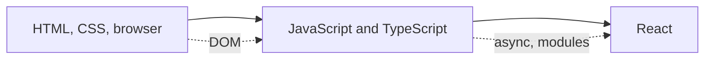

# Front end

How browsers render pages, HTML and CSS, JavaScript and TypeScript, and React.

Before this folder: Networking and Developer tools and workflow.

This folder covers what runs in the browser. You start with how a browser turns HTML and CSS into pixels, including the box model, flexbox, grid and accessibility. Next is JavaScript and TypeScript: the DOM, events, async code and the event loop, and the build tools around them. The last chapter is React: components, state, hooks, data fetching, and web performance.

Front end code is where AI tools are used most, and where mistakes are easy to hide: a layout that looks right in one window size, an effect that fetches twice, a form that a screen reader cannot use. Knowing the rendering model and the event loop lets you check generated code against what the browser will actually do.

It builds on [Networking](../07-networking/index.md) for HTTP and on [Developer tools and workflow](../04-developer-tools-and-workflow/index.md) for Git and dependencies. It feeds [Back end](../09-back-end/index.md), whose APIs the front end calls, and [Security](../12-security/index.md) (XSS, CSRF).

### How to use this folder

- Keep the browser developer tools open while you read. Most lessons say what to look at.
- JavaScript for Python programmers is the quickest way in if you know Python.
- Frameworks and libraries landscape is a survey, so skim it.

<!-- lessons:start -->
## Lessons

### 1. [HTML, CSS and the browser](01-html-css-and-the-browser/index.md)

1. [How browsers render pages](01-html-css-and-the-browser/01-how-browsers-render-pages.md)
2. [HTML](01-html-css-and-the-browser/02-html.md)
3. [CSS and the box model](01-html-css-and-the-browser/03-css-and-the-box-model.md)
4. [Layout with flexbox, grid and responsive design](01-html-css-and-the-browser/04-layout-flexbox-grid-and-responsive.md)
5. [Accessibility](01-html-css-and-the-browser/05-accessibility.md)

### 2. [JavaScript and TypeScript](02-javascript-and-typescript/index.md)

1. [JavaScript for Python programmers](02-javascript-and-typescript/01-javascript-for-python-programmers.md)
2. [The DOM and events](02-javascript-and-typescript/02-the-dom-and-events.md)
3. [Async JavaScript and the event loop](02-javascript-and-typescript/03-async-javascript-and-the-event-loop.md)
4. [TypeScript](02-javascript-and-typescript/04-typescript.md)
5. [npm, bundlers and Vite](02-javascript-and-typescript/05-npm-bundlers-and-vite.md)

### 3. [React](03-react/index.md)

1. [Components, props and JSX](03-react/01-components-props-and-jsx.md)
2. [State and hooks](03-react/02-state-and-hooks.md)
3. [Data fetching and forms](03-react/03-data-fetching-and-forms.md)
4. [Frameworks and libraries landscape](03-react/04-frameworks-and-libraries-landscape.md)
5. [Web performance](03-react/05-web-performance.md)

<!-- lessons:end -->
