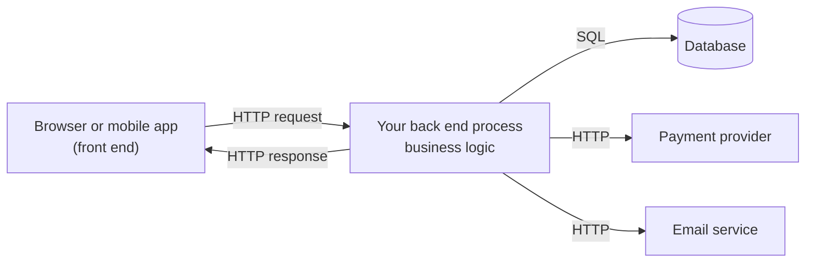
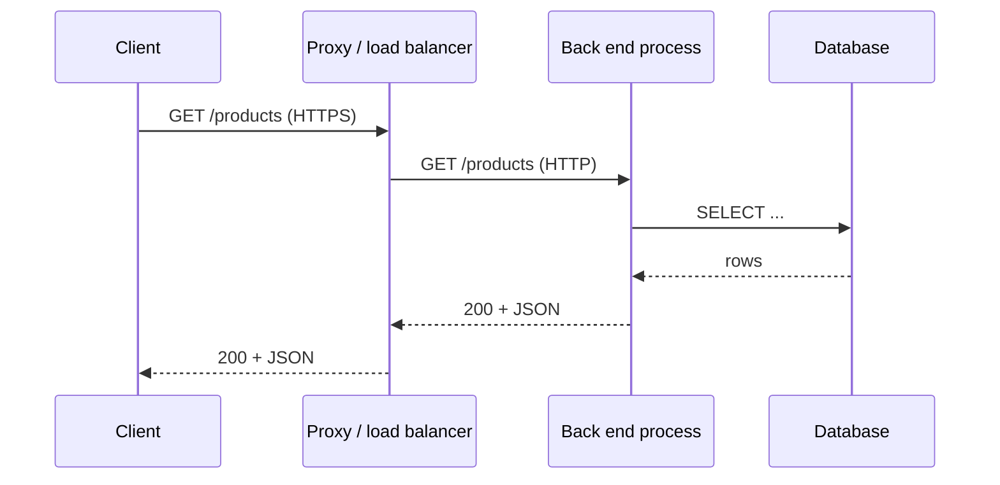

# What a back end does

After this you can say what code belongs in a back end, describe how a request reaches it, and read a minimal server in Node.js.

Before this: [Client-server architecture](../../07-networking/02-web-protocols/04-client-server-architecture.md) and [HTTP requests and responses](../../07-networking/02-web-protocols/01-http-requests-and-responses.md).

## The idea

You open a shop's web page and click "Add to cart". The browser can draw the button, but it cannot be trusted to know the price, check the stock, or remember the cart for next week. Anyone can edit code running in their own browser. So the click sends an HTTP request to a program on a machine the shop controls, and that program decides what happens.

That program is the **back end**. It receives requests, applies the rules of the business, reads and writes stored data, and sends back a response. The front end asks; the back end decides.



## Key terms

A **back end** (or server-side code) is the program that handles requests from clients, applies business logic and talks to data stores and other services.

An **API** (application programming interface) is the set of requests a program accepts and the responses it gives. For a web back end, an endpoint is one method plus one path, such as `GET /products`.

**Business logic** is the rules specific to what the application does: a discount applies only to orders over \$50, a user cannot cancel a shipped order.

A **server process** is an operating system process that starts, opens a port, and waits for connections until someone stops it. Unlike a script, it does not exit when the work is done.

**Integration** means calling another service (payments, email, a map provider) from your back end, usually over HTTP, with a secret key that must never reach the browser.

## What a back end is responsible for

Four jobs cover most of what you will see:

1. Business logic. Rules live here because the client can't be trusted to enforce them. The browser may hide the "Delete" button from a normal user, but the back end must still refuse the request.
2. Data. The back end is the only thing that talks to the database, so every change passes through code that checks it. Databases get their own chapter<!-- link: ../../10-databases-sql-and-postgres/index.md -->.
3. Authentication and authorization. The back end works out who is calling and whether they may do this. See Authentication vs authorization<!-- link: ../02-auth/01-authentication-vs-authorization.md -->.
4. Integrations. Secrets such as a payment API key sit in the back end's environment, and the back end calls the provider on the client's behalf.

## How it works

A back end is a long-running process. It asks the operating system for a port, then loops: accept a connection, read a request, run your function, write a response. The framework you pick (Express, FastAPI, Django) hides the loop and lets you write only the function.

In production the same process usually runs behind other pieces. A proxy or load balancer terminates TLS and spreads requests over several copies of your process, and the database runs on its own machine. See [Proxies and CDNs](../../07-networking/02-web-protocols/05-proxies-and-cdns.md). Your code can be on a rented virtual machine, in a container, or in a serverless function that the cloud starts per request. The code is the same in each; what changes is who starts and stops the process.



Because the process stays up, anything it keeps in memory (a variable, a counter) is lost when it restarts and is not shared between copies. Data that must survive goes in the database.

## Worked examples

<div class="example" markdown>

### Example 1: the smallest server

We write a back end with one endpoint, using only the `http` module that ships with Node.js, and call it with `curl`.

1. Save the code below as `server.mjs`. `http.createServer` takes a function that runs once per request, with the request `req` and the response `res`.
2. The function sends the product list as JSON for `GET /products` and a 404 for everything else.
3. `server.listen(3000)` asks the operating system for port 3000. The process now stays alive.

```javascript
import http from "node:http";

const products = [{ id: 1, name: "Keyboard", priceCents: 4999 }];

const server = http.createServer((req, res) => {
  if (req.method === "GET" && req.url === "/products") {
    res.writeHead(200, { "Content-Type": "application/json" });
    res.end(JSON.stringify(products));
  } else {
    res.writeHead(404, { "Content-Type": "application/json" });
    res.end(JSON.stringify({ error: "not found" }));
  }
});

server.listen(3000, () => console.log(`pid ${process.pid} listening on 3000`));
```

Run `node server.mjs`, and in a second terminal run `curl -i localhost:3000/products`:

```text
HTTP/1.1 200 OK
Content-Type: application/json
Date: Mon, 26 Oct 2026 00:30:12 GMT
Connection: keep-alive
Keep-Alive: timeout=5
Transfer-Encoding: chunked

[{"id":1,"name":"Keyboard","priceCents":4999}]
```

Check: `curl -s -o /dev/null -w "%{http_code}" localhost:3000/nope` prints `404`. Stop the server with Ctrl+C. The prices are in cents, an integer, because floating-point money gives errors like `0.1 + 0.2`.

</div>

## Common mistakes

<div class="warning" markdown>

Watch out: putting a rule only in the front end. A hidden button or a disabled form field is not a check; anyone can send the request with `curl`. Enforce every rule in the back end, and treat the front end's checks as convenience.

Watch out: keeping data in a variable. A `const cart = []` in the server works on your laptop and loses everything on restart, and two copies of the process behind a load balancer each hold a different cart.

</div>

## Working with AI

<div class="ai" markdown>

Words to use: endpoint, business logic, server process, stateless, integration, environment variable.

Prompts to try:

- "I have a Node.js 24 service with an in-memory `orders` array. It will run as three copies behind a load balancer. List what breaks and where the state should move."
- "Which of these checks must be in the back end and which can stay in the front end for usability only: password length, coupon validity, maximum quantity per order?"

What to check:

- Secrets in client code. Search the generated front-end code for API keys; any key the browser can read is public.
- Rules enforced only in the browser. Send the request with `curl` and see whether the server still refuses it.
- State kept in module variables. Ask what happens after a restart and with two instances.

</div>

## Quiz

1\. Name three things a back end does that a front end cannot be trusted to do.

<details class="solution" markdown>
<summary>Answer</summary>

Enforce business rules, store data durably, and keep secrets such as a payment API key. Authentication checks belong here too. The user controls their browser, so nothing running there can be trusted.

</details>

2\. In Example 1, what status code does `GET /products/1` return, and why?

<details class="solution" markdown>
<summary>Answer</summary>

404. The code compares `req.url` to the exact string `/products`, so `/products/1` falls to the `else` branch. Routing by hand like this is what Express replaces.

</details>

3\. A teammate stores the shopping cart in a JavaScript array in the server. In production, users report that carts vanish at random. Give two likely causes.

<details class="solution" markdown>
<summary>Answer</summary>

The process restarted (a deploy, a crash, or the host rescheduling it), which clears memory. Or there are several copies behind a load balancer, and a request reached a copy that never saw the earlier "add" request. Move the cart to the database.

</details>

4\. Why does a server process keep running after it handles a request, while a script does not?

<details class="solution" markdown>
<summary>Answer</summary>

It holds an open listening socket on a port, which keeps the runtime waiting for connections. A script exits when its last statement finishes.

</details>

## Lab

<div class="lab" markdown>

### Lab: your first back end

Goal: run the server from Example 1 and add one endpoint. Time: about 10 minutes. Runs in: any terminal with Node.js 24.

1. Save the Example 1 code as `server.mjs` and start it with `node server.mjs`.
2. In a second terminal, run `curl -i localhost:3000/products` and confirm the 200 and the JSON.
3. Add a branch for `GET /health` that returns status 200 and `{"status":"ok"}`. Stop the server with Ctrl+C and start it again, because Node does not reload code on its own.
4. Run `curl localhost:3000/health`.
5. Cleanup: stop the server.

Expected result:

```text
{"status":"ok"}
```

<details class="solution" markdown>
<summary>Solution</summary>

```javascript
  } else if (req.method === "GET" && req.url === "/health") {
    res.writeHead(200, { "Content-Type": "application/json" });
    res.end(JSON.stringify({ status: "ok" }));
  } else {
```

Insert it between the `/products` branch and the final `else`. Load balancers call a health endpoint like this to decide whether a copy of your process is alive.

</details>

</div>

## Where this shows up

- Next, the runtime that executes this code: [Node.js and its runtime](02-nodejs-and-its-runtime.md).
- Who may call each endpoint is covered in the [auth chapter](../02-auth/index.md).
