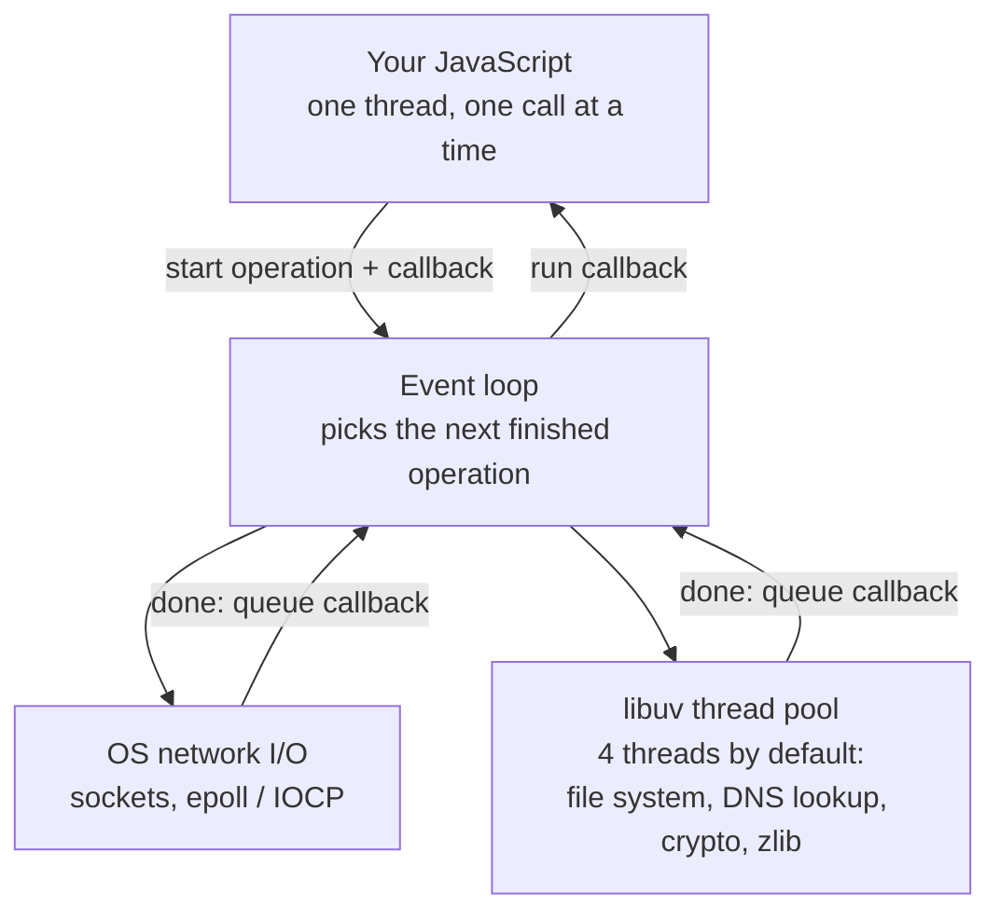

# Node.js and its runtime

After this you can explain why one Node.js process handles thousands of waiting requests on a single thread, and recognise code that blocks every user at once.

Before this: [What a back end does](01-what-a-back-end-does.md) and [Async JavaScript and the event loop](../../08-front-end/02-javascript-and-typescript/03-async-javascript-and-the-event-loop.md).

## The idea

A back end spends most of its time waiting: for the database, for a payment provider, for the client's slow connection. A design that gives each request its own thread would hold a thread (and its memory) idle for each of those waits.

Node.js takes the other route. Your JavaScript runs on one thread. When it starts a slow operation, such as a file read or an HTTP call, it hands the operation to the operating system or a helper, registers a callback, and moves on to the next request. When the result arrives, the callback runs. One thread can keep thousands of requests in flight because most of them are waiting, not computing.



## Key terms

**Node.js** is a JavaScript runtime: a program that runs JavaScript outside a browser. It combines **V8**, the engine that compiles and runs JavaScript (also used by Chrome), with **libuv**, a C library that provides the event loop and non-blocking I/O.

The **event loop** is the loop that takes finished operations off a queue and runs their callbacks, one at a time, on the main thread.

**Non-blocking I/O** means a read or write returns control immediately and signals completion later, instead of making the thread wait.

**Blocking** code is anything that keeps the main thread busy, either computing or in a synchronous call such as `fs.readFileSync`. While it runs, no other callback can run.

The **thread pool** is a small set of worker threads inside libuv for work the OS can't do without blocking. Its default size is 4 (`UV_THREADPOOL_SIZE`).

**npm** is Node's package manager and registry. `package.json` lists a project's dependencies and its scripts.

## How it works

Network I/O uses the OS's own notification system, so a waiting socket costs almost nothing. File reads, DNS lookups, and CPU-heavy library calls such as hashing go to the thread pool. In both cases your callback finally runs on the main thread, so your own JavaScript never runs in parallel with itself. That removes most locking problems, but it means any slow synchronous code delays everything.

Two practical tools remain. For CPU-heavy work, a **worker thread** (`node:worker_threads`) runs JavaScript on a second thread with its own memory and passes results back as messages. For more throughput on a multi-core machine, you run several copies of the process behind a load balancer.

A project also needs a start command and configuration. Scripts in `package.json` give short names to commands (`npm run dev`). Settings that change between machines, such as the port or a database URL, come from environment variables read through `process.env`, not from the source code. Node can load them from a file with `node --env-file=.env`. Never commit the `.env` file if it holds secrets.

```json
{
  "type": "module",
  "scripts": {
    "start": "node server.mjs",
    "dev": "node --watch server.mjs"
  }
}
```

Node.js 24 is in long-term support (LTS) as of 2026; use an LTS version for servers. Check the [Node.js releases page](https://nodejs.org/en/about/previous-releases).

## Worked examples

<div class="example" markdown>

### Example 1: waiting versus blocking

We build a server with three endpoints and see how a slow request affects a fast one.

1. `/fast` replies at once.
2. `/waiting` starts a 3-second `setTimeout` and returns. The thread is free during those 3 seconds.
3. `/blocking` runs a loop for 3 seconds. The thread is busy during all of it.

```javascript
import http from "node:http";

http.createServer((req, res) => {
  if (req.url === "/fast") {
    res.end("fast\n");
  } else if (req.url === "/blocking") {
    const end = Date.now() + 3000;
    while (Date.now() < end) {}                 // CPU work on the only thread
    res.end("blocking done\n");
  } else if (req.url === "/waiting") {
    setTimeout(() => res.end("waiting done\n"), 3000);   // no thread held
  }
}).listen(3001);
```

We request `/fast` 0.3 seconds after starting each slow request, and time it with `curl -w "%{time_total}"`:

```text
--- /fast while /waiting is pending
fast took 0.002701s
--- /fast while /blocking is running
fast took 2.668065s
```

Check: both slow endpoints take 3 seconds, but only the blocking one stops other users. `/fast` had to wait for the loop to end (about 2.7 seconds remaining of 3). Real blocking code is rarely a `while` loop; it is a big `JSON.parse`, a `readFileSync`, a regular expression with catastrophic backtracking, or a password hash done synchronously.

</div>

<div class="example" markdown>

### Example 2: the thread pool

`pbkdf2` is an asynchronous password-hashing function that runs in the thread pool. We start 8 at once on a 12-core machine:

```javascript
import { pbkdf2 } from "node:crypto";

const start = Date.now();
for (let i = 1; i <= 8; i++) {
  pbkdf2("secret", "salt", 400_000, 64, "sha512", () => {
    console.log(`hash ${i} finished at ${Date.now() - start} ms`);
  });
}
```

```text
hash 4 finished at 152 ms
hash 1 finished at 169 ms
hash 3 finished at 211 ms
hash 2 finished at 217 ms
hash 5 finished at 316 ms
hash 6 finished at 362 ms
hash 8 finished at 383 ms
hash 7 finished at 387 ms
```

Four finish together, then four more: the pool has 4 threads. Your times will differ, but the two waves should appear. Saved as `pool.mjs`, running it with `UV_THREADPOOL_SIZE=8 node pool.mjs` (bash) puts all 8 in one wave.

</div>

## Common mistakes

<div class="warning" markdown>

Watch out: using a `Sync` function in a request handler (`readFileSync`, `pbkdf2Sync`). It is fine at startup, but inside a handler it stops every other request for its whole duration. Use the promise or callback version.

Watch out: believing `async` makes code run in parallel. An `async` function that does a long loop still blocks the thread. `await` only helps when the thing awaited is I/O.

Watch out: a single thread does not mean one CPU core is the limit for the whole system. It means one process uses about one core for JavaScript. Start several processes to use the rest.

</div>

## Working with AI

<div class="ai" markdown>

Words to use: event loop, blocking, non-blocking I/O, libuv thread pool, worker thread, `process.env`.

Prompts to try:

- "This Express handler on Node.js 24 calls `fs.readFileSync` and then `bcrypt.hashSync`. Under 200 concurrent requests the p99 latency spikes. Explain why in terms of the event loop and rewrite it to be non-blocking."
- "Should this image-resizing endpoint use a worker thread, a separate process, or a job queue? It takes 800 ms of CPU per image."

What to check:

- `Sync` calls inside handlers, and long loops over big arrays or large `JSON.parse` calls. Search the code for `Sync`.
- Claims about "multithreading" in Node. Your code runs on one thread; check whether the answer means the thread pool, a worker thread, or several processes.
- Advice that uses `require` in a project with `"type": "module"`, or the reverse. Run the code.

</div>

## Quiz

1\. Why can one Node.js thread serve thousands of simultaneous requests?

<details class="solution" markdown>
<summary>Answer</summary>

Most requests are waiting on I/O. Node starts the operation, registers a callback and moves on, so waiting costs no thread. Only the short bursts of JavaScript between waits use the thread.

</details>

2\. In Example 1, what happens to `/fast` if `/blocking` is called twice at the same moment?

<details class="solution" markdown>
<summary>Answer</summary>

It waits for both loops, about 6 seconds in total, because the loops run one after the other on the single thread and `/fast` is queued behind them.

</details>

3\. A handler hashes a password with `pbkdf2Sync`, which takes 80 ms. About how many such requests per second can one process handle, at best?

<details class="solution" markdown>
<summary>Answer</summary>

About 12 ($1000 / 80 = 12.5$), because each hash occupies the only thread. The async `pbkdf2` moves the work to the thread pool, which lets the main thread serve other requests while hashes run.

</details>

4\. Where should the database URL for a deployed service come from?

<details class="solution" markdown>
<summary>Answer</summary>

From an environment variable (`process.env.DATABASE_URL`), set by the deployment platform or loaded from an uncommitted `.env` file. It differs between machines and may contain a password.

</details>

## Lab

<div class="lab" markdown>

### Lab: measure a blocked server

Goal: see a blocking handler freeze other requests, then fix it. Time: about 15 minutes. Runs in: any terminal with Node.js 24.

1. Save the Example 1 server as `server.mjs` and start it with `node server.mjs`.
2. In a second terminal, run `curl -s localhost:3001/blocking &` and then `curl -s -w "%{time_total}\n" localhost:3001/fast`. Note the time.
3. Change `/blocking` to use `setTimeout` as `/waiting` does. Restart the server and repeat step 2.
4. Cleanup: stop the server with Ctrl+C.

Expected result: about 2.7 seconds before the change, and a few milliseconds after.

<details class="solution" markdown>
<summary>Solution</summary>

Replace the loop and `res.end` of the `/blocking` branch with `setTimeout(() => res.end("blocking done\n"), 3000);`. A real CPU-bound task cannot be fixed this way; there you would move it to a `worker_threads` Worker:

```javascript
import { Worker, isMainThread, parentPort } from "node:worker_threads";

if (isMainThread) {
  const worker = new Worker(new URL(import.meta.url));
  worker.on("message", (sum) => console.log("sum from worker:", sum));
} else {
  let sum = 0;
  for (let i = 0; i < 1e8; i++) sum += i;
  parentPort.postMessage(sum);
}
```

```text
sum from worker: 4999999950000000
```

</details>

</div>

## Where this shows up

- The framework built on this runtime: [Express: routing and middleware](03-express-routing-and-middleware.md).
- Moving slow work out of the request entirely: background jobs<!-- link: ../03-api-quality/01-background-jobs.md -->.
