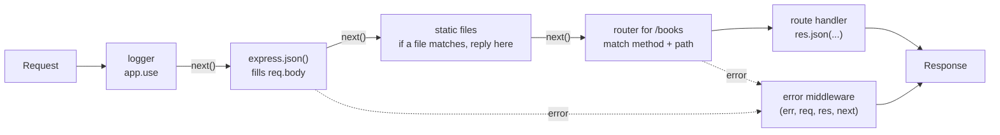

# Express: routing and middleware

After this you can build an Express app with routes, URL parameters, JSON bodies and middleware, and trace a request through it.

Before this: [Node.js and its runtime](02-nodejs-and-its-runtime.md).

## The idea

In the first lesson we routed requests with an `if` on `req.url`. That stops working at ten endpoints. **Express** is a small web framework for Node.js that does the routing and gives you a standard way to run shared steps (logging, parsing the body, checking a login) before your handler.

Think of a request walking down a corridor. Each door is a function. Some doors do shared work and open the next door; one door is the handler that answers. If something goes wrong, the request is sent to a special error room.



## Key terms

An **app** is the object returned by `express()`. It holds the routes and middleware and listens on a port.

A **route** pairs an HTTP method and a path pattern with a handler: `app.get("/books/:id", handler)`.

A **handler** is a function `(req, res)` that reads the request and sends exactly one response.

**Middleware** is a function `(req, res, next)` that runs before the handler. It can change `req` or `res`, end the response itself, or call `next()` to pass control to the next function in order.

A **route parameter** is a named piece of the path, such as `:id`, available as `req.params.id`. The **query string** is the part after `?`, available as `req.query`. Both arrive as strings.

**Error middleware** is a function with four parameters `(err, req, res, next)`. Express calls it when something throws or calls `next(err)`.

A **router** is a mini-app (`express.Router()`) that groups related routes so a file can own one part of the API.

## How it works

Express keeps one ordered list of middleware and routes. For each request it walks the list from the top and runs each entry whose method and path match. An entry that calls `next()` continues the walk; one that sends a response ends it. Order therefore matters: `express.json()` must come before the routes that read `req.body`.

- `app.use(fn)` runs `fn` for every request. `app.use("/books", router)` runs it only for paths starting with `/books`, and the router sees the rest of the path.
- `express.json()` is built-in middleware that parses a body with `Content-Type: application/json` into `req.body`. Without it, or with another content type, `req.body` is `undefined`.
- `express.static("public")` serves files from a folder.
- If a handler throws, or in Express 5 returns a rejected promise from an `async` function, Express skips ahead to the first error middleware. That error middleware goes last, after all routes.

Express 5 is the default version on npm (5.3 as of 2026, requires Node.js 18 or later); see the [Express docs](https://expressjs.com/) for the routing and error-handling guides. Older tutorials target Express 4 and wrap async handlers in a try/catch; with 5 you don't need to.

## Worked examples

<div class="example" markdown>

### Example 1: a small app

The router module `routes/books.mjs` owns the `/books` routes:

```javascript
import { Router } from "express";

export const books = Router();
const data = [
  { id: 1, title: "SICP", year: 1985 },
  { id: 2, title: "TAOCP", year: 1968 },
];

books.get("/", (req, res) => {
  const { year } = req.query;
  res.json(year ? data.filter((b) => b.year === Number(year)) : data);
});

books.get("/:id", (req, res) => {
  const book = data.find((b) => b.id === Number(req.params.id));
  if (!book) return res.status(404).json({ error: "no such book" });
  res.json(book);
});
```

The app file `app.mjs` assembles the middleware chain from the diagram:

```javascript
import express from "express";
import { books } from "./routes/books.mjs";

const app = express();

app.use((req, res, next) => {            // runs for every request
  console.log(req.method, req.url);
  next();                                // hand over to the next function
});
app.use(express.json());                 // parses JSON bodies into req.body
app.use(express.static("public"));       // serves files from ./public
app.use("/books", books);                // router mounted at /books

app.post("/echo", (req, res) => res.json({ youSent: req.body }));
app.get("/boom", () => { throw new Error("database password is hunter2"); });

app.use((err, req, res, next) => {       // four parameters: error middleware
  console.error(err.message);
  res.status(500).json({ error: "internal error" });
});

app.listen(3002, () => console.log("listening on 3002"));
```

Steps to read it: the logger runs first for every request; `/books/2` then matches the router, whose `/:id` route puts `"2"` in `req.params.id`; `Number(...)` converts it, because params are strings. Running `npm i express`, `node app.mjs` and some `curl` calls gives:

```text
GET /books            -> [{"id":1,"title":"SICP","year":1985},{"id":2,"title":"TAOCP","year":1968}] [200]
GET /books/2          -> {"id":2,"title":"TAOCP","year":1968} [200]
GET /books?year=1985  -> [{"id":1,"title":"SICP","year":1985}] [200]
GET /books/9          -> {"error":"no such book"} [404]
GET /                 -> <h1>Hello from public</h1> [200]
GET /boom             -> {"error":"internal error"} [500]
POST /echo (JSON)     -> {"youSent":{"name":"Ada"}} [200]
```

Check: the server log shows `database password is hunter2` for `/boom` but the client sees only `internal error`. The message with the secret stayed in the log. A `POST /echo` sent without the JSON content type returns `{}`, because `req.body` stayed `undefined` and `res.json` dropped the missing key.

</div>

## Common mistakes

<div class="warning" markdown>

Watch out: forgetting `next()` in middleware. The request then hangs until the client times out, because nothing sends a response and nothing continues. Either call `next()` or end the response.

Watch out: registering `express.json()` after the routes. Order is execution order, so the handlers run first and see an empty `req.body`.

Watch out: sending two responses, for example `res.json(...)` without `return` before more code that also responds. The second call throws "Cannot set headers after they are sent". Write `return res.status(404).json(...)`.

</div>

## Working with AI

<div class="ai" markdown>

Words to use: middleware, `next()`, route parameter, query string, router, error-handling middleware, Express 5.

Prompts to try:

- "Using Express 5 and ES modules, write a router for `/orders` with GET list, GET by id and POST. Mount it in app.mjs. Explain the order of `app.use` calls."
- "My Express 5 POST handler sees `req.body` as undefined. Here is my app file and the curl command I use. What is wrong?"

What to check:

- The Express version. Generated code often targets Express 4 (`bodyParser`, `res.send(status)` forms, a wrapper for async errors). Check `npm ls express` and the docs for 5.
- Order of middleware, and that the error handler is last with four parameters.
- Params and query values used as numbers without conversion. `req.params.id === 2` is never true.

</div>

## Quiz

1\. What are the two things a middleware function can do at the end of its work?

<details class="solution" markdown>
<summary>Answer</summary>

Call `next()` to pass the request on, or send a response itself, which ends the chain. If it does neither, the request hangs.

</details>

2\. With the router mounted by `app.use("/books", books)`, which route in the router handles `GET /books/2`, and what is `req.params.id`?

<details class="solution" markdown>
<summary>Answer</summary>

The `/:id` route, because the router sees the path after `/books`. `req.params.id` is the string `"2"`.

</details>

3\. A `POST /users` handler logs `req.body.email` and prints `undefined`, although the client sent `{"email":"a@b.ca"}`. Name two causes.

<details class="solution" markdown>
<summary>Answer</summary>

`express.json()` is missing or registered after the route, or the client didn't send `Content-Type: application/json`, so the parser skipped the body.

</details>

4\. Why does the error middleware in Example 1 respond with `internal error` instead of `err.message`?

<details class="solution" markdown>
<summary>Answer</summary>

Error messages can contain internal details such as hostnames or secrets. The full message goes to the log, and the client gets a generic one.

</details>

## Lab

<div class="lab" markdown>

### Lab: add a logger and a route

Goal: build the app from Example 1 and add timing middleware. Time: about 15 minutes. Runs in: any terminal with Node.js 24.

1. Create a folder, run `npm init -y`, `npm i express`, and add `"type": "module"` to `package.json`.
2. Save the router and app files from Example 1 (and any `public/index.html`). Start with `node app.mjs`.
3. Add a middleware before `express.json()` that records `Date.now()`, and on the response's `finish` event prints the method, URL and milliseconds taken.
4. Call `curl localhost:3002/books/2` and read the server log.
5. Cleanup: stop the server.

Expected result: a log line such as `GET /books/2 6ms`, printed after the response is sent.

<details class="solution" markdown>
<summary>Solution</summary>

```javascript
app.use((req, res, next) => {
  const start = Date.now();
  res.on("finish", () => console.log(`${req.method} ${req.originalUrl} ${Date.now() - start}ms`));
  next();
});
```

Use `req.originalUrl`: inside a mounted router `req.url` has the mount path removed, and the log would say `GET /2`. With the original logger above, you will see both lines (`GET /books/2` from the first middleware, then yours).

</details>

</div>

## Where this shows up

- The REST conventions that decide which routes to write: [REST API design](04-rest-api-design.md).
- Checking input in middleware: [Validation and error handling](05-validation-and-error-handling.md).
