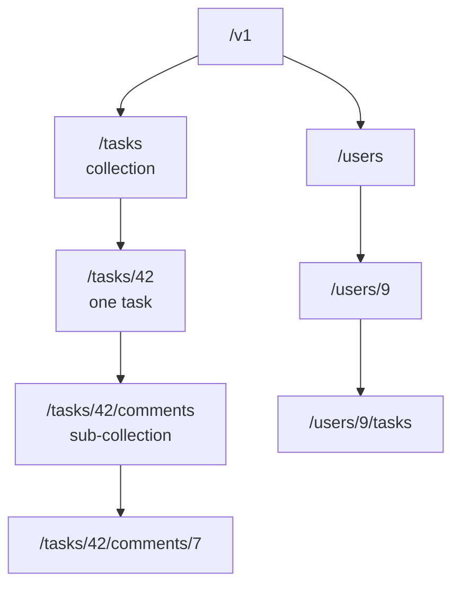

# REST API design

After this you can design a set of endpoints for a resource: the paths, methods, status codes, pagination and error format, so another developer can guess how they work.

Before this: [Express: routing and middleware](03-express-routing-and-middleware.md) and [HTTP requests and responses](../../07-networking/02-web-protocols/01-http-requests-and-responses.md).

## The idea

Two teams build APIs for the same task list. One has `POST /createTask`, `GET /getTasks`, `POST /deleteTask?id=4`. The other has `POST /tasks`, `GET /tasks`, `DELETE /tasks/4`. The second needs no documentation to guess the fourth endpoint, and any HTTP tool (caches, proxies, browsers) already knows what `GET` and `DELETE` mean.

That is the point of REST-style design: model your data as **resources** named by URLs (nouns), and let the HTTP method say the action (the verb). Strictly, "REST" is an architectural style from Roy Fielding's thesis; in practice "a REST API" means JSON over HTTP organised around resources like this.



## Key terms

A **resource** is a thing the API exposes, such as a task or a user. A **collection** is a resource that holds others (`/tasks`).

A **safe** method does not change server state (`GET`). An **idempotent** method has the same effect whether you send the request once or many times (`GET`, `PUT`, `DELETE`). `POST` is neither, and `PATCH` isn't guaranteed to be idempotent. Idempotency matters because networks fail: a client that gets no response can safely retry an idempotent request.

**Pagination** returns a long collection in pages. **Versioning** puts a version in the URL (`/v1/tasks`) or a header, so a breaking change can ship as a new version while old clients keep working.

A **problem details** object is the standard JSON error body defined in [RFC 9457](https://www.rfc-editor.org/rfc/rfc9457), served as `application/problem+json`, with the fields `type`, `title`, `status` and `detail`.

## How it works

The method table, and the status codes you will use for most responses (from [RFC 9110](https://www.rfc-editor.org/rfc/rfc9110)):

| Request | Meaning | Safe | Idempotent | Success status |
|---|---|---|---|---|
| `GET /tasks` | list | yes | yes | 200 |
| `POST /tasks` | create | no | no | 201 + `Location` header |
| `GET /tasks/42` | read one | yes | yes | 200 |
| `PUT /tasks/42` | replace | no | yes | 200 |
| `PATCH /tasks/42` | change some fields | no | not guaranteed | 200 |
| `DELETE /tasks/42` | remove | no | yes | 204 (no body) |

| Status | Use it when |
|---|---|
| 400 | the request is malformed (bad JSON, bad query) |
| 401 | no valid credentials |
| 403 | credentials fine, not allowed |
| 404 | no such resource |
| 409 | conflicts with current state (duplicate email) |
| 422 | well-formed but fails validation rules |
| 429 | rate limit exceeded |
| 500 | the server failed; not the client's fault |

Conventions that save arguments:

1. Plural nouns for collections (`/tasks`), lowercase, hyphens in multi-word names (`/order-items`), no verbs. Nest only one level deep.
2. Filtering and sorting go in the query string: `GET /tasks?done=true&sort=-created`.
3. Every list endpoint is paginated from day one. Offset pagination (`?limit=20&offset=40`) is easy but skips or repeats rows if data changes between pages; cursor pagination (`?after=<opaque token>`) is stable for large or changing data.
4. One error shape for every failure, so clients write one error handler.
5. Use the same field names and formats everywhere: ISO 8601 for dates, integers for money in cents.

## Worked examples

<div class="example" markdown>

### Example 1: a tasks API

We implement the table for tasks, held in a `Map`. The list handler reads `limit`, `offset` and a `done` filter; `POST` returns 201 with a `Location`; `PUT` on a missing id returns a problem details body.

```javascript
function problem(res, status, title, detail) {
  res.status(status).type("application/problem+json")
    .json({ type: "about:blank", title, status, detail });
}

app.get("/v1/tasks", (req, res) => {
  const limit = Math.min(Number(req.query.limit) || 10, 100);
  const offset = Number(req.query.offset) || 0;
  let items = [...tasks.values()];
  if (req.query.done) items = items.filter((t) => String(t.done) === req.query.done);
  res.json({ items: items.slice(offset, offset + limit), total: items.length, limit, offset });
});

app.post("/v1/tasks", (req, res) => {
  const task = { id: nextId++, title: req.body.title, done: false };
  tasks.set(task.id, task);
  res.status(201).location(`/v1/tasks/${task.id}`).json(task);
});

app.put("/v1/tasks/:id", (req, res) => {
  const id = Number(req.params.id);
  if (!tasks.has(id)) return problem(res, 404, "Task not found", `No task with id ${id}.`);
  const task = { id, title: req.body.title, done: Boolean(req.body.done) };
  tasks.set(id, task);
  res.json(task);
});

app.delete("/v1/tasks/:id", (req, res) => {
  tasks.delete(Number(req.params.id));
  res.status(204).end();
});
```

(`tasks`, `nextId` and `express.json()` are set up as in the previous lesson.) Calling it with `curl`:

```text
GET /v1/tasks?done=true&limit=5
{"items":[{"id":2,"title":"Run the code","done":true}],"total":1,"limit":5,"offset":0}

POST /v1/tasks
HTTP/1.1 201 Created
Location: /v1/tasks/3
{"id":3,"title":"Read RFC 9110","done":false}

PUT /v1/tasks/99
HTTP/1.1 404 Not Found
Content-Type: application/problem+json; charset=utf-8
{"type":"about:blank","title":"Task not found","status":404,"detail":"No task with id 99."}
```

Check idempotency by sending each request twice:

```text
POST twice: {"id":3,...} then {"id":4,...}   two tasks created
PUT twice:  {"id":1,"title":"Write lesson","done":true} both times   same result
DELETE twice: 204, 204
```

The two `POST`s made two tasks, while the repeated `PUT` and `DELETE` left the server in the same state. (Some APIs return 404 on the second `DELETE`; both choices are defensible, but the state afterwards is the same.) So if a client times out on a `PUT`, retrying is safe; on a `POST`, it needs an idempotency key (a unique value the client sends so the server can recognise a retry) or a check first.

</div>

## Common mistakes

<div class="warning" markdown>

Watch out: returning 200 with `{"error": ...}` for failures. Clients, proxies and monitoring read the status code first. Use the right 4xx or 5xx code, with the error in the body.

Watch out: verbs in paths (`/getUser`, `/tasks/42/delete`). Use the method as the verb. For an action that isn't CRUD, model it as a resource: `POST /tasks/42/archive` is acceptable when no noun fits, but prefer `PATCH /tasks/42` with `{"archived": true}`.

Watch out: changing a response shape in place. Removing or renaming a field breaks clients you can't see. Add fields freely; ship breaking changes under a new version.

</div>

## Working with AI

<div class="ai" markdown>

Words to use: resource, collection, idempotent, status code, pagination, cursor, problem details (RFC 9457).

Prompts to try:

- "Design a REST API for a library: books, members and loans. Give the paths, methods and status codes in a table, and say which are idempotent. Use cursor pagination for the book list."
- "Review this endpoint list for REST naming problems and wrong status codes: `POST /getOrders`, `GET /order/delete?id=3`, `PUT /orders` returning 200 on a validation error."

What to check:

- Verbs in paths, and a mix of singular and plural names.
- Errors returned as 200, or 404 used for a validation failure. Compare with the status table.
- Unbounded list endpoints with no `limit`. Request a collection with a million rows and see what happens.
- Invented standards. Look up any RFC or header the answer cites.

</div>

## Quiz

1\. Why is `PUT` idempotent but `POST` not?

<details class="solution" markdown>
<summary>Answer</summary>

`PUT` names the resource and replaces it with the given representation, so repeating it ends in the same state. `POST` to a collection creates a new resource each time.

</details>

2\. What status code and header does a successful `POST /v1/tasks` return?

<details class="solution" markdown>
<summary>Answer</summary>

201 Created, with a `Location` header giving the URL of the new task, such as `/v1/tasks/3`.

</details>

3\. A client calls `GET /v1/tasks/abc` and the server answers 500 with a stack trace. What should happen instead, and why?

<details class="solution" markdown>
<summary>Answer</summary>

A 4xx: 400 or 404 (or 422), as a problem details body. The client sent bad input; a 500 says the server is broken and leaks internals through the trace.

</details>

4\. A mobile app times out on `POST /v1/payments` and retries. What can go wrong, and what is the usual fix?

<details class="solution" markdown>
<summary>Answer</summary>

The first request may have succeeded, so the retry charges twice. The usual fix is an idempotency key: the client sends a unique key with the request, and the server returns the stored result if it has seen the key before.

</details>

## Lab

<div class="lab" markdown>

### Lab: add PATCH and a 409

Goal: extend the tasks API with a partial update and a conflict. Time: about 15 minutes. Runs in: any terminal with Node.js 24 and Express.

1. Save the app from Example 1 as `tasks.mjs` (with `import express`, `express.json()`, `tasks`, `nextId` and `app.listen(3003)`). Start it.
2. Add `PATCH /v1/tasks/:id` that changes only the fields present in the body, with a 404 problem if the task is missing.
3. In `POST`, return a 409 problem if a task with the same title already exists.
4. Test with `curl -X PATCH -H "Content-Type: application/json" -d '{"done":true}' localhost:3003/v1/tasks/1` and by posting the same title twice.
5. Cleanup: stop the server.

Expected result: the PATCH response shows the updated task with only `done` changed; the second identical `POST` returns 409.

<details class="solution" markdown>
<summary>Solution</summary>

```javascript
app.patch("/v1/tasks/:id", (req, res) => {
  const id = Number(req.params.id);
  const task = tasks.get(id);
  if (!task) return problem(res, 404, "Task not found", `No task with id ${id}.`);
  Object.assign(task, req.body, { id });
  res.json(task);
});
```

In `POST`, before creating: `if ([...tasks.values()].some((t) => t.title === req.body.title)) return problem(res, 409, "Duplicate task", "A task with this title exists.");`. The `Object.assign` in `PATCH` copies any field, so a real API validates which fields may change (next lesson).

</details>

</div>

## Where this shows up

- Rejecting bad input with the right status: [Validation and error handling](05-validation-and-error-handling.md).
- Other ways to shape an API: [Other API styles: GraphQL, gRPC and webhooks](06-other-api-styles-graphql-grpc-webhooks.md).
- Documenting the endpoints: testing and documenting APIs<!-- link: ../03-api-quality/02-testing-and-documenting-apis.md -->.
