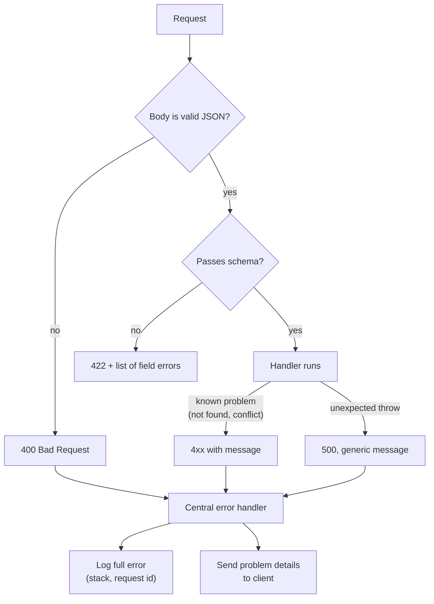

# Validation and error handling

After this you can validate request bodies with a schema, return the right 4xx code, and send every error through one handler that logs the detail and hides it from the client.

Before this: [REST API design](04-rest-api-design.md).

## The idea

Your endpoint expects `{"title": "Ship it", "priority": 2}`. Real clients send `{"title": ""}`, `{"priority": "high"}`, a 5 MB string, an array instead of an object, or text that isn't JSON at all. Some of that is bugs; some is someone probing your server on purpose. Either way, the rule is the same: **never trust input**. Anything that crosses the network is unchecked until your code checks it.

Two jobs follow. First, check the input at the edge of the system and reject bad input with a precise 4xx. Second, make sure that when something else fails, every failure leaves through one path that logs the full detail for you and tells the client only what it needs.



## Key terms

**Validation** is checking that input has the expected shape and values before using it. A **schema** is a declaration of that shape: which fields exist, their types and limits.

**zod** is a TypeScript and JavaScript library for declaring schemas and parsing data against them. `schema.safeParse(data)` returns either `{ success: true, data }` or `{ success: false, error }` and doesn't throw. Parsing also trims, converts and applies defaults, so the `data` it returns is the cleaned value to use.

**400 Bad Request** means the server can't understand the request (malformed JSON). **422 Unprocessable Content** means the request was understood but its content breaks a rule. Many APIs use 400 for both; pick one convention and apply it everywhere. This book uses 400 for syntax and 422 for rules.

A **central error handler** is the single error middleware (last in the chain) that turns every error into a response and a log line.

**Logging** records what happened on the server, usually one structured line per event, so you can debug later. A **stack trace** is the list of function calls that led to an error. It helps you and helps an attacker, so it goes in the log, never in the response.

## How it works

Validate in a layer that runs before the handler body does any work. With zod the schema is also the documentation:

```javascript
import { z } from "zod";

const NewTask = z.object({
  title: z.string().trim().min(1).max(100),
  priority: z.number().int().min(1).max(5).default(3),
});
```

Three habits cover most mistakes:

1. Allow-list: accept only the fields you declared. Take `parsed.data`, not `req.body`, so an extra field such as `"isAdmin": true` can't slip into your database call.
2. Limit sizes: strings, arrays and the body itself (`express.json({ limit: "100kb" })` is the default).
3. Validate again where it matters. The front end's checks are for usability; the back end's are for safety. Also, validation of shape doesn't replace checking permission or using [parameterised SQL](../../10-databases-sql-and-postgres/index.md).

Zod 4 is the current major version as of 2026; see the [zod docs](https://zod.dev/). Its `error.issues` is an array of `{ path, message, ... }` objects, which is what we format below.

## Worked examples

<div class="example" markdown>

### Example 1: schema check and one error handler

1. Parse the body with `safeParse`. On failure, answer 422 with each failing field and message.
2. Define `HttpError`, a class carrying a status, for problems we expect (a missing task).
3. Add one error middleware. It reads `err.status` (body-parser errors have one too, 400 for bad JSON), logs the stack only for 5xx, and sends a generic message for 5xx.

```javascript
class HttpError extends Error {
  constructor(status, title) { super(title); this.status = status; }
}

app.post("/tasks", (req, res) => {
  const parsed = NewTask.safeParse(req.body);
  if (!parsed.success) {
    return res.status(422).type("application/problem+json").json({
      title: "Validation failed",
      status: 422,
      errors: parsed.error.issues.map((i) => ({ field: i.path.join("."), message: i.message })),
    });
  }
  res.status(201).json({ id: 1, ...parsed.data });
});

app.get("/tasks/:id", () => { throw new HttpError(404, "Task not found"); });
app.get("/crash", () => { throw new Error("connect ECONNREFUSED db:5432"); });

app.use((err, req, res, next) => {
  const status = err.status ?? 500;
  if (status >= 500) console.error(err.stack);      // detail goes to the log only
  res.status(status).type("application/problem+json").json({
    title: status >= 500 ? "Internal server error" : err.message,
    status,
  });
});
```

Five requests (the first is valid; the second has an empty title and a string priority):

```text
POST {"title":"  Ship it  "}
{"id":1,"title":"Ship it","priority":3} [201]

POST {"title":"","priority":"high"}
{"title":"Validation failed","status":422,"errors":[{"field":"title","message":"Too small: expected string to have >=1 characters"},{"field":"priority","message":"Invalid input: expected number, received string"}]} [422]

POST {"title":
{"title":"Unexpected end of JSON input","status":400} [400]

GET /tasks/7
{"title":"Task not found","status":404} [404]

GET /crash
{"title":"Internal server error","status":500} [500]
```

Check: the first request was trimmed and given the default priority 3. The server's error log contains `connect ECONNREFUSED db:5432` and a stack trace for `/crash`, and none of it reached the client. Messages for expected 4xx errors are safe to show because you wrote them.

</div>

## Common mistakes

<div class="warning" markdown>

Watch out: `res.status(500).json({ error: err.stack })` while developing, then shipping it. Stack traces reveal file paths, library versions and sometimes connection strings. Log them; don't send them.

Watch out: validating but then using `req.body`. The cleaned and defaulted values are in `parsed.data`; `req.body` is still the raw input, extra fields included.

Watch out: swallowing errors with an empty `catch`. The request then succeeds or hangs with no trace of why. Either handle the error or let it reach the central handler.

</div>

## Working with AI

<div class="ai" markdown>

Words to use: schema validation, zod, safeParse, 400 vs 422, central error handler, problem details, allow-list.

Prompts to try:

- "Using zod 4 and Express 5, write a schema for creating a user (email, name up to 80 characters, optional birth year between 1900 and 2026) and middleware that returns 422 with an errors array on failure."
- "Here is my Express error handler and a `curl` response that includes a stack trace. Rewrite it so 5xx responses are generic, 4xx messages are kept, and the full error is logged with a request id."

What to check:

- Zod version differences. Zod 3 and 4 differ in error formats and some helper names; check against the installed version with `npm ls zod` and run the code.
- Whether the handler uses `parsed.data` and not `req.body`.
- That the error handler has four parameters and is registered last.
- That 5xx responses really omit the message. Trigger a throw and read the response.

</div>

## Quiz

1\. Why validate on the back end if the front-end form already checks the same rules?

<details class="solution" markdown>
<summary>Answer</summary>

The front end can be bypassed with `curl` or a modified client, and other clients may send requests as well. Only the back end's check protects your data.

</details>

2\. Which status code fits each: a request body of `{"title":`, a body of `{"title":""}` when titles must be non-empty?

<details class="solution" markdown>
<summary>Answer</summary>

400 for the truncated JSON (it can't be parsed), and 422 for the empty title (it parses, but breaks a rule), following the convention used in this book.

</details>

3\. A handler does `db.insert("users", req.body)`, and a client posts `{"email":"a@b.ca","role":"admin"}`. What is wrong, and how does the schema fix it?

<details class="solution" markdown>
<summary>Answer</summary>

Mass assignment: the client controls a field it should not, so it can make itself an admin. Parsing with a schema that lists only `email` and using `parsed.data` drops the extra `role` field (zod objects strip unknown keys by default).

</details>

4\. Why does the central handler log `err.stack` only when `status >= 500`?

<details class="solution" markdown>
<summary>Answer</summary>

5xx errors are unexpected faults that someone must debug, so they need the full detail. 4xx errors are caused by client input and happen all the time; logging a stack for each would add noise.

</details>

## Lab

<div class="lab" markdown>

### Lab: validate and handle

Goal: add validation and the central handler to an Express app. Time: about 20 minutes. Runs in: any terminal with Node.js 24.

1. In a new folder run `npm init -y`, `npm i express zod`, and add `"type": "module"` to `package.json`.
2. Save the Example 1 code in `app.mjs`, with `import express from "express"`, `import { z } from "zod"`, the `NewTask` schema, `const app = express(); app.use(express.json());` at the top and `app.listen(3004)` at the bottom. Put the error middleware after all routes.
3. Start it and send the five requests with `curl -s -X POST localhost:3004/tasks -H "Content-Type: application/json" -d '...'`.
4. Add `"tags": z.array(z.string()).max(5).default([])` to the schema and send `{"title":"x","tags":["a","b","c","d","e","f"]}`.
5. Cleanup: stop the server.

Expected result: the step 4 request returns 422 with a message about the array being too large for `tags`.

<details class="solution" markdown>
<summary>Solution</summary>

The response contains `{"field":"tags","message":"Too big: expected array to have <=5 items"}` (zod 4 wording; zod's messages can change between versions, so test your codes and fields, not the exact text).

</details>

</div>

## Where this shows up

- Who is allowed to call an endpoint at all: [Authentication vs authorization](../02-auth/01-authentication-vs-authorization.md).
- Tests that send bad input on purpose: [Testing and documenting APIs](../03-api-quality/02-testing-and-documenting-apis.md).
- The same idea in Python: [Python back ends: FastAPI and Django](07-python-back-ends-fastapi-and-django.md), where Pydantic does the schema work.
