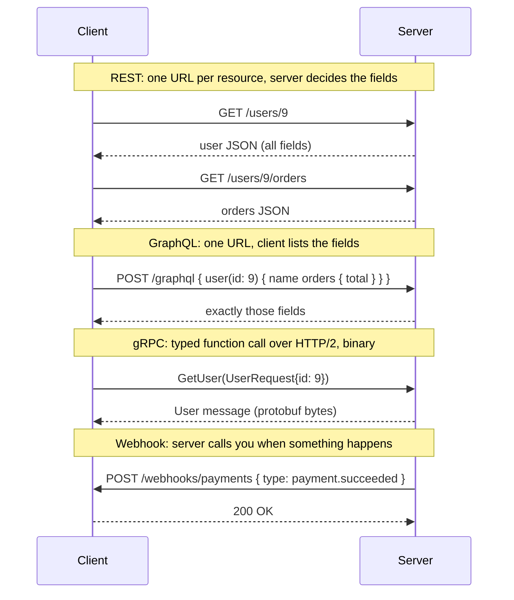

# Other API styles: GraphQL, gRPC and webhooks

After this you can say what GraphQL, gRPC and webhooks are for, and choose between them and a plain REST API.

Before this: [REST API design](04-rest-api-design.md).

This lesson is optional. Read it when a project or job posting mentions one of these.

## The idea

REST fits most back ends, but it has three well-known friction points. A mobile screen needs a user, their last three orders and each order's items, which takes three or four requests, or one custom endpoint per screen. Two internal services that call each other a million times a day pay for JSON text parsing on every call. And a payment provider can't wait for you to ask whether a payment finished; it must tell you.

Each of the three styles answers one of these. The diagram shows the shape of each exchange.



## Key terms

**GraphQL** is a query language for APIs, with a server that exposes one endpoint (usually `POST /graphql`) and a typed **schema**. The client sends a query naming the fields it wants, and gets back JSON with exactly that shape.

**gRPC** is a framework for calling functions on another machine ("remote procedure calls"). Services and messages are declared in `.proto` files in **Protocol Buffers**, a compact binary format, and code for client and server is generated in many languages. It runs over HTTP/2.

A **webhook** is an HTTP request that a service sends to a URL you registered when an event happens. It reverses the direction of the usual API call: the provider is the client and your back end is the server.

An **HMAC signature** is a hash of the request body made with a secret that only you and the sender know. Checking it proves the body came from the sender and wasn't altered.

## How it works

GraphQL puts the shape decision on the client. The schema declares types and the entry points; the server has a function (a resolver) per field. It removes over-fetching (receiving fields you don't use) and under-fetching (needing a second request), but you pay elsewhere: HTTP caching is harder because everything is a `POST` to one URL, and a careless query can ask for deeply nested data, so servers limit query depth and cost.

gRPC trades readability for speed and strictness. The contract is a file:

```text
service Users {
  rpc GetUser (UserRequest) returns (User);
}
message UserRequest { int32 id = 1; }
message User { int32 id = 1; string name = 2; }
```

Both sides generate typed code from it, so a wrong field name is a compile error rather than a runtime surprise. Browsers can't call plain gRPC directly, which is why it is mostly used between services, and REST or GraphQL faces the browser.

A webhook receiver has three rules: verify the signature, reply 2xx quickly and do slow work afterwards (providers retry on timeouts), and expect the same event more than once, so make the handler idempotent.

When each fits:

| Situation | Usual choice |
|---|---|
| Public API, many unknown clients, easy to debug with `curl` | REST |
| Many client screens needing different slices of the same data | GraphQL |
| Internal service-to-service calls, high volume, typed contracts | gRPC |
| A third party must notify you of events | Webhook |

## Worked examples

<div class="example" markdown>

### Example 1: a webhook receiver that checks the signature

The sender computes an HMAC-SHA256 of the raw body with the shared secret and puts it in the `X-Signature` header. Our receiver recomputes it. It reads the raw bytes (`express.raw`), not parsed JSON, because re-serialising JSON can change the bytes and break the match.

```javascript
import express from "express";
import { createHmac, timingSafeEqual } from "node:crypto";

const SECRET = "whsec_demo";
const app = express();

app.post("/webhooks/payments", express.raw({ type: "application/json" }), (req, res) => {
  const expected = createHmac("sha256", SECRET).update(req.body).digest("hex");
  const given = req.get("X-Signature") ?? "";
  const ok = given.length === expected.length &&
    timingSafeEqual(Buffer.from(given), Buffer.from(expected));
  if (!ok) return res.sendStatus(401);
  console.log("event:", JSON.parse(req.body).type);
  res.sendStatus(200);   // reply fast; do slow work later
});

app.listen(3005);
```

We sign a body with the same secret and post it, then post it again with a made-up signature:

```text
good signature: 200
bad signature: 401
```

The server's own terminal prints one line, `event: payment.succeeded`. Check: only the correctly signed request reached the `console.log`. `timingSafeEqual` compares in constant time, so an attacker can't learn the signature one character at a time from response timing. Real providers also include a timestamp in the signed data to stop replays.

</div>

<div class="example" markdown>

### Example 2: a GraphQL query

With the `graphql` package (`npm i graphql`) we build a schema and run a query that asks for only `title`:

```javascript
import { buildSchema, graphql } from "graphql";

const schema = buildSchema(`
  type Book { id: ID!, title: String!, year: Int! }
  type Query { book(id: ID!): Book }
`);
const rootValue = { book: ({ id }) => ({ id, title: "SICP", year: 1985 }) };

const result = await graphql({ schema, rootValue, source: `{ book(id: "1") { title } }` });
console.log(JSON.stringify(result));
```

```text
{"data":{"book":{"title":"SICP"}}}
```

The resolver returned all three fields, but the response holds only the requested one. In production you would use a server library on top of this, such as Apollo Server or GraphQL Yoga, not `graphql()` directly.

</div>

## Common mistakes

<div class="warning" markdown>

Watch out: choosing GraphQL or gRPC because it is fashionable. They add tooling, a schema to maintain and new failure modes. If one client talks to one back end with a handful of endpoints, REST is less work.

Watch out: trusting a webhook because it reached your URL. The URL is guessable and public. Without a signature check, anyone can post a fake "payment succeeded" event.

</div>

## Working with AI

<div class="ai" markdown>

Words to use: resolver, schema, over-fetching, protobuf, remote procedure call, webhook, HMAC signature, idempotent.

Prompts to try:

- "Our mobile app makes four REST calls per screen. Would GraphQL help? List what it would fix and what new problems (caching, query cost) we would take on."
- "Write an Express 5 webhook receiver that verifies an HMAC-SHA256 `X-Signature` header on the raw body and ignores duplicate event ids."

What to check:

- Signature code that parses the JSON first and hashes the re-serialised result, or uses `===` for the comparison. Use the raw body and `timingSafeEqual`.
- GraphQL answers that skip query depth and cost limits, or the N+1 problem across resolvers.
- Invented `.proto` syntax or library calls. Run the generated code.

</div>

## Quiz

1\. Over-fetching and under-fetching are problems of which style, and what solves them?

<details class="solution" markdown>
<summary>Answer</summary>

Of REST, where the server fixes each endpoint's shape. GraphQL lets the client name the fields it needs in one request.

</details>

2\. Why does a webhook handler read the raw request body before parsing it?

<details class="solution" markdown>
<summary>Answer</summary>

The signature is computed over the exact bytes the sender transmitted. Parsing and re-serialising can change whitespace or key order, and then the recomputed HMAC no longer matches.

</details>

3\. A payment provider says it delivered an event, but your database shows two identical orders. Why might that happen and how do you prevent it?

<details class="solution" markdown>
<summary>Answer</summary>

Providers retry when they don't get a fast 2xx, so the same event can arrive twice. Store each event id and skip ones you've handled, or make the handler idempotent.

</details>

4\. Why is gRPC rarely called directly from a browser?

<details class="solution" markdown>
<summary>Answer</summary>

It needs HTTP/2 features (trailers and full control of framing) that browser APIs don't expose, so browsers need a proxy layer (gRPC-Web). It is mostly used between back-end services.

</details>

## Lab

<div class="lab" markdown>

### Lab: send a signed webhook

Goal: run the receiver and test it with a valid and an invalid signature. Time: about 15 minutes. Runs in: Git Bash or WSL with Node.js 24 and Express installed.

1. Save the Example 1 code as `hook.mjs` and run `node hook.mjs`.
2. In a second terminal, set `BODY='{"type":"payment.succeeded","id":"evt_1"}'`.
3. Compute the signature: `SIG=$(printf '%s' "$BODY" | openssl dgst -sha256 -hmac whsec_demo | awk '{print $NF}')`.
4. Post it: `curl -s -o /dev/null -w "%{http_code}\n" -X POST localhost:3005/webhooks/payments -H "Content-Type: application/json" -H "X-Signature: $SIG" -d "$BODY"`.
5. Repeat with `X-Signature: abc`.
6. Cleanup: stop the server.

Expected result: 200 for the first request and 401 for the second.

<details class="solution" markdown>
<summary>Solution</summary>

The `openssl dgst -hmac` command prints the same hex digest that Node's `createHmac` produced for this body: `e64ad8d8f0267400e0f7610a3f2aaad011102572d6bfe892feadafaf047a6343`. If you get 401 for the valid one, check that `$BODY` has no trailing newline and that you used `-d "$BODY"` with quotes.

</details>

</div>

## Where this shows up

- Calling third-party APIs and receiving their events in a real integration: background jobs<!-- link: ../03-api-quality/01-background-jobs.md -->.
- Real-time channels for browsers: [WebSockets and real-time communication](../../07-networking/02-web-protocols/06-websockets-and-real-time.md).
