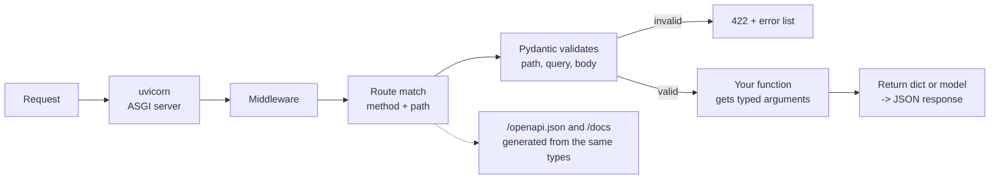

# Python back ends: FastAPI and Django

After this you can read a FastAPI or Django back end, say how each maps to the Express ideas, and pick between them for a new project.

Before this: [Express: routing and middleware](03-express-routing-and-middleware.md) and [Validation and error handling](05-validation-and-error-handling.md).

This lesson is optional. Read it if your jobs or courses use Python on the server.

## The idea

Everything so far used JavaScript, but the ideas are language-independent: a long-running process, routes, middleware, a schema for input, a central place for errors. Python has three well-known frameworks for them, and each gives a different answer to "how much should the framework decide for me".

FastAPI is closest to Express plus zod: a small core where you declare routes and the types of their inputs, and the framework validates and documents them. Django is the opposite end: a full set of parts (database layer, admin site, users, forms, migrations) that fit together. Flask is a minimal micro-framework, similar to Express in size; you add other libraries yourself.



## Key terms

**FastAPI** is a Python web framework for building APIs. You declare each route as a function with type hints, and FastAPI builds the validation and the API documentation from them.

**Pydantic** is the Python library FastAPI uses to define data models as classes and validate data against them. It plays the role zod plays in JavaScript.

**OpenAPI** is a standard, machine-readable description of an HTTP API (paths, parameters, schemas). FastAPI serves it at `/openapi.json` and shows an interactive page from it at `/docs`.

**ASGI** is the Python interface between an async-capable web server and the framework. **uvicorn** is a server that speaks it, and runs your app the way `node` runs an Express file.

**Django** is a full-stack Python web framework that includes an ORM (object-relational mapper, which maps tables to Python classes), migrations, an admin interface, authentication and templates. A Django project is split into **apps**, and requests are routed by a `urls.py` file to **view** functions.

## How it works

The Express ideas map across directly:

| Idea | Express | FastAPI | Django |
|---|---|---|---|
| Start the server | `node app.mjs` | `uvicorn main:app` | `python manage.py runserver` |
| Route | `app.get("/books/:id", fn)` | `@app.get("/books/{id}")` | `path("books/<int:id>/", view)` in `urls.py` |
| Parse and validate input | zod `safeParse` | Pydantic model or type hint on the argument | Forms, or Django REST framework serializers |
| Middleware | `app.use(fn)` | `app.add_middleware(...)` | `MIDDLEWARE` list in `settings.py` |
| Central error handling | error middleware | `@app.exception_handler` | middleware, `handler500` |
| Grouping routes | `Router()` | `APIRouter()` | one `urls.py` per app |
| Database | bring your own | bring your own (SQLAlchemy is common) | built-in ORM |

How to choose: FastAPI for an API-only service where types and automatic docs matter; Django when you need a database-backed site with logins and an admin panel quickly; Flask for small tools. Versions as of 2026: FastAPI 0.162 and Django 6.1 (see [FastAPI](https://fastapi.tiangolo.com/) and [Django](https://www.djangoproject.com/download/) for current releases and which Django versions get long-term support).

## Worked examples

<div class="example" markdown>

### Example 1: the tasks API in FastAPI

1. Install into a virtual environment: `python -m venv .venv`, activate it, `pip install fastapi uvicorn`.
2. Save the code as `main.py`. The `NewTask` class is the schema; the `task: NewTask` argument tells FastAPI to parse the JSON body into it.
3. Run `uvicorn main:app --port 8001`.

```python
from fastapi import FastAPI, HTTPException
from pydantic import BaseModel, Field

app = FastAPI()


class NewTask(BaseModel):
    title: str = Field(min_length=1, max_length=100)
    priority: int = Field(default=3, ge=1, le=5)


tasks = {1: {"id": 1, "title": "Write lesson", "priority": 3}}


@app.get("/tasks/{task_id}")
def get_task(task_id: int):
    if task_id not in tasks:
        raise HTTPException(status_code=404, detail="Task not found")
    return tasks[task_id]


@app.post("/tasks", status_code=201)
def create_task(task: NewTask):
    new = {"id": len(tasks) + 1, **task.model_dump()}
    tasks[new["id"]] = new
    return new
```

Requests, with `curl`:

```text
GET /tasks/1        {"id":1,"title":"Write lesson","priority":3} [200]
GET /tasks/abc      {"detail":[{"type":"int_parsing","loc":["path","task_id"],"msg":"Input should be a valid integer, unable to parse string as an integer","input":"abc"}]} [422]
GET /tasks/9        {"detail":"Task not found"} [404]
POST {"title":"Ship","priority":2}   {"id":2,"title":"Ship","priority":2} [201]
POST {"title":"","priority":9}       {"detail":[{"type":"string_too_short","loc":["body","title"], ... },{"type":"less_than_equal","loc":["body","priority"], ... }]} [422]
```

Check: we wrote no validation code, yet `abc` for an integer path and an empty title both produce a 422 with the location of each bad field. `GET /openapi.json` returned OpenAPI 3.1.0 with the paths `/tasks/{task_id}` and `/tasks` and the schema `NewTask`, and `/docs` returned an HTML page (status 200). The error body has FastAPI's own shape (`detail` list), not problem details; to change that, register an exception handler.

</div>

<div class="example" markdown>

### Example 2: the same endpoint in Django

`django-admin startproject shop .` and `python manage.py startapp tasks` create a project folder (`shop/` with `settings.py` and `urls.py`), an app folder (`tasks/` with `models.py`, `views.py`, `migrations/`) and `manage.py`. A view is a function that gets a request and returns a response, and `urls.py` maps paths to views:

```python
# tasks/views.py
from django.http import JsonResponse


def task_list(request):
    return JsonResponse({"items": [{"id": 1, "title": "Write lesson"}]})
```

```python
# shop/urls.py
from django.urls import path

from tasks import views

urlpatterns = [path("tasks/", views.task_list)]
```

After adding `"localhost"` to `ALLOWED_HOSTS` in `settings.py` and running `python manage.py runserver 8002`, `curl localhost:8002/tasks/` returns `{"items": [{"id": 1, "title": "Write lesson"}]}`. Django has no built-in JSON validation; for APIs people add Django REST framework or Django Ninja, or use plain forms. Its strength is the rest: the ORM, migrations and admin come already wired.

</div>

## Common mistakes

<div class="warning" markdown>

Watch out: running the development server in production. `uvicorn --reload` and Django's `runserver` are for development. Django's own docs warn that `runserver` has not been audited for security. Use a production server (uvicorn or gunicorn behind a proxy) and, in Django, set `DEBUG = False` and a real `ALLOWED_HOSTS`.

Watch out: blocking calls inside an `async def` FastAPI route. As in Node, a long synchronous call (a slow query with a blocking driver) stalls the event loop for every request. A plain `def` route runs in a thread pool, which is safe for blocking code.

</div>

## Working with AI

<div class="ai" markdown>

Words to use: Pydantic model, type hint, OpenAPI, ASGI, uvicorn, Django app, ORM, migration.

Prompts to try:

- "Convert this Express 5 router with zod validation to FastAPI with Pydantic v2. Keep the same paths and status codes, and say where the behaviour differs."
- "I need a CRUD API plus a staff admin page for a small inventory database. Compare FastAPI and Django for it, and say which you would pick."

What to check:

- Pydantic v1 syntax (`class Config`, `.dict()`) in a project that has v2 (`model_config`, `.model_dump()`). Run it and check `pip list`.
- `async def` routes that call blocking libraries.
- Django answers that skip `makemigrations` and `migrate`, or leave `DEBUG = True` and `ALLOWED_HOSTS = []` in deployment settings.

</div>

## Quiz

1\. Which FastAPI feature plays the role of zod in an Express app?

<details class="solution" markdown>
<summary>Answer</summary>

Pydantic models (and type hints on route arguments). FastAPI validates the input against them before your function runs, and answers 422 when it fails.

</details>

2\. In Example 1, what status does `POST /tasks` return for `{"title": "ok", "priority": 6}`, and where does the message point?

<details class="solution" markdown>
<summary>Answer</summary>

422, with `loc: ["body", "priority"]` and a "less than or equal to 5" message, because `priority` has `le=5`.

</details>

3\. A team needs user accounts, an admin page for staff and a relational database from day one. Which framework from this lesson fits best, and why?

<details class="solution" markdown>
<summary>Answer</summary>

Django. It ships an ORM, migrations, authentication and an admin site, so those need no assembly. FastAPI would need separate libraries for each.

</details>

4\. Where do you look in a running FastAPI app to see its API description without reading the code?

<details class="solution" markdown>
<summary>Answer</summary>

`/openapi.json` for the machine-readable description and `/docs` for the interactive page.

</details>

## Lab

<div class="lab" markdown>

### Lab: run FastAPI and read its docs

Goal: run the FastAPI example, break it on purpose, and read the generated docs. Time: about 15 minutes. Runs in: any terminal with Python 3.

1. Create a venv and run `pip install fastapi uvicorn`.
2. Save the Example 1 code as `main.py` and start `uvicorn main:app --port 8001`.
3. Open `http://localhost:8001/docs` and try `POST /tasks` from the page with an invalid body.
4. Add a `done: bool = False` field to `NewTask`, and stop and restart the server, since no `--reload` is used.
5. In a second terminal, run `curl localhost:8001/openapi.json` and find `done` in the schema.
6. Cleanup: stop uvicorn with Ctrl+C.

Expected result: the page shows the new field, and the schema lists `done` with type `boolean`.

<details class="solution" markdown>
<summary>Solution</summary>

The class becomes:

```python
class NewTask(BaseModel):
    title: str = Field(min_length=1, max_length=100)
    priority: int = Field(default=3, ge=1, le=5)
    done: bool = False
```

The function body needs no change, because `task.model_dump()` includes every field.

</details>

</div>

## Where this shows up

- Documenting and testing APIs, where FastAPI's OpenAPI output is used: [testing and documenting APIs](../03-api-quality/02-testing-and-documenting-apis.md).
- Databases from application code, including Django's ORM: [the databases folder](../../10-databases-sql-and-postgres/index.md).
