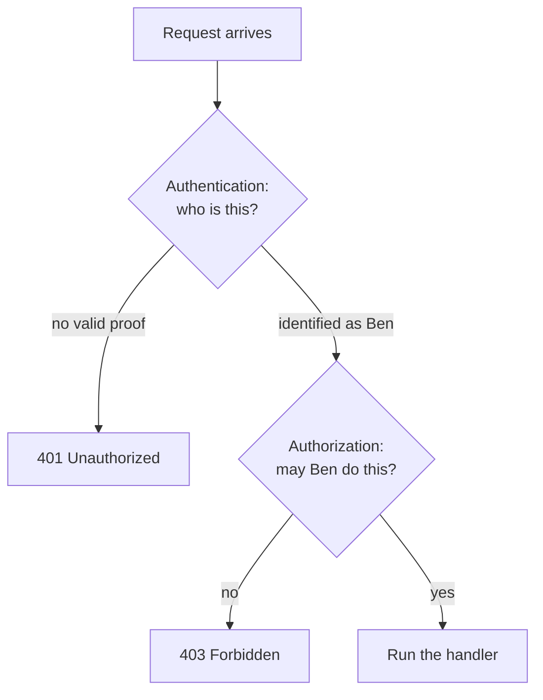

# Authentication vs authorization

After this you can say whether a request failed because the server doesn't know who you are or because you aren't allowed, return the right status code, and place permission checks where an attacker can't skip them.

Before this: [REST API design](../01-servers-and-apis/04-rest-api-design.md) and [Express: routing and middleware](../01-servers-and-apis/03-express-routing-and-middleware.md).

## The idea

You show a passport at an airport desk, and the agent decides it is really you. That is one question: who are you? Then the agent checks whether your ticket lets you board this flight. That is a different question: what may you do? A back end asks both questions on every request, in that order.



In the diagram, the two checks fail with different status codes. The first failure means "I can't tell who you are". The second means "I know who you are, and the answer is no".

## Key terms

**Authentication** (authn) is the process of verifying who is making a request, for example by checking a password, a session cookie or a signed token. The result is an **identity**, such as a user id.

**Authorization** (authz) is the process of deciding whether an authenticated identity may perform an action on a resource. The result is allow or deny.

A **permission** is the right to do one action, such as `invoice:delete`. A **role** is a named bundle of permissions, such as `admin` or `viewer`. **Role-based access control** (RBAC) grants permissions through roles instead of per user.

The **principle of least privilege** says each user, service and token gets only the permissions its job needs, and nothing more.

## How it works

The status codes are defined in [RFC 9110](https://datatracker.ietf.org/doc/html/rfc9110). Despite its name, 401 `Unauthorized` means "unauthenticated". It also tells the client how to authenticate, with a `WWW-Authenticate` header.

| Situation | Status | Meaning |
|---|---|---|
| No token, expired token or bad signature | 401 | Authentication failed; sending better credentials may help |
| Valid token, but the role is too low | 403 | Authenticated, not permitted; sending the same credentials again will not help |
| Valid user asks for another user's record | 403 or 404 | Return 404 when even revealing that the record exists would leak information |

In an Express app, both checks are middleware<!-- link: ../01-servers-and-apis/03-express-routing-and-middleware.md --> that runs before the handler. `authenticate` fills in `req.user`, and `requireRole` reads it. Roles are the simplest model, but they don't cover "a user may edit only their own posts". That is an **ownership check**: it needs the resource, so it runs inside the handler after the record is loaded.

Where the checks run matters more than how they look. Hiding the "Delete user" button in the front end is a convenience, not a control, because anyone can send the same request with `curl`. The server must check on every request, on every route, because the client is untrusted. [OWASP's Authorization Cheat Sheet](https://cheatsheetseries.owasp.org/cheatsheets/Authorization_Cheat_Sheet.html) lists this as "enforce least privileges" and "deny by default": a route with no rule should refuse, not allow.

## Worked examples

<div class="example" markdown>

### Example 1: 401 and 403 from one route

We protect `DELETE /users/:id` so only admins can use it. The code issues a signed token at login (the next lesson explains tokens) and uses `jsonwebtoken`.

1. `authenticate` reads the `Authorization: Bearer ...` header and verifies the token. If that throws, it answers 401.
2. `requireRole("admin")` compares `req.user.role` with the required role. If they differ, it answers 403.
3. Only then does the handler run.

<details class="code" markdown>
<summary>In code</summary>

```javascript
function authenticate(req, res, next) {
  const token = (req.get("authorization") || "").replace("Bearer ", "");
  try { req.user = jwt.verify(token, SECRET); next(); }
  catch { res.status(401).json({ error: "not authenticated" }); }
}
const requireRole = (role) => (req, res, next) =>
  req.user.role === role ? next() : res.status(403).json({ error: "forbidden" });

app.delete("/users/:id", authenticate, requireRole("admin"), (req, res) =>
  res.json({ deleted: req.params.id }));
```

</details>

We called it with no token, with a token for the user `ben` (role `user`) and with a token for `ana` (role `admin`). Express 5 and `jsonwebtoken` 9 on Node 24:

```text
no token                   401 {"error":"not authenticated"}
ben (user) deletes         403 {"error":"forbidden"}
ana (admin) deletes        200 {"deleted":"7"}
```

Check: the same URL gives three different answers, and only the admin reaches the handler. Order matters. If `requireRole` ran first, `req.user` would be undefined and the server would crash with a 500 instead of a 401.

</div>

## Common mistakes

<div class="warning" markdown>

Watch out: checking permissions only in the front end. The server never sees the hidden button, only the request, so every rule must also run in the API.

Watch out: reading the role from the request body or a header the client controls (`{"role": "admin"}`). Take the role from the verified token or the server-side session, or look it up in the database.

Watch out: returning 403 for everything, or 200 with an error message in the body. Clients, monitoring and caches all rely on the status code.

</div>

## Working with AI

<div class="ai" markdown>

Words to use: authentication, authorization, 401, 403, RBAC, least privilege, ownership check, deny by default.

Prompts to try:

- "Add an Express 5 middleware `requireRole(role)` that reads `req.user.role`, returns 403 when it doesn't match, and denies by default when `req.user` is missing. Show the route that uses it."
- "Here is my route file. List every route that has no authentication or ownership check, and say which status code each failure should return."

What to check:

- A check that only runs in the front end, or only on some routes. Grep the routes and confirm each one has the middleware.
- 401 and 403 swapped. Call the route with no token and with a low-privilege token, and read the status codes.
- A user id or role taken from `req.body` or `req.query`. It must come from `req.user`.
- A missing ownership check on routes like `/orders/:id`. Request another user's id and confirm you get 403 or 404.

</div>

## Quiz

1\. A request has a valid token for a user without the `admin` role and calls an admin route. Which status code should it get, and why not the other one?

<details class="solution" markdown>
<summary>Answer</summary>

403. The server knows who the caller is, so authentication succeeded; the caller lacks permission. 401 would tell the client to log in again, which would not help.

</details>

2\. What does this middleware chain do with a request that has no token? `app.get("/admin", requireRole("admin"), authenticate, handler)`

<details class="solution" markdown>
<summary>Answer</summary>

`requireRole` runs first and reads `req.user.role` while `req.user` is undefined, so it throws and the client gets a 500. `authenticate` must come first.

</details>

3\. A developer hides the admin menu from non-admin users and says the admin API is therefore protected. What is wrong?

<details class="solution" markdown>
<summary>Answer</summary>

Anyone can call the API directly with `curl` or the browser's dev tools. The server must check the role on every request.

</details>

4\. What is least privilege, and give one example for a database account used by a web app?

<details class="solution" markdown>
<summary>Answer</summary>

Each account gets only the permissions its task needs. The web app's database user can read and write its own tables but cannot drop tables or read other databases.

</details>

## Lab

<div class="lab" markdown>

### Lab: add the missing check

Goal: protect one route with authentication, a role check and an ownership check. Time: about 20 minutes. Runs in: any terminal with Node.js.

1. In a new folder run `npm init -y` and `npm i express jsonwebtoken`. Never use a real secret; a throwaway string is fine here.
2. Copy `authenticate` and `requireRole` from Example 1 into `server.mjs`, with a `/login` route that signs `{ sub, role }` for two hard-coded users.
3. Add `GET /notes/:id` over an in-memory array of notes with an `owner` field. Return 404 for a missing note and 403 when `req.user.sub` is not the owner and the role is not `admin`.
4. Start the server and call every case with `curl`: no token, wrong owner, right owner, admin.
5. Cleanup: stop the server and delete the folder.

Expected result: 401, 403, 200 and 200 for the four calls.

<details class="solution" markdown>
<summary>Solution</summary>

```javascript
const notes = [{ id: 1, owner: "ana", text: "private" }];
app.get("/notes/:id", authenticate, (req, res) => {
  const note = notes.find((n) => n.id === Number(req.params.id));
  if (!note) return res.status(404).json({ error: "not found" });
  if (note.owner !== req.user.sub && req.user.role !== "admin")
    return res.status(403).json({ error: "forbidden" });
  res.json(note);
});
```

The ownership check sits in the handler because it needs the loaded note.

</details>

</div>

## Where this shows up

- Next: sessions, cookies and JWT, which are the two ways a server remembers who you are ([next lesson](02-sessions-cookies-and-jwt.md)).
- Postgres can enforce the same idea inside the database: roles, privileges and row-level security<!-- link: ../../10-databases-sql-and-postgres/04-postgres-in-depth/05-roles-privileges-and-row-level-security.md -->.
- "Broken access control" is entry A01 in the 2021 OWASP top 10<!-- link: ../../12-security/01-web-security/02-owasp-top-10.md -->.
