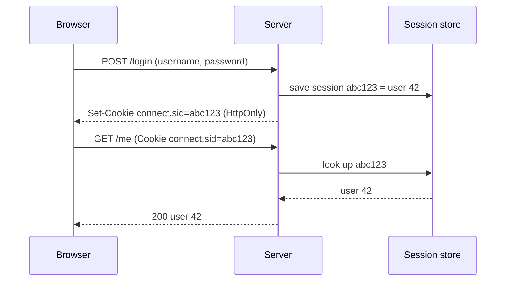
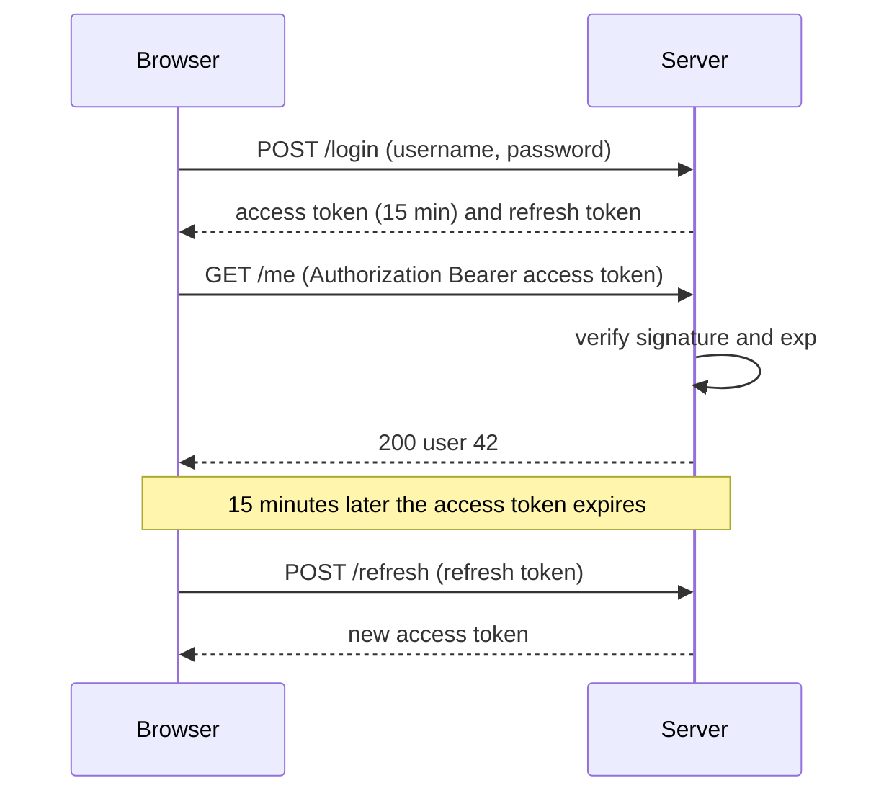

# Sessions, cookies and JWT

After this you can explain how a server remembers a logged-in user, choose between a server-side session and a JWT, set safe cookie flags, and decode a JWT to see what it does and doesn't protect.

Before this: [Authentication vs authorization](01-authentication-vs-authorization.md) and [HTTP headers, cookies and caching](../../07-networking/02-web-protocols/02-http-headers-cookies-and-caching.md).

## The idea

HTTP is stateless: each request arrives with no memory of the last one. After a user logs in, the server needs a way to recognize them on request 2, 3 and 400 without asking for the password again. There are two designs. In a **session**, the server keeps the record of who is logged in and gives the browser a short random id. In a **token** design, the server gives the browser a signed message that carries the identity, and keeps nothing.



In the diagram, the cookie holds only an id. The user data stays on the server, in the **session store** (memory, a database or Redis<!-- link: ../../10-databases-sql-and-postgres/05-databases-in-apps/04-redis-and-caching.md -->).

## Key terms

A **cookie** is a small name-value pair that the server sets with a `Set-Cookie` header and the browser sends back on later requests to the same site.

The cookie flags that matter: `HttpOnly` hides the cookie from JavaScript, so a script injected into the page can't read it. `Secure` sends it only over HTTPS. `SameSite=Lax` (or `Strict`) stops the browser attaching it to most cross-site requests, which blocks most CSRF attacks<!-- link: ../../12-security/01-web-security/04-xss-csrf-and-browser-security.md -->. `Max-Age` or `Expires` sets its lifetime.

A **JSON Web Token** (JWT, [RFC 7519](https://datatracker.ietf.org/doc/html/rfc7519)) is a compact string of three base64url parts joined by dots: `header.payload.signature`. The header names the signing algorithm, the payload holds **claims** such as `sub` (the user) and `exp` (the expiry time), and the signature proves the first two parts weren't changed.

**Signing** proves who made a message and that it wasn't altered. **Encryption** hides its contents. A normal JWT is signed, not encrypted.

An **access token** is the short-lived credential sent with each request. A **refresh token** is a longer-lived credential used only to get a new access token.

## How it works

With a JWT, the server signs the claims with a secret key at login, and verifies the signature on each request, with no store lookup.



The trade-off is revocation. A session ends the moment the server deletes the record. A JWT stays valid until `exp`, because nothing is looked up, so "log out everywhere" or "ban this user now" needs extra state: a deny list of token ids, or short lifetimes with refresh tokens that the server does store and can delete. Many apps that start with JWTs end up keeping a store anyway.

Where the browser keeps a token also matters. A token in `localStorage` can be read by any script on the page, so one XSS bug leaks it. A cookie with `HttpOnly` can't be read by scripts, but a cookie is attached automatically, so it needs `SameSite` or a CSRF token. For a browser app on one site, a server session in an `HttpOnly`, `Secure`, `SameSite=Lax` cookie is the simplest safe default ([OWASP Session Management Cheat Sheet](https://cheatsheetseries.owasp.org/cheatsheets/Session_Management_Cheat_Sheet.html)). JWTs fit APIs called by mobile apps or other services, where there is no cookie jar. [RFC 8725](https://datatracker.ietf.org/doc/html/rfc8725) lists the known JWT pitfalls.

## Worked examples

<div class="example" markdown>

### Example 1: a session and its cookie

We set up `express-session` with the flags above, log in, call `/me` with the cookie, log out, and call `/me` again.

1. `req.session.userId = 42` stores data in the session store and makes the library send `Set-Cookie`.
2. The test client copies the `name=value` part of the cookie into a `Cookie` header, as a browser does.
3. `req.session.destroy` removes the record, so the same cookie stops working.

<details class="code" markdown>
<summary>In code</summary>

```javascript
app.use(session({
  secret: "dev-only-secret",
  resave: false,
  saveUninitialized: false,
  cookie: { httpOnly: true, sameSite: "lax", secure: false, maxAge: 3600_000 },
}));
app.post("/login", (req, res) => { req.session.userId = 42; res.json({ ok: true }); });
```

</details>

Output (the session id differs on every run):

```text
Set-Cookie: connect.sid=s%3Ay12T7wk5lxuFi7pUFMATCZsYbU06Rus9.J1Ray%2F9y%2B...; Path=/; Expires=Mon, 26 Oct 2026 01:31:36 GMT; HttpOnly; SameSite=Lax
with cookie: 200 {"userId":42}
after logout: 401 {"error":"no session"}
```

Check: the cookie carries `HttpOnly` and `SameSite=Lax`, and the same cookie value fails after logout. We set `secure: false` only because this runs on `http://localhost`; in production it must be `true`. Without a `store` option, `express-session` uses its in-memory store, which its README says is [purposely not designed for a production environment](https://github.com/expressjs/session#readme): use Redis or a database.

</div>

<div class="example" markdown>

### Example 2: decoding a JWT with PyJWT

A JWT is only encoded. We split one, decode the parts with the standard library, then change the role and keep the old signature.

```python
import base64, json, jwt

key = "a-throwaway-key-at-least-32-bytes-long"
token = jwt.encode({"sub": "ana", "role": "user", "exp": 1893456000}, key, algorithm="HS256")
header, payload, signature = token.split(".")

def b64url_decode(part):
    return base64.urlsafe_b64decode(part + "=" * (-len(part) % 4))

print(json.loads(b64url_decode(header)))
print(json.loads(b64url_decode(payload)))   # no key needed

forged_payload = base64.urlsafe_b64encode(
    json.dumps({"sub": "ana", "role": "admin", "exp": 1893456000}).encode()).rstrip(b"=").decode()
try:
    jwt.decode(f"{header}.{forged_payload}.{signature}", key, algorithms=["HS256"])
except jwt.InvalidSignatureError as e:
    print("forged token:", type(e).__name__)
```

```text
{'alg': 'HS256', 'typ': 'JWT'}
{'sub': 'ana', 'role': 'user', 'exp': 1893456000}
forged token: InvalidSignatureError
```

Check: anyone can read the payload, so never put secrets or personal data in a JWT. Nobody without the key can change it without detection. When verifying, always pass `algorithms=[...]` yourself instead of trusting the header's `alg`.

</div>

## Common mistakes

<div class="warning" markdown>

Watch out: believing a JWT is encrypted. Decoding needs no key, as Example 2 shows. Keep passwords, card numbers and similar data out of the payload.

Watch out: long-lived JWTs with no way to revoke them. Use an access token of minutes plus a refresh token that the server stores.

Watch out: storing a session id or token in `localStorage` for convenience. One XSS bug lets an attacker copy it. Prefer an `HttpOnly` cookie.

</div>

## Working with AI

<div class="ai" markdown>

Words to use: session store, cookie flags, HttpOnly, SameSite, JWT claims, `exp`, refresh token, revocation.

Prompts to try:

- "Set up express-session in Express 5 with a Redis store, an HttpOnly, Secure, SameSite=Lax cookie, and a 1 hour lifetime. The secret must come from an environment variable."
- "I use PyJWT in FastAPI with 15 minute access tokens. Show how to verify the token with `algorithms=['HS256']`, reject expired tokens, and what happens on logout."

What to check:

- A hard-coded `secret` in the code, or `algorithms` missing in `jwt.decode`. Search for the literal string and the argument.
- `secure: false`, no `httpOnly`, or no `sameSite` in production config.
- The default memory store left in place. Look for the `store:` option.
- A "JWT logout" that only deletes the token in the browser. The token still works until `exp`.

</div>

## Quiz

1\. Why can a server end a session instantly but not a JWT?

<details class="solution" markdown>
<summary>Answer</summary>

A session is looked up on each request, so deleting the record stops it. A JWT is verified by its signature and `exp` alone, so it stays valid until it expires unless the server adds extra state such as a deny list.

</details>

2\. What does `HttpOnly` stop, and what does it not stop?

<details class="solution" markdown>
<summary>Answer</summary>

It stops JavaScript from reading the cookie, so an XSS script can't copy it. It doesn't stop the browser sending the cookie with requests, so it doesn't prevent CSRF; `SameSite` does most of that.

</details>

3\. Someone pastes a JWT into a public chat. The payload says `{"sub": "ana", "email": "ana@example.com"}`. What can a reader learn and do with it?

<details class="solution" markdown>
<summary>Answer</summary>

Anyone can decode the payload and read the email address. They can also use the token as a login until it expires, because possession is the proof. They can't forge a new one without the key.

</details>

4\. Why is a server-side session usually the simpler choice for a website with its own login page?

<details class="solution" markdown>
<summary>Answer</summary>

Revocation, logout and changing a user's permissions work immediately, and the cookie holds only a random id. The cost is a store lookup per request, which a store such as Redis makes cheap.

</details>

## Lab

<div class="lab" markdown>

### Lab: inspect a login by hand

Goal: see the cookie and the token in real HTTP responses. Time: about 15 minutes. Runs in: any terminal with Node.js and Python.

1. Create a folder, run `npm init -y` and `npm i express express-session`. Save the Example 1 app as `server.mjs` with a `/login` and a `/me` route, and start it.
2. In a second terminal run `curl -i -c jar.txt -X POST http://localhost:3000/login` and find `Set-Cookie` in the output. Which flags are present?
3. Run `curl -b jar.txt http://localhost:3000/me`, then the same command without `-b jar.txt`. Compare the status codes.
4. In a venv run `pip install PyJWT` and run Example 2. Change the `role` and confirm the forged token fails.
5. Cleanup: stop the server, delete the folder and `jar.txt`.

Expected result: 200 with the cookie, 401 without it, and an `InvalidSignatureError` for the forged token.

<details class="solution" markdown>
<summary>Solution</summary>

Use `app.listen(3000)` in `server.mjs` and the `/login` and `/me` routes from Example 1. In step 2 look for `HttpOnly; SameSite=Lax`. `-c jar.txt` saves cookies and `-b jar.txt` sends them, like a browser's cookie jar.

</details>

</div>

## Where this shows up

- [OAuth and SSO](03-oauth-and-sso.md) ends with your server issuing its own session after another provider confirms the user.
- [Secure authentication](../../12-security/01-web-security/05-secure-authentication.md) covers password storage, MFA and attacks on logins.
- Signatures, the basis of a JWT, are explained in public-key encryption and signatures<!-- link: ../../12-security/02-cryptography/03-public-key-encryption-and-signatures.md -->.
