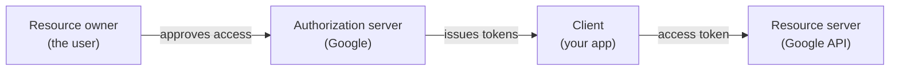
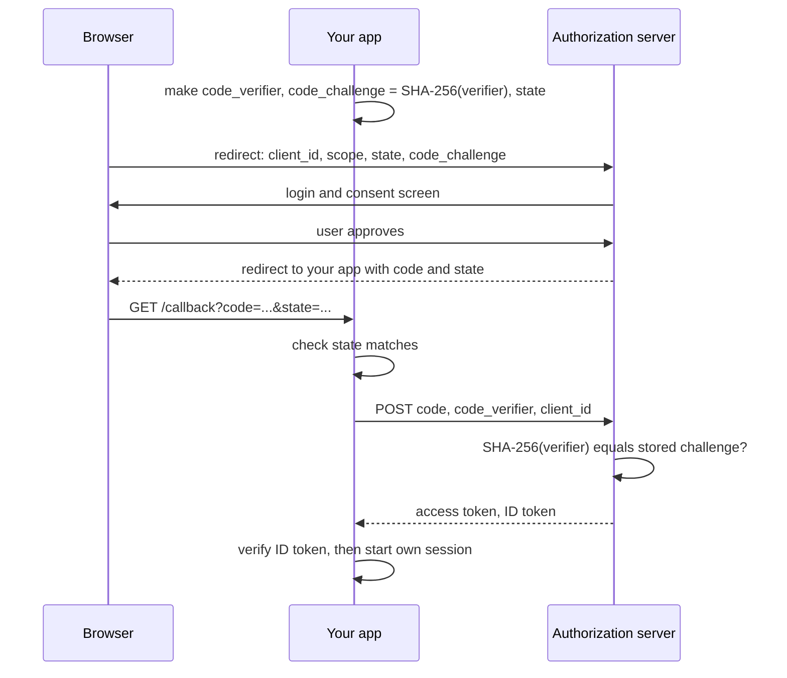

# OAuth and SSO

After this you can read an OAuth login flow, name each role and token in it, explain what PKCE protects against, and decide when to use "Sign in with Google" instead of building your own login.

Before this: [Sessions, cookies and JWT](02-sessions-cookies-and-jwt.md).

## The idea

A photo-printing site wants to read your photos from a cloud drive. The bad way is to type your drive password into the printing site, which then holds the keys to everything. **OAuth 2.0** ([RFC 6749](https://datatracker.ietf.org/doc/html/rfc6749)) is the good way: the printing site sends you to the drive, you approve one narrow permission there, and the site receives a token for only that permission. Your password never leaves the drive.

OAuth is about delegated authorization, not login. **OpenID Connect** (OIDC) is a thin layer on top that adds identity: besides an access token, you get an **ID token**, a signed JWT that says who the user is. "Sign in with Google" is OIDC.



## Key terms

The four OAuth roles are the **resource owner** (the user), the **client** (your app), the **authorization server** (issues tokens after the user approves) and the **resource server** (the API that accepts tokens).

A **scope** is a named permission the client asks for, such as `openid email` or `calendar.readonly`. The user sees the list on the consent screen, and the token is limited to it.

An **authorization code** is a short-lived, one-use value that the browser carries from the authorization server back to your app. Your server exchanges it for tokens directly, not through the browser.

**PKCE** (Proof Key for Code Exchange, "pixie", [RFC 7636](https://datatracker.ietf.org/doc/html/rfc7636)) binds the code to the client that started the login. The client invents a random **code verifier**, sends its SHA-256 hash (the **code challenge**) at the start, and sends the verifier itself when exchanging the code.

**Single sign-on** (SSO) means one login at a central identity provider gives access to many apps. In companies this is often **SAML**, an older XML-based protocol, or OIDC. The idea is identical: the app trusts a signed statement from the identity provider instead of checking a password.

## How it works

The browser sees only the redirects. The secret parts happen between your server and the authorization server.



In the diagram, an attacker who steals the `code` from the redirect can't use it, because they don't have the verifier. The `state` value is a random string your app generates and checks on return, which stops an attacker from pasting their own code into your callback. PKCE was designed for public clients such as mobile apps and single-page apps. The OAuth security best current practice, [RFC 9700](https://datatracker.ietf.org/doc/html/rfc9700), says public clients must use it and recommends it for confidential clients too.

After the exchange, your server verifies the ID token: the signature against the provider's published keys, the `iss` (issuer), `aud` (your client id) and `exp`, as listed in [OpenID Connect Core](https://openid.net/specs/openid-connect-core-1_0.html). It then creates its own session or token, as in the last lesson. The provider's token proves who the user is once; your app still handles every later request.

## Worked examples

<div class="example" markdown>

### Example 1: making a PKCE pair

We build the verifier and challenge in Python and check our code against the example in RFC 7636, Appendix B.

1. The verifier is 32 random bytes written in base64url without padding: 43 characters, within the 43 to 128 the RFC allows.
2. The challenge is the SHA-256 hash of the verifier's ASCII bytes, also base64url without padding. This is the `S256` method.
3. The server later repeats step 2 on the verifier it receives and compares with the stored challenge.

```python
import base64, hashlib, secrets

def b64url(raw: bytes) -> str:
    return base64.urlsafe_b64encode(raw).rstrip(b"=").decode()

def challenge_for(verifier: str) -> str:
    return b64url(hashlib.sha256(verifier.encode("ascii")).digest())

print(challenge_for("dBjftJeZ4CVP-mB92K27uhbUJU1p1r_wW1gFWFOEjXk"))  # RFC 7636, Appendix B

verifier = b64url(secrets.token_bytes(32))
print(len(verifier), "chars")
print("code_challenge:", challenge_for(verifier))
```

```text
E9Melhoa2OwvFrEMTJguCHaoeK1t8URWbuGJSstw-cM
43 chars
code_challenge: fyuA986L7pgYkT6CVdJb5sAtkYrBSiFB51Nr2tNuxvc
```

Check: the first line equals the challenge printed in the RFC, so the hashing is right. The last line changes on every run, which is the point: each login uses a new pair. In practice a library (an OAuth client such as `openid-client` for Node or Authlib for Python) does this for you.

</div>

## Common mistakes

<div class="warning" markdown>

Watch out: using OAuth alone as a login. An access token says an app may call an API, not who is at the keyboard. Use OIDC and verify the ID token.

Watch out: skipping `state`, or accepting any `redirect_uri`. Register exact redirect URIs with the provider and always check `state`.

Watch out: putting the client secret in front-end code. A browser or mobile app can't keep a secret, so it uses PKCE with no secret.

</div>

## Working with AI

<div class="ai" markdown>

Words to use: authorization code flow, PKCE, scope, ID token, redirect URI, `state`, identity provider, OIDC.

Prompts to try:

- "Add Sign in with Google to my Express 5 app using the authorization code flow with PKCE and a well-maintained OIDC library. Verify the ID token's issuer, audience and expiry, then create an express-session session."
- "Explain each parameter in this authorization URL and tell me which ones an attacker could change: <paste the URL>."

What to check:

- Hand-rolled token exchange or signature code. Prefer a maintained library and read which checks it makes.
- The implicit flow (`response_type=token`) or the password grant. Both are discouraged for new apps; the answer should use `response_type=code`.
- No `state` check, no PKCE, or a wildcard redirect URI.
- Real client secrets pasted into the code or the chat. Secrets come from environment variables.

</div>

## Quiz

1\. In "Sign in with Google" on your site, which party is the client, and which is the authorization server?

<details class="solution" markdown>
<summary>Answer</summary>

Your site is the client; Google is the authorization server (and, for profile data, the resource server). The user is the resource owner.

</details>

2\. What does an attacker need, besides a stolen authorization code, to get tokens in a PKCE flow?

<details class="solution" markdown>
<summary>Answer</summary>

The code verifier. The server returns tokens only if the SHA-256 of the verifier matches the challenge sent at the start, and the verifier never travels through the redirect.

</details>

3\. A developer uses the access token from Google as proof of login and trusts a user id sent by the front end. What should they do instead?

<details class="solution" markdown>
<summary>Answer</summary>

Request the `openid` scope, receive the ID token on the server, verify its signature, `iss`, `aud` and `exp`, and take the user id (`sub`) from it. Never trust an id sent by the client.

</details>

4\. When is building your own username and password login the wrong choice?

<details class="solution" markdown>
<summary>Answer</summary>

When an identity provider can do it. You would take on password storage, reset flows, rate limiting and MFA, all of which are easy to get wrong. Use OIDC or a hosted service unless you have a reason not to.

</details>

## Lab

<div class="lab" markdown>

### Lab: build the authorization URL

Goal: see exactly what your app sends to the authorization server. Time: about 10 minutes. Runs in: any terminal with Python 3.

1. Save the PKCE functions from Example 1 in `pkce.py`.
2. Add code that builds a URL with `urllib.parse.urlencode`, using the parameters `response_type=code`, `client_id=demo-client`, `redirect_uri=http://localhost:3000/callback`, `scope=openid email`, `state` (a random string), `code_challenge` and `code_challenge_method=S256`. The host `https://auth.example.com/authorize` is a placeholder.
3. Print the URL and name the purpose of each parameter.
4. Cleanup: delete the file.

Expected result: one long URL with all seven parameters and a different `state` and `code_challenge` each run.

<details class="solution" markdown>
<summary>Solution</summary>

```python
from urllib.parse import urlencode
import secrets

params = {
    "response_type": "code", "client_id": "demo-client",
    "redirect_uri": "http://localhost:3000/callback", "scope": "openid email",
    "state": secrets.token_urlsafe(16),
    "code_challenge": challenge_for(verifier), "code_challenge_method": "S256",
}
print("https://auth.example.com/authorize?" + urlencode(params))
```

The app stores `verifier` and `state` (in the session) and uses them at the callback.

</details>

</div>

## Where this shows up

- Every "Sign in with ..." button, and company SSO through an identity provider.
- [CORS and same origin](04-cors-and-same-origin.md) explains what a browser lets a page call, which matters for any front end that talks to your API after login.
- Secure authentication<!-- link: ../../12-security/01-web-security/05-secure-authentication.md --> covers MFA and passkeys.
