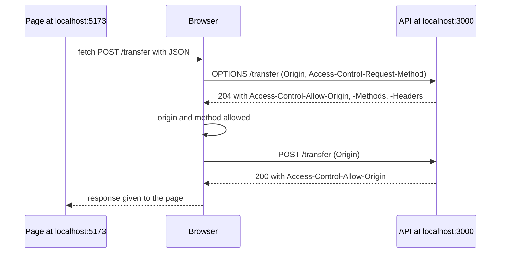

# CORS and same origin

After this you can read a CORS error, say what a preflight request is, configure the `cors` middleware in Express, and explain why CORS does not protect your server.

Before this: [Sessions, cookies and JWT](02-sessions-cookies-and-jwt.md) and [Express: routing and middleware](../01-servers-and-apis/03-express-routing-and-middleware.md).

## The idea

You build a React app on `http://localhost:5173` and an API on `http://localhost:3000`. The first `fetch` fails, and the console says the request "has been blocked by CORS policy". The API never returned an error; the browser refused to give the response to your page.

The reason is the **same-origin policy**. Without it, any page you open could use your logged-in session cookies to call your bank's API in your name and read the answers. So the browser lets a page read responses only from its own **origin**. **CORS** (cross-origin resource sharing) is the way a server tells the browser "this other origin may read my responses" ([MDN: CORS](https://developer.mozilla.org/en-US/docs/Web/HTTP/Guides/CORS)).

## Key terms

An **origin** is the scheme, host and port of a URL. `http://localhost:5173` and `http://localhost:3000` are different origins because the ports differ. So are `http://example.com` and `https://example.com`, and `https://example.com` and `https://api.example.com`.

A **cross-origin request** is a request from a page at one origin to a different origin.

The **`Origin`** request header names the page's origin; the browser adds it and scripts can't change it. The server answers with **`Access-Control-Allow-*`** headers: `Allow-Origin` (which origin may read), `Allow-Methods`, `Allow-Headers`, `Allow-Credentials` and `Max-Age` (how long the browser may cache the preflight answer).

A **preflight** is an `OPTIONS` request the browser sends first, on its own, to ask whether the real request is allowed.

## How it works

A request is **simple** when it uses `GET`, `HEAD` or `POST` with only basic headers and a content type of form data or plain text. The browser sends it straight away and checks the response headers afterwards. Anything else is **preflighted**: a `DELETE`, an `Authorization` header, or `Content-Type: application/json` all trigger it, so a JSON API call from a front end is nearly always preflighted.



In the diagram, the browser makes the decision twice, from headers the server sent. If the preflight answer doesn't list the origin, method or headers, the browser never sends the real request. If the real response lacks `Access-Control-Allow-Origin`, the request happened but the page can't read the answer.

Cookies add one rule. For a page to send or receive cookies cross-origin, the request needs `credentials: "include"` and the server must send `Access-Control-Allow-Credentials: true`. The server then cannot use `Access-Control-Allow-Origin: *`; it must name the exact origin. Cookies also still obey their `SameSite` setting, so a front end and API on different sites need `SameSite=None; Secure`, which is a reason to put both under one site (`app.example.com` and `api.example.com` are the same site).

Note what CORS is not. It is enforced only by browsers, and it only restricts who may read a response. A script, `curl` or another server ignores it. Browsers also send a simple cross-origin POST even without permission, so the server may act on it. CORS is not an access control for your API; authentication and authorization are.

## Worked examples

<div class="example" markdown>

### Example 1: the headers on the wire

We run an Express API with the `cors` middleware set for one front end, then send the preflight and the real request ourselves with `fetch` in Node, adding the `Origin` header a browser would add.

1. `origin` sets `Access-Control-Allow-Origin`; `methods` and `allowedHeaders` answer the preflight; `credentials: true` sends `Allow-Credentials`; `maxAge` is in seconds.
2. We send `OPTIONS` with the `Access-Control-Request-*` headers, then a `POST` from the allowed origin, then a `POST` claiming another origin.

<details class="code" markdown>
<summary>In code</summary>

```javascript
app.use(cors({
  origin: "http://localhost:5173",
  methods: ["GET", "POST", "DELETE"],
  allowedHeaders: ["Content-Type", "Authorization"],
  credentials: true,
  maxAge: 600,
}));
app.post("/transfer", (req, res) => { console.log("  server ran the handler"); res.json({ ok: true }); });
```

</details>

Output (the `cors` package 2.8, Express 5):

```text
1. Preflight from the allowed origin
  204
  access-control-allow-origin: http://localhost:5173
  access-control-allow-methods: GET,POST,DELETE
  access-control-allow-headers: Content-Type,Authorization
  access-control-allow-credentials: true
  access-control-max-age: 600
2. Actual POST from the allowed origin
  server ran the handler
  200
  access-control-allow-origin: http://localhost:5173
3. Actual POST from another origin (a browser would block the reply)
  server ran the handler
  200
  access-control-allow-origin: http://localhost:5173
```

Check case 3: the server ran the handler and returned 200 for the foreign origin. The only protection is that the `Allow-Origin` header names a different origin, so a browser would hide the response from that page. A non-browser client sees everything. That is why the transfer must also require authentication.

</div>

## Common mistakes

<div class="warning" markdown>

Watch out: fixing the error with `Access-Control-Allow-Origin: *` on an API that uses cookies. Browsers refuse `*` together with credentials, and reflecting any `Origin` back is worse: it lets every site read logged-in responses.

Watch out: trying to fix CORS in the front end. The fix is always a response header from the server. A dev proxy (for example Vite's `server.proxy`) avoids the issue in development because the browser then sees one origin.

Watch out: registering `cors()` after the routes, or letting `OPTIONS` hit an auth check. The preflight carries no credentials, so it must be answered before authentication runs.

</div>

## Working with AI

<div class="ai" markdown>

Words to use: origin, same-origin policy, preflight, `Access-Control-Allow-Origin`, credentials, simple request.

Prompts to try:

- "My React app on http://localhost:5173 calls my Express 5 API on http://localhost:3000 with fetch, JSON and an Authorization header. The browser reports a failed preflight. Here are the request and response headers from the Network tab: <paste>. What is missing?"
- "Configure the cors middleware for production with two exact allowed origins from an environment variable, credentials on, and no wildcard."

What to check:

- `origin: "*"` or `origin: true` in production. Replace with an explicit list.
- Advice to disable web security in the browser or install an extension. That hides the problem on one machine only.
- A claim that CORS protects the API from attackers. Confirm with `curl` that the API still answers a request with a forged `Origin`.
- The middleware placed after the routes. Check the order in the code.

</div>

## Quiz

1\. Which of these are the same origin as `https://shop.example.com`? (a) `https://shop.example.com/cart` (b) `http://shop.example.com` (c) `https://shop.example.com:8443` (d) `https://api.example.com`

<details class="solution" markdown>
<summary>Answer</summary>

Only (a). (b) has a different scheme, (c) a different port and (d) a different host.

</details>

2\. A front end sends `fetch(url, {method: "POST", headers: {"Content-Type": "application/json"}})` to another origin. Does the browser preflight it, and why?

<details class="solution" markdown>
<summary>Answer</summary>

Yes. `application/json` is not one of the content types allowed in a simple request, so the browser sends an `OPTIONS` request first.

</details>

3\. The Network tab shows the POST returned 200 and the server's log shows it ran, yet the console reports a CORS error. How is that possible?

<details class="solution" markdown>
<summary>Answer</summary>

The response lacked a valid `Access-Control-Allow-Origin` for that page. The request was sent, but the browser refuses to hand the response to the page. This also means a blocked request may still have changed data.

</details>

4\. A teammate says: "Our API is safe from other websites because CORS only allows our domain." What is wrong with that?

<details class="solution" markdown>
<summary>Answer</summary>

CORS is enforced by browsers and limits reading responses. `curl`, scripts and servers ignore it, and some cross-origin requests still reach the server. The API needs its own authentication and authorization.

</details>

## Lab

<div class="lab" markdown>

### Lab: see the preflight

Goal: send a preflight by hand and change the answer by changing the configuration. Time: about 15 minutes. Runs in: any terminal with Node.js.

1. Run `npm init -y` and `npm i express cors` in a new folder. Save the Example 1 server as `server.mjs` and start it on port 3104 with `app.listen(3104)`.
2. In a second terminal, run the preflight with curl:

```bash
curl -i -X OPTIONS http://localhost:3104/transfer -H "Origin: http://localhost:5173" -H "Access-Control-Request-Method: POST" -H "Access-Control-Request-Headers: content-type"
```

3. Read the `Access-Control-Allow-*` headers. Repeat with `-H "Origin: http://evil.example"` and compare `Access-Control-Allow-Origin`.
4. Remove `"Content-Type"` from `allowedHeaders`, restart, and run the first command again. Predict the change first.
5. Cleanup: stop the server and delete the folder.

Expected result: the preflight answers 204 with the allow headers. The foreign origin still gets `http://localhost:5173` in `Allow-Origin`, which a browser treats as a refusal.

<details class="solution" markdown>
<summary>Solution</summary>

With `allowedHeaders` set, the `cors` middleware sends exactly that list in `Access-Control-Allow-Headers`. Without `Content-Type` in it, a browser would block the real JSON POST, because the preflight does not permit that header.

</details>

</div>

## Where this shows up

- Fetching data from React<!-- link: ../../08-front-end/03-react/03-data-fetching-and-forms.md --> across origins, and the dev proxy in `npm`, bundlers and Vite<!-- link: ../../08-front-end/02-javascript-and-typescript/05-npm-bundlers-and-vite.md -->.
- CSRF and browser security<!-- link: ../../12-security/01-web-security/04-xss-csrf-and-browser-security.md --> explains the attacks that the same-origin policy and `SameSite` cookies limit.
- Next chapter: [background jobs](../03-api-quality/01-background-jobs.md).
