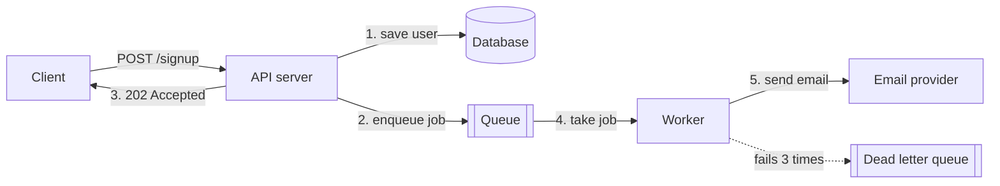

# Background jobs

After this you can move slow work out of a request, describe how a queue and a worker cooperate, and make a job safe to retry.

Before this: [REST API design](../01-servers-and-apis/04-rest-api-design.md) and [CORS and same origin](../02-auth/04-cors-and-same-origin.md).

## The idea

A signup endpoint saves the user, sends a welcome email, and builds a PDF. The email provider takes 2 seconds on a good day and times out on a bad one. If the handler waits for it, the user stares at a spinner, a slow provider ties up your server's capacity, and a timeout makes a successful signup look like a failure.

The fix is to do only the essential work in the request, put the rest on a **queue** as a small message ("send welcome email to ana"), and answer at once. A separate process, the **worker**, takes messages off the queue and does the slow work later. The request returns `202 Accepted`, which means "received, not finished".



In the diagram, the dashed arrow is a job that keeps failing. The API server and the worker can crash, restart and scale independently, because the queue holds the work between them.

## Key terms

A **job** is one unit of deferred work, stored as data: a name and arguments such as `{type: "welcomeEmail", to: "ana@example.com"}`.

A **queue** is an ordered store of jobs waiting to run, [kept in Redis](../../10-databases-sql-and-postgres/05-databases-in-apps/04-redis-and-caching.md), a database or a message broker. A **worker** is a long-running process that pulls jobs from it. Libraries do this for you: BullMQ (Node.js, on Redis), Celery and RQ (Python, on Redis or RabbitMQ).

A **retry** runs a failed job again, usually after a growing delay (**exponential backoff**: 1 s, 2 s, 4 s). A **dead letter queue** (DLQ) collects jobs that failed every retry, so a person can look at them instead of the job disappearing or looping forever.

An operation is **idempotent** if doing it twice has the same effect as doing it once. An **idempotency key** is a unique id sent with a request or stored on a job, so the second delivery can be recognized and skipped.

A **scheduled job** (cron job) runs at fixed times, such as "every night at 02:00". Linux has [`cron`](../../02-operating-systems-and-linux/02-linux-command-line/09-shell-scripting-and-cron.md); queue libraries also offer repeating jobs.

## How it works

Most queues promise **at-least-once** delivery: a job will be delivered, but after a crash it may be delivered twice. Exactly-once is rarely available. So the rule for every job is to make it safe to run again.

1. Give each job a stable id, such as the idempotency key from the request or the id of the record it concerns.
2. At the start of the job, check whether that id was already done; if so, return.
3. Do the work, then record the id as done. Do both in one database transaction, or to use an operation the provider itself deduplicates.
4. On an error, throw. The library retries with backoff up to a limit, then moves the job to the DLQ.

Use the same idea at the front door. A client that gets a network timeout will retry its `POST`. If it sends an `Idempotency-Key` header, the server stores the key with the result and returns the stored result for a repeat instead of charging a card twice.

Not everything belongs on a queue. If the user needs the answer on the next screen (a search result), do it in the request. Queue what can take more than a second or two, can fail independently, or must not block (email, reports, image resizing, webhooks, calling slow third parties). A queue also gives you something to watch: depth, age of the oldest job, and the DLQ size.

## Worked examples

<div class="example" markdown>

### Example 1: a queue, a worker and a dead letter

We use an in-memory array as the queue to show the mechanism without installing Redis. A real system uses BullMQ or Celery for storage, but the logic is the same.

1. `POST /signup` pushes `{id, to, attempts: 0}` and answers `202`.
2. The worker loop takes a job. If its id is in `done`, it skips it.
3. On an error it counts the attempt, retries after a delay of 100 ms, 200 ms (doubling), and after three attempts moves the job to `dead`.
4. We send `k1` twice (a client retry) and `k2` for an address that always fails.

<details class="code" markdown>
<summary>In code</summary>

```javascript
async function worker() {
  while (true) {
    const job = queue.shift();
    if (!job) { await new Promise(r => setTimeout(r, 20)); continue; }
    if (done.has(job.id)) { console.log(`  [worker] skip ${job.id} (already done)`); continue; }
    try { await sendWelcomeEmail(job); done.add(job.id); }
    catch (e) {
      job.attempts++;
      if (job.attempts >= MAX_ATTEMPTS) { dead.push(job); console.log(`  [worker] ${job.id} -> dead letter (${e.message})`); }
      else { console.log(`  [worker] ${job.id} failed (${e.message}), retry ${job.attempts}`); setTimeout(() => queue.push(job), 50 * 2 ** job.attempts); }
    }
  }
}
app.post("/signup", (req, res) => {
  queue.push({ id: req.get("idempotency-key"), to: req.body.email, attempts: 0 });
  res.status(202).json({ status: "queued" });
});
```

</details>

Output:

```text
  [worker] sent email to ana@example.com
k1: 202 in 58 ms
k1: 202 in 3 ms
k2: 202 in 2 ms
  [worker] skip k1 (already done)
  [worker] k2 failed (mail server down), retry 1
  [worker] k2 failed (mail server down), retry 2
  [worker] k2 -> dead letter (mail server down)
dead letters: [ 'k2' ]
```

Check: each request answered in milliseconds, whatever the mail server did. The repeated `k1` sent one email, and `k2` ended in the dead letter list after three attempts. The 58 ms on the first request is the first call warming up. This sketch loses the queue when the process stops; a durable queue is the reason to use a library.

</div>

## Common mistakes

<div class="warning" markdown>

Watch out: a job that is not idempotent, such as "add 10 to the balance". A retry after a crash adds 10 twice. Store what the final state should be, or record the job id as done.

Watch out: retrying forever, or retrying errors that can't succeed (a malformed email address). Set a maximum, back off, and send permanent failures to the DLQ.

Watch out: putting large data or secrets in the job. Store ids and look the data up in the worker; the queue is not a database.

</div>

## Working with AI

<div class="ai" markdown>

Words to use: queue, worker, at-least-once delivery, idempotency key, exponential backoff, dead letter queue, 202 Accepted.

Prompts to try:

- "Convert this Express handler that sends the email inline into a BullMQ job. Return 202, retry 5 times with exponential backoff, and keep failed jobs for inspection. Show the producer and the worker file."
- "Review this Celery task for idempotency. What happens if it runs twice after a worker crash halfway through?"

What to check:

- A worker in the same process as the web server. If it blocks, the API blocks too; confirm it runs as its own process.
- No retry limit or backoff, and no plan for failed jobs. Look for `attempts` and `backoff` settings.
- Non-idempotent side effects (emails, charges, counters) with no dedupe key. Run the job twice and see what happens.
- Library options that don't exist. Check each option name in the BullMQ or Celery docs.

</div>

## Quiz

1\. Why does the signup endpoint return 202 and not 201?

<details class="solution" markdown>
<summary>Answer</summary>

201 means the resource was created. 202 means the request was accepted and processing continues later. The user record exists, but the welcome email hasn't been sent.

</details>

2\. A worker crashes after charging a card and before marking the job done. The queue redelivers it. What prevents a second charge?

<details class="solution" markdown>
<summary>Answer</summary>

An idempotency key. The job passes a stable key to the payment provider, which returns the first result for a repeated key, or the job checks a record of completed charges first.

</details>

3\. A job fails with "invalid email address" and is retried 10 times with backoff. What should happen instead?

<details class="solution" markdown>
<summary>Answer</summary>

A permanent error won't succeed on retry. Fail it immediately (or validate before queueing), and send it to the dead letter queue for review.

</details>

4\. Name two kinds of work that belong in a request and two that belong in a job.

<details class="solution" markdown>
<summary>Answer</summary>

In the request: checking a password, reading a record the page shows. In a job: sending email, generating a report or resizing an uploaded image.

</details>

## Lab

<div class="lab" markdown>

### Lab: make a job idempotent

Goal: write a worker function that is safe to run twice. Time: about 15 minutes. Runs in: any terminal with Python 3.

1. Write `charge(account, amount)` that adds `amount` to a dictionary `balances[account]`, and call it twice. Note the balance.
2. Add a set `done_ids`. Change the function to `charge(job_id, account, amount)` so it returns early if `job_id` is in `done_ids`, and adds it after the change.
3. Call it twice with the same id and once with a new id. Predict the balance first.
4. Cleanup: delete the file.

Expected result: the balance increases once for the repeated id and once for the new id.

<details class="solution" markdown>
<summary>Solution</summary>

```python
balances = {"ana": 0}
done_ids = set()

def charge(job_id, account, amount):
    if job_id in done_ids:
        return
    balances[account] += amount
    done_ids.add(job_id)

charge("j1", "ana", 10); charge("j1", "ana", 10); charge("j2", "ana", 10)
print(balances)   # {'ana': 20}
```

In a real system the balance change and the `done_ids` insert happen in one database transaction, so a crash between them can't leave a charge without its record.

</details>

</div>

## Where this shows up

- [Queues and event-driven design](../../14-software-and-system-design/02-system-design/06-queues-and-event-driven-design.md) and [rate limiting](../../14-software-and-system-design/02-system-design/07-rate-limiting-and-api-gateways.md).
- [Testing and documenting APIs](02-testing-and-documenting-apis.md) covers how to test an endpoint like `POST /signup`.
- Webhooks from Stripe and others are delivered at least once, so their handlers need the same idempotency.
