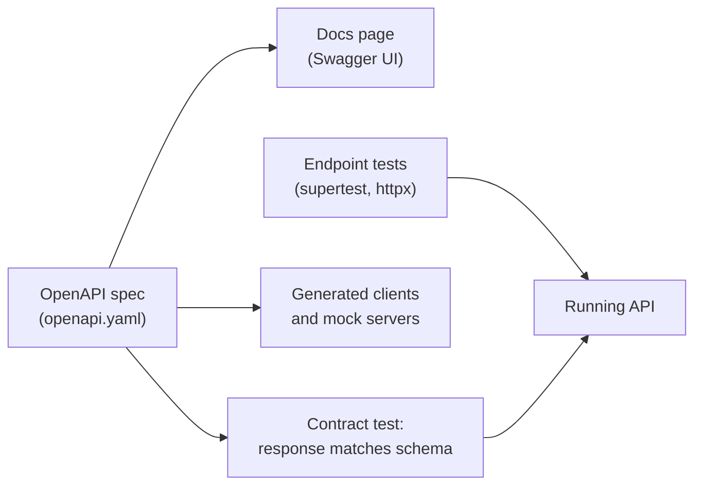

# Testing and documenting APIs

After this you can write an automated test for an endpoint, check a response against an OpenAPI description, and say what a useful API reference contains.

Before this: [Validation and error handling](../01-servers-and-apis/05-validation-and-error-handling.md) and [unit testing](../../04-developer-tools-and-workflow/03-code-quality/01-unit-testing.md).

## The idea

You change how `POST /todos` validates a title, and a mobile app that worked yesterday starts failing. Nobody noticed because the only check was clicking around in a browser. An API has two audiences, the code that calls it and the people who write that code. Both need something written down and checked by a machine: tests that say what the API does, and a description that says what callers can expect.



In the diagram, one spec feeds the docs, the contract test and client generators, so they can't drift apart without a test failing.

## Key terms

An **endpoint test** (or API test) sends a real HTTP request to the app and asserts on the status code, headers and body. It sits between a unit test of one function and an end-to-end test<!-- link: ../../04-developer-tools-and-workflow/03-code-quality/02-integration-tests-mocks-and-e2e.md --> of the whole system. **supertest** does this for Node apps without opening a port; **httpx** (with pytest) does it from Python, over the network or straight into an ASGI app.

A **contract test** checks that responses keep the shape the API promised: required fields exist and have the right types. It catches a renamed field before a client does.

**OpenAPI** is a standard, machine-readable format (YAML or JSON) for describing an HTTP API: paths, methods, parameters, request and response schemas, and auth ([OpenAPI Specification](https://spec.openapis.org/oas/latest.html)). **Swagger UI** turns an OpenAPI file into an interactive page where a reader can try each endpoint.

An API **collection** is a saved set of requests in a tool such as Postman or Bruno (or a folder of `curl` commands), shared with the team so anyone can reproduce a call.

**Versioning** means that a breaking change goes into a new version, such as `/v2/todos`, while the old one keeps working for a stated period.

## How it works

Test the behaviour a caller depends on, not the internals. For each endpoint, cover the success case, each validation failure, and the auth cases from the earlier chapter: no token (401), wrong role (403), someone else's record (403 or 404). Use a separate test database or in-memory data, and reset it between tests so they can run in any order.

For the spec, write it by hand for a small API, or let the framework generate it. [FastAPI](../01-servers-and-apis/07-python-back-ends-fastapi-and-django.md) builds an OpenAPI file and a Swagger UI page from the type hints automatically; with Express you write `openapi.yaml` yourself or use a generator. Generated specs describe what the code does, which may not be what you intended, so read them.

A good reference page answers, for each endpoint: what it does, parameters and body, every status code it can return, an example request and response, the auth it needs, and the rate limits. Error responses matter as much as successes. When behaviour changes, keep a changelog and mark deprecated fields in the spec with `deprecated: true`, so callers get warning before a removal.

## Worked examples

<div class="example" markdown>

### Example 1: endpoint tests and a contract test

We test a small todo API, with `supertest` and Node's built-in test runner, then check a live response against the schema in `openapi.yaml` from Python.

1. `request(app)` starts the Express app on a temporary port, so no server needs to be running.
2. The first test posts a valid body and asserts 201 and the body. The second posts an empty body and asserts the 400 error.
3. The contract test loads the `Todo` schema from the spec, calls the running API with `httpx`, and validates the JSON with `jsonschema`.

<details class="code" markdown>
<summary>In code</summary>

```javascript
import test from "node:test";
import assert from "node:assert/strict";
import request from "supertest";
import { app } from "./app.mjs";

test("POST /todos creates a todo", async () => {
  const res = await request(app).post("/todos").send({ title: "ship it" });
  assert.equal(res.status, 201);
  assert.equal(res.body.done, false);
});

test("POST /todos rejects a missing title", async () => {
  const res = await request(app).post("/todos").send({});
  assert.equal(res.status, 400);
  assert.deepEqual(res.body, { error: "title is required" });
});
```

```python
import httpx, yaml
from jsonschema import validate

spec = yaml.safe_load(open("openapi.yaml"))
schema = spec["paths"]["/todos"]["get"]["responses"]["200"]["content"]["application/json"]["schema"]
schema["items"] = spec["components"]["schemas"]["Todo"]   # resolve the $ref by hand

def test_list_matches_spec():
    r = httpx.get("http://localhost:3106/todos")
    assert r.status_code == 200
    validate(r.json(), schema)   # raises if a field is missing or has the wrong type
```

</details>

Run with `node --test app.test.mjs` and, with the API listening on port 3106, `pytest test_contract.py`:

```text
✔ POST /todos creates a todo (34.8752ms)
✔ POST /todos rejects a missing title (6.1768ms)
ℹ tests 2
ℹ pass 2
ℹ fail 0
.                                                                        [100%]
1 passed in 0.64s
```

Check: break something on purpose. Rename `done` to `completed` in `app.mjs` and the contract test fails with a "'done' is a required property" error, while the status-code test still passes. That gap is why contract tests exist. The `$ref` is resolved by hand to keep the sketch short; use a library that handles `$ref` for real specs.

</div>

<div class="example" markdown>

### Example 2: the spec as documentation

The schema part of `openapi.yaml` that the contract test used:

```yaml
openapi: 3.1.0
info:
  title: Todo API
  version: 1.0.0
paths:
  /todos:
    get:
      summary: List todos
      responses:
        "200":
          description: All todos
          content:
            application/json:
              schema:
                type: array
                items:
                  $ref: "#/components/schemas/Todo"
```

Point Swagger UI at this file (the `swagger-ui-express` package for Node, or a Docker image) and every operation appears with a "Try it out" button. The same file can feed a client generator or a mock server. The file's `version` describes the API, and the spec's `openapi` field describes the format.

</div>

## Common mistakes

<div class="warning" markdown>

Watch out: tests that only check the status code. A 200 with a wrong or missing field passes. Assert on the body, or validate it against a schema.

Watch out: tests that share data and depend on order, such as the second test expecting the id the first one created. Reset the data before each test or create what each test needs.

Watch out: docs that describe only success. Callers write error handling from your reference, so list the 400, 401, 403, 404 and 429 responses with their body shape.

</div>

## Working with AI

<div class="ai" markdown>

Words to use: endpoint test, supertest, httpx, contract test, OpenAPI, Swagger UI, deprecated, versioning.

Prompts to try:

- "Write supertest tests with node:test for this Express router. Cover success, validation failures, 401 and 403. Use a fresh in-memory data store per test: <paste router>."
- "Generate an OpenAPI 3.1 file for these Express routes, including every error response, and list anything in the code the spec cannot express."

What to check:

- Tests that assert nothing, or only `status === 200`. Break the code on purpose and confirm a test fails.
- A spec that is out of step with the code. Run the contract test against the live API.
- Invented fields or routes in generated docs. Compare the spec with the routes line by line.
- Mocks that hide the real behaviour. If the test replaces the database or the auth middleware, say what real code goes untested.

</div>

## Quiz

1\. What can a contract test catch that a status-code test cannot?

<details class="solution" markdown>
<summary>Answer</summary>

A response with the right status but the wrong shape, such as a renamed or missing field, or a number returned as a string.

</details>

2\. Why does `request(app)` in supertest work without starting the server yourself?

<details class="solution" markdown>
<summary>Answer</summary>

supertest binds the app to a temporary port for the request and closes it afterwards, so tests need no fixed port and can run in parallel.

</details>

3\. You must rename the `done` field to `completed`. How do you do it without breaking existing mobile apps?

<details class="solution" markdown>
<summary>Answer</summary>

Add the new name in a new version (`/v2`), or return both fields for a stated period while marking `done` as `deprecated: true` in the spec, and remove it only after clients have moved.

</details>

4\. A test passes when run alone but fails after another test. What is the likely cause, and the fix?

<details class="solution" markdown>
<summary>Answer</summary>

Shared state, such as the same in-memory list or database rows. Reset the data before each test or give each test its own data.

</details>

## Lab

<div class="lab" markdown>

### Lab: test and break a todo API

Goal: write one passing endpoint test, then one that catches a regression. Time: about 20 minutes. Runs in: any terminal with Node.js 20 or later.

1. In a new folder run `npm init -y` and `npm i express supertest`. Set `"type": "module"` in `package.json`.
2. Save `app.mjs` with `GET /todos` and `POST /todos` from the code above (validate that `title` is a non-empty string).
3. Save the two tests as `app.test.mjs` and run `node --test`.
4. Add a third test that `GET /todos` returns an array whose items each have a numeric `id`, a string `title` and a boolean `done`. Then rename `done` in the app and confirm the third test fails.
5. Cleanup: delete the folder.

Expected result: three passing tests, then one failure after the rename.

<details class="solution" markdown>
<summary>Solution</summary>

```javascript
test("GET /todos items have the documented shape", async () => {
  const res = await request(app).get("/todos");
  assert.equal(res.status, 200);
  for (const t of res.body) {
    assert.equal(typeof t.id, "number");
    assert.equal(typeof t.title, "string");
    assert.equal(typeof t.done, "boolean");
  }
});
```

</details>

</div>

## Where this shows up

- [Integration tests, mocks and end-to-end tests](../../04-developer-tools-and-workflow/03-code-quality/02-integration-tests-mocks-and-e2e.md) goes wider than one endpoint.
- CI/CD<!-- link: ../../13-devops-and-cloud/02-ci-cd/01-ci-cd-concepts.md --> runs these tests on every push.
- Back in this chapter: [background jobs](01-background-jobs.md) need tests for retries and idempotency too.
